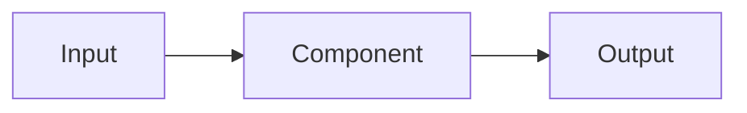

# Feature: [Feature name]

- Status: `planned` | `in-progress` | `complete` | `superseded`
- Last updated: YYYY-MM-DD
- Plan: [link to `docs/plans/...`](../plans/)

## Overview

What this feature does, why it exists, and what is deliberately out of scope.

## User-facing behavior

Describe normal, empty, loading, interruption, error, and recovery behavior.
Include activation/gating rules and what happens when the feature is disabled.

## Current architecture and target changes

State what exists today before describing the implemented change. Do not present
planned components as current behavior.



Explain the data/control flow, ownership boundaries, and lifecycle in plain
language. Link `docs/scheme.mmd` when the system diagram changes.

## Canonical files and contracts

| Area | File or interface | Responsibility / contract |
|------|-------------------|---------------------------|
| | | |

Document configuration names, environment variables, tool schemas, event
names, serialized shapes, and provider boundaries that another feature must
respect.

## Extension guide

### Safe to extend

- [Add safe extension points.]

### Do not change without updating this document and its tests

- [Add invariants and contracts.]

### Common extension path

1. [Describe the first step.]
2. [Describe the second step.]
3. [Describe the validation step.]

## Constraints, privacy, and failure modes

- [Add constraints, privacy rules, and failure modes.]

Describe resource limits, timeouts, cancellation, reconnect behavior, logging
rules, secrets, PII, and privacy invariants. Explain graceful degradation and
what an error looks like to callers.

## Dependencies

- Depends on:
- Used by:

## Testing

Tests ship with the feature. List exact files and what behavior each proves;
include failure, timeout, cancellation, interruption, privacy, and platform
cases where relevant. See [`docs/TESTING.md`](../TESTING.md).

### Unit tests

| File | Scenarios |
|------|-----------|
| `tests/...` | |

### Integration tests

| File | Scenarios |
|------|-----------|
| `tests/...` | |

### Simulator / end-to-end tests

| Command or artifact | Scenarios |
|---------------------|-----------|
| | |

### Test commands

```bash
# Add focused commands for this feature here.
pytest tests/ -v
```

## Changelog

| Date | Change |
|------|--------|
| YYYY-MM-DD | Initial implementation. |
