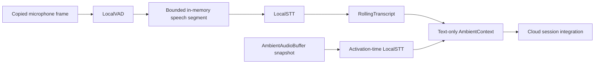

# Feature: local ambient context

- Status: `in-progress`
- Last updated: 2026-08-31
- Plan: [Reachy hybrid household companion](../plans/reachy-hybrid-household-companion.md)

## Overview

This module provides the local-only VAD/STT boundary needed for the dinner
demo. It can either maintain a continuous rolling transcript (Strategy A) or
transcribe a RAM audio snapshot only when activation occurs (Strategy B). It
does not connect to a provider, persist audio, add a model dependency, or
replace the existing realtime conversation loop.

The parent runtime owns the bounded `AmbientAudioBuffer` and passes its
defensive snapshot to Strategy B. `HybridRuntime` now connects the processor to
local transcript wake events and injects only its bounded derived text into a
new provider session. The hybrid runtime separately submits the bounded
wake-stripped suffix as the first user turn after provider readiness.

An explicitly opt-in `LOCAL_TRANSCRIPT_PREVIEW_ENABLED` flag exposes the same
bounded continuous transcript through the loopback-only
`GET /api/transcript-preview` endpoint for short-lived local STT diagnostics.
The endpoint marshals preview reads through the LocalStream owner loop and
never enters the metadata-only `conversation.status` result.

## User-facing behavior

While idle, the eventual hybrid runtime can pass copied microphone frames to
`AmbientContextProcessor`. The processor runs the selected local VAD and keeps
only a bounded in-memory speech segment until local STT completes. In Strategy
A, completed local transcripts are retained for the configured time and text
limits. The application default is a 60-second text-only window, independent
from the 20-second raw PCM ring. In Strategy B, no transcript is retained
between calls; activation transcribes the supplied in-memory ring snapshot and
returns derived text.

When the diagnostic preview is enabled, the Talk view polls the loopback-only
HTTP endpoint and displays the current bounded Strategy A transcript with a
diagnostic notice. Disabled, unavailable, empty, and closed states return an
empty preview safely; non-loopback clients receive `403`; the browser stores no
preview text.

An empty snapshot, empty transcription, VAD failure, STT failure, or local
timeout produces empty context and keeps the cloud boundary closed. A caller
must treat empty context as normal rather than opening a provider because of
the local processor.

## Architecture and data flow



`LocalVAD` and `LocalSTT` are typed protocols. Implementations may be
synchronous or return an awaitable; the processor runs them behind bounded
asyncio timeouts. Synchronous calls execute in a processor-owned bounded
executor so one model call does not block the event loop. A timeout cancels the
waiter but not an already-running synchronous function: its admission slot and
defensive frame copy remain tracked until the worker exits. STT results are
committed by segment sequence, not completion order, so a slow earlier result
cannot reorder the ambient context. Results that arrive after a newer sequence,
or after a newer activation request, are rejected.

Strategy A activation reads the already-completed rolling transcript without
waiting for an in-flight local STT call. This keeps wake-to-cloud latency
bounded; the still-local STT result may become available for a later
activation. Strategy B deliberately waits only up to its configured STT
timeout because activation-time transcription is its context source.

The processor normalizes accepted frames to defensive mono int16 before local
processing. It never returns an audio frame to its caller. `AmbientContext`
contains only normalized derived text and ordering metadata; metrics contain
only counters and aggregate durations.

## Canonical files and contracts

| Area | File or interface | Responsibility / contract |
|------|-------------------|---------------------------|
| Local VAD | `ambient_context.LocalVAD` | `is_speech(frame)` returns `bool` or an awaitable boolean. |
| Local STT | `ambient_context.LocalSTT` | `transcribe(audio)` returns text or an awaitable string. |
| Strategy selection | `AmbientContextStrategy` | `CONTINUOUS_TRANSCRIPT` for Strategy A; `ACTIVATION_BUFFER` for Strategy B. |
| Bounds | `AmbientContextConfig` | Time window, text size, speech segmentation, VAD timeout, and STT timeout. |
| Rolling context | `RollingTranscript` | Accepts ordered final `TranscriptSegment` values and returns bounded text. |
| Coordinator | `AmbientContextProcessor` | Observes local frames, schedules Strategy A STT, and builds activation context. |
| Integration output | `AmbientContext` | Text-only context plus strategy/time/sequence metadata; no PCM. |
| Diagnostics | `AmbientContextMetrics` | Immutable metadata-only counts and aggregate local timing. |
| Runtime integration | `hybrid_runtime.HybridRuntime` | Supplies ring snapshots locally and configures provider startup with derived text only. |
| Diagnostic preview | `console.LocalStream` / `GET /api/transcript-preview` | Returns bounded Strategy A text on the owner loop only when explicitly enabled and requested from an actual loopback client; disabled/no processor/closed processor results are empty and unavailable. |

Important contracts:

- `transcript_window_seconds` and `max_transcript_chars` are always positive.
- A transcript segment must have a positive sequence and finite, ordered times.
- Final transcript text is whitespace-normalized and bounded to the newest text.
- Partial segments can be staged for the same sequence but are not returned as
  context until a final segment replaces them.
- `context_for_activation(snapshot)` does not persist the snapshot or add it to
  the rolling transcript. Strategy B sends only its returned text to the next
  integration layer. Continuous callers may pass `before_sequence` for the
  current wake; only entries with a strictly smaller sequence are returned, so
  later accepted ambient segments cannot leak into the seeded context. Source
  metadata is derived from the same fenced entries.
- Continuous STT input is capped independently at 20 seconds of PCM per
  request. A text-retention window may be longer (the application default is
  60 seconds), and a single oversized frame is trimmed to its newest 20-second
  tail before concatenation.
- Strategy A does not wait for pending STT at activation. The
  `continuous_stt_pending_at_activation` counter records how many results were
  still outstanding; those results remain local and can populate a later
  context.
- Continuous STT retains at most two pending segments by default. Under
  overload, the newest additional segment is dropped locally, ordering advances,
  and a metadata counter records the drop.
- Local backend admission is bounded independently of waiter timeouts. The
  `local_work_pending` metric includes calls whose synchronous worker is still
  running after a timeout or cancellation; those calls do not admit more audio
  until they exit.
- `close()` is idempotent, cancels pending local STT, and releases in-memory
  speech references. If an uncancellable synchronous worker is still running,
  close returns with that work visible in `local_work_pending` and logs only its
  count; the executor shuts down after the worker exits. Calls after close fail
  clearly instead of silently doing work.

## Extension guide

### Safe to extend

- Implement `LocalVAD` with a local Silero/openWakeWord-compatible boundary or
  another measured backend without changing the processor.
- Implement `LocalSTT` with a local Whisper, Parakeet, or other backend. Keep
  model loading and platform-specific code outside this module.
- Add a transcript observer to forward derived local transcript events to the
  wake-word or local-intent layer. The observer receives no audio.
- Benchmark both strategies by passing `strategy=` to
  `context_for_activation`; do not upload the pre-activation snapshot.

### Do not change without updating this document and its tests

- Do not return, serialize, or log raw audio from this module.
- Do not make a cloud/provider call from a VAD or STT implementation used here.
- Do not remove ordering checks or timeout/cancellation handling.
- Do not turn the transcript buffer into persistent memory. Persistent memory
  is a separate local feature.
- Keep `LOCAL_TRANSCRIPT_PREVIEW_ENABLED` default-off. Preview text is served
  only through its dedicated loopback-only HTTP/UI path and must not be copied
  into status, logs, browser storage, or disk; preview retrieval itself adds no
  provider traffic, while normal activation may inject bounded derived
  context.

### Common extension path

1. Add a typed local backend implementing `LocalVAD` or `LocalSTT`.
2. Add deterministic fake-backend tests for success, timeout, failure,
   cancellation, ordering, and input-copy behavior.
3. Wire it through the hybrid runtime, then run the privacy and simulator tests
   at the integration boundary.

## Constraints, privacy, and failure modes

- No dependency beyond the application's existing Python and NumPy runtime was
  added for this seam.
- Raw frames are copied, downmixed locally, and held only while required for
  local segmentation/transcription. The module has no file, database, or cloud
  output path.
- Logs contain operation names and exception types only; transcript and PCM
  payloads are not logged.
- A VAD timeout/error skips that frame and leaves the coordinator usable.
- An STT timeout/error records metadata, advances the sequence barrier, and
  leaves later segments eligible for context.
- A slow STT backend cannot retain an unbounded number of audio segments;
  `max_pending_stt_tasks` bounds admission and `continuous_stt_dropped` records
  overload without logging content. VAD has one admitted call at a time, and
  `vad_dropped` records frames rejected while a blocking VAD worker is still
  running.
- The owning capture loop currently awaits each local frame observation. A slow
  VAD can therefore delay capture and contribute to capture-worker drops; this
  is a benchmark follow-up rather than a reason to remove the bounded admission
  and executor safeguards.
- Speech shorter than `min_speech_seconds` is discarded once the configured
  silence boundary is reached. A sample-rate change also discards the current
  segment and advances its sequence barrier; neither can block later context.
- Cancelling an observation or activation propagates `CancelledError` so the
  owning runtime can shut down deterministically. `close()` cancels background
  STT tasks and is safe to call repeatedly.
- An activation result from an older concurrent request becomes empty context;
  this prevents stale derived text from being injected into a newer cloud
  session.
- A synchronous backend runs in the processor-owned bounded executor;
  cancelling its await does not forcibly stop code already executing inside
  that worker thread. Its result and frame are retained only until the worker
  exits, then discarded at the timeout/stale-generation boundary. `close()`
  does not claim to have released such work until its completion callback runs.
- The module does not claim OS-level swap protection. The application-level
  guarantee is that no raw ambient audio is persisted or sent to a provider by
  this seam.
- The preview is a diagnostic surface, not a transcript export: it reads the
  existing bounded rolling store on the LocalStream owner loop and returns an
  empty/unavailable result when the flag, processor, or runtime is unavailable.

## Dependencies

- Depends on: existing `AudioFrame`, `AmbientAudioBuffer` integration boundary,
  and `audio_to_mono_int16`; no new package.
- Used by: the hybrid runtime, local transcript wake detector, and local intent
  activation path.

## Testing

Tests ship with this seam. They use deterministic VAD/STT fakes and do not need
credentials, a cloud session, a microphone, a simulator, or robot hardware.

### Unit tests

| File | Scenarios |
|------|-----------|
| `tests/test_ambient_context.py` | Configuration bounds; transcript normalization, partial/final replacement, sequence-fenced activation context and metadata, 2/5/10/20-second and text limits, stale rejection; Strategy A speech segmentation, defensive copies, ordered out-of-order results, bounded STT backlog and failure recovery, fixed 20-second continuous-STT input cap, and oversized-frame tail trimming; Strategy B snapshot-only transcription and bounded derived text; concurrent activation staleness; VAD/STT timeout and failure; repeated blocking-sync timeout admission, bounded frame retention, honest close, async cancellation, empty snapshots, and payload-free logging. |
| `tests/test_console.py`, `tests/test_hybrid_runtime.py` | Opt-in loopback HTTP preview, owner-loop routing, empty/bounded/closed behavior, and status/log payload exclusion. |

### Integration tests

| File | Scenarios |
|------|-----------|
| `tests/test_hybrid_runtime.py`, `tests/test_gemini_live.py`, `tests/test_main.py` | Strategy A/B activation ordering, Gemini ordered initial-history seeding, addressed-text-before-PCM ordering, seed failure/cancellation/shutdown cleanup, wake routing, application wiring, and zero ambient cloud bytes. |

### Simulator / end-to-end tests

| Command or artifact | Scenarios |
|---------------------|-----------|
| Live acceptance | Both strategies with `openai/whisper-small.en` produced accurate dinner context and a contextual Gemini answer with zero ambient cloud bytes. Strategy B added 6.015 seconds of activation-time STT; first-response audio, peak CPU, and multilingual quality remain pending. |

### Test commands

```bash
.venv/bin/ruff check src/reachy_mini_conversation_app/ambient_context.py tests/test_ambient_context.py
.venv/bin/mypy --pretty --show-error-codes src/reachy_mini_conversation_app/ambient_context.py
.venv/bin/pytest tests/test_ambient_context.py -q
```

Preview diagnostics are covered by the console/runtime focused tests:

```bash
.venv/bin/pytest tests/test_console.py tests/test_hybrid_runtime.py -q
```

Validated on 2026-08-29: focused Ruff and strict mypy passed; the combined
Phase 3–5 implementation suite passed 195 tests. After final integration, the
repository gate passed all 649 tests; the live Strategy A/B benchmark is
recorded separately in the plan.

The 2026-08-31 provider-handoff correction passed 108 focused Gemini/runtime
tests and the full repository gate passed 736 tests with one explicit native
skip, plus Ruff, formatting, strict mypy, lock consistency, JavaScript syntax,
and `git diff --check`.

The follow-up hardening adds sequence-fenced context regressions, 20-second
continuous-STT cap and oversized-frame tests, and processor-backed delayed and
deadline wake tests. These are deterministic local fakes; no multi-second live
STT delay or microphone claim is made.

Targeted validation on 2026-08-31 passed 165 ambient/config/runtime/main tests,
11 hybrid smoke tests with one opt-in native-audio skip, Ruff, and strict mypy
for the three changed source modules. Final root verification passed Ruff,
formatting, strict mypy across 59 source files, and 761 tests with the same one
explicit native-audio skip.

The transcript preview diagnostic was added on 2026-08-31. The focused
configuration/HTTP/runtime/static-UI suite passed 212 tests; repository Ruff,
formatting, strict mypy for the four changed Python modules, both JavaScript
syntax checks, and `git diff --check` also passed. Final root verification
passed Ruff, formatting, strict mypy across 59 source files, and 782 tests with
one explicit opt-in native-audio skip; `uv lock --check` also passed.
Independent adversarial review found no remaining P0/P1 blocker.

The first live preview run showed that the default RMS threshold of 500 can be
too conservative for the current Mac microphone: a payload-free level probe
measured an estimated 235 PCM RMS peak, and the runtime classified 207 seconds
of captured audio as zero speech frames without calling STT. For this simulator
setup, retest with `LOCAL_VAD_RMS_THRESHOLD=100`; this is a measured local
calibration, not a new cross-platform default.

With that calibration, the next live run detected 257 speech frames but its
first Whisper request hit the configured timeout at exactly 5.00 seconds. The
loopback server stayed healthy, and a synthetic warm-up request completed in
2.06 seconds. The current Mac simulator acceptance command therefore uses
`LOCAL_STT_TIMEOUT_SECONDS=15`; retain the measured five-second default until
real utterance latency and slower target hardware are compared.

The following English-only run passed the Strategy A dinner acceptance. Two
local STT segments completed without failure, timeout, or drop; 68 bounded
context characters were available, Gemini answered contextually, the runtime
returned to `LOCAL_AMBIENT`, and ambient cloud bytes stayed zero. Total local
STT latency was 11.171 seconds with a 9.227-second maximum. The local serving
process measured a 3.4 GB current/peak macOS physical footprint after the run;
peak CPU and multilingual Spanish/English/Portuguese/Italian quality remain
unmeasured follow-ups.

The Strategy B run also passed. Keyboard activation transcribed one defensive
20-second RAM snapshot in 6.015 seconds and produced 68 context characters.
Gemini was ready approximately 7.228 seconds after activation and answered the
dinner question contextually. The runtime later returned to `LOCAL_AMBIENT`
with Gemini closed; pre-activation ambient cloud bytes and cloud video frames
remained zero. No local STT failure, timeout, or drop occurred. Post-run macOS
physical footprints were 2.5 GB for Transformers Serve and 185.7 MB for the
app. Peak CPU and first-response-audio timing were not measured. Capture-worker
warnings reached 200 dropped frames, so Strategy B is functionally accepted but
is not the preferred low-latency path.

## Changelog

| Date | Change |
|------|--------|
| 2026-08-29 | Added dependency-free VAD/STT protocols, bounded Strategy A/B context processor, ordered transcript handling, timeout/cancellation paths, metadata-only metrics, and deterministic tests. |
| 2026-08-29 | Integrated text-only activation context, transcript observation, local wake routing, and zero-prewake-cloud privacy tests through `HybridRuntime`. |
| 2026-08-29 | Added a two-request continuous-STT admission bound with overload metrics and ordering-safe drop behavior. |
| 2026-08-29 | Replaced uncancellable default-thread dispatch with a processor-owned bounded executor. Sync timeout/cancellation now retains admission and frame ownership until the worker exits; close reports still-running work honestly, with deterministic blocking VAD/STT regressions. |
| 2026-08-29 | Rejected reordered partial updates after the same transcript sequence was finalized, preventing late partials from reopening or duplicating final context. |
| 2026-08-30 | Recorded the current inline capture/VAD await boundary and its possible capture-drop impact; concurrency remains a measured performance follow-up. |
| 2026-08-31 | A live Strategy A run produced 96 local context characters from three completed segments but Gemini asked for context. Corrected the provider handoff to ordered initial history and serialized the addressed question before bounded live PCM; live response-quality retest remains pending. |
| 2026-08-31 | Fenced activation context at the wake sequence so later accepted ambient text cannot seed the same cloud turn; independently capped each continuous local-STT request at 20 seconds and safely trimmed oversized frames. |
| 2026-08-31 | Added the default-off RAM-only transcript preview, with a loopback-only no-store HTTP endpoint, owner-loop access, bounded empty/closed handling, and a non-persistent Talk-view panel. |
| 2026-08-31 | Accepted the live Strategy A English dinner demo with `openai/whisper-small.en`: accurate derived context produced a contextual Gemini answer while ambient cloud bytes remained zero. Multilingual household quality remains separate follow-up scope. |
| 2026-08-31 | Accepted the live Strategy B English dinner demo: the RAM-only snapshot was transcribed locally after activation, Gemini answered contextually, and ambient cloud bytes remained zero. Its approximately 7.2-second activation-to-ready delay makes Strategy A the current latency preference. |
