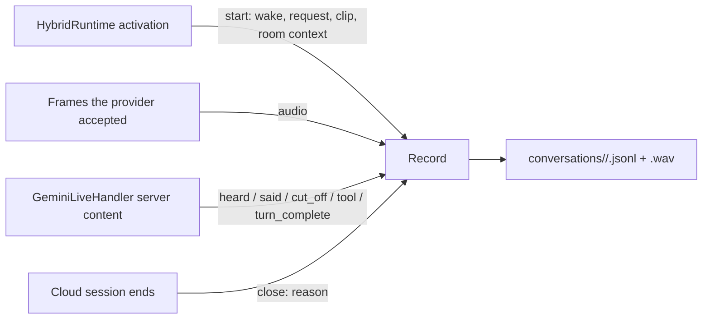

# Feature: Conversation record

- Status: `in-progress`
- Last updated: 2026-11-05
- Plan: [Find out why Reachy answers nonsense](../plans/conversation-record.md)

## Overview

A local, opt-in record of each cloud conversation, kept to find out why Reachy sometimes answers something
nobody said, mixes topics, changes topic mid-sentence or switches language. The app logs hold counts and
timings only; this record holds what the provider was given, what it heard and what it said, so an odd reply
can be traced to its cause. It changes nothing about how Reachy listens or answers.

Out of scope: wake-word audio (see [wake clip capture](wake-clip-capture.md)), local quick commands that never
open a conversation, and any upload or sharing of the record.

## User-facing behavior

None. With `CONVERSATION_RECORD_ENABLED=1` and the hybrid runtime on, each conversation is written as it
happens; without it nothing is written. A record that cannot be written logs a warning and the conversation
goes on unrecorded.

## Current architecture

- `HybridRuntime` owns the lifecycle. When an activation hands the conversation to a new handler, it opens a
  record (`ConversationRecorder.start`) and attaches it with `ConversationHandler.set_conversation_record`.
  Every frame the handler accepted (queued after the wake or live) is appended as audio. When the cloud
  session ends (`_deactivate_cloud`, next to the session summary log), it detaches and closes the record.
- `GeminiLiveHandler` adds the turns: input transcription pieces (`heard`), output transcription pieces
  (`said`), interruptions (`cut_off`), tool call names (`tool`) and `turn_complete`. Pieces carry their own
  spacing and are joined as sent, like `SpokenTurnAssembler`. Other providers get start, audio and end only.
- Gemini session rotation keeps the same handler, so one conversation stays one record.

## Canonical files and contracts

| Area | File or interface | Responsibility / contract |
|------|-------------------|---------------------------|
| Store | `src/reachy_mini_conversation_app/conversation_record.py` | `ConversationRecorder` (day folders, pruning), `ConversationRecord` (events, WAV) |
| Lifecycle | `hybrid_runtime.py`: `_start_conversation_record`, `_record_sent_audio`, `_close_conversation_record` | Open at activation, audio after each accepted `receive`, close when the session ends |
| Turns | `gemini_live.py` server-content handling and `_handle_tool_call` | Feed `heard`, `said`, `cut_off`, `tool`, `turn_complete` |
| Handler hook | `ConversationHandler.set_conversation_record` | `None` detaches |
| Wiring | `main.py` | Builds the recorder when `CONVERSATION_RECORD_ENABLED` and the hybrid runtime are on |

Configuration: `CONVERSATION_RECORD_ENABLED` (default `0`), `CONVERSATION_RECORD_KEEP_DAYS` (default `14`,
1–365). Folder: `~/.local/share/reachy_mini_conversation_app/conversations/<YYYY-MM-DD>/` (`$XDG_DATA_HOME`
aware). Files: `<HHMMSS>.jsonl` (a `-2` suffix when two start in the same second) and `<HHMMSS>.wav`.

Event lines, each with `t` (seconds since the conversation started):

| `event` | Fields |
|---------|--------|
| `start` | `at` (local time), `wake` (activation reason), `trusted_without_name`, `request_heard_locally`, `request_sent_as` (`audio`, `text` or `none`), `request_clip_s`, `request_clip_cut_off`, `room_context` (the exact text Gemini got before the request) |
| `heard` | `text`: one user turn as the provider transcribed it; `t` is its first piece |
| `said` | `text`, `cut_off` (stopped by the provider's barge-in), `unfinished` (the session ended mid-reply); `t` is its first piece |
| `cut_off` | `into_reply_s`: how long the reply had been going |
| `tool` | `name` (arguments are not kept) |
| `end` | `reason` (why the session closed), `audio_s` (length of the WAV) |

The WAV is mono PCM16 at the first frame's rate; frames at another rate are skipped. It is what the provider
was sent, including the silence Reachy sends after his goodbye.

## Extension guide

### Safe to extend

- New event kinds or start fields, when they hold no secrets and tests cover them.
- Turn events from another provider, fed through the same handler hook.

### Do not change without updating this document and its tests

- Off by default; files owner-only (folders 0700, files 0600); day folders deleted after the keep period.
- A failing record never raises into the conversation (`start` returns `None`; write errors are logged).
- Only cloud conversations are recorded; ambient listening never opens a record.

### Reading a record

On the Mac mini, `~/.local/share/reachy_mini_conversation_app/conversations/<date>/` holds one `.jsonl` per
conversation. Compare `request_heard_locally` and `room_context` with the first `heard` line, look for `said`
lines with `cut_off` and a small `into_reply_s`, and transcribe the WAV with the accurate local Whisper to see
whether Gemini's own transcription was wrong. Report findings as counts and patterns, never quotes.

## Constraints, privacy, and failure modes

- The record holds household speech: transcripts, the room context already sent to Gemini, and audio. It stays
  on the computer running Reachy, is never uploaded, and is deleted after the keep period. Eduardo agreed to it
  on 2026-11-05 to diagnose odd replies.
- Gemini's input transcription comes from a separate recognizer: it shows what Gemini most likely heard, not
  exactly what the model understood.
- Writes are small and synchronous on the event loop (an event line, or a frame of audio).
- A crash leaves the event lines written so far; the WAV header may then be incomplete.

## Tests

`tests/test_conversation_record.py`:

- `test_a_conversation_records_how_it_started_each_turn_and_how_it_ended`
- `test_the_audio_sent_is_saved_at_its_first_rate`
- `test_two_conversations_in_the_same_second_get_their_own_files`
- `test_days_past_the_keep_period_are_deleted`
- `test_an_unwritable_folder_records_nothing_and_never_raises`
- `test_a_cloud_conversation_is_recorded_from_start_to_end`
- `test_nothing_is_recorded_without_a_recorder_or_a_conversation`
- `test_gemini_adds_what_it_heard_said_and_cut_off`

## Changelog

| Date | Change |
|------|--------|
| 2026-11-05 | Built: per-conversation events and audio, opt-in, kept 14 days. |
