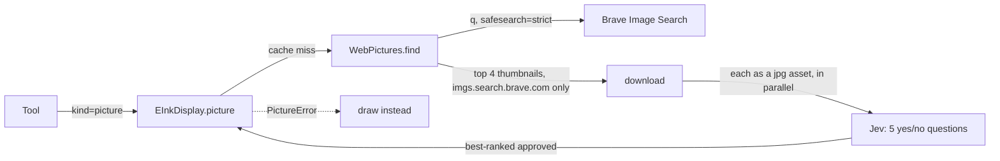
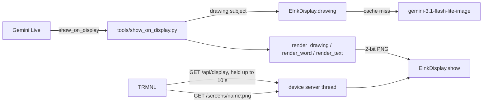

# Feature: E-ink display (TRMNL)

- Status: `in-progress` (v1 and v2 checked live on the household TRMNL, including real web pictures; voice use not yet tried)
- Last updated: 2026-10-25
- Plan: [docs/plans/eink-display.md](../plans/eink-display.md)

## Overview

Reachy shows drawings, checked pictures from the web, word cards and short text on a TRMNL OG e-ink display (7.5", 800x480,
four grays). It is a deliberately slow, low-stimulation screen: no video, no feed, no apps. The
screen changes only when someone asks; otherwise it shows a resting card with a cartoon Reachy and
"¡Hola! Soy Reachy / Hi, I'm Reachy".

Out of scope so far: multi-panel visual explanations, stories, scheduled pages (see the plan).

## User-visible behavior

- "Draw me a dinosaur": Reachy says to look at the screen; a friendly line drawing with a caption
  appears a few seconds later (about 3 s to draw, usually 0–2 s for the TRMNL to fetch it, then the
  e-ink redraw). Asking for the same subject again reuses the saved drawing.
- "Show me the Mona Lisa", "what does a Falcon 9 look like?": a real picture from the web, dithered
  to the four grays, with its source site in small type. Brave Image Search (strict SafeSearch)
  finds candidates and Jev checks each shows the subject and has no violence, mature content or
  nudity; classical and fine-art nudity is allowed, and fierce animals (open-jawed sharks, roaring
  dinosaurs) are fine, by the household's choice. If none passes, the keys are missing, today's 30 searches are used or
  it takes over 12 s, the subject is drawn instead and Reachy is told so. A subject shown before
  comes from the cache.
- Teaching an Italian word, or "how do you say rainbow in Italian?": a word card with the word in
  large type, its pronunciation written for a Spanish speaker ("la MÉ-la"), the Spanish meaning, an
  optional header and an optional small drawing. If the drawing fails the card shows without it.
- "Write MARA big", "put up the shopping list", "show 3 + 4": one big line, or a title over up to
  six lines; longer text is cut with "…".
- "Go back to the start screen": the resting card. It also returns 30 minutes after the last screen.
- After 20 new drawings in a day (`DISPLAY_DRAWINGS_PER_DAY`), new drawings are refused and Reachy
  says its pencil needs a rest; cards and cached drawings still work.
- A drawing that fails (no API key, blocked by Google's filter, over 20 s) leaves the screen as it
  was, and Reachy is told to say so and not retry.

## Setup

1. `.env`: `TRMNL_ENABLED=1` (and optionally `TRMNL_PORT`, `TRMNL_REFRESH_SECONDS`). Drawings use
   `GEMINI_API_KEY`.
2. On the TRMNL, hold the back button until the setup screen shows; join the `TRMNL-xxxx` Wi-Fi
   from a phone. On the setup page tap **Advanced** and set **API Server** to
   `http://<computer's LAN IP>:8090` (no trailing slash), then **Back**, choose the home Wi-Fi
   (2.4 GHz) and **Connect**. This takes the device off TRMNL's cloud; to go back, clear the field.
3. Allow incoming connections for Python if macOS asks. Keep the TRMNL on USB power: with the
   default 1 s sleep and held check-ins its Wi-Fi is on most of the time, which would drain the
   battery in hours. On battery set `TRMNL_REFRESH_SECONDS` to several minutes.

### Web pictures (v2)



Jev's questions (all Noul, one request per candidate, state `{subject, audience, image}`), and the
policy applied in code (`WebPictures._approved`, calibrated on real searches 2026-10-25):

| Question | Rule |
|----------|------|
| `shows_subject` | ≥ 0.7 |
| `nudity`, `fine_art` | nudity ≤ 0.2, or fine_art ≥ 0.8 (classical and fine-art nudes allowed). Nudity means bare breasts, buttocks or genitals or underwear, not bare hands or faces (a hand in a crocodile photo scored 0.51 under broader wording, 0.05 now) |
| `sexual` | ≤ 0.2; ≤ 0.4 when fine_art ≥ 0.8 (Venus and David score 0.19–0.29 while judged fine art) |
| `violent` | ≤ 0.3: fighting, attacks, prey being caught, blood, injury; fierce animals with open jaws and roaring dinosaurs are not violence (boxing, battles, zombies, kills, a bloody T. rex 0.45–0.98; roaring T. rex and open-jawed sharks 0.05–0.18) |
| `mature` | ≤ 0.4: horror, gore, drugs, alcohol, smoking, gambling, crude gestures (smoking, beer, horror, zombies 0.84–0.98; Botticelli's Venus 0.17–0.27) |
| `cluttered` | ≤ 0.3: logos, icons, clip art, text, screenshots, memes, collages (tiger logos 0.80–0.95) |
| `clear_on_screen` | ≥ 0.5, judged on a second image, the candidate rendered by `render_photo` exactly as the TRMNL will show it: a dark crocodile 0.26–0.27, a tiny cat in a dark corner 0.27, a Louvre wall with the Mona Lisa small 0.19 are rejected; clear ducks, tigers and close-ups score 0.7–0.87. Among approved candidates the clearest wins (ties go to search rank) |

A missing answer counts against the picture. Six candidates are checked in parallel; the
approved one clearest on screen wins. Every verdict is logged as scores only (no subject). Requests send
the image as a base64 `jpg` asset with `TypeSafe-Danger-Zone-Images: true`. Jev answers HTTP 400
"Invalid image dimensions" for a short side under ~280 px or a long side over ~1000 px, so each
candidate is resized to a 300 px short side within a 1000 px long side first. Brave's plan allows
about one search a second (a burst returned 429, which falls back to a drawing).

## Architecture



- `EInkDisplay` holds the current screen and the resting card behind a lock. The device server is
  a standard-library `ThreadingHTTPServer` on `0.0.0.0:TRMNL_PORT` in a daemon thread, started and
  stopped by `main.run()`, independent of `--ui`.
- The tool runs on the conversation loop and awaits the drawing (about 3 s; the Live tool deadline
  is 30 s). Rendering and the screen swap are synchronous.
- Speed: the TRMNL deep-sleeps between check-ins and reboots and reconnects to Wi-Fi on every wake,
  so a plain poll is slow (measured: a 60 s rate averaged ~35 s to pick up a screen; a 5 s rate gave
  a 16 s cycle and ~6 s). Instead each `/api/display` request is held for up to `CHECK_IN_HOLD_S`
  (10 s, under the firmware's 15 s read timeout) and answered the moment `show()` or `show_home()`
  changes the screen (`screen_for_check_in`, a condition variable). With a 1 s sleep the device is
  listening most of the time: measured 0–2 s to fetch a screen shown after a quiet spell, ~5.5 s
  when screens come seconds apart (the device is still drawing the last one).
- The firmware does not redraw an image whose file name it has just shown, so frequent check-ins
  never flash the panel (`display_session.cpp`: "The image hasn't changed since the last wakeup").
- Drawings and pictures are cached as grayscale PNGs in `~/.cache/reachy-mini-conversation-app/display/`
  (`drawings/`, `pictures/` with the source site in a PNG text chunk), named by the subject folded
  to ASCII ("A Cat" and "a cat" share one). The day's counts are in `per-day.json` there; an attempt
  counts even if it fails, which bounds cost.
- Each drawing's tokens go to the usage ledger as feature `display_drawing`. Brave searches and Jev
  checks are not in the ledger yet (Brave bills per search; Jev reports input tokens).

## Canonical files and contracts

| Area | File or interface | Responsibility / contract |
|------|-------------------|---------------------------|
| Screens and server | `eink_display.py` | `render_home/drawing/word/text() -> bytes` (PNG); `encode_png`; `EInkDisplay.show/show_home/current/screen_png/drawing/start/stop` |
| Web pictures | `web_pictures.py` | `WebPictures(..., screen_preview=render_photo).find(subject) -> WebPicture(image, source)`; raises `PictureError`. Downloads only from `THUMBNAIL_HOST` |
| Tool | `tools/show_on_display.py` | `kind`: `drawing` / `picture` (`subject`, `caption`), `word` (`word`, `pronunciation`, `meaning`, `header`, `picture`), `text` (`lines`, `title`), `home`. Returns `{"ok": True, "note": ...}` or `{"error": ..., "instruction"?: ...}` |
| Gate | `tools/core_tools.py` `DISPLAY_TOOLS` | Present only with `TRMNL_ENABLED`; added automatically unless the profile's tools were customized |
| Dependency | `ToolDependencies.display` | Built by `main._build_display()` |
| Config | `config.py` | `TRMNL_ENABLED` (0), `TRMNL_PORT` (8090, 1024–65535), `TRMNL_REFRESH_SECONDS` (1, 1–3600), `DISPLAY_IMAGE_MODEL`, `DISPLAY_DRAWINGS_PER_DAY` (20, 0–500), `BRAVE_API_KEY`, `TYPESAFE_API_KEY`, `DISPLAY_CHECK_MODEL` (`jev-latest`), `DISPLAY_PICTURES_PER_DAY` (30, 0–500) |
| Assets | `static/eink/` | `reachy.png` (resting-card art, generated from photos of the robot), Atkinson Hyperlegible Regular/Bold (`Atkinson-*.ttf`, short names for the Windows wheel path budget) and its `OFL.txt` |
| Guidance | `profiles/household_companion/profile.md` | When to use the screen; Spanish-style pronunciation and Spanish meanings for Italian words |

TRMNL device API, as served (firmware 1.8.17 checked):

- `GET /api/setup` → `{"status": 200, "api_key", "friendly_id", "image_url", "message"}`.
- `GET /api/display` → held up to 10 s for a screen not yet sent, then `{"status": 0, "image_url", "filename", "refresh_rate": <int>, "reset_firmware": false, "update_firmware": false, "firmware_url": null, "special_function": "none"}`.
  `refresh_rate` must be an integer: the firmware reads a string as 0 and wakes immediately.
- `GET /screens/<filename>.png` → the current screen or the resting card, else 404.
- `POST /api/log` → 204; the device's report is logged (first 500 characters).

## Extension guide

### Safe to extend

- New layouts: add a `render_*` function that returns `encode_png(canvas)` and a `kind` in the tool.
- Drawing style: `DRAWING_PROMPT`. Keep "no text" and the grayscale wording, or fills speckle.

### Do not change without updating this document and its tests

- Filenames are `<name>-<id>-<unix time>` (13-character `<name>-<id>`, at most 31 characters) and
  change with every screen: the TRMNL caches by name, so a reused name hides a new screen.
- Shown screens share one `<name>-<id>` (`reachy-000001`) and differ by timestamp; the resting card
  is `reachy-000000`. The firmware deletes a saved image when a newer one shares its first 13
  characters, otherwise only after 24 h (`filesystem_purge_old_file`). A new id per screen filled
  the device's flash with photos and caused "File writing ERROR" reports (2026-10-25).
- A held check-in must answer within the firmware's 15 s read timeout (`HTTP_DEFAULT_TIMEOUT_MS`);
  a timeout counts as a failed request and the device backs off to its retry ladder.
- PNGs are 2-bit grayscale (color type 0) and at most 90,000 bytes (`MAX_PNG_BYTES`).
- `_LEVEL_EDGES` puts only near-white (≥ 230) on white, so light-grey fills from the image model
  become one even grey. Rendered text uses the exact levels 0/85/170/255.
- Text is always typed by the renderer, never asked of the image model.

## Constraints, privacy, and failure modes

- The server listens on all interfaces without authentication (the TRMNL firmware sends no
  credential when fetching images). Anything on the LAN can read the current screen: drawings and
  short text, never audio, camera frames or memory. The setup `api_key` is a fixed placeholder.
- Web pictures send the subject words (chosen by the model, never raw speech) to Brave, and web
  thumbnails (never household images) to TypeSafe. Picture checks rely on TypeSafe's experimental
  image input; if Jev rejects or cannot read images, every picture falls back to a drawing.
- Logs carry the screen kind, firmware/model at setup, and battery/signal at debug level, never the
  words or subjects shown.
- A port already in use logs an error; the app runs without the display.
- Drawing failures leave the screen unchanged; the word card degrades to no picture.
- Pillow's built-in font lacks accents and ¡¿ñ, hence the bundled font.

## Dependencies

- Pillow (added for this feature): image decoding, scaling, text. HPND license, no network access.
- `google-genai` (existing) for drawings.
- Atkinson Hyperlegible, SIL Open Font License 1.1 (bundled with its license).

## Testing

| Test file | Covers |
|-----------|--------|
| `tests/test_eink_display.py` | Shown screens share one id so the device keeps only the latest; photo dithering keeps four levels; picture cache with source, own daily limit, no keys / failed / slow search; PNG format and four levels; light-grey fills; every layout incl. overflowing text; idle return; filename rules; held check-ins answered on change and after the hold; oversized screens; drawing cache, prompt and usage record; daily limit and day rollover; no key / blocked / timeout; the device API over real HTTP; 404s and the log endpoint |
| `tests/test_web_pictures.py` | Strict SafeSearch and Brave auth; best-ranked approved candidate and its source; Jev request shape (danger-zone header, bearer, jpg asset, placeholder in state, one Noul question per risk); every rejection rule incl. nudity outside fine art and suggestive art; classical nudes and calm wild animals pass; resizing into Jev's accepted sizes; only Brave thumbnails downloaded (LAN and other hosts never fetched); every doubt rejects; search, check, tiny and broken-image failures |
| `tests/tools/test_show_on_display.py` | No display; each kind; home; incomplete requests; drawing failure and daily limit messages; word card without its picture; the `TRMNL_ENABLED` gate |
| `tests/test_config.py` | `TRMNL_*` and `DISPLAY_DRAWINGS_PER_DAY` parsing and fallbacks |

Commands run on 2026-10-25 (macOS, Python 3.12):

```bash
.venv/bin/pytest tests/test_eink_display.py tests/tools/test_show_on_display.py tests/test_config.py -q
ruff check . --fix && ruff format . && mypy --pretty --show-error-codes && pytest tests/ -v
```

Results: full gate clean; 1,817 passed, 4 skipped.

Live check 2026-10-25 (household TRMNL OG, firmware 1.8.17, MacBook on the same Wi-Fi): the real
`EInkDisplay` and `show_on_display` served the resting card, a fox drawing made in 2.7 s, a word card
reusing the cached drawing and a list; the device fetched each at its next check-in. Not yet tried
through a spoken conversation.

## Changelog

- 2026-10-25: v1 — drawings, word and translation cards, text, resting card, device server.
- 2026-10-25: v2 web pictures (Brave Image Search + Jev check, drawing fallback).
- 2026-10-25: Jev also judges each candidate as the screen will show it and the clearest approved one
  wins; nudity narrowed to bare breasts, buttocks, genitals or underwear.
- 2026-10-25: Household policy: block violence, mature content and nudity (fine art excepted), not
  scary-looking animals; "frightening" replaced by "mature", violence reworded and recalibrated.
- 2026-10-25: Live calibration of Jev's questions and limits, resizing for Jev, six candidates; shown
  screens share one id so the TRMNL's flash no longer fills up.
- 2026-10-25: Held check-ins and a 1 s default refresh: screens appear in seconds instead of up to a minute.
