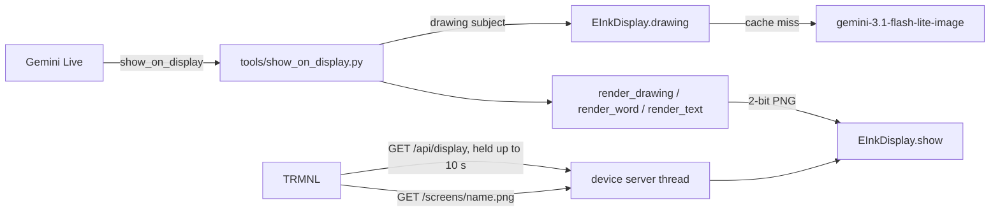

# Feature: E-ink display (TRMNL)

- Status: `in-progress` (v1 built and unit-tested; every screen kind shown on the household TRMNL; voice use not yet tried)
- Last updated: 2026-10-25
- Plan: [docs/plans/eink-display.md](../plans/eink-display.md)

## Overview

Reachy shows drawings, word cards and short text on a TRMNL OG e-ink display (7.5", 800x480,
four grays). It is a deliberately slow, low-stimulation screen: no video, no feed, no apps. The
screen changes only when someone asks; otherwise it shows a resting card with a cartoon Reachy and
"¡Hola! Soy Reachy / Hi, I'm Reachy".

Out of scope in v1: pictures from the web, multi-panel visual explanations, stories, scheduled
pages (see the plan).

## User-visible behavior

- "Draw me a dinosaur": Reachy says to look at the screen; a friendly line drawing with a caption
  appears a few seconds later (about 3 s to draw, usually 0–2 s for the TRMNL to fetch it, then the
  e-ink redraw). Asking for the same subject again reuses the saved drawing.
- Teaching an Italian word, or "how do you say rainbow in Italian?": a word card with the word in
  large type, its pronunciation written for a Spanish speaker ("la MÉ-la"), the Spanish meaning, an
  optional header and an optional small drawing. If the drawing fails the card shows without it.
- "Write MARA big", "put up the shopping list", "show 3 + 4": one big line, or a title over up to
  six lines; longer text is cut with "…".
- "Go back to the start screen": the resting card. It also returns 30 minutes after the last screen.
- After 20 new drawings in a day (`DISPLAY_DRAWINGS_PER_DAY`), new drawings are refused and Reachy
  says its pencil needs a rest; cards and cached drawings still work.
- A drawing that fails (no API key, blocked by Google's filter, over 20 s) leaves the screen as it
  was, and Reachy is told to say so and not retry.

## Setup

1. `.env`: `TRMNL_ENABLED=1` (and optionally `TRMNL_PORT`, `TRMNL_REFRESH_SECONDS`). Drawings use
   `GEMINI_API_KEY`.
2. On the TRMNL, hold the back button until the setup screen shows; join the `TRMNL-xxxx` Wi-Fi
   from a phone. On the setup page tap **Advanced** and set **API Server** to
   `http://<computer's LAN IP>:8090` (no trailing slash), then **Back**, choose the home Wi-Fi
   (2.4 GHz) and **Connect**. This takes the device off TRMNL's cloud; to go back, clear the field.
3. Allow incoming connections for Python if macOS asks. Keep the TRMNL on USB power: with the
   default 1 s sleep and held check-ins its Wi-Fi is on most of the time, which would drain the
   battery in hours. On battery set `TRMNL_REFRESH_SECONDS` to several minutes.

## Architecture



- `EInkDisplay` holds the current screen and the resting card behind a lock. The device server is
  a standard-library `ThreadingHTTPServer` on `0.0.0.0:TRMNL_PORT` in a daemon thread, started and
  stopped by `main.run()`, independent of `--ui`.
- The tool runs on the conversation loop and awaits the drawing (about 3 s; the Live tool deadline
  is 30 s). Rendering and the screen swap are synchronous.
- Speed: the TRMNL deep-sleeps between check-ins and reboots and reconnects to Wi-Fi on every wake,
  so a plain poll is slow (measured: a 60 s rate averaged ~35 s to pick up a screen; a 5 s rate gave
  a 16 s cycle and ~6 s). Instead each `/api/display` request is held for up to `CHECK_IN_HOLD_S`
  (10 s, under the firmware's 15 s read timeout) and answered the moment `show()` or `show_home()`
  changes the screen (`screen_for_check_in`, a condition variable). With a 1 s sleep the device is
  listening most of the time: measured 0–2 s to fetch a screen shown after a quiet spell, ~5.5 s
  when screens come seconds apart (the device is still drawing the last one).
- The firmware does not redraw an image whose file name it has just shown, so frequent check-ins
  never flash the panel (`display_session.cpp`: "The image hasn't changed since the last wakeup").
- Drawings are cached as grayscale PNGs in `~/.cache/reachy-mini-conversation-app/drawings/`, named
  by the subject folded to ASCII ("A Cat" and "a cat" share one). The day's count is in
  `drawings-per-day.json` there; an attempt counts even if it fails, which bounds cost.
- Each drawing's tokens go to the usage ledger as feature `display_drawing`.

## Canonical files and contracts

| Area | File or interface | Responsibility / contract |
|------|-------------------|---------------------------|
| Screens and server | `eink_display.py` | `render_home/drawing/word/text() -> bytes` (PNG); `encode_png`; `EInkDisplay.show/show_home/current/screen_png/drawing/start/stop` |
| Tool | `tools/show_on_display.py` | `kind`: `drawing` (`subject`, `caption`), `word` (`word`, `pronunciation`, `meaning`, `header`, `picture`), `text` (`lines`, `title`), `home`. Returns `{"ok": True, "note": ...}` or `{"error": ..., "instruction"?: ...}` |
| Gate | `tools/core_tools.py` `DISPLAY_TOOLS` | Present only with `TRMNL_ENABLED`; added automatically unless the profile's tools were customized |
| Dependency | `ToolDependencies.display` | Built by `main._build_display()` |
| Config | `config.py` | `TRMNL_ENABLED` (0), `TRMNL_PORT` (8090, 1024–65535), `TRMNL_REFRESH_SECONDS` (1, 1–3600), `DISPLAY_IMAGE_MODEL`, `DISPLAY_DRAWINGS_PER_DAY` (20, 0–500) |
| Assets | `static/eink/` | `reachy.png` (resting-card art, generated from photos of the robot), Atkinson Hyperlegible Regular/Bold and its `OFL.txt` |
| Guidance | `profiles/household_companion/profile.md` | When to use the screen; Spanish-style pronunciation and Spanish meanings for Italian words |

TRMNL device API, as served (firmware 1.8.17 checked):

- `GET /api/setup` → `{"status": 200, "api_key", "friendly_id", "image_url", "message"}`.
- `GET /api/display` → held up to 10 s for a screen not yet sent, then `{"status": 0, "image_url", "filename", "refresh_rate": <int>, "reset_firmware": false, "update_firmware": false, "firmware_url": null, "special_function": "none"}`.
  `refresh_rate` must be an integer: the firmware reads a string as 0 and wakes immediately.
- `GET /screens/<filename>.png` → the current screen or the resting card, else 404.
- `POST /api/log` → 204; the device's report is logged (first 500 characters).

## Extension guide

### Safe to extend

- New layouts: add a `render_*` function that returns `encode_png(canvas)` and a `kind` in the tool.
- Drawing style: `DRAWING_PROMPT`. Keep "no text" and the grayscale wording, or fills speckle.

### Do not change without updating this document and its tests

- Filenames are `<name>-<id>-<unix time>` (13-character `<name>-<id>`, at most 31 characters) and
  change with every screen. The TRMNL caches by name: a reused name hides a new screen.
- A held check-in must answer within the firmware's 15 s read timeout (`HTTP_DEFAULT_TIMEOUT_MS`);
  a timeout counts as a failed request and the device backs off to its retry ladder.
- PNGs are 2-bit grayscale (color type 0) and at most 90,000 bytes (`MAX_PNG_BYTES`).
- `_LEVEL_EDGES` puts only near-white (≥ 230) on white, so light-grey fills from the image model
  become one even grey. Rendered text uses the exact levels 0/85/170/255.
- Text is always typed by the renderer, never asked of the image model.

## Constraints, privacy, and failure modes

- The server listens on all interfaces without authentication (the TRMNL firmware sends no
  credential when fetching images). Anything on the LAN can read the current screen: drawings and
  short text, never audio, camera frames or memory. The setup `api_key` is a fixed placeholder.
- Logs carry the screen kind, firmware/model at setup, and battery/signal at debug level, never the
  words or subjects shown.
- A port already in use logs an error; the app runs without the display.
- Drawing failures leave the screen unchanged; the word card degrades to no picture.
- Pillow's built-in font lacks accents and ¡¿ñ, hence the bundled font.

## Dependencies

- Pillow (added for this feature): image decoding, scaling, text. HPND license, no network access.
- `google-genai` (existing) for drawings.
- Atkinson Hyperlegible, SIL Open Font License 1.1 (bundled with its license).

## Testing

| Test file | Covers |
|-----------|--------|
| `tests/test_eink_display.py` | PNG format and four levels; light-grey fills; every layout incl. overflowing text; idle return; filename rules; held check-ins answered on change and after the hold; oversized screens; drawing cache, prompt and usage record; daily limit and day rollover; no key / blocked / timeout; the device API over real HTTP; 404s and the log endpoint |
| `tests/tools/test_show_on_display.py` | No display; each kind; home; incomplete requests; drawing failure and daily limit messages; word card without its picture; the `TRMNL_ENABLED` gate |
| `tests/test_config.py` | `TRMNL_*` and `DISPLAY_DRAWINGS_PER_DAY` parsing and fallbacks |

Commands run on 2026-10-25 (macOS, Python 3.12):

```bash
.venv/bin/pytest tests/test_eink_display.py tests/tools/test_show_on_display.py tests/test_config.py -q
ruff check . --fix && ruff format . && mypy --pretty --show-error-codes && pytest tests/ -v
```

Results: full gate clean; 1,817 passed, 4 skipped.

Live check 2026-10-25 (household TRMNL OG, firmware 1.8.17, MacBook on the same Wi-Fi): the real
`EInkDisplay` and `show_on_display` served the resting card, a fox drawing made in 2.7 s, a word card
reusing the cached drawing and a list; the device fetched each at its next check-in. Not yet tried
through a spoken conversation.

## Changelog

- 2026-10-25: v1 — drawings, word and translation cards, text, resting card, device server.
- 2026-10-25: Held check-ins and a 1 s default refresh: screens appear in seconds instead of up to a minute.
