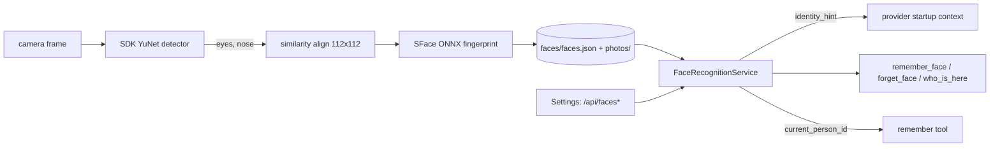

# Feature: Face recognition

- Status: `in-progress` (unit-tested; live accuracy on household faces not yet validated)
- Last updated: 2026-10-16
- Plan: none; requested directly. Builds on [speaker following](speaker-following.md).

## Overview

Reachy recognizes enrolled household members on camera, entirely on this computer,
and uses it three ways: Gemini (or another provider) is told who is in front of
the robot when a conversation starts, the model can ask who is there with the
`who_is_here` tool, and household memory notes record the recognized person as
their source.

Out of scope: recognizing anyone who has not enrolled themselves, sending faces or
fingerprints anywhere, and naming people mid-session without a tool call (Gemini
Live has no silent context injection; sending text starts a model turn).

## User-facing behavior

- **Enable:** `FACE_RECOGNITION_ENABLED=1` (default off). Needs the camera; the
  `remember_face`, `forget_face` and `who_is_here` tools are added to the active
  profile unless its tools were customized in the UI.
- **Enroll by voice:** "Reachy, remember my face, I'm Ana." The robot turns
  toward the speaker and captures the single face in view for about 3 s (up to 6
  samples). It refuses when no clear face is in view, when several faces are, or
  when the face is already enrolled under another name. Repeating adds samples
  (newest 12 kept). The tool description tells the model to enroll only the
  person asking, under their own name.
- **Enroll in the web UI** (`--ui`, Settings → Faces Reachy knows): type a name,
  look at Reachy, press *Remember my face*. *Show faces* lists people with photo
  thumbnails and a *Forget* button. Same computer only.
- **Forget:** "forget my face" / "forget Ana's face", or *Forget* in the UI,
  deletes the fingerprints and photos.
- **During a conversation:** recognition runs about once a second from wake
  until the conversation ends; the largest face is the person in front. When the
  provider's startup context is sent (after the wake turn), it begins with
  "The camera recognizes the person in front of you as Ana …" if someone was
  recognized in the last 10 s. `who_is_here` recognizes every face in the current
  frame on demand.
- **Memory:** `remember` uses the recognized person as `source_person_id` when the
  model does not give one (household memory must be enabled).
- **Failure:** if the models cannot load (first run downloads ~39 MB), a warning
  is logged and the tools report that recognition is starting/unavailable.

## Current architecture



Detection runs on a half-size frame with the SDK's `reachy_mini.vision.face_detector.FaceDetector`
(YuNet, pinned on the Hub). Each face is aligned from its eyes and nose onto the
standard 112x112 template and embedded by OpenCV's SFace (`opencv/face_recognition_sface`,
Apache-2.0, pinned revision), single-threaded on ONNX Runtime. Fingerprints are
unit vectors; a face matches the enrolled person with the highest cosine
similarity if it is at least 0.40 (OpenCV uses 0.363) and 0.05 above the
runner-up. No OpenCV or Pillow dependency: alignment and crops are numpy; photos
are encoded with GStreamer (`camera_frames.encode_jpeg`).

## Canonical files and contracts

| Area | File or interface | Responsibility / contract |
|------|-------------------|---------------------------|
| Recognition | `src/reachy_mini_conversation_app/face_identity.py` | `FaceAnalyzer`, `FaceRegistry`, `FaceRecognitionService` (`start/stop/set_active/identify_now/enroll_from_camera/person_in_front/identity_hint`). |
| Storage | `<memory dir>/faces/faces.json`, `<memory dir>/faces/photos/*.jpg` | Next to `memory.v1.json`; folder 0700, files 0600, atomic writes. `faces.json` = `{version, model, people[{person_id, name, created_at, updated_at, samples[{embedding[128], photo}]}]}`. A different `model` is ignored (re-enroll). |
| Person IDs | `face_identity.person_id_for` | Trimmed, single-spaced, case-folded name without accents ("María" → `maria`), so a transcription without accents finds the same person; the first enrolled spelling is kept as the display name. |
| Tools | `tools/remember_face.py`, `tools/forget_face.py`, `tools/who_is_here.py`; `core_tools.FACE_TOOLS` | Auto-enabled with the flag. |
| Context | `ConversationHandler.set_identity_hint_provider` | Hint is read when `get_initial_context()` is called and placed first so length limits keep it; never added without base context. |
| Memory | `ToolDependencies.current_person_id`, `tools/remember.py` | Default `source_person_id`. |
| Web UI | `console.py` `_register_face_routes`; `static/js/views/settings.js` `buildFacesSection` | `GET /api/faces`, `GET /api/faces/photo?person_id&photo`, `POST /api/faces/enroll {name}`, `POST /api/faces/forget {person_id}`; loopback + same-origin, `no-store`; 404 when disabled. Fingerprints are never returned. |
| Camera | `camera_frames.capture_frame`, `encode_jpeg` | Frame reads share the capture lock with the Gemini camera stream. |
| Wiring | `main.py` | Builds the service, activates it on wake and for the cloud session, passes it to tools, handlers and the console. |
| Config | `FACE_RECOGNITION_ENABLED` | Default `0`. |

## Extension guide

### Safe to extend

- Tune `MATCH_THRESHOLD`, `MATCH_MARGIN`, the minimum face sizes, or the
  recognition interval after measuring on real household faces.
- Use `FaceRecognitionService.person_in_front()` for other behaviour (greetings,
  per-person preferences).

### Do not change without updating this document and its tests

- Recognition runs only while a conversation is active or on explicit request;
  state is cleared when the conversation ends.
- Only names leave the machine; fingerprints and photos never do, and the web
  routes never return fingerprints.
- Changing the recognition model must change `MODEL_ID` so old fingerprints are
  not compared against new ones.

## Constraints, privacy, and failure modes

- Face fingerprints are biometric data. They are stored only on this computer,
  owner-readable, for people who enrolled themselves, and are deleted on request.
- Accuracy depends on light and distance (faces narrower than 48 px at 1920x1080
  are ignored; enrollment needs 80 px). The camera's 120° lens makes faces small
  beyond ~2 m.
- Recognition uses one CPU thread for ~50–150 ms once a second during
  conversations.

## Dependencies

- Depends on: SDK face detector (`huggingface_hub`, `onnxruntime`), GStreamer JPEG
  encoding, the camera, speaker following (enrollment turns toward the speaker).
- Used by: provider startup context, `remember`, the Settings view.

## Testing

### Unit tests

| File | Scenarios |
|------|-----------|
| `tests/test_face_identity.py` | Similarity transform and warp; analyzer downscale, box scaling, small-face filter, unit fingerprints; person IDs; enroll/match/reload/forget with photo deletion; private permissions and model tag; foreign-model store ignored; unknown and ambiguous faces; sample cap; enrollment needs one clear face; refusing a face enrolled under another name; identify/expiry/hint; conversation end clears state; background loop runs only while active. |
| `tests/tools/test_face_tools.py` | Tools when disabled; enroll turns toward the speaker and relays errors; forget by name; who_is_here output and startup state; `remember` attribution; tool auto-enable flag; identity hint ordering. |
| `tests/test_faces_console.py` | List/photo locality and no-store, photo ownership and traversal; remote/rebinding rejection; enroll success/failure/origin/body checks; forget; disabled 404s. |

### Live validation (pending)

Enroll two household members; check same-person cosine (log `Recognized … (score …)`)
stays above 0.40 across distance and light, and that the other person is not
matched.

### Test commands

```bash
.venv/bin/python -m pytest tests/test_face_identity.py tests/tools/test_face_tools.py tests/test_faces_console.py -q
```

## Changelog

| Date | Change |
|------|--------|
| 2026-10-16 | Initial implementation. |
