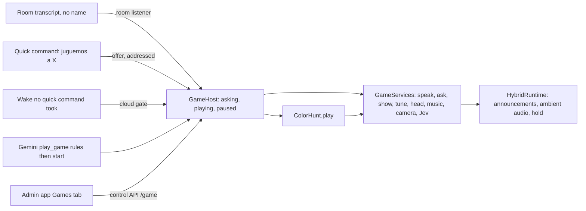

# Feature: Games

- Status: `in-progress` (built and tested on the MacBook; not deployed or played on the robot yet)
- Last updated: 2026-11-03 (six treasures and ten Simón dice poses the kids asked for; the book's drawing)
- Plan: [games.md](../plans/games.md)

## Overview

Reachy plays games with the household, started by name in Spanish or English, and they all start, pause and
end the same way. A game runs on the Mac mini with no Gemini session open: the room is already transcribed
locally, the lines are cached by the reply voice, and only narrow judgments go to the cloud (Jev on a camera
frame, a small fraction of a cent).

Three games so far. The Spanish is Venezuelan (2026-10-31): "listo", "bueno", "una media", "un carrito",
"rosado", "cachetes"; "ya va" pauses, and "listo", "chévere", "dale" say yes.

Two finding games on one engine (`games/hunt.py`):

- the **color hunt** ("juguemos a los colores", "let's play color hunt"): Reachy names a color, a tune speeds
  up for 30 seconds, and the children show him something of that color;
- the **treasure hunt** ("juguemos a buscar tesoros", "let's play treasure hunt"): Reachy names something
  from around the house (a ball, a shoe, a Lego, an animal, something round), the screen shows a drawing of
  it, and they have 60 seconds to find it and show it.

And **Simón dice** ("juguemos a Simón dice", "let's play Simon says"): Reachy names a still pose ("Simón dice:
¡tócate la nariz!"), the screen shows a child doing it, and the camera checks they do it and hold still.

And **la gallina loca** ("juguemos a la gallina loca", "let's play crazy hen"; plan:
[la-gallina-loca.md](../plans/la-gallina-loca.md)): a hot-potato game with no camera. Richie, a crazy hen with a
secret timer, calls each child in turn with something silly to do; a pat or "¡listo!" passes the hen to the
next child, and when he crows "¡COCOROCÓ!", whoever has it lays an egg.

Out of scope for now: flashing the room lights in the game's color (the light systems do not report a lamp's
current color, so it could not be put back exactly), pausing camera games when nobody is in view, writing
practice on the host, and every other game from the 2026-10-30 brainstorm.

Big Brain, the team quiz show played on phones, runs on the same host and has its own page:
[big-brain.md](big-brain.md). It adds `GameServices.say_audio` (recorded speech played as Reachy's line, through
`request_announcement(..., audio=...)`), which any game can use for a recorded voice.

**Scribble Rush**, the drawing race Reachy guesses with a vision model, uses Big Brain's phone server with its
own page: [scribble-rush.md](scribble-rush.md).
**Sheeple**, the survey game played on phones, has its own page too: [sheeple.md](sheeple.md). So does
**Ballpark**, the range-guessing game on phones: [ballpark.md](ballpark.md).

Detectives, the mystery party game played on phones, also runs on the host and has its own page:
[detectives.md](detectives.md).

**Story mode** runs on the same host too. Richie tells a classic story (Los tres cerditos, El nabo gigante, Ricitos de Oro, Los músicos de Bremen, La gran carrera) in Spanish or
Italian, and the kids knock, shout, blow, copy moves and pick small things. Each story is a data file under
`stories/`, and its audio is recorded ahead of time by `scripts/story_build.py`. Plan:
[story-mode.md](../plans/story-mode.md). Stories are catalog entries with `kind="story"`, and Italian is used only
for them.

## User-facing behavior

- **Starting by voice:** "Richie, juguemos a los colores" / "vamos a jugar al juego de los colores" / "let's
  play color hunt" / "play the color game". Reachy asks first, with a one-line pitch: "¿Jugamos a los
  colores? Yo digo un color y tú me traes algo de ese color." "Sí", "vale", "dale", "yes", "ok", or a pat on
  his head starts it; "no" gets "Bueno, otro día."; silence or anything else (30 s) starts nothing. The yes
  guards against starts from the TV or chatter. "Juguemos" alone asks "¿A qué jugamos? Puedo jugar a los
  colores."; answering with a game's name starts it. "Play Coldplay" stays music.
- **Starting through Gemini:** the `play_game` tool is always offered. Gemini must read a game's rules
  (`action=rules`) before it may start it (`action=start`, refused otherwise or after 5 minutes), so it always
  asks first; then it says "¡Vamos!" and ends the conversation, and the game runs locally.
- **Starting from the phone:** the admin app's Games tab has a card per game; Play starts it at once (the tap
  is the yes) in the language and Kids mode chosen there, and wakes Reachy if he sleeps. Kids mode reaches the
  game as `GameContext.kids` (the phone lobby can still switch it). Voice starts work as before, without kids
  mode. While a game runs, Home and the Games tab show it with Pause or Resume, End, and its join QR code
  (`GameContext.join_url`, drawn by the admin server at `GET /api/game/qr`).
- **Language:** the game speaks the language it was asked for in.
- **While a game plays:** Spotify is paused (and not resumed afterwards), the game owns the e-ink screen (the
  music card waits), other announcements (Maribel's replies) wait until the game is paused or over, and the
  `home_lights` and `spotify_control` tools refuse changes.
- **Pause:** "pausa", "espera", "para el juego", "pause", "wait" heard without his name; or his name alone, or
  an antenna bend: "Pausa. ¿Seguimos o terminamos?". The screen shows a pause sign, PAUSA, the game's name and how to go on; timers stop; the
  head is held still so a pat resumes. "Seguimos", "continue", "sí" or a pat plays on. 10 minutes paused ends
  the game. An incoming WhatsApp call pauses it.
- **Quit:** "se acabó el juego", "terminamos", "ya no quiero jugar", "stop the game", "game over" (with or
  without the name), or End in the admin app: "Listo, se acabó el juego." A bare "para" or "stop" does not
  count (children shout it in games).
- **Other requests mid-game:** "Richie, enciende la luz" gets "Estamos jugando a los colores. ¿Lo
  terminamos?". Yes ends the game and then turns the light on (as if just asked: quick command or Gemini); no,
  or 20 s of silence, plays on.
- **After a game:** the screen shown before comes back, the head moves freely again, Reachy listens as usual.
  A game nobody plays for 5 minutes ends by itself.
- **"¿Otra vez?" (the three kids' games):** the answer is read loosely, as children answer: a yes anywhere in
  it ("¡Sí, otra, otra!", "yes yes", "one more time") plays again; another kids' game named anywhere ("no, ¡el
  tesoro!", "Simón dice", "the color game") ends this one without a goodbye and starts that one at once, in the
  same language; "otro juego" / "something else" asks "¿A cuál? ¿A los colores, a buscar tesoros o a Simón
  dice?"; a no ("no", "ya no", "chao") ends with "¡Gracias por jugar!". When a yes and a no are both there, the
  first one wins. An answer that says none of these, or that the speech model could not read, gets "¿Otra
  vez?" once more; silence for 12 s ends the game. Only the kids' games switch this way: other games are started
  by asking Reachy as usual.

### The color hunt

- Each round: "¡Busca algo ROJO!", the screen shows ROJO inside the kids' frame, "Busca…" on a tab at the top and a tray of five stars, and a staccato tune
  plays, speeding up from 100 to 180 BPM over 30 seconds of play.
- About twice a second a camera frame that changed (or one every 1.5 s if nothing did) goes to Jev:
  "is someone holding an object up to the camera?" (a Noul) and "what is its main color?" (a Choice).
- Two of the last three frames held up (≥ 0.5) with the target's color find it: the tune stops, a happy
  move, "¡Sí! ¡Rojo!", a filled star.
- Eleven colors, each accepting its neighbors (generous on purpose, chosen 2026-10-31; Reachy's camera
  shows red and hot pink as orange): rojo (red, orange, pink), naranja (orange, red, yellow), amarillo (yellow,
  orange), verde (green), azul (blue, purple), morado (purple, pink, blue), rosa (pink, red, orange), marrón
  (brown, orange, black), blanco (white, gray), negro (black, gray, brown), gris (gray, white, black).
  Purple, brown and gray were not in the camera spike.
- A sure color outside the group (≥ 0.7) is named at most every 5 s: "Mmm, eso es azul. ¡Busca algo rojo!".
- A color already in view when the round starts (a bottle on the table) counts only after it has left.
- Time up: "¡Se acabó el tiempo! Era el rojo." Nobody loses. After five rounds: "¡Tres estrellas!",
  "¿Otra vez?" (see above): yes plays five more, another kids' game starts that one, otherwise "¡Gracias por
  jugar!" and the game ends.

### The treasure hunt

- Things at home: una pelota, un zapato, una media, un libro, un peluche, un carrito, una cuchara, un vaso,
  una gorra, una muñeca, un Lego, un creyón o un lápiz, and the kids' favorites (asked for 2026-11-03): un
  autobús, un avión, una olla o un sartén (real or toy), un libro de Buscando a Wally (its cover, or a page
  crowded with tiny people), un Bluey and un Spider-Man (a toy, a book, a picture or clothes with them on it). They
  come up as often as the rest. Groups: un animal, una fruta, algo con
  ruedas, algo redondo, algo cuadrado, algo blando, algo con letras, algo más pequeño que tu mano. No letters
  ("algo que empieza con P") and no combinations ("algo verde y redondo") yet. No repeats within five rounds.
- The screen shows a drawing of the thing on the left (for the 2-year-old) and its name on the right. The
  drawings are made once by the image model (about $0.03 each, 24 of them; the last two groups have none;
  Bluey and the Wally book are drawn as themselves, three good drawings out of three tries; Spider-Man is
  refused by gpt-image and Gemini's image model alike, however he is described, so his is a spider web with a
  friendly spider. The Spider-Man hands pose draws fine, as it shows only a child)
  and kept in `game-pictures/` beside the display cache, apart from the gallery's drawings. The first game
  draws the missing ones in the background; until a drawing exists its rounds show the name alone. A drawing
  is kept by its subject, so changing the subject draws it again: "a children's picture book" came out as an
  elephant (an illustration from one), so the book is now "a closed hardcover book, seen at an angle".
- Jev is asked "is the object held up {a ball of any kind}?": ≥ 0.6 counts (two of the last three frames). Held
  up surely (≥ 0.7) and surely not it (≤ 0.15): "Mmm, eso no. ¡Busca una pelota!", at most every 5 s. These two
  thresholds were not tested on real frames.
- Rounds last 60 s with the same tune speeding up; "¡Se acabó el tiempo! Era una pelota." when nothing is found.

### Simón dice

- 57 still poses Jev judges from one frame (no sounds or movement, chosen 2026-10-31): face and head (tócate
  la nariz, tápate los ojos, pon cara de bravo, saca la lengua, mira hacia arriba, cara de pez, cachetes de pez
  globo, hazte el dormido…), arms (levanta los brazos, haz el avión, saca músculos, brazos de zombi, T-rex,
  trompa de elefante, vuela como superhéroe…), hands and fingers (pulgar arriba, un corazón con las manos,
  cachos de toro, enséñame dos dedos, orejas de conejo, manos de Spider-Man, bigotes de gato…) and the whole body
  (agáchate, siéntate en el piso, párate en un pie, voltéate de espaldas, haz una estrella, pose de superhéroe,
  flamenco…). The ten newest were added 2026-11-03: Spider-Man hands, which the kids asked for, and superheroes,
  animals and silly faces Eduardo picked; still no trick rounds (he chose to keep it simple). `games/simon_says.py` `POSES` has each one's words,
  what Jev is asked ("Is a person in `frame` touching their nose with a finger?") and its drawing.
- Eight poses a game, random, close-up ones first; before the first whole-body pose "¡Da un paso hacia
  atrás!", after the last "¡Ahora acércate!". For "mira hacia arriba" and "mira hacia un lado" Reachy turns his
  head too, and back after.
- Each pose: "Simón dice: ¡tócate la nariz!", the screen shows a drawing of a child doing it (for the
  2-year-old; the 57 drawings are made once like the treasure ones) beside short words, then 8 s of play for
  two of the last three checked frames to show it (≥ 0.6, untested on real frames). Done: a cheer ("¡Muy
  bien!", "¡Eso!", "¡Chévere!", "¡Perfecto!"), a happy move, a star. Not done: "¡Así! Mira la pantalla." and on.
  Nobody loses; "¡Ocho estrellas!" and "¿Otra vez?" at the end. No trick rounds (without "Simón dice") yet.

### La gallina loca

- **Names first:** "¿Quién juega? ¡Díganme sus nombres!" Each answer may hold one or several names ("Enzo y
  Sofía"); they are matched against the family's names from face recognition (the enrolled list read as words;
  the camera is not used), first names only, close slips included ("Endzo" is Enzo), and any other name is taken
  as heard ("me llamo Valentina"). Richie greets each one live ("¡Hola, Enzo!") and asks "¿Quién más?" until "ya",
  "nadie más", silence or six names. Then he says the order ("Vamos en este orden: Enzo, Sofía y Papá."), shown
  on the screen too. With no names he calls "¡Siguiente!" instead, and the children go round the circle.
- **The rules, said once in kid words:** do the silly thing, pat his head or shout "¡listo!", and it is the next
  one's turn; when he crows "¡COCOROCÓ!", whoever has the hen lays an egg. (Before 2026-11-03 it said "when the
  hen clucks, penitencia", which meant nothing: he clucks every turn, and "penitencia" is a grown-up word.)
- **A round:** a secret 45–90 s of playing time and a bouncy hen tune that switches to a faster one between 55%
  and 75% of it ("¡La gallina se está poniendo loca!"). Turns go strictly in the order the names were said, so
  everyone plays (before, a random child was picked each turn and some never played). Each turn: a cluck, the
  name and one of 30 quick challenges, none repeated until all have been played, with its drawing and short
  words on the screen:
  - silly moves: shake your chicken butt, write your name with your butt, an armpit toot, wobble like jelly,
    noodle dance, penguin, zombie, frog ("¡croac!"), hop on one foot ("¡pío, pío!"), monkey, a statue that
    can't laugh;
  - silly voices: "pollito" in a monster voice, a witch's laugh, cry like a baby, sing your name like opera,
    hello like a robot, a giant sneeze, a pretend burp, your favorite food with your tongue out;
  - quick thinking: three yellow things, an animal that flies, count down from five and blast off;
  - runs: touch something red, something soft, and come back;
  - Richie: "¡Copia a Richie!" (he plays one of his recorded moves: a dance, an electric shake, scared,
    surprised; pats are ignored for its first 4 s so his own move is not taken for one), tickle Richie;
  - "¡Inventa algo loco!".
  Mild butt and fart jokes are on purpose (Eduardo, 2026-11-03: the original's spirit, and what 4–8 year olds
  laugh at most). A pat on his head or "¡listo!" / "¡ya!" (heard without his name, not in the turn's first
  1.5 s) passes the hen on; about a third of the turns before the faster tune get a quick "¡Bien!", none after,
  so the pace picks up. After 20 s, "¡La gallina sigue!". Nothing is checked: children are trusted.
- **The egg:** when the timer runs out, even mid-turn: a squawk, "¡COCOROCÓ!", the name of whoever has the hen
  (if the turn was just done, the next child: the hen was already passed), "¡Te toca poner un huevo!" and one of
  six ways to lay it (squat and wiggle, "¡plop!"; push out a giant egg; flap and cluck; spin; crow like a
  rooster; peck around), with its drawing. A pat or "¡listo!" (or 15 s), a pop and a cheer, and the screen shows
  everyone's eggs. Then "¿Otra vez?", which keeps the names and starts with the child after the one who laid.
- **The golden hen:** when nobody wants another round, whoever laid the most eggs is "la gallina de oro" (all of
  them on a tie), with the eggs on the screen. Eduardo chose eggs over "becomes the hen" or a plain forfeit.
- The head is held still the whole game (`Game.holds_head`), so pats count while playing.
- In the admin app it is "Crazy Hen" on the "For little ones" shelf, with its own card art
  (`static/admin/games/gallina.webp`).

### Recorded voice, sounds and music (the three kids' games)

Built 2026-11-02 so the games stop sounding flat after a few rounds, while staying easy on adults nearby.

- **Richie's lines are recorded** with ElevenLabs in "Richie kids host" (voice `o5eAiNLN0h2ipUCjBmju`, designed
  2026-11-02 as an upbeat preschool-TV presenter, option C take 1 of three designs Eduardo heard), two or three takes of every
  moment (`games/kids_lines.py`, 176 moments, 381 takes per language), never the same take twice in a row:
  an opening per game, round intros ("¡Primera ronda!", "¡Otra!", "¡Última ronda!"), every color, thing and
  pose said two or three ways, finds, "eso es azul", time up, one nudge halfway through a treasure round
  ("¿Dónde estará?"), "¡Rápido!" for the last 10 s of a round, stars up to eight, "¿Jugamos otra vez?" and
  goodbyes. Spanish is Venezuelan and gender-neutral. Lines carry audio tags; nothing shown has them.
- **Sounds**: a jingle opens each game, a whoosh before each round, a sparkle on a find and a twinkle for the
  star, a soft boing for a wrong thing, a slide whistle at time up, a shutter for a pose, tiptoes for "un paso
  atrás", a short celebration before the stars.
- **Music bed**: quiet searching music during a hunt round that turns faster for the last 10 s, and bouncy
  "freeze" music while children hold a pose. It replaces the beep tune and stops by itself while Richie
  speaks or listens.
- **Levels**: every sound is levelled by loudness (ElevenLabs' takes differ by 15 dB or more): sounds at
  -24 dB RMS, jingles -22, the music bed -33, against about -20 for the voice.
- **Without the recordings** (or any one clip), the games say the old lines in Richie's everyday voice and
  play the beep tune, exactly as before.

### Hearing game answers

- What is said right after a game's question (a buzzed answer, a Sheeple guess, a Detectives question, a
  child's name, "¿Otra vez?") is transcribed by **ElevenLabs Scribe v2** (`scribe_stt.py`), sent as raw 16 kHz
  PCM. If Scribe fails or takes more than 3.5 s, the local request model (Qwen3-ASR 1.7B) hears it instead.
  Before, Qwen heard every answer, and the room overruled it a few times a game (9 times in 8 Big Brain games
  on 2026-11-01).
- Each game tells the speech model which words to expect (`GameServices.hint_answers`), sent as Scribe
  keyterms: Big Brain the whole board's answers (each clue's answer, then the forms it accepts; never one clue
  alone, so a wrong answer is not pulled toward the right one), Sheeple each board's answers in both languages,
  Detectives the characters' names and the evidence, la gallina loca the family's names. At most 100 are sent:
  more would bill each answer as at least 20 s. The host clears them when a game starts and ends.
- Only game answers go to the cloud (Eduardo agreed on 2026-11-03: they are game words, not conversation).
  Everything else Reachy hears stays on the Mac mini. `GAME_ANSWERS_SCRIBE=false` turns it off; without
  `ELEVENLABS_API_KEY` the local model hears everything.
- Cost: about $0.004–0.006 a minute plus 20% for keyterms, so 1–2 cents for a game's 2–3 minutes of answers.
  It draws on the same ElevenLabs credits as the host voices. The log keeps counts only (seconds, characters,
  hints, milliseconds), never words.

### What the screens look like

Every game screen is drawn for the TRMNL's four greys and for reading from across the living room: flat greys or
bold patterns (no gradients), outlines of 3 px or more, Atkinson Hyperlegible for words and Anton (a condensed
poster face, OFL) for game names, numbers and big titles.

- **The kids' games** share one frame: a thick rounded border with the caption ("Busca…", "Simón dice…") on a
  black tab over its top edge, the word as large as it fits (up to three lines, never cut), and the stars on a
  light-grey tray: won stars solid black, the rest white in a dark-grey outline (two rows when there are eight).
  With a drawing, the drawing fills the left and the word and stars the right.
- **Paused** (any game): a black pause disc beside PAUSA, the game's name on a grey pill, how to go on, and
  striped bands top and bottom.
- **The party games** (Big Brain, Sheeple, Scribble Rush, Detectives, Ballpark) share a header: a black band with
  the game's icon and name, a status pill on the right (points, round), and the game's motif under it (marquee
  bulbs, wool, a checkered flag, crime-scene tape, a measuring tape). Join screens keep the QR code exactly as large as before on white,
  with a black panel beside it: title, "scan to play" pointing at the code, the six-letter code as tiles, and the
  teams or players. Teams are told apart by shape and fill as well as name: red a black circle, blue a striped
  square, green a dark-grey triangle, yellow a light-grey diamond. Shared helpers live in `eink_display.py`
  (`_game_header`, `_badge`, `_pill`, `_pattern`, `_draw_star`, `_star_rows`, `_big_words`) and the team tiles and
  join screen in `games/big_brain_screens.py`.

## Current architecture

- The host (`games/host.py`) runs one game at a time: `offer` asks, `start` begins (pausing music and saving
  the screen), `heard` takes room transcripts, `addressed` takes every request by name while a game runs (and
  the start answer while asking), `pause` / `resume` / `end`, and a watch loop (every 50 ms) for pats, playing
  time, a ringing call and the idle and pause timeouts.
- A game is one coroutine, `Game.play(context)`. `GameContext.sleep` counts playing time only and
  `GameContext.playing()` blocks while paused, so a paused game's timers and tune stop by themselves.
- Hybrid runtime hooks: `set_room_listener` (games first, then writing practice), `set_cloud_gate` (a wake no
  quick command took reaches the host before Gemini; his name alone pauses), `set_announcement_hold` (other
  announcements wait while a game plays; game lines are marked `game=True`), `request_announcement(...,
  on_spoken=)` (a line has been heard: the tune starts after it), `play_ambient_audio` (the tune, accepted
  only while Reachy waits for his name; a wake clears it), `request_when_free` (the request a game ended for)
  and `loop` (the control API schedules game actions on it).
- Jev requests go through `jev.py`, shared with web pictures, and are recorded as `game_check` (the color hunt's
  first day as `game_color_check`).

## Canonical files and contracts

| Area | File or interface | Responsibility / contract |
|------|-------------------|---------------------------|
| Names and words | `games/catalog.py` | `GAMES`, `parse_game_request(text)`, `find_game`, `words`, the YES / NO / PAUSE / RESUME / QUIT word sets (whole transcripts, normalized); `KIDS_GAMES`, `again_answer(text, playing)` (a game key, `STOP`, `ANOTHER_GAME` or None; cues anywhere, the first of a yes and a no wins) |
| Host | `games/host.py` | `GameHost(services, factories)`: `offer`, `start(key, language) -> str | None`, `heard`, `addressed`, `pause`, `resume`, `end`, `holding`, `status`; `host_phrases()` for the speech cache |
| Game interface | `games/base.py` | `GameServices` (wired in `main._build_games`), `GameContext` (`next_game`: set by a game as it ends, the host starts it), `Game` (`phrases`, `play`, `heard`, `paused`) |
| Finding engine | `games/hunt.py` | `Hunt` (rounds, tune, frame loop, two-of-three, already in view, wrong line), `ask_again(context, audio) -> next game or None` (all three kids' games; asked twice at most, `AGAIN_LISTEN_S` 12 s to start answering), `Check`, `HELD_QUESTION`, thresholds from the 2026-10-31 spike |
| Color hunt | `games/color_hunt.py` | `ColorHunt`, `TARGETS` (accepted Jev answers per color), `color_hunt_phrases()` |
| La gallina loca | `games/gallina_loca.py` | `GallinaLoca(audio, speech=, known_names=)`, `CHALLENGES`, `FORFEITS`, `heard_names(text, known) -> (names, done)`; names said live in the kids' voice (`Speech`, `game-data/kids/speech`); registered without the camera |
| Simón dice | `games/simon_says.py` | `SimonSays`, `POSES` (words, Jev question, drawing, whole body, head gesture), `pose_drawings()`, `simon_says_phrases()` |
| Kids' audio | `games/kids_audio.py`, `games/kids_lines.py` | `KidsAudio(folder, LINES)`: `say(context, *moments, sounds, after)` (one recorded line with sounds, or Richie's voice), `ask(context, moment, seconds, listen_s=)` (the answer's text), `play_music(context, pick, until)`, `leveled`, `loopable`; `LINES[moment][language]` takes with tags, `TAGS`. Data in `game-data/kids/voice/<moment>/<lang>-NN.wav` and `game-data/kids/sounds/` (`chosen.json`). Made by `scripts/big_brain_voice.py --set kids --voice ID` and `scripts/big_brain_sounds.py --set kids` (convert the mp3s with ffmpeg on the laptop: the mini has none) |
| Treasure hunt | `games/treasure_hunt.py` | `TreasureHunt`, `TREASURES` (names, what Jev is asked, drawing subject), `treasure_drawings()`, `treasure_hunt_phrases()` |
| Jev client | `jev.py` | `ask(client, api_key, model, state, questions, images, feature)`, `sized_jpeg`, `JevError` |
| Tool | `tools/play_game.py` | `play_game(game, action=rules|start, language)`; direct (not a skill); added with `games_configured()` |
| Screens | `eink_display.py` | `render_game_prompt(word, stars, total, caption)`, `render_game_picture(picture, word, stars, total, caption)`, `render_game_paused(title, language)`; screen owner `game`; `game_picture(subject)` (kept only, never waits), `draw_game_pictures(subjects)`, `GAME_PICTURES_DIR` |
| Admin | `control_api.py` `/status` (`game`), `POST /game`; `admin/server.py` `POST /api/game` (audited), `GET /api/game/qr`; `static/admin` Games tab and Now playing card | |
| Config | `HYBRID_RUNTIME_ENABLED`, `QUICK_COMMANDS_ENABLED`, `TYPESAFE_API_KEY`, `DISPLAY_CHECK_MODEL` | Games need all three flags/keys; the color hunt also needs the camera |

## Extension guide

### Safe to extend

- A new game: a `GameInfo` in `catalog.py` (names in both languages with mishearings, title, pitch, rules), a
  `Game` subclass with its fixed lines in `phrases()`, its factory in `main._build_games`, and its phrases in
  the speech cache. The host gives it the yes, pause, quit, screen and music handling for free.
- More names or mishearings for a game, and more words in the word sets.

### Do not change without updating this document and its tests

- Nothing starts without a yes: the spoken question, Gemini's rules-before-start, or a tap in the admin app.
- During a game every addressed request reaches the host first (quick commands and the cloud gate).
- A bare "para" / "stop" is not a quit word.
- Game lines are `game=True` announcements; other announcements wait only while a game plays.
- The screen is put back and the head released when a game ends, however it ends.

## Constraints, privacy, and failure modes

- Camera frames go to TypeSafe (Jev) during the color hunt only, one at a time, never stored; with privacy on
  the camera returns nothing, so nothing is found. Starting a game from the phone is refused while privacy is on.
- A Jev failure skips that frame. A game line not heard within 20 s (Reachy busy) is skipped.
- Head pats only register while the head is held still: while asking and while paused, and while playing a
  game with `holds_head` (la gallina loca). Otherwise, while playing, voice and the antennas are the controls.
- La gallina loca sends the children's names to ElevenLabs to say them in the kids' voice (kept by text, so
  each name once); without a key Richie's everyday voice says them.
- Reachy's own tune reaches the room transcription; game words must be heard over it (to check live).

## Testing

`tests/games/` (catalog, host with a waiting game and a fake clock, color and treasure hunts with a fake camera,
Jev and drawings; "¿Otra vez?" read loosely, asked again when unclear, and switching to another kids' game from
the color hunt and Simón dice; `test_gallina_loca.py` for names heard, a whole game with pats and "¡listo!",
no names, the head held still, and switching to and from it; `test_kids_audio.py` for recorded lines, the fallback voice, levelling, the music bed, a
recorded color hunt, and that every moment the games use is written in both languages),
`tests/tools/test_play_game.py`, the runtime hooks in `tests/test_hybrid_runtime.py`, quick-command routing in
`tests/test_quick_commands.py`, the screens in `tests/test_eink_display.py`, `tests/test_control_api.py` and
`tests/admin/test_server.py`. Jev thresholds come from the 2026-10-31 spike on 258 frames from Reachy's camera
(see the plan).

## Changelog

- 2026-11-03: Game answers are heard by ElevenLabs Scribe v2, biased toward the words each game expects, with the
  local model as the fallback (the room kept overruling Qwen on short answers).

- 2026-11-03: La gallina loca, a hot-potato kids' game without the camera (names said at the start, turns passed
  by a pat or "¡listo!", a secret timer, a silly forfeit). A game can hold the head still while it plays, so pats
  count (`Game.holds_head`). The kids' screens draw no star tray when there are no stars.

- 2026-11-02: "¿Otra vez?" in the kids' games reads the answer loosely (before, only a bare "sí" counted: on
  2026-11-02 a yes followed by more words ended a color hunt, and a reply the speech model could not read ended a
  treasure hunt), asks once more when it is unclear, and starts another kids' game when one is named.
- 2026-11-02: Redesigned game screens: a shared header and motif per party game, team shapes, the kids' frame
  and star tray, a new paused screen, and Anton bundled for titles and numbers. Previews checked by eye from the
  2-bit PNGs the TRMNL gets; not yet seen on the device.
