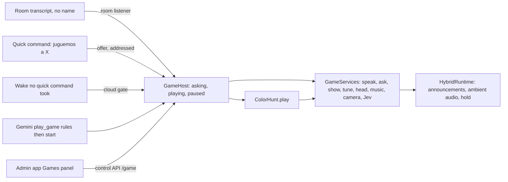

# Feature: Games

- Status: `in-progress` (built and tested on the MacBook; not deployed or played on the robot yet)
- Last updated: 2026-10-31
- Plan: [games.md](../plans/games.md)

## Overview

Reachy plays games with the household, started by name in Spanish or English, and they all start, pause and
end the same way. A game runs on the Mac mini with no Gemini session open: the room is already transcribed
locally, the lines are cached by the reply voice, and only narrow judgments go to the cloud (Jev on a camera
frame, a small fraction of a cent).

The first game is the **color hunt** ("juguemos a los colores", "let's play color hunt"): Reachy names a
color, a tune speeds up for 30 seconds, and the children show him something of that color.

Out of scope for now: flashing the room lights in the game's color (the light systems do not report a lamp's
current color, so it could not be put back exactly), pausing camera games when nobody is in view, writing
practice on the host, and every other game from the 2026-10-30 brainstorm.

## User-facing behavior

- **Starting by voice:** "Richie, juguemos a los colores" / "vamos a jugar al juego de los colores" / "let's
  play color hunt" / "play the color game". Reachy asks first, with a one-line pitch: "¿Jugamos a los
  colores? Yo digo un color y tú me traes algo de ese color." "Sí", "vale", "dale", "yes", "ok", or a pat on
  his head starts it; "no" gets "Vale, otro día."; silence or anything else (30 s) starts nothing. The yes
  guards against starts from the TV or chatter. "Juguemos" alone asks "¿A qué jugamos? Puedo jugar a los
  colores."; answering with a game's name starts it. "Play Coldplay" stays music.
- **Starting through Gemini:** the `play_game` tool is always offered. Gemini must read a game's rules
  (`action=rules`) before it may start it (`action=start`, refused otherwise or after 5 minutes), so it always
  asks first; then it says "¡Vamos!" and ends the conversation, and the game runs locally.
- **Starting from the phone:** the admin app's Home tab has a Games panel; Play starts a game at once (the tap
  is the yes) and wakes Reachy if he sleeps.
- **Language:** the game speaks the language it was asked for in.
- **While a game plays:** Spotify is paused (and not resumed afterwards), the game owns the e-ink screen (the
  music card waits), other announcements (Maribel's replies) wait until the game is paused or over, and the
  `home_lights` and `spotify_control` tools refuse changes.
- **Pause:** "pausa", "espera", "para el juego", "pause", "wait" heard without his name; or his name alone, or
  an antenna bend: "Pausa. ¿Seguimos o terminamos?". The screen shows PAUSA and how to go on; timers stop; the
  head is held still so a pat resumes. "Seguimos", "continue", "sí" or a pat plays on. 10 minutes paused ends
  the game. An incoming WhatsApp call pauses it.
- **Quit:** "se acabó el juego", "terminamos", "ya no quiero jugar", "stop the game", "game over" (with or
  without the name), or End in the admin app: "Vale, se acabó el juego." A bare "para" or "stop" does not
  count (children shout it in games).
- **Other requests mid-game:** "Richie, enciende la luz" gets "Estamos jugando a los colores. ¿Lo
  terminamos?". Yes ends the game and then turns the light on (as if just asked: quick command or Gemini); no,
  or 20 s of silence, plays on.
- **After a game:** the screen shown before comes back, the head moves freely again, Reachy listens as usual.
  A game nobody plays for 5 minutes ends by itself.

### The color hunt

- Each round: "¡Busca algo ROJO!", the screen shows ROJO above a row of five stars, and a staccato tune
  plays, speeding up from 100 to 180 BPM over 30 seconds of play.
- About twice a second a camera frame that changed (or one every 1.5 s if nothing did) goes to Jev:
  "is someone holding an object up to the camera?" (a Noul) and "what is its main color?" (a Choice).
- Two of the last three frames held up (≥ 0.5) with the target's color find it: the tune stops, a happy
  move, "¡Sí! ¡Rojo!", a filled star.
- Colors: rojo, azul, amarillo, verde, rosa, blanco, negro. Reachy's camera shows red as orange, so red
  accepts orange; naranja, morado and marrón are not asked for.
- A sure wrong color (≥ 0.7) is named at most every 5 s: "Mmm, eso es azul. ¡Busca algo rojo!".
- A color already in view when the round starts (a bottle on the table) counts only after it has left.
- Time up: "¡Se acabó el tiempo! Era el rojo." Nobody loses. After five rounds: "¡Tres estrellas!",
  "¿Otra vez?"; yes plays five more, otherwise "¡Gracias por jugar!" and the game ends.

## Current architecture

- The host (`games/host.py`) runs one game at a time: `offer` asks, `start` begins (pausing music and saving
  the screen), `heard` takes room transcripts, `addressed` takes every request by name while a game runs (and
  the start answer while asking), `pause` / `resume` / `end`, and a watch loop (every 50 ms) for pats, playing
  time, a ringing call and the idle and pause timeouts.
- A game is one coroutine, `Game.play(context)`. `GameContext.sleep` counts playing time only and
  `GameContext.playing()` blocks while paused, so a paused game's timers and tune stop by themselves.
- Hybrid runtime hooks: `set_room_listener` (games first, then writing practice), `set_cloud_gate` (a wake no
  quick command took reaches the host before Gemini; his name alone pauses), `set_announcement_hold` (other
  announcements wait while a game plays; game lines are marked `game=True`), `request_announcement(...,
  on_spoken=)` (a line has been heard: the tune starts after it), `play_ambient_audio` (the tune, accepted
  only while Reachy waits for his name; a wake clears it), `request_when_free` (the request a game ended for)
  and `loop` (the control API schedules game actions on it).
- Jev requests go through `jev.py`, shared with web pictures, and are recorded as `game_color_check`.

## Canonical files and contracts

| Area | File or interface | Responsibility / contract |
|------|-------------------|---------------------------|
| Names and words | `games/catalog.py` | `GAMES`, `parse_game_request(text)`, `find_game`, `words`, the YES / NO / PAUSE / RESUME / QUIT word sets (whole transcripts, normalized) |
| Host | `games/host.py` | `GameHost(services, factories)`: `offer`, `start(key, language) -> str | None`, `heard`, `addressed`, `pause`, `resume`, `end`, `holding`, `status`; `host_phrases()` for the speech cache |
| Game interface | `games/base.py` | `GameServices` (wired in `main._build_games`), `GameContext`, `Game` (`phrases`, `play`, `heard`, `paused`) |
| Color hunt | `games/color_hunt.py` | `ColorHunt`, `TARGETS` (accepted Jev answers per color), thresholds from the 2026-10-31 spike, `color_hunt_phrases()` |
| Jev client | `jev.py` | `ask(client, api_key, model, state, questions, images, feature)`, `sized_jpeg`, `JevError` |
| Tool | `tools/play_game.py` | `play_game(game, action=rules|start, language)`; direct (not a skill); added with `games_configured()` |
| Screens | `eink_display.py` | `render_game_prompt(word, stars, total, caption)`, `render_game_paused(title, language)`; screen owner `game` |
| Admin | `control_api.py` `/status` (`game`), `POST /game`; `admin/server.py` `POST /api/game` (audited); `static/admin` Games panel | |
| Config | `HYBRID_RUNTIME_ENABLED`, `QUICK_COMMANDS_ENABLED`, `TYPESAFE_API_KEY`, `DISPLAY_CHECK_MODEL` | Games need all three flags/keys; the color hunt also needs the camera |

## Extension guide

### Safe to extend

- A new game: a `GameInfo` in `catalog.py` (names in both languages with mishearings, title, pitch, rules), a
  `Game` subclass with its fixed lines in `phrases()`, its factory in `main._build_games`, and its phrases in
  the speech cache. The host gives it the yes, pause, quit, screen and music handling for free.
- More names or mishearings for a game, and more words in the word sets.

### Do not change without updating this document and its tests

- Nothing starts without a yes: the spoken question, Gemini's rules-before-start, or a tap in the admin app.
- During a game every addressed request reaches the host first (quick commands and the cloud gate).
- A bare "para" / "stop" is not a quit word.
- Game lines are `game=True` announcements; other announcements wait only while a game plays.
- The screen is put back and the head released when a game ends, however it ends.

## Constraints, privacy, and failure modes

- Camera frames go to TypeSafe (Jev) during the color hunt only, one at a time, never stored; with privacy on
  the camera returns nothing, so nothing is found. Starting a game from the phone is refused while privacy is on.
- A Jev failure skips that frame. A game line not heard within 20 s (Reachy busy) is skipped.
- Head pats only register while the head is held still: while asking and while paused. While playing, voice
  and the antennas are the controls.
- Reachy's own tune reaches the room transcription; game words must be heard over it (to check live).

## Testing

`tests/games/` (catalog, host with a waiting game and a fake clock, color hunt with a fake camera and Jev),
`tests/tools/test_play_game.py`, the runtime hooks in `tests/test_hybrid_runtime.py`, quick-command routing in
`tests/test_quick_commands.py`, the screens in `tests/test_eink_display.py`, `tests/test_control_api.py` and
`tests/admin/test_server.py`. Jev thresholds come from the 2026-10-31 spike on 258 frames from Reachy's camera
(see the plan).
