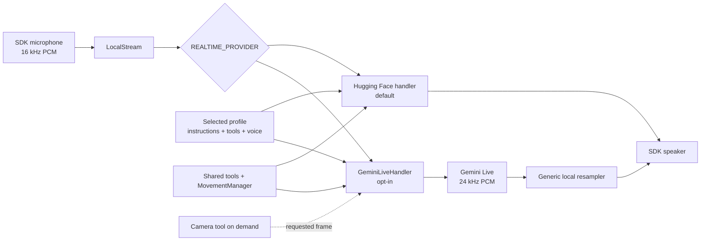

# Feature: Gemini Live provider

- Status: `in-progress`
- Last updated: 2026-10-19
- Plan: [Reachy hybrid household companion](../plans/reachy-hybrid-household-companion.md)

## Overview

This feature lets the app choose Gemini Live as its realtime conversation
provider while keeping the existing Hugging Face provider as the default. The
simple mental model is: one local microphone stream goes to one selected
conversation handler, and one handler sends assistant audio back to the local
speaker.

The configuration selector, handler factory, Gemini adapter, provider-neutral
runtime wiring, shared resampler, and deterministic automated tests are complete
and have passed the repository gate. The opt-in hybrid supervisor now composes
this handler lazily with local ambient context, transcript wake, and exact local
commands. The direct cloud path remains the default; Phase 3–5 live measurements
remain in progress.

The latest WebRTC attempt first hit a producer-startup race (`KeyError`) until
the producer registered. A retry selected WebRTC and initialized the
bidirectional client, reaching `connection_ready_ms=640.8` and greeting-tool
timings of 231.6 ms and 230.9 ms, but the SDK reverse-audio send queue then
failed with `not-negotiated (-4)`. No complete WebRTC conversation, first-audio,
or interruption benchmark was obtained in that attempt. The current Reachy SDK main still contains
the same send-chain implementation, so this workaround is not validated and
should not be presented as expected to work on this Mac. Disk pressure was
resolved to 19 GiB free, and the Python runtime was rebuilt for arm64. The
earlier 545.7 ms and 270.8/274.2 ms samples remain historical only. The bounded
daemon capture worker keeps up to 200 frames (about 2 s of the SDK's 10 ms
frames, raised from 8 after hardware diagnostics showed 140 ms of user speech
lost to a 158 ms event-loop stall), polls empty input every 5 ms, drops the
oldest frame on overflow and logs each drop burst with the lost duration, joins
for at most 100 ms at stop, and records metadata-only diagnostics covered by
privacy tests.

The current local forensic snapshot found one daemon and four conversation-app
processes in uninterruptible `UE` state, including two `PPID 1` orphans; four
clients still showed connections to the daemon, and PID 92880 still listened on
7860. This is likely dirty local runtime state that may explain the later LOCAL
wedge, not a proven root cause.

Before the later native-audio wedge, a user manually completed one long,
responsive Phase 1 Gemini conversation over the SDK LOCAL backend, including a
successful barge-in/interruption. This is user-observed qualitative evidence,
not an instrumented first-audio or interruption-latency result; reproducible
quantitative benchmark evidence remains incomplete. The Phase 0 `Exacto!`
feedback loop is a separate baseline speaker-to-microphone echo observation and
must not be conflated with this Phase 1 LOCAL success. WebRTC was a later
fallback, and its `not-negotiated (-4)` failure does not invalidate the earlier
LOCAL conversation.

## Gemini 3.8 Live Extended Thinking migration

The local implementation passed offline validation under the
[migration plan](../plans/gemini-38-live-extended-thinking-migration.md). The current
local provider has not been switched and no new live/hardware acceptance is
claimed. The legacy model remains the Gemini configuration default.

The target model is `gemini-3.8-live-extended-thinking`, selected through
`GEMINI_LIVE_MODEL` with `REALTIME_PROVIDER=gemini`. `GEMINI_THINKING_LEVEL`
accepts low/medium/high (default medium for this model only). Voice, profile and
managed Google Search remain on the existing Gemini path. Background reasoning
uses the same live model, not GPT speech delegation. Optional memory capture and
daily review still use the configured OpenAI Responses model and existing budgets;
choosing Gemini speech does not remove those separately opted-in text requests.

The protocol gate uses `google-genai==2.19.0` with explicit `v1alpha` transport.
Google's [wire reference](https://ai.google.dev/api/live#BidiGenerateContentServerContent)
places `interactionStatus` under `serverContent`. Some tutorial examples show a
top-level variant which the SDK discards; the adapter must follow the typed schema.
Synthetic public-receive fixtures pass on the pinned SDK. They establish
parsing, not account access or the exact transcription framing of a real session.

The adapter distinguishes speech utterance completion from interaction IDLE,
returns non-blocking tool results independently by ID, and applies bounded interaction,
tool and session lifetimes. It retains on-demand camera handling, interruption
flushes and the existing local movement/audio integration. The plan records the
exact deadlines and conservative image-session limit; human acceptance must include
these limits, not just a successful greeting.

Extended Thinking interactions have a fixed 120-second cap. A new user turn before IDLE (a barge-in, or music keeping the model from reaching IDLE) clears the unfinished interaction's cap, and the new accepted input starts a fresh one; busy or filler events still never extend it. Tools have at most
30 seconds, shortened to leave two seconds before an interaction/session deadline.
Extended Thinking sessions enable sliding-window context window compression and
session resumption. Compression removes Gemini's session-length limits (15 minutes
audio-only, 2 minutes once an image is sent), so no camera session limit applies.
Each connection is still replaced before nine minutes (Gemini ends connections at
about ten). The handler keeps the latest handle from resumable `session_resumption_update`
messages; it is never logged. From eight minutes the handler rotates the connection at
the first quiet moment (no user turn, model turn, tool call or queued output, and no
user speech in the last second), or at nine minutes regardless; a GoAway rotates at
once. Rotation closes the connection and the same handler reconnects with the handle,
skipping the initial context and greeting, so the conversation continues in hybrid
and direct mode alike; audio already received keeps playing. Without a handle the
nine-minute limit still ends the session, and the direct-mode resume below remains
the fallback. A live probe on
2026-10-13 confirmed that `gemini-3.8-live-extended-thinking` accepts both settings
and recalls earlier turns after resuming; neither is listed on its model card.

The 110-second camera session limit remains for an Extended Thinking session without
compression (`_context_compression` false, used in tests): the first frame actually
sent imposes a 110-second total session-age limit. A camera call alone, or a result
without a frame, leaves the nine-minute limit in place. Once the window (less the
two-second headroom) has passed, a camera request is rejected without taking a frame
and a late frame is dropped (`image_attached: false`); neither ends the session.
These settings apply to the selected Extended Thinking model; the legacy Gemini model
keeps its existing configuration.

Memory integration uses the shared store and active-session lifecycle, including
explicit spoken forget/correction semantics. Automatic saving of Gemini speech
remains gated: the pinned SDK does not identify whether a finished transcript is
the full utterance or its final chunk. Ambiguous spoken transcripts stay out of
capture; accepted submitted text can be captured once. Explicit memory tools and
the separately enabled daily review remain available. Live transcript validation
is still required before claiming automatic spoken-memory parity.
Standby must fence new work before cleanup and remain STOPPING until provider and
auxiliary cleanup is contained. See the plan for mutation receipts, cancellation
races, required regression suites and pending validation.

Protocol milestone, primary verification on 2026-09-16:
`REACHY_MINI_SKIP_DOTENV=1 .venv/bin/pytest tests/test_gemini_live.py tests/test_gemini_sdk_contract.py tests/test_config.py tests/tools/test_background_tool_manager.py -q`
passed 195 tests. Two SDK warnings come from deliberately invalid status fixtures.
Shared memory integration and the final combined gate subsequently passed; see the final validation below.

Additional integration coverage lives in `tests/test_gemini_live_memory.py` and
`tests/test_household_memory_session.py`. The shared lifecycle owns optional worker
startup, exact mutation receipts and cleanup; keep provider transport/status handling
in `gemini_live.py`. Do not send unverified transcript chunks to capture or add
automatic provider fallback when extending this path.

## Plain Gemini 3.8 Live and the context cap

`GEMINI_LIVE_MODEL=gemini-3.8-live` selects Gemini 3.8 Live without Extended Thinking.
It shares the 3.8 session features: v1alpha transport, sliding-window compression,
session resumption with connection rotation, live video, and camera images inside the
function response. It differs in three ways:

- **No thinking level.** Google rejects `thinking_level` for this model, and so does the
  config (`GEMINI_THINKING_LEVEL` must be unset). The model still thinks briefly between
  turns (36-88 thought tokens per short turn in a 2026-10-19 probe).
- **Blocking tools.** Its default is `NON_BLOCKING`, but it sends no interaction status,
  so tools are declared `BLOCKING` and use the synchronous response path of the legacy
  model. A probe on 2026-10-19 confirmed a blocking tool call is answered in one turn,
  and a red test image in the function response was described correctly.
- **Spoken acknowledgement by instruction.** It calls a tool about 0.5 s after the request
  and stays silent until the result, even with `NON_BLOCKING` tools and any response
  scheduling (probe, 2026-10-19). An instruction to acknowledge first fixes this: in
  three probe requests it started speaking ("Sure, turning them off") 0.5-0.8 s after
  the request, called the tool about 0.2 s later, and confirmed after the result. The
  instruction lives in the profile (the household companion's MOVEMENT AND TOOLS
  section), not in code; Extended Thinking acknowledges even without it.
- **Quiet rotation without status.** The handler cannot see a reply in progress, so
  rotation waits five seconds after the user's speech and two after the model's last
  audio.

Both 3.8 models trim the context at `GEMINI_CONTEXT_TRIGGER_TOKENS` (default 32,000)
down to half of it. Google's default trigger is 80% of the 131k window, which a normal
conversation never reached, so every turn re-billed the whole growing history. A probe
with a 16k trigger kept the prompt between about 6k and 14k tokens on both models
across seven 5k-token turns. Instructions and tool declarations (about 8k tokens) are
not trimmed. A single realtime text input of about 26k tokens was rejected
(`1007 invalid argument`) with a 16k trigger.

## User-facing behavior

### Default Hugging Face behavior

With `REALTIME_PROVIDER` unset or blank, the app selects Hugging Face exactly as
before. Its deployed-session and local-websocket connection modes, settings
controls, voices, tools, and startup behavior remain the compatibility baseline.

### Opting into Gemini Live

Set these values in the app's local, ignored `.env` file:

```env
REALTIME_PROVIDER=gemini
GEMINI_API_KEY=<local secret; do not commit or log>
# GEMINI_LIVE_MODEL=gemini-3.1-flash-live-preview
# GEMINI_VOICE=Puck
```

`GEMINI_API_KEY` is required for a Gemini session. `GEMINI_LIVE_MODEL` is
optional and defaults to `gemini-3.1-flash-live-preview`. `GEMINI_VOICE` is
optional and defaults to `Puck`; the configured voice must be supported by the
selected model. Provider values are trimmed and case-normalized. An unknown
provider fails clearly rather than silently choosing another cloud service.

Every Gemini Live session also enables Google's managed `google_search` tool.
It is sent alongside profile-selected application function declarations, is
executed by Gemini's service, and is not controlled by Tools → Tool access. The
default Live model supports this capability. The existing Pollen MCP search,
weather, and time tools remain available as profile-managed custom tools; the
managed search tool is not a dedicated flight-status or fare API.

The initial project `.env` load preserves explicit process/terminal values and
fills only unset values. A direct benchmark can therefore override hybrid
settings for one invocation while an unset Gemini key continues to load from
the ignored `.env`.

The Phase 1 direct audio contract is:

```text
16 kHz microphone PCM → Gemini Live → 24 kHz assistant PCM
                                          ↓
                         generic local resampler → speaker
```

The Mac baseline reported a 16 kHz input stream. Gemini output is emitted at
24 kHz, and `LocalStream` converts it to the SDK's speaker rate with the shared
local resampler. There is one audio queue and one active provider handler; no
second agent or movement loop is introduced.

Gemini may emit a one-sample PCM fragment before speech. These tiny fragments
reproduce a native SDK mixer crash on this Mac. `Pcm16ChunkBuffer` now retains
fewer than 240 samples (10 ms), combining them with the next chunk before queueing.
Generation/turn completion pads only a final short tail with silence; every output
queue clear also discards held samples. Regular chunks remain immediate. This
preserves the SDK speech-wobble and echo-reference path without SDK modifications.
See [native evidence and tests](simulator-speaker-output.md#gemini-tiny-fragment-containment--2026-09-20).
Live Gemini speaker acceptance after this correction remains pending.

The Live setup handshake has a 15-second timeout; this bound applies only to
opening the session, not to the ongoing receive loop. The adapter exposes a
`GeminiLatencySnapshot` containing numeric monotonic-millisecond samples for
connection-ready, first-audio, tool-response, and interruption-flush timings.
Each sample list retains at most 32 entries. `first_audio_ms` means the
client-observed interval from an end-of-speech marker to the first assistant
audio frame, and is recorded only when that marker arrives before the audio.
The official SDK describes input transcription as independent of the model
turn, so if audio arrives first the interval is unknowable from these events:
the adapter records bounded `first_audio_unavailable_count`,
`first_audio_reordered_count`, and `first_audio_ambiguous_count` diagnostics
and never reports a negative or zero substitute. A final transcript arriving
after a completed response is treated as ambiguous when no final transcript
was observed for the completed turn; it cannot re-arm a second latency sample.
These values are bounded diagnostics, not a live quality or latency result.

### Simulator media backend selection

The CLI exposes the primary app media-backend choices: `default` (the
unchanged SDK auto-detection), `local`, `webrtc`, and `no_media`. The option is
passed only when the app constructs its own
`ReachyMini`; an SDK-injected robot keeps its existing media configuration. For
the macOS simulator/Gemini path, configure `REALTIME_PROVIDER=gemini` and
keep `GEMINI_API_KEY` in the ignored `.env`, then run:

```bash
REALTIME_PROVIDER=gemini .venv/bin/reachy-mini-conversation-app --media-backend local
```

This is the console-only accepted simulator path. Add `--ui` only when port
7860 is free. `no_media` disables usable conversation audio and is for
headless/non-audio diagnostics. A separate WebRTC attempt failed its reverse
audio chain and is not an accepted workaround. The direct Phase 1 benchmark is
complete: headphones passed, while Mac speakers failed through measured
assistant-to-microphone feedback.

### Tools, camera, profiles, and reconnects

Gemini uses the existing `ToolDependencies`, tool dispatcher, and
`MovementManager`. Movement remains queued through the local movement layer.
Profiles continue to provide instructions, startup greeting, voice, and enabled
tool access. Persistent remember/forget data remains local and is not owned by
the provider.

Native Google Search is available in every Gemini session, including sessions
using the hybrid runtime, independently of the selected profile's custom tool
access. Gemini handles that search server-side; only application function calls
enter the shared local tool manager and require a client function response.

Thinking and tool calls can leave Gemini silent for several seconds after the
user stops talking. Two things show that Reachy heard. The
`household_companion` profile asks for a two-to-four-word acknowledgement
("Let me check") before a tool or search. If no reply audio has started
`_THINKING_CUE_DELAY_S` (2 s) after Gemini reports speech end, the handler
queues the recorded `thinking` emotion through `queue_intent_move`. Reply
audio, renewed user speech, an interruption, or the session ending cancels the
pending gesture. Typical replies start within about 1.5 s, so the gesture only
appears on slow turns.

The `camera` tool is on-demand. By default a camera frame is sent to Gemini only
as the result of an explicit camera-tool call, not merely because a camera exists.

Optional live video (`GEMINI_LIVE_VIDEO_ENABLED=1`, Gemini 3.8 Live models only, since it
relies on context compression to avoid Gemini's two-minute audio+video session
limit) streams the camera at about one frame per second while the user is engaged:
from the first user voice activity or transcript until 30 seconds after the last
one. Frames are captured off the event loop, downscaled like camera-tool frames,
and sent with `send_realtime_input`; the system instruction tells the model to
answer visual questions from the feed and keep the camera tool for when it has no
recent frame. This removes the model's 4-12 s decide-then-call step for "what do
you see" questions observed on the Reachy Mini Lite. Streaming is logged only as
started or paused, never per frame. It changes the privacy boundary: camera frames
go to Google throughout each conversation, not only on request, and video costs
about $0.90 per streamed hour. The camera tool and the stream share one capture
lock because the SDK's one-shot JPEG encoder is not safe to use concurrently.
The tool downscales each frame to fit 768x768 (Gemini's recommended Live input
size) before upload, using the GStreamer stack the SDK already depends on
(`camera_frames.py`); a 1280x720 frame becomes 768x432 and about 70% smaller in
roughly 10 ms. Frames that are already small, unreadable, or fail to re-encode are
sent unchanged. Each camera request logs payload-free timings: `Camera frame ready
capture_ms scale_ms bytes`, and `Gemini camera timing` lines for
`speech_end_to_call_ms` (end of the user's speech to the model's camera call),
`call_to_frame_sent_ms`, and `frame_to_first_audio_ms` (frame sent to the first
reply audio). `media_resolution` is left at the default: MEDIUM was accepted but
was not faster for a 768x432 frame in the probe.
Tool results, transcripts, assistant audio, interruptions, and session errors
remain inside the existing conversation lifecycle. A provider/session failure
is reported through logs and the settings connection state; the supervisor can
retry or rebuild the handler. In direct mode (no hybrid runtime), a session that
the provider ends normally, such as a GoAway at Gemini's session time limit,
leaves its handler policy-fenced, so the supervisor waits the retry delay and
then builds a fresh handler instead of retrying the fenced one. The same applies
when the session ends with an error, such as a provider close surfaced as
`APIError: 1000`: every failed start in direct mode is retried with a fresh
handler. That fresh handler continues the conversation instead of starting over.
If the previous handler holds a session resumption handle, the supervisor reconnects
immediately (no retry delay; logged as "Backend session closed (...); resuming it
now", not as a start failure), passes the handle on and disables the startup
greeting; Gemini restores the full session. A handle the
server rejects (for example after its two-hour validity) is dropped, and the next
attempt falls back to the recap. Without a handle, when the conversation already has
turns, the supervisor disables the startup greeting and seeds a recap of the last 12 turns (bounded by `LOCAL_CONTEXT_MAX_CHARS`) as untrusted
initial context, telling the model not to greet again. The recap
(`conversation_recap.py`) is built in memory from final user transcripts and
assistant transcript chunks; it is never logged or written to disk, and a
user-requested rebuild (backend, profile or voice change) still starts a new
conversation with a greeting. Hybrid mode does not use this path.

Parallel Gemini function calls are started through the shared tool manager, but
their function responses are sent together in the server-provided order. If one
call is cancelled, completed sibling results are flushed and the cancelled local
tool is cancelled; no completed result is stranded. For a camera result on the
Extended Thinking model, the image is attached to the function response itself
(`FunctionResponse.parts` inline JPEG), so it is ordered with the result. A live
probe showed that a frame sent with `send_realtime_input` just before the response
was often not yet seen: the model named the wrong colours or timed out, while the
attached image was described correctly in 3 of 3 runs. google-genai 2.19 does not
base64-encode bytes in tool responses, so the image is attached pre-encoded and the
resulting pydantic serializer warning is filtered narrowly. The legacy model still
sends the frame with `send_realtime_input` before the JSON result.

When Gemini is selected, there is no application gateway between this app and
the Gemini endpoint. Current live microphone audio, provider transcripts, tool
schemas and results, and explicitly requested camera frames cross that cloud
boundary as part of the active conversation. The local app still avoids raw
payload logging and does not send camera frames unless the camera tool is
requested or live video is explicitly enabled, in which case frames are sent while
the user is engaged in conversation (see above).

Changing the active profile or voice requests a backend reconnect so the next
session receives the new instructions or voice. An active Gemini handler marks
that close as intentional and keeps its startup loop alive until the replacement
session is ready; hybrid mode therefore remains in `CLOUD_CONVERSATION` instead
of reporting a provider failure. A request made while setup is still waiting for
the session assignment is retained and causes that just-opened session to be
closed before seeding. A request that races the initial-history seed uses an
internal reconnect signal, so it cannot be confused with task cancellation or
shutdown cancellation. Intentional reconnects also drain provider output and
invoke the playback clearer, preventing old-voice audio from playing after the
readiness boundary. The connection observer sees the normal false/true
readiness boundary, and frames arriving during setup remain in the existing
bounded runtime queue. The Settings view can select the provider and save the
provider selector to the instance `.env`. While Gemini is selected, Hugging Face
endpoint fields are unavailable. The Gemini key is intentionally
environment-only: settings RPC rejects key fields, and the web page never
receives the secret. If the selected provider has no target, the app exposes the
missing-configuration state and waits rather than opening a partial session.

## Current architecture and target changes

Before this feature, `main.py` always built a
`HuggingFaceRealtimeHandler`, while `console.LocalStream` owned the common
microphone/speaker loop. Phase 1 adds a provider selector and a factory. The
factory imports `GeminiLiveHandler` only for the Gemini branch, so the default
Hugging Face import and startup path remain intact.



The provider boundary owns session setup, provider events, audio decoding,
transcripts, interruptions, and tool-call translation. `LocalStream` owns the
SDK media loop and converts provider output to the speaker rate. Existing tools
own local camera/movement operations, and profiles own declarative personality
data. The system-level source diagram is [`docs/scheme.mmd`](../scheme.mmd);
its provider choice has been updated, but the generated
`docs/assets/conversation_app_arch.svg` still needs regeneration through the
existing diagram workflow.

When composed by the hybrid runtime, `ConversationHandler` exposes typed traffic
and connection observers. Gemini calls the traffic observer only after a
successful audio or explicitly requested camera send, allowing cloud
bytes/frames to be counted at the transport boundary. The runtime calls
`set_startup_greeting_enabled(False)` before `start_up()` so activation does not
trigger an unrelated automatic greeting; the existing `start_up()` signature and
direct-provider behavior are unchanged.

Nonempty locally derived context uses Gemini Live's ordered initial-history
protocol, not mutable `system_instruction` text. Session setup enables
`initial_history_in_client_content`, sends one bounded untrusted user-content
seed with `turn_complete=True`, and reports connected only after that seed
succeeds. Empty-context sessions retain the ordinary setup path. Seed failure,
cancellation, or concurrent shutdown closes setup without a stale connected
event; transcript content is never logged.

This document describes the Gemini provider slice. The composed local ambient,
local command, and cloud conversation states are documented in
[`hybrid-runtime.md`](hybrid-runtime.md); they remain opt-in and must not be
inferred from the provider selector alone.

## Canonical files and contracts

| Area | File or interface | Responsibility / contract |
|------|-------------------|---------------------------|
| Configuration | `src/reachy_mini_conversation_app/config.py` | Normalize and validate `REALTIME_PROVIDER`; expose `get_realtime_provider()`, `has_realtime_target()`, and `get_realtime_missing_config_message()`. |
| Provider constants | `src/reachy_mini_conversation_app/config.py` | Keep `HF_BACKEND="huggingface"`, `GEMINI_BACKEND="gemini"`, and Gemini env/default constants available to callers. |
| Handler factory | `src/reachy_mini_conversation_app/main.py` | Build exactly the selected handler and reject unknown values before starting either backend. |
| Gemini adapter | `src/reachy_mini_conversation_app/gemini_live.py` | Implement `ConversationHandler` for Gemini Live audio, managed Google Search, ordered initial-history context, events, transcripts, interruptions, application tools, camera results, reconnect, and shutdown. |
| Shared media loop | `src/reachy_mini_conversation_app/console.py` | Record the SDK input frame, emit handler output, resample output for the selected speaker boundary, expose settings, and supervise reconnects. The bounded capture worker isolates synchronous SDK pulls from asyncio. |
| Audio conversion | `src/reachy_mini_conversation_app/streaming.py` | Provide the generic mono-float32 resampler used when provider and SDK rates differ. |
| Latency diagnostics | `src/reachy_mini_conversation_app/gemini_live.py` | Expose bounded `GeminiLatencySnapshot` numeric samples (maximum 32 per sample list) and marker-order diagnostics without retaining payloads. |
| Common contract | `src/reachy_mini_conversation_app/conversation_handler.py` | Preserve the lifecycle, receive/emit, profile, voice, transcript, activity, typed traffic, connection, and greeting-control interfaces shared by providers. |
| Local operations | `src/reachy_mini_conversation_app/tools/` and `moves.py` | Execute existing tools and queue movement; providers do not issue raw motor commands. |
| Environment template | `.env.example` | List provider and Gemini variable names without values or credentials. |

The approved adapter constructor begins with
`GeminiLiveHandler(deps: ToolDependencies, instance_path: str | None = None,
startup_voice: str | None = None)`. `ToolDependencies` remains the shared
dependency boundary. The adapter sends input audio as PCM with its source rate
and emits assistant audio frames tagged with Gemini's 24 kHz rate; the common
media loop performs the final local conversion.

The adapter limits only the Live session setup handshake to 15 seconds. Once a
session is open, the receive loop remains event-driven and is closed by normal
shutdown, cancellation, provider interruption, reconnect, or error handling.
The session tool list always includes managed `google_search`; application
function declarations are added as a separate group when profile tools exist.
Google handles managed search internally, while application tool batches
preserve the provider's call order in the single function-response message.
Camera bytes are sent as an image input before that function-response message,
and transport-only base64 is removed from the model-visible JSON.

### Configuration contract

| Variable | Required | Default / meaning |
|----------|----------|-------------------|
| `REALTIME_PROVIDER` | No | `huggingface`; accepted values are `huggingface` and `gemini`. Blank means the default. Invalid values fail closed. |
| `GEMINI_API_KEY` | For Gemini | Local secret required before a Gemini client/session is created. Never accepted through settings RPC or logged. |
| `GEMINI_LIVE_MODEL` | No | `gemini-3.1-flash-live-preview`. |
| `GEMINI_VOICE` | No | `Puck`, subject to Gemini model support. |
| `HYBRID_RUNTIME_ENABLED` | No | `0`; set to `1` to keep the provider closed until keyboard activation. |
| `HYBRID_CLOUD_INACTIVITY_SECONDS` | No | `60`; set to `0` to disable hybrid session inactivity close. |
| `HYBRID_AMBIENT_BUFFER_SECONDS` | No | `20`, capped at 20 seconds for the RAM-only ring. |
| `AUDIO_OUTPUT_BACKEND` | No | `sdk`; `gstreamer` explicitly selects the experimental app-owned simulator speaker output. This changes only local playback, not the Gemini transport. |

Provider readiness is deliberately separate from provider selection. The
selected Gemini provider is not ready until the key is non-empty; the selected
Hugging Face provider uses its existing target-resolution rules. This allows the
UI to show a waiting state without constructing a client with incomplete
credentials.

## Extension guide

### Safe to extend

- Add another provider only by defining a named constant, documenting its
  readiness contract, and extending the explicit factory branch.
- Reuse `ConversationHandler`, `ToolDependencies`, `LocalStream`, and
  `MovementManager`; keep provider-specific protocol translation inside the
  provider adapter.
- Add provider-neutral status/readiness fields to settings while keeping
  credentials environment-only.
- Add fake client/session seams and deterministic tests before exercising a new
  provider's network client.
- Extend the shared resampler only with measured audio-format requirements and
  regression tests.

### Do not change without updating this document and its tests

- Do not make an invalid provider silently fall back to Hugging Face or another
  cloud provider.
- Do not log API keys, raw audio, transcripts, camera bytes, prompts, or model
  responses. Log only lifecycle state, counters, and sanitized error metadata.
- Do not create a second audio queue, tool manager, movement loop, or observer
  chain for a provider.
- Do not send camera frames except through the explicit camera-tool path.
- Do not send pre-activation ambient audio when this adapter is composed by the
  hybrid runtime. Direct provider mode intentionally remains the compatibility
  path and does not claim the hybrid ambient boundary.
- Do not change Hugging Face defaults or its settings behavior without updating
  compatibility tests.

### Common extension path

1. Define the provider's configuration/readiness values and update `.env.example`
   without adding a secret.
2. Implement the existing `ConversationHandler` lifecycle and translate audio,
   transcripts, interruptions, tools, and camera results at that boundary.
3. Add fake-session tests for success, failure, timeout, cancellation,
   interruption, reconnect, and privacy-sensitive send boundaries.
4. Add an explicit factory branch and provider-neutral settings behavior.
5. Run the focused checks and full gate, then record actual results in this
   document and the living plan before calling the provider complete.

## Constraints, privacy, and failure modes

- The Gemini key belongs only in a local ignored `.env` or process environment.
  The repository must contain no `.env` file, key value, captured media, or raw
  provider payload.
- `.env` is local configuration, not source control. The Phase 0 setup safely
  renamed `.env.local` to the ignored `.env` and used permission mode `600`;
  the key was not exposed or recorded.
- Missing Gemini configuration leaves the app waiting with a clear status. It
  must not construct a real Gemini client or claim that a session is ready.
- Invalid provider values fail closed so a typo cannot unexpectedly select a
  different cloud service.
- Provider/session errors, disconnects, cancellation, and profile changes must
  close the old session and let the supervisor retry or rebuild it. Stale
  callbacks must not write audio into a replacement session.
- Audio and transcripts are sensitive. The adapter and tests must avoid raw
  payload logging. Native search queries/results are handled within the Gemini
  service during the active cloud session. Camera data is requested on demand
  and is not persisted by this feature.
- The direct cloud path is not the hybrid ambient privacy boundary. Those
  guarantees apply only when `HYBRID_RUNTIME_ENABLED=1` and are enforced by
  `HybridRuntime`, not by selecting Gemini alone.
- Phase 0 found speaker-to-microphone feedback: the assistant's `Exacto!` was
  transcribed as repeated user `Exacto.` turns, with 25 barge-in flushes in
  approximately 86 seconds. This is recorded as an acoustic echo/AEC weakness,
  not a frozen process, and is separate from the user-observed Phase 1 LOCAL
  conversation above. Phase 1 must benchmark Mac speakers and headphones and
  record echo-loop observations; headphones are the immediate control.
- The generic local resampler is a linear-interpolation compatibility path. It
  does not provide a high-quality anti-aliased sample-rate conversion guarantee;
  transient fidelity and spectral quality still require real-device review or a
  measured higher-quality replacement. It is not a latency result, and no Gemini
  live latency or quality claim is made here.
- Earlier LOCAL-media evidence recorded Gemini connection-ready at 545.7 ms and
  tool timings of 270.8 ms and 274.2 ms; those samples remain historical. The
  latest WebRTC attempt and its reverse-audio failure are recorded above. The
  current Reachy SDK main still contains the same send-chain implementation, so
  `--media-backend webrtc` is not a validated workaround on this Mac.
- Simulator and live-device validation remain platform-sensitive: Reachy Mini
  daemon availability, macOS audio permissions, GStreamer/media setup, camera
  availability, network access, model availability, and supported Gemini voices
  all affect runtime validation.

## Dependencies

- Depends on the Reachy Mini SDK, existing `ConversationHandler` and
  `ToolDependencies` contracts, local media loop, profiles, tools, and movement
  manager.
- Simulator support is optional. The `sim` dependency group uses the locked
  `reachy-mini[mujoco]` extra and provides MuJoCo 3.3.0; install it with
  `uv sync --frozen --group dev --group sim` before starting the rendered
  simulator.
- Uses the official `google-genai==2.19.0` SDK for the Gemini Live adapter. Its
  bundled license is Apache-2.0 and the package supports Python >=3.10; this
  application currently declares Python >=3.11. The SDK opens a direct network
  connection to Gemini, with no application gateway.
- Uses the configured Gemini cloud service only after the user selects Gemini
  and provides `GEMINI_API_KEY` locally.
- The provider adapter itself does not own local VAD, local STT, wake-word,
  persistent memory, local TTS, or another agent framework. Hybrid components
  compose around the provider-neutral `ConversationHandler` contract.

## Testing

As of 2026-08-29, the deterministic adapter/runtime/resampler tests and the
repository gate have passed. These tests do not require Gemini credentials, a
live Gemini connection, or physical hardware. The real simulator/Gemini session
benchmark remains pending, so this evidence does not establish reproducible
quantitative first-audio/interruption latency or end-to-end latency. The
user-observed LOCAL conversation above is qualitative only. The earlier 545.7 ms
connection-ready sample and tool timings remain historical; the latest WebRTC
attempt did not cover a complete WebRTC conversation or end-to-end latency.

The first-audio regression tests cover both server event orders. A
marker-before-audio event records a positive sample; audio before the
independent speech-end marker records only bounded reordered/unavailable
diagnostics. Repeated turns, interruption, shutdown, duplicate prevention, and
diagnostic bounds are covered without live credentials.

### Unit tests

| File | Scenarios |
|------|-----------|
| `tests/test_config.py` | Hugging Face default, provider normalization, invalid-provider failure, Gemini model/voice defaults and overrides, dotenv precedence, readiness, and missing-configuration messages. |
| `tests/test_main.py` | Explicit Hugging Face and Gemini factory branches, constructor arguments, unknown-provider rejection, media-backend parsing/default/validation/forwarding, and injected-robot isolation. |
| `tests/test_streaming.py` | Generic output resampling, rate validation, mono shape, empty frames, and audio conversion. |

### Integration tests

| File | Scenarios |
|------|-----------|
| `tests/test_gemini_live.py` | Fake client/session lifecycle, managed Google Search plus application tool configuration, 15-second setup timeout/cancellation, setup and server events, input/output audio, transcripts, marker-before-audio and audio-before-marker latency ordering, repeated turns, bounded diagnostics, interruption, ordered parallel tool calls, on-demand camera result, camera session-age limit applied only to a sent frame (late camera calls and frames rejected without ending the session) and lifted under context compression, opt-in live video with model guidance and engagement-gated frame streaming, camera image attached inside the function response and JSON-encodable through the SDK, session resumption and compression config, resumable-handle tracking without logging, rejected-handle reset, camera timing logs, intentional voice reconnect during setup and initial-context seeding, stale-output/playback clearing, hybrid readiness/state preservation, cancellation, reconnect/stale-session protection, errors, and shutdown without credentials. |
| `tests/test_camera_frames.py` | JPEG size parsing, aspect-preserving fit, real GStreamer 1280x720 to 768x432 downscale, small-frame and unreadable-data passthrough, and original-frame fallback on encoder failure. |
| `tests/tools/test_camera.py` | Camera tool frame capture, downscaled frame returned to the model, disabled camera, missing frame, and question kept out of logs. |
| `tests/test_conversation_recap.py` | Recap turn merging (cumulative and delta chunks), exclusion of user partials and error notices, newest-first bounding, and truncation. |
| `tests/test_console.py` | Provider-neutral settings status, environment-only key rule, provider selection, readiness/waiting state, profile/voice reconnect, backend rebuild, session resumption handle handoff with immediate reconnect (recap fallback without a handle) and no greeting after a provider-ended session, output-rate conversion, bounded capture-worker polling/overflow/stop behavior, and metadata-only capture errors. |

### Simulator / end-to-end tests

| Command or artifact | Scenarios |
|---------------------|-----------|
| Reachy Mini simulator plus app | The optional `sim` group installs the locked `reachy-mini[mujoco]` extra with MuJoCo 3.3.0 via `uv sync --frozen --group dev --group sim`; the real MuJoCo-with-media daemon was healthy. Pending: reproducible direct Gemini conversation, movement/tool call, camera tool, interruption, clean reconnect/shutdown, and output-device capture. |
| Phase 1 LOCAL qualitative observation | A user manually completed one long, responsive Gemini conversation over the SDK LOCAL backend with successful barge-in/interruption before the later native-audio wedge. This is qualitative user observation only, not instrumented latency; reproducible quantitative benchmark evidence remains incomplete. |
| Accepted Phase 1 headphone rerun | A saved-log direct Gemini run connected in 637.5 ms, executed `move_head(left)` with a 2.6 ms provider tool-result interval, and flushed two audible interruptions in 1.4 ms and 3.8 ms. All five turns sounded smooth, both barge-ins worked, movement was visible, and shutdown produced no crash or traceback. Gemini emitted no usable speech-end/first-audio sample, so exact first-audio latency remains unavailable. |
| Accepted Phase 1 speaker control | A direct Mac-speaker run connected in 455.6 ms but immediately fed assistant output into the microphone, producing six self-triggered interruption flushes in about 18 seconds while the user stayed silent. The process remained live and exited without traceback. This is measured acoustic feedback, not a freeze; headphones are required for the app-owned simulator output path. |
| Mac speaker/headphone benchmark | The first WebRTC attempt hit a producer-registration `KeyError`; a retry initialized the bidirectional client with `connection_ready_ms=640.8` and greeting-tool timings of 231.6 ms and 230.9 ms, then the SDK reverse-audio send queue failed with `not-negotiated (-4)`. No complete WebRTC conversation, first-audio, interruption, echo-loop, repeated-transcript, barge-in, or shutdown benchmark was obtained. |

### Test commands

These are the exact focused and gate commands used from the repository root:

```bash
.venv/bin/pytest -q tests/test_config.py tests/test_main.py
.venv/bin/pytest -q tests/test_gemini_live.py tests/test_console.py tests/test_streaming.py
.venv/bin/ruff check src/reachy_mini_conversation_app/config.py src/reachy_mini_conversation_app/main.py src/reachy_mini_conversation_app/console.py src/reachy_mini_conversation_app/gemini_live.py src/reachy_mini_conversation_app/streaming.py tests/test_config.py tests/test_main.py tests/test_console.py tests/test_gemini_live.py tests/test_streaming.py
.venv/bin/ruff format --check src/reachy_mini_conversation_app/config.py src/reachy_mini_conversation_app/main.py src/reachy_mini_conversation_app/console.py src/reachy_mini_conversation_app/gemini_live.py src/reachy_mini_conversation_app/streaming.py tests/test_config.py tests/test_main.py tests/test_console.py tests/test_gemini_live.py tests/test_streaming.py
.venv/bin/mypy --pretty --show-error-codes
.venv/bin/pytest tests/ -v
```

Verified results on 2026-08-29:

- `.venv/bin/pytest -q tests/test_config.py tests/test_main.py` — 27 passed.
- `.venv/bin/pytest -q tests/test_gemini_live.py` — 26 passed.
- `.venv/bin/pytest -q tests/test_console.py` — 51 passed.
- `.venv/bin/pytest -q tests/test_streaming.py` — 10 passed (61 combined).
- Exact full gate — `ruff check . --fix`, `ruff format .`, strict mypy, and
  `pytest tests/ -v` — Ruff clean, format left 81 files unchanged, mypy was
  clean across 46 source files, and pytest passed 392 tests in 7.64 seconds.
- `uv lock --check` — passed.
- `node --check settings.js` — passed.
- `git diff --check` — passed.
- Secret-pattern scan over repository files, excluding the ignored `.env` —
  passed; no credential value is documented here.
- Privacy sentinel tests cover console `AdditionalOutputs`, Gemini, Hugging Face
  transcripts/tools/errors, camera, memory, idle reason, and background progress.

The real simulator/Gemini session benchmark is still pending. It must record
connection, end-of-speech-to-first-audio, tool-call, interruption, output-device
condition, echo-loop, repeated-transcript, and barge-in observations before
Phase 1 can be marked complete. The living [`HYBRID_BENCHMARK.md`](../../HYBRID_BENCHMARK.md)
records current evidence and marks missing values explicitly; do not infer live
conversation quality or end-to-end latency from automated results or isolated
connection samples.

The 2026-08-31 initial-history correction passed 108 focused Gemini/runtime
tests and the full dotenv-isolated repository gate: Ruff, formatting, strict
mypy across 59 source files, 736 tests passed with one explicit native skip,
lock consistency, both JavaScript syntax checks, and `git diff --check`. Live
dinner response quality remains a separate acceptance check.

The follow-up reconnect and activation-fence hardening passed 52 focused Gemini
tests and a 217-test ambient/config/Gemini/runtime/main suite. Final root
verification passed Ruff, formatting, strict mypy across 59 source files, and
761 tests with one explicit native-audio skip. Independent adversarial review
found no remaining P0/P1 blocker. Live dinner response quality remains a
separate acceptance check.

The 2026-09-01 native-search change passed the focused Gemini suite with 52
tests. The test asserts that managed `google_search` is present with and
without profile application functions. The full repository gate then passed
Ruff, formatting, strict mypy across 60 source files, all 833 tests with one
explicit native-audio skip, lock consistency, JavaScript syntax checks, and
`git diff --check`. No live search or flight-data quality test was run.

## Changelog

| Date | Change |
|------|--------|
| 2026-10-17 | Added the spoken acknowledgement instruction and the 2-second thinking gesture so slow thinking or tool turns show the user they were heard. |
| 2026-09-01 | Enabled Gemini Live's managed `google_search` tool alongside profile-selected application function declarations; retained the custom Pollen MCP search, weather, and time tools for dedicated application lookups. |
| 2026-08-31 | Documented and tested project `.env` precedence: explicit process/terminal values win while unset Gemini configuration continues to load from the ignored `.env`. |
| 2026-08-31 | Made profile and voice changes intentional reconnects across setup and initial-history races, drained stale provider/playback output, and preserved hybrid cloud state while the replacement session becomes ready. |
| 2026-08-31 | Moved bounded ambient transcript text from `system_instruction` to Gemini Live ordered initial history. Context seeding now completes before the connected callback, fails closed across transport errors/cancellation/shutdown, and remains payload-free in logs. |
| 2026-08-29 | Documented the Phase 1 provider selector, Gemini configuration and audio boundary, shared tools/profiles/settings behavior, privacy constraints, test inventory, and pending benchmark validation. |
| 2026-08-29 | Recorded the verified focused/full gate, bounded latency diagnostics, 15-second setup-only timeout, ordered tool/cancellation behavior, camera send ordering, SDK dependency review, and the still-pending real Gemini benchmark. |
| 2026-08-29 | Recorded the optional MuJoCo 3.3.0 simulator group, historical interim 378-test gate evidence, and expanded privacy sentinel coverage while retaining the pending live benchmark. |
| 2026-08-29 | Recorded earlier healthy MuJoCo-with-media validation, a 634.4 ms connection-ready Gemini sample, the `gst_app_sink_try_pull_sample` asyncio freeze confirmed by `/usr/bin/sample`, an attempted PID 92880 cleanup that left the process wedged/listening on 7860, the bounded daemon capture worker, and the historical earlier 383-test gate; Phase 1 live metrics remained pending. |
| 2026-08-29 | Recorded the 545.7 ms Gemini connection-ready sample, 270.8/274.2 ms tool timings, the healthy event loop and daemon/Gemini sockets alongside the LOCAL capture-worker block, 19 GiB free disk, arm64 Python rebuild, and the `--media-backend webrtc` simulator validation target; Phase 1 remains in progress. |
| 2026-08-29 | Recorded user-observed qualitative Phase 1 evidence: one long, responsive Gemini conversation over SDK LOCAL with successful barge-in/interruption before the later native-audio wedge; first-audio and interruption latency remain uninstrumented. |
| 2026-08-29 | Recorded the WebRTC producer-registration `KeyError`, retry initialization with `connection_ready_ms=640.8` and greeting-tool timings of 231.6/230.9 ms, the SDK reverse-audio `not-negotiated (-4)` failure, the unchanged SDK send chain, and the stop recommendation pending a clean reboot/local retest versus a native macOS audio adapter/upstream SDK fix; Phase 1 remains in progress. |
| 2026-08-29 | Corrected first-audio instrumentation for independent Gemini event ordering: marker-before-audio records a positive sample, audio-first records bounded unavailable/reordered diagnostics, and completed/interrupted turns cannot be rearmed by late or duplicate markers. Added partial-transcript and startup-greeting regression coverage. |
| 2026-08-29 | Added explicit same-text/final-only ambiguity handling after adversarial review. Independent re-review found no P0/P1 blocker; 41 focused Gemini tests and the full 474-test repository gate pass. |
| 2026-10-12 | Raised the microphone capture queue from 8 frames (80 ms) to 200 (about 2 s) and replaced first/every-100th drop warnings with one warning per overflow burst giving frames and milliseconds lost. Reachy Mini Lite diagnostics had shown 14 frames of speech dropped silently during a 158 ms loop stall. Regression tests: `test_capture_worker_default_queue_survives_short_event_loop_stall`, `test_capture_worker_reports_each_drop_burst_with_lost_duration`. |
| 2026-10-12 | Direct mode now rebuilds the handler after a provider-ended session. On the Reachy Mini Lite a Gemini GoAway after ~9.5 minutes left the fenced handler retrying every 5 s with "Restart the conversation", so Reachy stopped responding. Regression test: `test_startup_loop_starts_fresh_handler_after_provider_ends_session`. |
| 2026-10-12 | Direct mode also rebuilds the handler when start-up fails. On `gemini-3.8-live-extended-thinking`, after the user stopped talking for about a minute, the provider closed the session (`APIError: 1000 None.`); the startup loop kept retrying the fenced handler every 5 s with "Restart the conversation", so Reachy looked asleep. Regression test: `test_startup_loop_starts_fresh_handler_after_provider_closes_with_error`. |
| 2026-10-13 | Sessions no longer restart because the camera was asked for. In a long Reachy Mini Lite conversation Reachy "started over" four times: three sessions were fenced by `camera_session_age_limit` after camera calls that returned no frame (the camera was not delivering frames), and one ended at Gemini's ~9-minute limit. The 110-second limit is now installed only when a frame is sent; late camera calls and frames are refused without ending the session. After any provider-ended session, direct mode now continues with a recap of recent turns and no greeting. Regression tests: `test_extended_thinking_camera_call_does_not_shorten_session_before_a_frame`, `test_startup_loop_continues_conversation_after_provider_ends_session`. |
| 2026-10-13 | Camera frames are downscaled to fit 768x768 before upload (1280x720 to 768x432, about 70% fewer bytes) and each camera request logs capture, send and reply timings, after the user reported slow camera looks on the Reachy Mini Lite. Pillow could not be added (resolving the lockfile rebuilds `pygobject` from source), so scaling uses GStreamer. `media_resolution`, context window compression and session resumption are not yet enabled: the model card does not list them, so they are being probed live first. |
| 2026-10-13 | Enabled sliding-window context window compression and session resumption for `gemini-3.8-live-extended-thinking` after a live probe: the model accepted both, plus `media_resolution` MEDIUM and LOW, and after reconnecting with a handle it recalled a code word from the earlier connection. Provider-ended connections now resume the same session (full context, no greeting); the recap remains the fallback when no handle exists or the server rejects one. The 110-second camera session limit no longer applies under compression. The same probe showed the model answering "I cannot see the image" for frames sent with `send_realtime_input` immediately before a question; image delivery is being compared before changing the camera path. Regression tests: `test_extended_thinking_session_config_enables_resumption_and_compression`, `test_failed_resume_clears_the_handle`, `test_provider_ended_session_resumes_with_the_previous_handle`. |
| 2026-10-13 | Camera images for `gemini-3.8-live-extended-thinking` now travel inside the function response instead of as a realtime frame sent just before it. In a live tool-flow probe with a colour-bar image, the old path named the wrong colours once and timed out once, while the attached image was described correctly 3 of 3 times (first reply audio 2.4–2.9 s after the response). The probe also showed the model taking 3.5–6 s, including a spoken filler, before calling the camera at all. Regression test: `test_extended_thinking_camera_image_is_attached_to_the_function_response`. |
| 2026-10-13 | A Reachy Mini Lite run confirmed accurate camera answers and a resumed session at the nine-minute close, but the app's part of each look took ~35 ms while Gemini took 4-12 s to call the camera and 2.7-7.3 s more to answer. Added opt-in live video (`GEMINI_LIVE_VIDEO_ENABLED`) streaming one frame per second while the user is engaged, so the model can answer from the feed without a tool call. Resumable closes now reconnect immediately instead of after the 5 s retry delay, and are logged as a resume rather than a start failure. Regression tests: `test_live_video_is_opt_in_and_requires_compression`, `test_camera_stream_sends_frames_only_while_the_user_is_engaged`, `test_resumable_session_close_reconnects_without_the_retry_delay`. |
| 2026-10-13 | Live acceptance on the Reachy Mini Lite with `GEMINI_LIVE_VIDEO_ENABLED=1`: the user reported visual answers as much faster than the camera-tool path. The architecture source (`docs/scheme.mmd`) now shows the opt-in live video edge; the generated SVG still needs regenerating with the Mermaid CLI, which is not installed here. |
| 2026-10-13 | A hybrid session on the Reachy Mini Lite ended with `interaction_deadline` (APIError, provider_failed) about two minutes into a lively exchange: Spotify music played near the robot, the user barged in repeatedly, and the model never reported IDLE, so the cap started by the first request kept running across many later user turns. A new user turn now restarts the cap. Regression test: `test_extended_thinking_new_user_turn_restarts_the_interaction_deadline`. |
| 2026-10-19 | Added `gemini-3.8-live` (blocking tools, no thinking level) with the 3.8 session features, and capped context at `GEMINI_CONTEXT_TRIGGER_TOKENS` (default 32k) after the usage ledger showed re-billed context was 44% of conversation cost. Live probes confirmed both models accept the cap, trim at it, and resume; the plain model answered a blocking tool call and read an image from a function response. Regression tests: `test_plain_38_live_session_config_has_blocking_tools_and_capped_compression`, `test_plain_38_live_client_uses_v1alpha`, `test_plain_38_live_is_not_quiet_right_after_speech_or_reply_audio`, `test_gemini_38_camera_image_is_attached_to_the_function_response`, `test_gemini_context_trigger_tokens_default_and_override`. Not yet tried in a real conversation on the robot. |
| 2026-10-14 | A hybrid conversation on the Reachy Mini Lite ended after exactly nine minutes with `provider_failed` (APIError): the handler's own nine-minute connection limit closed the session as final, and hybrid mode has no resume step, so Reachy went quiet mid-conversation. With compression the handler now rotates the connection itself (at a quiet moment after eight minutes, at nine minutes, or on GoAway) and resumes from the handle without re-sending context. Every fenced close now logs `Gemini Live session closed reason=…`. Regression tests: `test_go_away_with_compression_resumes_on_a_new_connection`, `test_aging_connection_rotates_at_a_quiet_moment`, `test_aging_connection_waits_for_the_turn_then_rotates_at_the_limit`, `test_aging_connection_without_a_handle_ends_at_the_limit`. |

## Shared migration validation — 2026-09-16

The final full repository gate passed: **1,247 passed, 3 native opt-in checks
skipped**, with two expected synthetic SDK warnings. Ruff, formatting, strict
mypy, lock validation, JavaScript syntax and diff checks passed. The
[final validation record](../plans/gemini-38-live-extended-thinking-migration.md#final-offline-validation--2026-09-16)
lists exact commands, test inventory, skipped checks and the reproducible next
live-validation step. Gemini spoken-memory parity and real audio/hardware
acceptance remain unverified; the active provider was not switched.

### Optional local interruption assist — 2026-09-21

`GEMINI_LIVE_LOCAL_BARGE_IN_ENABLED=1` enables an experimental local microphone
onset check (default off). After roughly 120 ms above `LOCAL_VAD_RMS_THRESHOLD`,
it clears queued playback if Gemini recently produced audible output. A quiet
400 ms re-arms the check. Microphone audio continues to Gemini; this does not
cancel cloud generation, and later server audio can refill playback. Speaker
leakage or noise can trigger the energy detector, so live speaker acceptance is
still required. The SDK playback, expression and echo-processing paths remain
in use. On the Mac trial, keep the reviewed SDK playback-flush checkout and
`MACOS_LOCAL_AUDIO_FLUSH_ENABLED=1` from the existing launch command.

Spotify investigation on the same date: the effective Gemini tool registry and
schema include Spotify; 29 focused Spotify/SDK contract tests passed. A read-only
live status call succeeded and confirmed the configured device was available.
The supplied trial log contained no Spotify call. This does not establish that
Gemini selects the tool correctly for the failed spoken request; the exact
request/reply or a fresh reproduction remains needed. No playback was started
and no speculative tool-schema change was made.

Validation for the 2026-09-21 follow-up: full `REACHY_MINI_SKIP_DOTENV=1
.venv/bin/pytest tests/ -q` passed (1,263 passed, four opt-in skips, two expected
SDK enum warnings). `.venv/bin/ruff check .`, `.venv/bin/ruff format --check .`,
`.venv/bin/mypy --pretty --show-error-codes` and `git diff --check` passed.
Relevant regression inventory: `tests/test_gemini_live.py`, `tests/test_config.py`,
`tests/test_hybrid_runtime.py`, `tests/test_hybrid_smoke.py`, with existing
`tests/test_openai_live.py`, `tests/test_gemini_sdk_contract.py` and
`tests/tools/test_spotify_control.py`. Live speaker acceptance remains pending.
