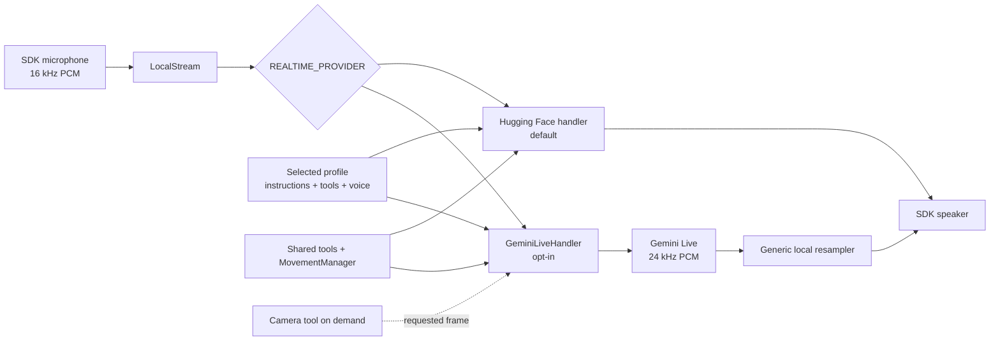

# Feature: Gemini Live provider

- Status: `in-progress`
- Last updated: 2026-08-29
- Plan: [Reachy hybrid household companion](../plans/reachy-hybrid-household-companion.md)

## Overview

This feature lets the app choose Gemini Live as its realtime conversation
provider while keeping the existing Hugging Face provider as the default. The
simple mental model is: one local microphone stream goes to one selected
conversation handler, and one handler sends assistant audio back to the local
speaker.

The configuration selector, handler factory, Gemini adapter, provider-neutral
runtime wiring, shared resampler, and deterministic automated tests are complete
and have passed the repository gate. The opt-in hybrid supervisor now composes
this handler lazily with local ambient context, transcript wake, and exact local
commands. The direct cloud path remains the default; Phase 3–5 live measurements
remain in progress.

The latest WebRTC attempt first hit a producer-startup race (`KeyError`) until
the producer registered. A retry selected WebRTC and initialized the
bidirectional client, reaching `connection_ready_ms=640.8` and greeting-tool
timings of 231.6 ms and 230.9 ms, but the SDK reverse-audio send queue then
failed with `not-negotiated (-4)`. No complete WebRTC conversation, first-audio,
or interruption benchmark was obtained in that attempt. The current Reachy SDK main still contains
the same send-chain implementation, so this workaround is not validated and
should not be presented as expected to work on this Mac. Disk pressure was
resolved to 19 GiB free, and the Python runtime was rebuilt for arm64. The
earlier 545.7 ms and 270.8/274.2 ms samples remain historical only. The bounded
daemon capture worker keeps its queue at 8, polls empty input every 5 ms, drops
the oldest frame on overflow, joins for at most 100 ms at stop, and records
metadata-only diagnostics covered by privacy tests.

The current local forensic snapshot found one daemon and four conversation-app
processes in uninterruptible `UE` state, including two `PPID 1` orphans; four
clients still showed connections to the daemon, and PID 92880 still listened on
7860. This is likely dirty local runtime state that may explain the later LOCAL
wedge, not a proven root cause.

Before the later native-audio wedge, a user manually completed one long,
responsive Phase 1 Gemini conversation over the SDK LOCAL backend, including a
successful barge-in/interruption. This is user-observed qualitative evidence,
not an instrumented first-audio or interruption-latency result; reproducible
quantitative benchmark evidence remains incomplete. The Phase 0 `Exacto!`
feedback loop is a separate baseline speaker-to-microphone echo observation and
must not be conflated with this Phase 1 LOCAL success. WebRTC was a later
fallback, and its `not-negotiated (-4)` failure does not invalidate the earlier
LOCAL conversation.

## User-facing behavior

### Default Hugging Face behavior

With `REALTIME_PROVIDER` unset or blank, the app selects Hugging Face exactly as
before. Its deployed-session and local-websocket connection modes, settings
controls, voices, tools, and startup behavior remain the compatibility baseline.

### Opting into Gemini Live

Set these values in the app's local, ignored `.env` file:

```env
REALTIME_PROVIDER=gemini
GEMINI_API_KEY=<local secret; do not commit or log>
# GEMINI_LIVE_MODEL=gemini-3.1-flash-live-preview
# GEMINI_VOICE=Puck
```

`GEMINI_API_KEY` is required for a Gemini session. `GEMINI_LIVE_MODEL` is
optional and defaults to `gemini-3.1-flash-live-preview`. `GEMINI_VOICE` is
optional and defaults to `Puck`; the configured voice must be supported by the
selected model. Provider values are trimmed and case-normalized. An unknown
provider fails clearly rather than silently choosing another cloud service.

The Phase 1 direct audio contract is:

```text
16 kHz microphone PCM → Gemini Live → 24 kHz assistant PCM
                                          ↓
                         generic local resampler → speaker
```

The Mac baseline reported a 16 kHz input stream. Gemini output is emitted at
24 kHz, and `LocalStream` converts it to the SDK's speaker rate with the shared
local resampler. There is one audio queue and one active provider handler; no
second agent or movement loop is introduced.

The Live setup handshake has a 15-second timeout; this bound applies only to
opening the session, not to the ongoing receive loop. The adapter exposes a
`GeminiLatencySnapshot` containing numeric monotonic-millisecond samples for
connection-ready, first-audio, tool-response, and interruption-flush timings.
Each sample list retains at most 32 entries. `first_audio_ms` means the
client-observed interval from an end-of-speech marker to the first assistant
audio frame, and is recorded only when that marker arrives before the audio.
The official SDK describes input transcription as independent of the model
turn, so if audio arrives first the interval is unknowable from these events:
the adapter records bounded `first_audio_unavailable_count`,
`first_audio_reordered_count`, and `first_audio_ambiguous_count` diagnostics
and never reports a negative or zero substitute. A final transcript arriving
after a completed response is treated as ambiguous when no final transcript
was observed for the completed turn; it cannot re-arm a second latency sample.
These values are bounded diagnostics, not a live quality or latency result.

### Simulator media backend selection

The CLI exposes the primary app media-backend choices: `default` (the
unchanged SDK auto-detection), `local`, `webrtc`, and `no_media`. The option is
passed only when the app constructs its own
`ReachyMini`; an SDK-injected robot keeps its existing media configuration. For
the macOS simulator/Gemini path, configure `REALTIME_PROVIDER=gemini` and
keep `GEMINI_API_KEY` in the ignored `.env`, then run:

```bash
REALTIME_PROVIDER=gemini .venv/bin/reachy-mini-conversation-app --media-backend local
```

This is the console-only accepted simulator path. Add `--ui` only when port
7860 is free. `no_media` disables usable conversation audio and is for
headless/non-audio diagnostics. A separate WebRTC attempt failed its reverse
audio chain and is not an accepted workaround. Phase 1 remains in progress for
the retained quantitative rerun.

### Tools, camera, profiles, and reconnects

Gemini uses the existing `ToolDependencies`, tool dispatcher, and
`MovementManager`. Movement remains queued through the local movement layer.
Profiles continue to provide instructions, startup greeting, voice, and enabled
tool access. Persistent remember/forget data remains local and is not owned by
the provider.

The `camera` tool is on-demand. A camera frame is sent to Gemini only as the
result of an explicit camera-tool call, not merely because a camera exists.
Tool results, transcripts, assistant audio, interruptions, and session errors
remain inside the existing conversation lifecycle. A provider/session failure
is reported through logs and the settings connection state; the supervisor can
retry or rebuild the handler.

Parallel Gemini function calls are started through the shared tool manager, but
their function responses are sent together in the server-provided order. If one
call is cancelled, completed sibling results are flushed and the cancelled local
tool is cancelled; no completed result is stranded. For a camera result, the
image frame is sent before the function response so Gemini receives the image
context before the sanitized JSON result.

When Gemini is selected, there is no application gateway between this app and
the Gemini endpoint. Current live microphone audio, provider transcripts, tool
schemas and results, and explicitly requested camera frames cross that cloud
boundary as part of the active conversation. The local app still avoids raw
payload logging and does not send camera frames unless the camera tool is
requested.

Changing the active profile or voice requests a backend reconnect so the next
session receives the new instructions or voice. The Settings view can select
the provider and save the provider selector to the instance `.env`. While
Gemini is selected, Hugging Face endpoint fields are unavailable. The Gemini
key is intentionally environment-only: settings RPC rejects key fields, and
the web page never receives the secret. If the selected provider has no target,
the app exposes the missing-configuration state and waits rather than opening a
partial session.

## Current architecture and target changes

Before this feature, `main.py` always built a
`HuggingFaceRealtimeHandler`, while `console.LocalStream` owned the common
microphone/speaker loop. Phase 1 adds a provider selector and a factory. The
factory imports `GeminiLiveHandler` only for the Gemini branch, so the default
Hugging Face import and startup path remain intact.



The provider boundary owns session setup, provider events, audio decoding,
transcripts, interruptions, and tool-call translation. `LocalStream` owns the
SDK media loop and converts provider output to the speaker rate. Existing tools
own local camera/movement operations, and profiles own declarative personality
data. The system-level source diagram is [`docs/scheme.mmd`](../scheme.mmd);
its provider choice has been updated, but the generated
`docs/assets/conversation_app_arch.svg` still needs regeneration through the
existing diagram workflow.

When composed by the hybrid runtime, `ConversationHandler` exposes typed traffic
and connection observers. Gemini calls the traffic observer only after a
successful audio or explicitly requested camera send, allowing cloud
bytes/frames to be counted at the transport boundary. The runtime calls
`set_startup_greeting_enabled(False)` before `start_up()` so activation does not
trigger an unrelated automatic greeting; the existing `start_up()` signature and
direct-provider behavior are unchanged.

This document describes the Gemini provider slice. The composed local ambient,
local command, and cloud conversation states are documented in
[`hybrid-runtime.md`](hybrid-runtime.md); they remain opt-in and must not be
inferred from the provider selector alone.

## Canonical files and contracts

| Area | File or interface | Responsibility / contract |
|------|-------------------|---------------------------|
| Configuration | `src/reachy_mini_conversation_app/config.py` | Normalize and validate `REALTIME_PROVIDER`; expose `get_realtime_provider()`, `has_realtime_target()`, and `get_realtime_missing_config_message()`. |
| Provider constants | `src/reachy_mini_conversation_app/config.py` | Keep `HF_BACKEND="huggingface"`, `GEMINI_BACKEND="gemini"`, and Gemini env/default constants available to callers. |
| Handler factory | `src/reachy_mini_conversation_app/main.py` | Build exactly the selected handler and reject unknown values before starting either backend. |
| Gemini adapter | `src/reachy_mini_conversation_app/gemini_live.py` | Implement `ConversationHandler` for Gemini Live audio, events, transcripts, interruptions, tools, camera results, reconnect, and shutdown. |
| Shared media loop | `src/reachy_mini_conversation_app/console.py` | Record the SDK input frame, emit handler output, resample output for the SDK speaker, expose settings, and supervise reconnects. The bounded capture worker isolates synchronous SDK pulls from asyncio. |
| Audio conversion | `src/reachy_mini_conversation_app/streaming.py` | Provide the generic mono-float32 resampler used when provider and SDK rates differ. |
| Latency diagnostics | `src/reachy_mini_conversation_app/gemini_live.py` | Expose bounded `GeminiLatencySnapshot` numeric samples (maximum 32 per sample list) and marker-order diagnostics without retaining payloads. |
| Common contract | `src/reachy_mini_conversation_app/conversation_handler.py` | Preserve the lifecycle, receive/emit, profile, voice, transcript, activity, typed traffic, connection, and greeting-control interfaces shared by providers. |
| Local operations | `src/reachy_mini_conversation_app/tools/` and `moves.py` | Execute existing tools and queue movement; providers do not issue raw motor commands. |
| Environment template | `.env.example` | List provider and Gemini variable names without values or credentials. |

The approved adapter constructor begins with
`GeminiLiveHandler(deps: ToolDependencies, instance_path: str | None = None,
startup_voice: str | None = None)`. `ToolDependencies` remains the shared
dependency boundary. The adapter sends input audio as PCM with its source rate
and emits assistant audio frames tagged with Gemini's 24 kHz rate; the common
media loop performs the final local conversion.

The adapter limits only the Live session setup handshake to 15 seconds. Once a
session is open, the receive loop remains event-driven and is closed by normal
shutdown, cancellation, provider interruption, reconnect, or error handling.
Tool batches preserve the provider's call order in the single function-response
message. Camera bytes are sent as an image input before that function-response
message, and transport-only base64 is removed from the model-visible JSON.

### Configuration contract

| Variable | Required | Default / meaning |
|----------|----------|-------------------|
| `REALTIME_PROVIDER` | No | `huggingface`; accepted values are `huggingface` and `gemini`. Blank means the default. Invalid values fail closed. |
| `GEMINI_API_KEY` | For Gemini | Local secret required before a Gemini client/session is created. Never accepted through settings RPC or logged. |
| `GEMINI_LIVE_MODEL` | No | `gemini-3.1-flash-live-preview`. |
| `GEMINI_VOICE` | No | `Puck`, subject to Gemini model support. |
| `HYBRID_RUNTIME_ENABLED` | No | `0`; set to `1` to keep the provider closed until keyboard activation. |
| `HYBRID_CLOUD_INACTIVITY_SECONDS` | No | `60`; set to `0` to disable hybrid session inactivity close. |
| `HYBRID_AMBIENT_BUFFER_SECONDS` | No | `20`, capped at 20 seconds for the RAM-only ring. |

Provider readiness is deliberately separate from provider selection. The
selected Gemini provider is not ready until the key is non-empty; the selected
Hugging Face provider uses its existing target-resolution rules. This allows the
UI to show a waiting state without constructing a client with incomplete
credentials.

## Extension guide

### Safe to extend

- Add another provider only by defining a named constant, documenting its
  readiness contract, and extending the explicit factory branch.
- Reuse `ConversationHandler`, `ToolDependencies`, `LocalStream`, and
  `MovementManager`; keep provider-specific protocol translation inside the
  provider adapter.
- Add provider-neutral status/readiness fields to settings while keeping
  credentials environment-only.
- Add fake client/session seams and deterministic tests before exercising a new
  provider's network client.
- Extend the shared resampler only with measured audio-format requirements and
  regression tests.

### Do not change without updating this document and its tests

- Do not make an invalid provider silently fall back to Hugging Face or another
  cloud provider.
- Do not log API keys, raw audio, transcripts, camera bytes, prompts, or model
  responses. Log only lifecycle state, counters, and sanitized error metadata.
- Do not create a second audio queue, tool manager, movement loop, or observer
  chain for a provider.
- Do not send camera frames except through the explicit camera-tool path.
- Do not send pre-activation ambient audio when this adapter is composed by the
  hybrid runtime. Direct provider mode intentionally remains the compatibility
  path and does not claim the hybrid ambient boundary.
- Do not change Hugging Face defaults or its settings behavior without updating
  compatibility tests.

### Common extension path

1. Define the provider's configuration/readiness values and update `.env.example`
   without adding a secret.
2. Implement the existing `ConversationHandler` lifecycle and translate audio,
   transcripts, interruptions, tools, and camera results at that boundary.
3. Add fake-session tests for success, failure, timeout, cancellation,
   interruption, reconnect, and privacy-sensitive send boundaries.
4. Add an explicit factory branch and provider-neutral settings behavior.
5. Run the focused checks and full gate, then record actual results in this
   document and the living plan before calling the provider complete.

## Constraints, privacy, and failure modes

- The Gemini key belongs only in a local ignored `.env` or process environment.
  The repository must contain no `.env` file, key value, captured media, or raw
  provider payload.
- `.env` is local configuration, not source control. The Phase 0 setup safely
  renamed `.env.local` to the ignored `.env` and used permission mode `600`;
  the key was not exposed or recorded.
- Missing Gemini configuration leaves the app waiting with a clear status. It
  must not construct a real Gemini client or claim that a session is ready.
- Invalid provider values fail closed so a typo cannot unexpectedly select a
  different cloud service.
- Provider/session errors, disconnects, cancellation, and profile changes must
  close the old session and let the supervisor retry or rebuild it. Stale
  callbacks must not write audio into a replacement session.
- Audio and transcripts are sensitive. The adapter and tests must avoid raw
  payload logging. Camera data is requested on demand and is not persisted by
  this feature.
- The direct cloud path is not the hybrid ambient privacy boundary. Those
  guarantees apply only when `HYBRID_RUNTIME_ENABLED=1` and are enforced by
  `HybridRuntime`, not by selecting Gemini alone.
- Phase 0 found speaker-to-microphone feedback: the assistant's `Exacto!` was
  transcribed as repeated user `Exacto.` turns, with 25 barge-in flushes in
  approximately 86 seconds. This is recorded as an acoustic echo/AEC weakness,
  not a frozen process, and is separate from the user-observed Phase 1 LOCAL
  conversation above. Phase 1 must benchmark Mac speakers and headphones and
  record echo-loop observations; headphones are the immediate control.
- The generic local resampler is a linear-interpolation compatibility path. It
  does not provide a high-quality anti-aliased sample-rate conversion guarantee;
  transient fidelity and spectral quality still require real-device review or a
  measured higher-quality replacement. It is not a latency result, and no Gemini
  live latency or quality claim is made here.
- Earlier LOCAL-media evidence recorded Gemini connection-ready at 545.7 ms and
  tool timings of 270.8 ms and 274.2 ms; those samples remain historical. The
  latest WebRTC attempt and its reverse-audio failure are recorded above. The
  current Reachy SDK main still contains the same send-chain implementation, so
  `--media-backend webrtc` is not a validated workaround on this Mac.
- Simulator and live-device validation remain platform-sensitive: Reachy Mini
  daemon availability, macOS audio permissions, GStreamer/media setup, camera
  availability, network access, model availability, and supported Gemini voices
  all affect runtime validation.

## Dependencies

- Depends on the Reachy Mini SDK, existing `ConversationHandler` and
  `ToolDependencies` contracts, local media loop, profiles, tools, and movement
  manager.
- Simulator support is optional. The `sim` dependency group uses the locked
  `reachy-mini[mujoco]` extra and provides MuJoCo 3.3.0; install it with
  `uv sync --frozen --group dev --group sim` before starting the rendered
  simulator.
- Uses the official `google-genai==2.19.0` SDK for the Gemini Live adapter. Its
  bundled license is Apache-2.0 and the package supports Python >=3.10; this
  application currently declares Python >=3.11. The SDK opens a direct network
  connection to Gemini, with no application gateway.
- Uses the configured Gemini cloud service only after the user selects Gemini
  and provides `GEMINI_API_KEY` locally.
- The provider adapter itself does not own local VAD, local STT, wake-word,
  persistent memory, local TTS, or another agent framework. Hybrid components
  compose around the provider-neutral `ConversationHandler` contract.

## Testing

As of 2026-08-29, the deterministic adapter/runtime/resampler tests and the
repository gate have passed. These tests do not require Gemini credentials, a
live Gemini connection, or physical hardware. The real simulator/Gemini session
benchmark remains pending, so this evidence does not establish reproducible
quantitative first-audio/interruption latency or end-to-end latency. The
user-observed LOCAL conversation above is qualitative only. The earlier 545.7 ms
connection-ready sample and tool timings remain historical; the latest WebRTC
attempt did not cover a complete WebRTC conversation or end-to-end latency.

The first-audio regression tests cover both server event orders. A
marker-before-audio event records a positive sample; audio before the
independent speech-end marker records only bounded reordered/unavailable
diagnostics. Repeated turns, interruption, shutdown, duplicate prevention, and
diagnostic bounds are covered without live credentials.

### Unit tests

| File | Scenarios |
|------|-----------|
| `tests/test_config.py` | Hugging Face default, provider normalization, invalid-provider failure, Gemini model/voice defaults and overrides, readiness, and missing-configuration messages. |
| `tests/test_main.py` | Explicit Hugging Face and Gemini factory branches, constructor arguments, unknown-provider rejection, media-backend parsing/default/validation/forwarding, and injected-robot isolation. |
| `tests/test_streaming.py` | Generic output resampling, rate validation, mono shape, empty frames, and audio conversion. |

### Integration tests

| File | Scenarios |
|------|-----------|
| `tests/test_gemini_live.py` | Fake client/session lifecycle, 15-second setup timeout/cancellation, setup and server events, input/output audio, transcripts, marker-before-audio and audio-before-marker latency ordering, repeated turns, bounded diagnostics, interruption, ordered parallel tool calls, on-demand camera result, cancellation, reconnect/stale-session protection, errors, and shutdown without credentials. |
| `tests/test_console.py` | Provider-neutral settings status, environment-only key rule, provider selection, readiness/waiting state, profile/voice reconnect, backend rebuild, output-rate conversion, bounded capture-worker polling/overflow/stop behavior, and metadata-only capture errors. |

### Simulator / end-to-end tests

| Command or artifact | Scenarios |
|---------------------|-----------|
| Reachy Mini simulator plus app | The optional `sim` group installs the locked `reachy-mini[mujoco]` extra with MuJoCo 3.3.0 via `uv sync --frozen --group dev --group sim`; the real MuJoCo-with-media daemon was healthy. Pending: reproducible direct Gemini conversation, movement/tool call, camera tool, interruption, clean reconnect/shutdown, and output-device capture. |
| Phase 1 LOCAL qualitative observation | A user manually completed one long, responsive Gemini conversation over the SDK LOCAL backend with successful barge-in/interruption before the later native-audio wedge. This is qualitative user observation only, not instrumented latency; reproducible quantitative benchmark evidence remains incomplete. |
| Mac speaker/headphone benchmark | The first WebRTC attempt hit a producer-registration `KeyError`; a retry initialized the bidirectional client with `connection_ready_ms=640.8` and greeting-tool timings of 231.6 ms and 230.9 ms, then the SDK reverse-audio send queue failed with `not-negotiated (-4)`. No complete WebRTC conversation, first-audio, interruption, echo-loop, repeated-transcript, barge-in, or shutdown benchmark was obtained. |

### Test commands

These are the exact focused and gate commands used from the repository root:

```bash
.venv/bin/pytest -q tests/test_config.py tests/test_main.py
.venv/bin/pytest -q tests/test_gemini_live.py tests/test_console.py tests/test_streaming.py
.venv/bin/ruff check src/reachy_mini_conversation_app/config.py src/reachy_mini_conversation_app/main.py src/reachy_mini_conversation_app/console.py src/reachy_mini_conversation_app/gemini_live.py src/reachy_mini_conversation_app/streaming.py tests/test_config.py tests/test_main.py tests/test_console.py tests/test_gemini_live.py tests/test_streaming.py
.venv/bin/ruff format --check src/reachy_mini_conversation_app/config.py src/reachy_mini_conversation_app/main.py src/reachy_mini_conversation_app/console.py src/reachy_mini_conversation_app/gemini_live.py src/reachy_mini_conversation_app/streaming.py tests/test_config.py tests/test_main.py tests/test_console.py tests/test_gemini_live.py tests/test_streaming.py
.venv/bin/mypy --pretty --show-error-codes
.venv/bin/pytest tests/ -v
```

Verified results on 2026-08-29:

- `.venv/bin/pytest -q tests/test_config.py tests/test_main.py` — 27 passed.
- `.venv/bin/pytest -q tests/test_gemini_live.py` — 26 passed.
- `.venv/bin/pytest -q tests/test_console.py` — 51 passed.
- `.venv/bin/pytest -q tests/test_streaming.py` — 10 passed (61 combined).
- Exact full gate — `ruff check . --fix`, `ruff format .`, strict mypy, and
  `pytest tests/ -v` — Ruff clean, format left 81 files unchanged, mypy was
  clean across 46 source files, and pytest passed 392 tests in 7.64 seconds.
- `uv lock --check` — passed.
- `node --check settings.js` — passed.
- `git diff --check` — passed.
- Secret-pattern scan over repository files, excluding the ignored `.env` —
  passed; no credential value is documented here.
- Privacy sentinel tests cover console `AdditionalOutputs`, Gemini, Hugging Face
  transcripts/tools/errors, camera, memory, idle reason, and background progress.

The real simulator/Gemini session benchmark is still pending. It must record
connection, end-of-speech-to-first-audio, tool-call, interruption, output-device
condition, echo-loop, repeated-transcript, and barge-in observations before
Phase 1 can be marked complete. The living [`HYBRID_BENCHMARK.md`](../../HYBRID_BENCHMARK.md)
records current evidence and marks missing values explicitly; do not infer live
conversation quality or end-to-end latency from automated results or isolated
connection samples.

## Changelog

| Date | Change |
|------|--------|
| 2026-08-29 | Documented the Phase 1 provider selector, Gemini configuration and audio boundary, shared tools/profiles/settings behavior, privacy constraints, test inventory, and pending benchmark validation. |
| 2026-08-29 | Recorded the verified focused/full gate, bounded latency diagnostics, 15-second setup-only timeout, ordered tool/cancellation behavior, camera send ordering, SDK dependency review, and the still-pending real Gemini benchmark. |
| 2026-08-29 | Recorded the optional MuJoCo 3.3.0 simulator group, historical interim 378-test gate evidence, and expanded privacy sentinel coverage while retaining the pending live benchmark. |
| 2026-08-29 | Recorded earlier healthy MuJoCo-with-media validation, a 634.4 ms connection-ready Gemini sample, the `gst_app_sink_try_pull_sample` asyncio freeze confirmed by `/usr/bin/sample`, an attempted PID 92880 cleanup that left the process wedged/listening on 7860, the bounded daemon capture worker, and the historical earlier 383-test gate; Phase 1 live metrics remained pending. |
| 2026-08-29 | Recorded the 545.7 ms Gemini connection-ready sample, 270.8/274.2 ms tool timings, the healthy event loop and daemon/Gemini sockets alongside the LOCAL capture-worker block, 19 GiB free disk, arm64 Python rebuild, and the `--media-backend webrtc` simulator validation target; Phase 1 remains in progress. |
| 2026-08-29 | Recorded user-observed qualitative Phase 1 evidence: one long, responsive Gemini conversation over SDK LOCAL with successful barge-in/interruption before the later native-audio wedge; first-audio and interruption latency remain uninstrumented. |
| 2026-08-29 | Recorded the WebRTC producer-registration `KeyError`, retry initialization with `connection_ready_ms=640.8` and greeting-tool timings of 231.6/230.9 ms, the SDK reverse-audio `not-negotiated (-4)` failure, the unchanged SDK send chain, and the stop recommendation pending a clean reboot/local retest versus a native macOS audio adapter/upstream SDK fix; Phase 1 remains in progress. |
| 2026-08-29 | Corrected first-audio instrumentation for independent Gemini event ordering: marker-before-audio records a positive sample, audio-first records bounded unavailable/reordered diagnostics, and completed/interrupted turns cannot be rearmed by late or duplicate markers. Added partial-transcript and startup-greeting regression coverage. |
| 2026-08-29 | Added explicit same-text/final-only ambiguity handling after adversarial review. Independent re-review found no P0/P1 blocker; 41 focused Gemini tests and the full 474-test repository gate pass. |
