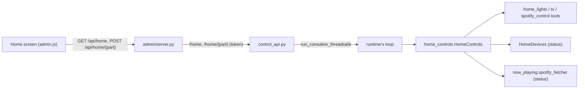

# Feature: home controls in the admin app

- Status: `in-progress` (built and tested with fakes 2026-11-12; not yet on the Mac mini)
- Last updated: 2026-11-12
- Plan: none (asked by Eduardo on 2026-11-12, "like the Google Home app": lights, the TV and music at once)

## Overview

The admin app's Home screen has a **Your home** section: the household routines, the lights and plugs by
area, the TV, and what Spotify plays on Reachy's speaker. Every change goes through the tools Reachy uses by
voice (`home_lights`, `tv`, `spotify_control`), so the phone and his voice match: the same names, the same
routines, the same "a game is on" refusal. Nothing new holds a key or token: the phone asks Reachy's app,
which already talks to the IKEA hub, the Tuya devices, the TV and Spotify.

Out of scope: adding or renaming devices, editing routines (still `~/.config/reachy-home/layout.json` on the
mini), schedules, Spotify search, instant updates (the screen refreshes every 8 s).

## User-facing behavior

- **Routines**: a row of buttons, one per household routine (movie mode, lights off…) then each IKEA scene,
  and **All off**. A routine does what it does by voice: its lights, the TV off, music paused if playing, and
  sleep for one that says so.
- **Lights and plugs**: grouped by area (the layout's order), then by room; each area or room has a
  Turn on/Turn off button. **Tap** a tile to switch it (shown at once, corrected by the next refresh).
  **Hold** a light for its sheet: on/off, brightness, Warm/Neutral/Cool for white lights, colors for color
  lights. A device that does not answer is greyed out ("Not responding"); a change that a device missed is
  named in a message.
- **TV**: a card with its state and a power button; tapping it opens the remote: power, app buttons
  (YouTube, YouTube Kids, Netflix, Disney Plus, Prime Video, Spotify), a YouTube search, the d-pad with OK,
  Back, Home, play/pause, volume and mute.
- **Music**: cover art, song and artist, play/pause, next, and the speaker's Spotify volume.
- A part that is not set up does not show; one that does not answer says so ("The TV didn't answer.") while
  the rest work. Privacy mode does not affect these.
- **Activity** ("Changes"): routines, "all lights off", and "TV on"/"TV off", with who. Single lights, the
  remote's keys and music are not written down.

## Architecture

- `home_controls.py`, `HomeControls(deps)`: `status()` gathers the three parts at once with their own limits
  (`LIGHTS_TIMEOUT_S` 8 s, as an unplugged Tuya device takes up to 6 s; `TV_TIMEOUT_S` 3 s;
  `MUSIC_TIMEOUT_S` 4 s). `light(payload)`, `all_off()`, `routine(name)`, `tv(payload)`, `music(payload)`
  check their fields (types, `TV_ACTIONS`, `MUSIC_ACTIONS`, warmth names, brightness clamped 1-100, text at most
  100 characters) and call the tools.
- `control_api.py`: `GET /home`, `POST /home/{light|all-off|routine|tv|music}`, run on the runtime's loop
  (the TV's and the hub's connections belong to it; the control API has its own). A tool's `error` becomes
  a 409 with its text; a routine that says sleep puts him to sleep as `/sleep` does. 503 without the runtime.
- `admin/server.py`: `GET /api/home` (12 s, `HOME_STATUS_TIMEOUT_S`) and `POST /api/home/{part}` relayed like
  the other controls, behind the same Tailscale guard.
- `now_playing.Playback.volume`: the speaker's Spotify volume, read from the same `/me/player` answer.
- `tools/home_lights.without_offline_duplicates` (was private): an old offline device with an online
  namesake is left out, on the phone as by voice.

## Wire contract

`GET /home` →
`{"lights": {"devices": [{"name", "kind": "light"|"plug", "room", "areas": [...], "on", "reachable",
"brightness", "warmth", "colors"}], "areas": [...], "routines": [...]} | {"error"} | null,
"tv": {"on", "app", "volume", "muted", "apps": [...]} | {"error", "apps"} | null,
"music": {"playing", "title", "artist", "art", "volume"} | {"playing": false, "title": null} | {"error"} | null}`.

| `POST /home/…` | Body |
|---|---|
| `light` | `{"target": device, area or room name, "on"?, "brightness"? 1-100, "warmth"? "warm"\|"neutral"\|"cool", "color"? name or #rrggbb}` |
| `all-off` | none |
| `routine` | `{"name": routine or scene name}` |
| `tv` | `{"action": "power"\|"volume"\|"mute"\|"media"\|"navigate"\|"open"\|"youtube", "on", "level", "change", "steps", "muted", "key", "repeat", "app", "query"}` as the `tv` tool |
| `music` | `{"action": "resume"\|"pause"\|"next"\|"volume", "volume"? 0-100}` |

## Constraints and failure modes

- The Home screen refreshes every 8 s; it waits a moment after a change (devices take time to report), and
  no refresh redraws a tile under a finger.
- Tuya readings can be up to a minute old for a change made elsewhere (`tuya_devices.STATE_FRESH_S`).
- The cover art loads from Spotify's image server (`i.scdn.co`) on the phone.
- A game holds the lights and music, by phone as by voice ("A game is on…").

## Tests

- `tests/test_home_controls.py`: what the phone sees (offline duplicates dropped, routines then scenes, the
  TV's apps, the song), parts not set up or failing or slow, light changes checked and passed to the tool,
  routines (lights, TV off, music paused only when playing, sleep; a lights-only failure stops), TV and music
  commands checked.
- `tests/test_control_api.py`: the routes run on the runtime's loop, a refusal is a 409, a bedtime routine
  puts him to sleep, no runtime is a 503.
- `tests/admin/test_server.py`: relayed and audited (routine, all off, TV power only), refusals passed
  through, unknown part, another page refused, the app down.
- `tests/test_now_playing.py`: the speaker's volume read.
- Checked in a browser against fakes through the real admin server: tiles, area buttons, hold for the sheet
  (it does not also switch the light), brightness and warmth, the TV remote, the music card. Not yet tried
  against the real devices.
