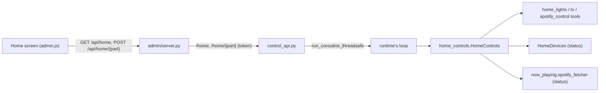

# Feature: home controls in the admin app

- Status: `in-progress` (on the Mac mini 2026-11-12; Devices tab and routine editor built and tested with fakes the same day)
- Last updated: 2026-11-12
- Plan: none (asked by Eduardo on 2026-11-12, "like the Google Home app": lights, the TV and music at once)

## Overview

The admin app's **Devices** tab (it replaced the Camera tab on 2026-11-12) holds, in order: a link to
Reachy's camera, the household routines (run them, and edit them), the lights and plugs by group, the TV,
and what Spotify plays on Reachy's speaker. Every change goes through the tools Reachy uses by
voice (`home_lights`, `tv`, `spotify_control`), so the phone and his voice match: the same names, the same
routines, the same "a game is on" refusal. Nothing new holds a key or token: the phone asks Reachy's app,
which already talks to the IKEA hub, the Tuya devices, the TV and Spotify.

Out of scope: adding or renaming devices, editing areas, routines that set brightness or colors, schedules,
Spotify search, instant updates (the screen refreshes every 8 s).

## User-facing behavior

- **Camera**: the first card opens the camera view (live picture, intercom, Be Reachy); a back arrow returns
  to Devices, which stays lit in the tab bar.
- **Routines**: a row of buttons, one per household routine (movie mode, lights off…) then each IKEA scene,
  and **All off**. A routine does what it does by voice: its lights, the TV off, music paused if playing, and
  sleep for one that says so.
- **Editing routines** (Edit): the list with what each does; tap one to edit, **New** to add one. A routine
  has the phrases that start it (the first is its name; add other ways and languages), lights to turn on
  (All lights, an area, a room or a light), lights to turn off ("Everything else" is every light it does not
  turn on), and switches for turning the TV off, pausing the music and Reachy going to sleep. Delete asks
  first. IKEA scenes are listed but edited in the IKEA app. A save is refused when it names nothing real,
  does nothing, gives two routines the same phrase, or someone changed the routines since the editor
  opened (by hand or another phone); nothing is written then. Saved routines work at once: by voice,
  in conversations and here.
- **Lights and plugs**: one card per group (areas in the layout's order, then rooms) with a switch for the
  whole group and a summary ("3 of 5 on"). Tap the group to open it: each light or plug has its own switch,
  and tapping a light's name (marked "adjust") opens its sheet: on/off, brightness, Warm/Neutral/Cool for
  white lights, colors for color lights. Changes show at once and the next refresh corrects them. A device
  that does not answer is greyed out ("Not responding"); a change a device missed is named in a message.
- **TV**: a card with its state and a power button; tapping it opens the remote: power, app buttons
  (YouTube, YouTube Kids, Netflix, Disney Plus, Prime Video, Spotify), a YouTube search, the d-pad with OK,
  Back, Home, play/pause, volume and mute.
- **Music**: cover art, song and artist, play/pause, next, and the speaker's Spotify volume.
- A part that is not set up does not show; one that does not answer says so ("The TV didn't answer.") while
  the rest work. Privacy mode does not affect these.
- **Activity** ("Changes"): routines run, "routines saved", "all lights off", and "TV on"/"TV off", with who. Single lights, the
  remote's keys and music are not written down.

## Routines everywhere: quick commands, Gemini and the phone

Routines live in the home layout file (`HOME_LAYOUT_FILE`, `~/.config/reachy-home/layout.json` on the mini).
All three ways in read the same `HomeDevices.layout`, which a save replaces at once:

- **Quick commands** (a phrase that is the whole request, e.g. "modo cine"): `QuickCommands._run_routine`
  runs the lights through `home_lights` with `lights_only=True` and does the TV, music and sleep itself
  (the TV in the background, the reply in the phrase's language).
- **Gemini conversations**: `HomeLights.spec()` lists every routine, its other phrases and what it does in
  the tool's description, read from the file when each conversation starts, so Gemini can run one when
  asked in any words ("put on movie mode", "I'm off to bed"). `home_lights action=scene` then runs the whole
  routine (`HomeLights._routine_extras`): the TV off in the background, the music paused if playing, and
  sleep as `go_to_sleep` does (`deps.standby`), telling Gemini to say a very short good night. Until
  2026-11-12 Gemini ran only the lights and was asked to do the rest itself; sleep was dropped.
- **The phone**: `HomeControls.routine` with `lights_only=True`, then the TV and music itself, and the
  control API puts him to sleep.

`lights_only` is not in the tool's schema, so the model never sends it.

## Architecture

- `home_controls.py`, `HomeControls(deps)`: `status()` gathers the three parts at once with their own limits
  (`LIGHTS_TIMEOUT_S` 8 s, as an unplugged Tuya device takes up to 6 s; `TV_TIMEOUT_S` 3 s;
  `MUSIC_TIMEOUT_S` 4 s). `light(payload)`, `all_off()`, `routine(name)`, `tv(payload)`, `music(payload)`
  check their fields (types, `TV_ACTIONS`, `MUSIC_ACTIONS`, warmth names, brightness clamped 1-100, text at most
  100 characters) and call the tools.
- `control_api.py`: `GET /home`, `POST /home/{light|all-off|routine|tv|music}`, run on the runtime's loop
  (the TV's and the hub's connections belong to it; the control API has its own). A tool's `error` becomes
  a 409 with its text; a routine that says sleep puts him to sleep as `/sleep` does. 503 without the runtime.
- `admin/server.py`: `GET /api/home` (12 s, `HOME_STATUS_TIMEOUT_S`) and `POST /api/home/{part}` relayed like
  the other controls, behind the same Tailscale guard.
- `now_playing.Playback.volume`: the speaker's Spotify volume, read from the same `/me/player` answer.
- Routine editing: `HomeControls.routines()` (from the file, with the areas, rooms and lights to pick and
  `home_devices.routines_version`), `HomeControls.save_routines()` (checks each routine, the version, then
  `home_devices.save_routines` rewrites only `"routines"` in the file, keeping the old file as
  `layout.json.bak`, and `HomeDevices.set_layout` loads it again). Limits: 30 routines, 8 phrases of 60
  characters, 40 lights per side.
- `tools/home_lights.without_offline_duplicates` (was private): an old offline device with an online
  namesake is left out, on the phone as by voice.

## Wire contract

`GET /home` →
`{"lights": {"devices": [{"name", "kind": "light"|"plug", "room", "areas": [...], "on", "reachable",
"brightness", "warmth", "colors"}], "areas": [...], "routines": [...]} | {"error"} | null,
"tv": {"on", "app", "volume", "muted", "apps": [...]} | {"error", "apps"} | null,
"music": {"playing", "title", "artist", "art", "volume"} | {"playing": false, "title": null} | {"error"} | null}`.

| `POST /home/…` | Body |
|---|---|
| `light` | `{"target": device, area or room name, "on"?, "brightness"? 1-100, "warmth"? "warm"\|"neutral"\|"cool", "color"? name or #rrggbb}` |
| `all-off` | none |
| `routine` | `{"name": routine or scene name}` |
| `tv` | `{"action": "power"\|"volume"\|"mute"\|"media"\|"navigate"\|"open"\|"youtube", "on", "level", "change", "steps", "muted", "key", "repeat", "app", "query"}` as the `tv` tool |
| `music` | `{"action": "resume"\|"pause"\|"next"\|"volume", "volume"? 0-100}` |

`GET /home/routines` → `{"routines": [layout-file routines], "version", "targets": {"areas", "rooms",
"devices"}, "scenes": [IKEA scene names]}`. `PUT /home/routines` with `{"version", "routines": [...]}` →
`{"ok", "version", "count"}`, or 409 `{"error"}`. Routines are written as in the file: `{"say": [...],
"on"?, "off"?, "sleep"?: true, "tv"?: "off", "music"?: "pause"}`.

## Constraints and failure modes

- The Home screen refreshes every 8 s; it waits a moment after a change (devices take time to report), and
  no refresh redraws a tile under a finger.
- Tuya readings can be up to a minute old for a change made elsewhere (`tuya_devices.STATE_FRESH_S`).
- The cover art loads from Spotify's image server (`i.scdn.co`) on the phone.
- A game holds the lights and music, by phone as by voice ("A game is on…").

## Tests

- `tests/test_home_controls.py`: routines read from the file with their targets; a save rewrites only the
  routines, keeps a `.bak` and is used at once; bad routines and a stale version are refused unwritten;
  what the phone sees (offline duplicates dropped, routines then scenes, the
  TV's apps, the song), parts not set up or failing or slow, light changes checked and passed to the tool,
  routines (lights, TV off, music paused only when playing, sleep; a lights-only failure stops), TV and music
  commands checked.
- `tests/test_control_api.py`: the routes run on the runtime's loop, a refusal is a 409, a bedtime routine
  puts him to sleep, no runtime is a 503.
- `tests/admin/test_server.py`: relayed and audited (routine, all off, TV power only), refusals passed
  through, unknown part, another page refused, the app down.
- `tests/test_now_playing.py`: the speaker's volume read.
- `tests/tools/test_home_lights.py`: a routine asked for in a conversation runs whole (TV, music, sleep);
  `lights_only` leaves those to the caller; each conversation's description lists the routines as they
  are now; an unknown name lists the routines.
- `tests/test_control_api.py`, `tests/admin/test_server.py`: routines read and saved, a stale save refused,
  "routines saved" audited.
- Checked in a browser against fakes through the real admin server: the Devices tab and camera link with
  its back arrow, group and single switches, a light's sheet, brightness and warmth, the TV remote, the
  music card, editing, adding and deleting routines (the delete confirmation itself needs a visible
  pane; it was answered in code). Not yet tried
  against the real devices.
