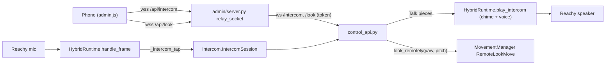

# Feature: Intercom and "Be Reachy"

- Status: `in-progress` (built and tested with fakes 2026-11-10; not yet tried on the robot or a phone)
- Last updated: 2026-11-10
- Plan: none (decisions below, from Eduardo on 2026-11-10)

## Overview

From the admin app's Camera tab, a parent can **listen** to the room through Reachy's mic and **hold to talk**
through his speaker. **Be Reachy** opens the camera full screen: his head follows where the back of the phone
points (the phone's motion sensor), with the intercom on, so it feels like looking out through him.

Decisions (Eduardo, 2026-11-10): talking is hold-to-talk; listening is silent (no chime or sign on Reachy),
but Reachy chimes before each time someone talks; his conversation and wake word pause while a phone is
connected; while asleep, Be Reachy lifts his head like a peek and lowers it again on leaving.

Out of scope: video calls in the other direction (the phone's camera), more than one phone at a time,
recording, real 3D (one camera).

## User-facing behavior

- **Listen** (Camera tab): connects the intercom; the button turns green ("Listening"). A **Hold to talk**
  button appears. Holding it chimes on Reachy, then the phone's voice plays from his speaker (his head
  wobbles with it, as when he speaks). While held, and 0.6 s after letting go, the phone does not play the
  room, so you do not hear your own voice back. Tapping Listen again, leaving the tab or locking the phone
  disconnects.
- **Be Reachy**: full screen (landscape when the phone allows it), the camera at about 12 frames a second,
  the intercom on (sound toggle bottom left, hold to talk bottom centre). The direction the phone points
  when it opens is straight ahead; the target button makes the current direction straight ahead again.
  Dragging the picture also looks around (and is the only way on a computer without a motion sensor).
  Awake, the head follows quickly and the body turns after it (up to 150° either side, pitch ±35°); asleep,
  only the head lifts (±60° yaw, ±30° pitch) and he stays asleep. Leaving (×, the phone's back gesture,
  leaving the tab or locking the phone) turns him back to the front, or lowers his head if asleep. If the
  phone stops sending for 3 s (`REMOTE_LOOK_IDLE_S`), he does the same.
- **While connected**: an open conversation closes when the intercom opens; then nothing activates him (wake
  word, antennas, announcements, incoming-call answering by voice or pat). Announcements wait (and are
  dropped if he stays busy too long, as when he is busy talking). Nothing he hears is kept for the room
  transcript or sent to the cloud.
- **Refused**: privacy on ("Privacy is on."), a game playing ("A game is on."), a command or call under way
  ("Reachy is busy. Try again in a moment."), another phone connected ("Someone else is already
  connected."), the app not running. Privacy turning on closes the intercom within a second and stops the
  head following.
- **Activity**: the "Changes" list records "listened through Reachy" for each connection and "talked through
  Reachy" once per connection in which someone talked, with who.

## Architecture

- **Runtime** (`hybrid_runtime.py`): `open_intercom(tap)` closes an open conversation, refuses during a
  command or activation, then sets `_intercom_tap`. `handle_frame` sends every frame to the tap first and
  returns; `activate` returns False and the pending-turn loop counts as busy while it is set.
  `play_intercom(tap, voice)` queues the chime and the voice as reply audio (16 kHz) while that tap's
  intercom stays open. `close_intercom(tap)`. All on the runtime's loop. Taps are compared with `==` (a
  bound method is a new object on each access).
- **Control API** (`control_api.py`): `WS /intercom` and `WS /look` (loopback and token, like every route).
  The control API runs on its own loop in its own thread; `IntercomSession.hear` hands frames over with
  `call_soon_threadsafe`, and `Talk` queues the phone's voice onto the runtime's loop.
  `GET /camera?fast=1`: `FAST_STREAM_FRAME_S` (1/12 s), `FAST_STREAM_MAX_SIDE` (512 px).
- **Movement** (`moves.py`): `look_remotely(yaw_deg, pitch_deg)` / `stop_looking_remotely()`, thread-safe.
  `RemoteLookMove` keeps one target the phone moves; each tick the head eases toward it
  (`REMOTE_LOOK_HEAD_TAU_S` 0.12 s) and, awake, the body after it (`REMOTE_LOOK_BODY_TAU_S` 0.5 s, the head at
  most 50° from the body). Awake it pauses face tracking (resumed after) and clears other moves, then a
  `GazeTurnMove` back to 0° ends it. Asleep it is held as the sleep pose with `_peek_until`, so it lowers
  like a peek.
- **Admin server** (`admin/server.py`): `relay_socket` carries `/api/intercom` and `/api/look` both ways.
  The HTTP guard does not run for sockets, so it checks `refusal_reason` itself; a socket counts as a change
  (the Origin must match the host). `AppLink.connect` opens the app's socket with the token.
- **Phone** (`static/admin/admin.js`): a 16 kHz `AudioContext` plays the room (0.15 s lead, skipping ahead if
  more than 0.6 s behind); an `AudioWorklet` (from a Blob URL) takes the mic, sent in 100 ms pieces only while
  held. `phoneAim` turns the `deviceorientation` angles into where the back of the phone points (yaw and
  elevation), which works held upright or sideways; it sends about 15 times a second and at least once a
  second. A screen wake lock keeps the phone on in Be Reachy.

## Wire contract

| Socket | Direction | Messages |
|---|---|---|
| `/intercom` | app → phone | `{"ready": true}` once open, or `{"error": "…"}` then close; binary: the room, 16 kHz mono 16-bit little-endian PCM (one mic frame each) |
| `/intercom` | phone → app | `{"talk": true}` / `{"talk": false}`; binary while talking: the same PCM, at most 1 s per message (`MAX_TALK_CHUNK_BYTES`); malformed pieces are dropped; a talk ends after 2 s without a piece (`TALK_GAP_S`) |
| `/look` | phone → app | `{"yaw": degrees, "pitch": degrees}`, +yaw left, +pitch down; anything else is ignored |
| `/look` | app → phone | `{"error": "…"}` only (the admin relay, when the app is down) |

## Constraints, privacy, and failure modes

- Nothing from the intercom is stored or sent anywhere but the phone; the room transcript, wake word and
  Gemini get nothing meanwhile. Privacy mode refuses and closes it, as it does the camera.
- One phone at a time. A WhatsApp call, a quick command or a game refuses it; it does not interrupt them.
- Latency is what Tailscale gives: expect a quarter to half a second each way, and the picture at 12 fps
  trails the phone a little. If that is too sluggish, WebRTC is the next step (not built).
- The phone's mic needs the page's permission (HTTPS through Tailscale Serve provides the secure context).
- Echo: the phone mutes the room while you talk; an open two-way call would need echo cancellation.

## Tests

- `tests/test_intercom.py`: the chime (short, soft, no click), the phone's PCM validated, a slow phone hears
  the latest frames, a talk ends on let-go or silence.
- `tests/test_hybrid_runtime.py`: `test_the_intercom_takes_the_room_and_holds_every_activation`,
  `test_opening_the_intercom_ends_the_conversation`, `test_talking_through_the_intercom_chimes_then_plays_the_voice`.
- `tests/test_moves.py`: Be Reachy asleep (follows, clamped, body still, lowers on leaving or silence), awake
  (head then body, tracking paused and resumed, faces forward), non-finite angles ignored.
- `tests/test_control_api.py`: the fast camera, the intercom both ways and closed on leaving, refusals (token,
  privacy, busy, game), the look socket.
- `tests/admin/test_server.py`: the relay both ways with its audit entries, sockets from another page
  refused, the app down. `tests/admin/test_app_link.py`: `connect` with the token, refused and unreachable.
- Not tested automatically: the phone side (audio, motion sensor, full screen). Not yet tried on the robot.
