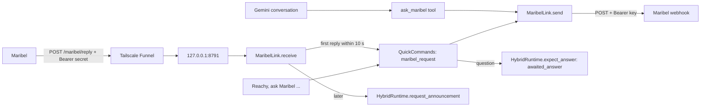

# Feature: Maribel hand-off (Grok Bot)

- Status: `in-progress`
- Last updated: 2026-10-28
- Plan: [Hand voice requests to Maribel](../plans/maribel-handoff.md)

## Overview

Maribel is the household's assistant in the Grok Bot app (a Cursor automation). "Richie, ask Maribel
to…" hands the request to her; Reachy speaks her short reply. Longer work, drafts and approvals she
reports in the Grok Bot app, never through Reachy.

Out of scope: waking on "Maribel" (Reachy's name or an antenna touch still wakes him), reading her
results aloud later, and any request that does not name her.

## User-facing behavior

- **Asking.** A woken request that starts with "ask / tell / message / text / let Maribel…",
  "pregúntale / dile / pídele a Maribel…", "chiedi / di' a Maribel…" or "pergunta / diz / pede à
  Maribel…" (politeness like "can you" allowed) is hers. Reachy says "Asking Maribel" in the request's
  language, sends the whole request word for word, plays a thinking move and waits up to 10 s.
  - Her reply in time: he says her `speak` text.
  - No reply in 10 s: "I've passed that to Maribel. She'll get back to you."
  - Webhook down (non-2xx or network error, retried once after 2 s): "I couldn't reach Maribel right now."
- **In a Gemini conversation**, "ask Maribel…" goes through the `ask_maribel` tool, which Gemini may
  use only when the person names her or answers her question. Gemini says only her `speak` text.
- **Her question.** Right after he says it, the antennas perk and he listens up to 15 s without his name;
  what he hears goes to her as the answer. Silence ends it quietly. For 2 minutes after her question, a
  woken "tell Maribel…" also answers it; after that it starts a new conversation.
- **Late replies.** A reply that comes after the 10 s wait, within 2 minutes of the request, is spoken
  once Reachy is free (no conversation or command in progress); a question then opens the 15 s window.
  Only the latest request's reply is spoken. Anything later is dropped and she follows up in the app.
- **Not configured** (any of the four settings missing): her name is an ordinary request and the tool is
  not offered.

## Current architecture



- The quick command's reply text is the acknowledgement; its `after` step sends, waits and returns her
  `speak`. `QuickReply.after_timeout_s` (23 s) covers two posts, the retry pause and the 10 s wait.
- `MaribelLink` keeps sent requests for 2 minutes and at most one open question. A lock decides whether a
  callback is the first reply (handed to the waiter on its loop with `call_soon_threadsafe`) or late
  (`on_late_reply`, from the server thread).
- `HybridRuntime.expect_answer(handler)` queues an `awaited_answer` turn: a listening activation (in
  `_LISTENING_WAKES`: cue, request clip with a 15 s start, no name check) whose text goes to `handler`
  instead of the quick commands; nothing heard returns to ambient listening and never opens Gemini.
- `HybridRuntime.request_announcement(text, language, answer=None)` queues an `announcement` turn: a
  short activation that speaks the text (waking him from sleep) and then expects the answer if given.
  Queued turns start only while the runtime is `LOCAL_AMBIENT` with no activation running; an awaited
  answer expires after 30 s, an announcement after 2 minutes.

## Canonical files and contracts

| Area | File or interface | Responsibility / contract |
|------|-------------------|---------------------------|
| Protocol | `maribel.py`: `MaribelLink.send`, `first_reply`, `receive`, `has_open_question` | Request body `{version: 1, request_id, conversation_id, in_reply_to, text, sent_at (Europe/Lisbon), callback_url}`; callbacks `{version, request_id, conversation_id, type: answer/accepted/question/error, speak, question_id}` |
| Callback server | `maribel.serve_replies` | `ThreadingHTTPServer` on 127.0.0.1:`MARIBEL_CALLBACK_PORT`; only `POST /maribel/reply`; 401 bad secret, 400 bad body, 404 unknown request, 413 over 16 KB, 200 otherwise |
| Trigger | `quick_commands.maribel_request`, `QuickCommands.answer_maribel` | Language of an explicit request, or None; phrases `MARIBEL_ASKING`, `MARIBEL_PASSED_ON`, `MARIBEL_UNREACHABLE` |
| Runtime | `HybridRuntime.expect_answer`, `request_announcement` | Thread-safe; reasons `awaited_answer` and `announcement` |
| Tool | `tools/ask_maribel.py` | `{request}` → `{status, say, note}`; added with `MARIBEL_TOOLS` when configured |
| Wiring | `main._build_maribel`, `deps.maribel`, `deps.expect_answer` | Late replies → `request_announcement` |
| Test script | `python -m reachy_mini_conversation_app.maribel fake-reply` | Without ids: expects 401, 401, 404. With `--request-id` and `--conversation-id` from a `Maribel request sent` log line: 200 and Reachy speaks `--speak` |

Configuration (`.env`): `MARIBEL_WEBHOOK_URL`, `MARIBEL_WEBHOOK_KEY` (sent as `Authorization: Bearer`,
as her routine panel says), `MARIBEL_CALLBACK_URL` (the public Funnel URL Maribel posts to),
`REACHY_CALLBACK_SECRET` (she sends it as `Authorization: Bearer`), `MARIBEL_CALLBACK_PORT` (default 8791).

Publishing on the Mac mini (once; Funnel must be allowed in the tailnet policy):

```bash
/Applications/Tailscale.app/Contents/MacOS/Tailscale funnel --bg --set-path /maribel/reply http://127.0.0.1:8791/maribel/reply
```

## Extension guide

### Safe to extend

- More trigger phrasings in `_ASK_MARIBEL` (keep the name required and something after it).
- The waits (`FIRST_REPLY_WAIT_S`, `LATE_REPLY_S`, `QUESTION_OPEN_S`, `_ANSWER_START_S`) from logged delays.

### Do not change without updating this document and its tests

- Only explicit requests go to Maribel; her callbacks need the secret and a request id Reachy sent.
- Reachy speaks only `speak`; never the body, links or ids.
- The server binds loopback only; Funnel publishes the one path.
- Logs carry ids, types and delays, never texts or secrets.

## Constraints, privacy, and failure modes

- The request text leaves the house for Maribel's webhook by the household's choice; nothing else does.
- The answer window sends whatever speech it hears in 15 s (TV, someone else) to Maribel.
- Callbacks while the app restarts (about 20 s) fail; she follows up in the app.
- If the callback port is taken, the server logs an error; requests still go out and replies time out.
- A late reply waits while Reachy is in a conversation and is dropped if he stays busy 2 minutes.

## Dependencies

- Depends on: `httpx`, the hybrid runtime's listening path, quick commands and local speech, Tailscale Funnel.
- Used by: the household's spoken requests and the Gemini conversation.

## Testing

### Unit tests

| File | Scenarios |
|------|-----------|
| `tests/test_maribel.py` | Body and Bearer key; one retry then unreachable; first reply reaches the waiter across threads; 401/400/404 and no secrets or texts in logs; late replies only for the latest request, once, within 2 minutes; a question continues the conversation with `in_reply_to` and expires; the loopback server's paths, size cap and auth |
| `tests/test_quick_commands.py` | Trigger phrases in four languages and near misses; acknowledgement then verbatim send, thinking move, her reply; unreachable and passed-on lines; a question registers the answer handler and the answer is sent; not configured |
| `tests/test_hybrid_runtime.py` | `test_a_question_listens_once_for_the_answer_without_the_name`, `test_no_answer_after_a_question_goes_back_to_listening_for_the_name`, `test_an_announcement_waits_for_the_conversation_to_end_then_awaits_the_answer` |
| `tests/tools/test_ask_maribel.py` | Verbatim request, only `speak` returned, question note, passed-on line, errors |

### Live checks

| Command or artifact | Scenarios |
|---------------------|-----------|
| `fake-reply` against the Funnel URL | Pending: strangers turned away from outside the house |
| Spoken request on the robot | Pending: "Richie, ask Maribel…" end to end |

### Test commands

```bash
REACHY_MINI_SKIP_DOTENV=1 .venv/bin/pytest tests/test_maribel.py tests/test_quick_commands.py tests/tools/test_ask_maribel.py -q
REACHY_MINI_SKIP_DOTENV=1 .venv/bin/pytest tests/test_hybrid_runtime.py -q -k "answer or announcement"
```

## Changelog

| Date | Change |
|------|--------|
| 2026-10-28 | Initial implementation. |
