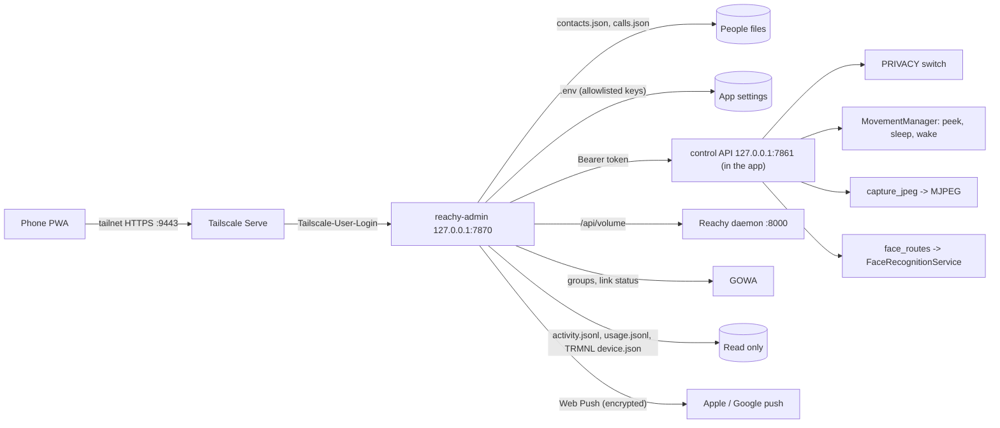

# Phone admin app

- Status: built and tested; live check on the Mac mini pending
- Plan: [Phone admin app](../plans/phone-admin-app.md)

## Overview

Eduardo and Adriana manage Reachy from a web app installed on their phones' home screens. It has five tabs:

| Tab | What it does |
|-----|--------------|
| People | One card per person: the name Reachy uses, other names people say, the WhatsApp group for voice notes and photos (picked from Reachy's own group list), the phone number for calls, and face photos (added from the phone or from Reachy's camera). Warns when two people answer to the same spoken name. |
| Camera | A live view from Reachy's camera (about 5 frames a second, 640 px, never recorded). A pad turns his head; while he sleeps it lifts his head without waking him, and "Lift his head" looks straight ahead. The head lowers again two minutes after the last turn. |
| Status | Reachy running or not, asleep or awake, privacy, WhatsApp linked, call service connected, quiet hours, the e-ink screen's last check-in and battery, free disk, the speaker volume. Wake up, go to sleep, restart. Turn notifications on. |
| Activity | Calls in, out and missed (with minutes), voice notes and photos sent, who changed what in the admin app, AI cost estimates. |
| Settings | Quiet hours, languages, who may start calls, wake sensitivity, face recognition, speaker following, the song on the e-ink screen. Saving restarts Reachy. |

The **privacy switch** sits at the top of every tab. On: the microphone audio is dropped before anything
hears it (wake word, local speech, the cloud conversation, calls, voice notes), the camera is not read (face
recognition, photos, the Gemini video stream, the camera view, the daemon's head tracking), incoming calls
are declined, and an antenna bend does nothing. Reachy goes to sleep and the e-ink screen's resting card
becomes "Privacy on". Only the admin app turns it off; voice cannot (the mic is off). It survives restarts.

**Quiet hours** (`QUIET_HOURS=21:30-07:00`): Reachy does not listen, an antenna bend does nothing, and
incoming calls are declined. The camera stays available to the admin app.

**Notifications** (Web Push to the installed app): Reachy stopped, WhatsApp unlinked, call service
disconnected, a missed call, privacy still on after four hours.

## Who can reach it

Nobody outside the tailnet, and on the tailnet only the logins in `ADMIN_ALLOWED_LOGINS`.

| Layer | Guarantee |
|-------|-----------|
| `reachy-admin` binds `127.0.0.1:7870` | Nothing listens on the home network. |
| `tailscale serve --bg --https=9443 http://127.0.0.1:7870` | Tailnet-only HTTPS with a real certificate (a PWA needs HTTPS). Never port 443: Maribel's Funnel is on 443, and Funnel publishes a whole port. |
| Tailscale access rules | Only Eduardo's and Adriana's users reach the mini on 9443 (set in the admin console). |
| `admin/server.py` `refusal` | Every request, static files included, needs a loopback peer (the Serve proxy) and a `Tailscale-User-Login` in the allowlist. Serve sets that header and strips any the client sent; Funnel traffic has none, so even a Funnel mistake is refused. |
| Same-origin writes | Every POST/PUT needs an `Origin` matching `Host` or `X-Forwarded-Host`, and JSON bodies. |
| App control API | `127.0.0.1:7861`, `Authorization: Bearer` with the token in `APP_CONTROL_TOKEN_FILE` (created by the app, mode 600, read by the admin app on each call). |
| Audit log | `ADMIN_DATA_DIR/audit.jsonl`: who, what and when for every change (no phone numbers). |

The page caches nothing (`Cache-Control: no-store` on the API; the service worker caches nothing), so a
lost phone that leaves the tailnet shows nothing.

## Architecture

- The admin app is its own process so it keeps working while the conversation app is stopped or
  restarting (status, restart, people, settings, activity all work then; camera, faces, privacy and
  sleep/wake need the app).
- People files are edited in place in the formats `whatsapp_contacts.py` and the call service already read;
  both re-read them on each use, so changes need no restart. Entries may carry a `face` field (the face
  store's person id) so a card joins them; otherwise cards join by normalized name.
- Faces stay in the app's face store; the admin app reaches them through the control API, which mounts the
  same `face_routes.register_face_routes` the 7860 settings page uses.

## Key files

| File | Role |
|------|------|
| `admin/server.py` | `AdminSettings.from_env`, `refusal` (the guard), `create_app` (routes, health, the watch), `main` (`reachy-admin`). |
| `admin/people.py` | `PeopleFiles.load/save`, `person_from_json`, `validate`, `shared_spoken_names`. |
| `admin/records.py` | `read_json`/`write_json` with versions (a hash of the file) so two phones never silently overwrite each other; atomic owner-only writes with three backups. |
| `admin/settings.py` | `SETTINGS` (the only `.env` keys the app may change), `read_settings`, `write_settings` (other lines kept byte for byte). |
| `admin/app_link.py` | `AppLink`: the control API client. |
| `admin/notifier.py` | `Notifier` (subscriptions in `push.json`, VAPID key `vapid.pem`), `Watch` (checks every minute). |
| `admin/web_push.py` | RFC 8291 aes128gcm encryption and RFC 8292 VAPID with `cryptography`; checked against the RFC 8291 example. |
| `static/admin/` | `index.html`, `admin.js`, `admin.css`, `manifest.webmanifest`, `sw.js`, icons. Plain JS, no build step. |
| `control_api.py` | `ControlApi` (status, privacy, camera, head, look-up, sleep, wake, faces), `load_or_create_token`, `start_control_server`. |
| `privacy.py` | `PrivacySwitch`, `PRIVACY`, `quiet_now`, `listening_allowed`. |
| `activity_log.py`, `json_lines.py` | `record(kind, who, outcome, seconds)` into `ACTIVITY_LOG_FILE`; `JsonLines` shared with the audit log. |
| `face_routes.py` | Face routes shared by the settings page and the control API. |
| `moves.py` | `MovementManager.peek(yaw, pitch, hold_s)` and `.sleeping`; head tracking refused while private. |

Where privacy is enforced: `console.LocalStream.record_loop` (mic frames, with quiet hours),
`camera_frames.capture_jpeg`/`capture_frame` (every camera read in the app), `MovementManager._set_head_tracking`
(the daemon's own camera use), `main._start_calls` `on_incoming` (declines), `main` `antenna_touched`.
`main.privacy_changed` puts him to sleep and swaps the TRMNL resting card (`EInkDisplay.set_resting_card`).

Activity is recorded in `CallManager` (`place`, `answer`, `decline`, `finished`, missed rings),
`QuickCommands.record_and_send` (voice notes) and `photographer.take_and_share` (photos).

## Control API (app, loopback)

| Route | Body | Result |
|-------|------|--------|
| `GET /status` | | `mode`, `sleeping`, `privacy {on, since}`, `quiet_hours`, `calls_linked`, `faces`, `camera` |
| `POST /privacy` | `{"on": bool}` | status |
| `POST /sleep`, `POST /wake` | | status; wake is 409 while private |
| `POST /head` | `{"direction": "left"\|"right"\|"up"\|"down"\|"center"}` | asleep: a peek step (20° yaw, 15° pitch; ±60°/±30°); awake: the `move_head` tool |
| `POST /look-up` | | asleep: peek straight ahead for 120 s; awake: 409 |
| `GET /camera` | | `multipart/x-mixed-replace` JPEG frames; 409 while private; ends when privacy comes on |
| `/api/faces...` | as the settings page | list, photo, enroll, upload, forget-photo, forget |

## Configuration

| Variable | Default | Meaning |
|----------|---------|---------|
| `ADMIN_ALLOWED_LOGINS` | (none: all refused) | Tailscale logins allowed in, comma separated. |
| `ADMIN_PORT` | 7870 | The admin app's loopback port. |
| `ADMIN_DATA_DIR` | `~/.local/share/reachy-admin` | Audit log, push subscriptions, VAPID key. |
| `ADMIN_ENV_FILE` | the app's `.env` | The file Settings edits. |
| `ADMIN_APP_SERVICE` | (none: no restart) | The app's LaunchAgent label. Restart sends the app SIGINT, waits up to 2 minutes for it and any `start-reachy` launcher to exit (the launcher may stop the daemon on its way out), then runs `launchctl kickstart -k`; nothing is started if something is still running. No "Reachy stopped" notification for 5 minutes after. |
| `REACHY_DAEMON_URL` | `http://127.0.0.1:8000` | For the volume. |
| `APP_CONTROL_PORT` | 7861 | The app's control API. |
| `APP_CONTROL_TOKEN_FILE` | `~/.local/share/reachy/control-token` | Shared token. |
| `PRIVACY_STATE_FILE` | `~/.local/share/reachy/privacy.json` | Saved privacy state. |
| `ACTIVITY_LOG_FILE` | `~/.local/share/reachy/activity.jsonl` | Calls, voice notes, photos. |
| `QUIET_HOURS` | (none) | `HH:MM-HH:MM`, may cross midnight. |

## Setting it up on the Mac mini

1. In `.env`: `ADMIN_ALLOWED_LOGINS=eduardo@…,adriana@…` (the logins shown in the Tailscale admin
   console) and `ADMIN_APP_SERVICE=<the app's LaunchAgent label>`.
2. A LaunchAgent for `reachy-admin` (like `com.eduardo.reachy-calls`): program `.venv/bin/reachy-admin`,
   working directory the checkout (so it finds `.env`), `RunAtLoad` and `KeepAlive` true, log
   `~/Library/Logs/Reachy/admin.log`.
3. Publish it to the tailnet (in a Terminal window on the mini, as for Funnel):
   `/Applications/Tailscale.app/Contents/MacOS/Tailscale serve --bg --https=9443 http://127.0.0.1:7870`.
   Check `tailscale serve status` shows 9443 and `tailscale funnel status` shows only `/maribel/reply`.
4. In the Tailscale admin console: invite Adriana as a user, and add an access rule that lets only the two
   users reach the mini on 9443.
5. On each phone: Tailscale signed in (iPhone: VPN On Demand for `*.ts.net`), open
   `https://<mini>.<tailnet>.ts.net:9443` in Safari, Share → Add to Home Screen, open it from the home
   screen, Status → Turn on notifications.

## Constraints and gotchas

- A call already in progress when privacy comes on keeps playing the other side but sends silence; the
  ringing of a new one is declined.
- `REALTIME_TRANSCRIPTION_LANGUAGE` and the other settings apply on restart; Settings restarts Reachy after
  saving when `ADMIN_APP_SERVICE` is set.
- The camera view shares the SDK's JPEG encoder lock with the Gemini video stream and face recognition; at
  5 frames a second each frame waits for at most one other capture.
- iOS shows notifications only for the installed app (iOS 16.4+), after the permission prompt from a tap.
- The peek pose is neutral height with the antennas folded; how it looks on the robot is unverified.

## Tests

| File | Covers |
|------|--------|
| `tests/test_privacy.py` | Switch persistence and permissions, listeners, quiet hours across midnight, `listening_allowed`. |
| `tests/test_json_lines.py` | Append/read, trimming, failures logged, activity entries. |
| `tests/test_control_api.py` | Token and loopback, status, privacy and the refused camera, MJPEG frames and stop on privacy, peeking steps and limits, awake head turns, sleep/wake, faces, token file. |
| `tests/test_console.py` | `record_loop` drops mic audio when listening is not allowed. |
| `tests/test_moves.py` | Peek while asleep, expiry, replace, wake, go to sleep; tracking refused while private. |
| `tests/test_eink_display.py` | Resting card swap, battery voltage. |
| `tests/test_whatsapp_calls.py`, `tests/test_quick_commands.py`, `tests/tools/test_take_photo.py` | Activity entries for calls (with seconds, missed, declined), voice notes, photos; incoming calls declined during privacy and quiet hours; `CallManager.linked`. |
| `tests/admin/` | Records, people (round trip through the app's own loaders), settings, Web Push (RFC 8291 vector, VAPID signature), notifier and watch, app link, the server's guard and every route. |

Commands run and results are recorded in the plan's progress log.
