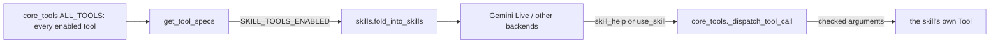

# Feature: Skill tools (progressive tool disclosure)

- Status: `in-progress` (on by default as a test; `SKILL_TOOLS_ENABLED=0` switches back)
- Last updated: 2026-10-27
- Plan: [skill-tools.md](../plans/skill-tools.md)

## Overview

Realtime models reread every tool declaration on every turn. Gemini Live has no context
caching, so Reachy's 26 tool declarations (about 5.3k tokens) were billed in full on each of a
day's ~140 turns. With skill tools, rarely used tools are offered as one menu line each inside a
`use_skill` tool; the model fetches a skill's full instructions with `skill_help` only when it needs
them. Frequently used, latency-sensitive and system tools stay ordinary declarations.

Out of scope: trimming the profile instructions, choosing tools per session, and changing tools
mid-session (Gemini Live cannot change its configuration while connected).

## User-facing behavior

- Nothing changes for always-on tools: camera, emotions, dances, head moves, sleep, end
  conversation, turn off, weather, time, the e-ink display, Spotify, and background task status/cancel.
- Skills: `home_lights`, `tv`, `remember`, `forget`, `update_memory`,
  `remember_face`, `forget_face`, `who_is_here`, `head_tracking`, `sweep_look` (only those enabled).
  The first use of a skill in a conversation usually adds one `skill_help` round trip, about 1–2 s
  and one extra model generation. Lights, TV and music are mostly handled by local quick commands
  before Gemini is involved.
- A `use_skill` call with missing, unknown or out-of-range arguments is not run; it returns the
  error together with the skill's instructions and arguments, so the model can retry at once.
- `SKILL_TOOLS_ENABLED=0` offers the full tool list again, exactly as before.

## Current architecture



- The registry is unchanged; only what is offered to the model changes. `get_tool_specs()` folds
  skill specs into `use_skill` (menu + `skill` enum of enabled skills + free-form `arguments`) and
  `skill_help`. Dispatch resolves `use_skill` to the real tool after a top-level check of required,
  unknown and enum arguments, then runs it exactly as a direct call (same errors, same logging, a
  "Using skill: <name>" log line).
- Idle behaviour runs tools locally, so it lists every registered tool (`get_tools()`), not the
  folded specs.
- Applies to every backend that uses `get_tool_specs()` (Gemini Live, OpenAI Live, Hugging Face
  realtime); the cost problem is Gemini Live's.

## Canonical files and contracts

| Area | File or interface | Responsibility / contract |
|------|-------------------|---------------------------|
| Skill layer | `tools/skills.py` | `SKILL_SUMMARIES` (skill name → one menu line), `fold_into_skills(specs)`, `skill_help(tools, args)`, `check_arguments(tools, args)` |
| Offer and dispatch | `tools/core_tools.py` | `get_tool_specs()` folds when enabled; `_dispatch_tool_call` handles `skill_help` / `use_skill` |
| Config | `config.py` | `SKILL_TOOLS_ENABLED` (default `1`) |
| Tool results | `skill_help` | `{"skill", "instructions" (the tool's description), "arguments" (its JSON schema)}`; unknown → `{"error", "skills"}` |

## Extension guide

### Safe to extend

- Move a tool into or out of the skills by adding or removing its `SKILL_SUMMARIES` line. Good
  candidates are long, rarely used and not time-critical.

### Do not change without updating this document and its tests

- Camera, end_conversation, go_to_sleep, turn_off and task_status/task_cancel stay direct: the
  handlers treat the camera result specially, the session tools must work at once, and the
  background manager injects itself into the task tools by name.
- `use_skill` must never run a tool that is not an enabled skill.
- `spotify_control` stays direct: playing music takes a search and then a play with its result. As a
  skill, Gemini re-read `skill_help` after the search and closed the conversation without playing
  (2026-10-27). Keep any tool that needs several calls in a row out of the skills.

## Constraints, privacy, and failure modes

- Argument checks are top-level only (required, unknown, enum); deeper schema errors surface from
  the tool itself, as with direct calls.
- A skill's instructions stay in the conversation until compression drops them, so repeated use in
  one session needs no new help call.
- No new data leaves the machine; the same tool descriptions are sent, later and less often.
- A rejected `use_skill` logs `use_skill rejected: skill=... missing=[...] unknown=[...] invalid=[...]`
  with argument names only (an unknown skill logs no name): values can carry the person's words.
  Before 2026-10-28 a rejected call left no trace.

## Testing

| Test file | Covers |
|-----------|--------|
| `tests/tools/test_skills.py` | Skills become menu lines and leave the declarations; switching off restores every declaration; no skills, no extra tools; `skill_help` returns the tool's description and schema; `use_skill` runs the tool with its arguments; missing / bad enum / unknown / non-object arguments return the instructions and log argument names but no values; direct tools, disabled skills and missing names are refused |
| `tests/test_external_loading.py` | Registry reload tests pin `SKILL_TOOLS_ENABLED=0`, since they check the full list |

Commands run on 2026-10-25 (macOS, Python 3.12):

```bash
.venv/bin/pytest tests/tools/test_skills.py -q
ruff check . && ruff format --check . && mypy --pretty && pytest tests/ -q
```

Live check 2026-10-25 against `gemini-3.8-live` (tool calls answered by a stub, nothing executed):
the fixed block (instructions + tools, first-turn prompt) measured 9,934 tokens with skills off
and 7,830 with skills on (10,444 before the dance description was shortened). Kitchen lights, open
YouTube on the TV and "remember Enzo's swimming class moved to Thursdays" each went
`skill_help` → `use_skill` with valid arguments; weather went straight to `get_weather`.

## Changelog

- 2026-10-25: Added as a switchable test (`SKILL_TOOLS_ENABLED`, default on).
- 2026-10-27: `spotify_control` is a direct tool again; as a skill, "play Spotify" stalled after the search.
- 2026-10-28: Rejected `use_skill` calls are logged by argument name.
