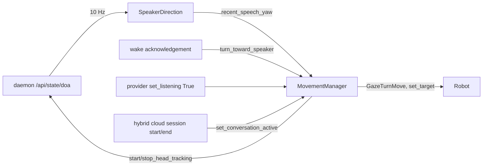

# Feature: Speaker following

- Status: `in-progress`
- Last updated: 2026-10-29
- Plan: none; requested directly (Reachy "stares at the abyss" instead of the person talking).

## Overview

Reachy turns to face whoever is talking and follows their face during a
conversation. The ReSpeaker microphone array reports which direction speech
comes from (DoA); the app turns head and body toward it on wake and whenever the
user starts speaking, then the daemon's face tracker holds the face. When the
conversation ends, tracking stops and Reachy eases back to facing forward.

Out of scope: recognizing who is speaking, telling front from back (the array
reports a half-plane, so speech from behind maps to the front), and moving
toward a speaker outside the camera's view once a face is lost.

## User-facing behavior

- **Wake / user speech:** if recent speech came from more than 25° away from
  where the head faces, Reachy turns head and body together toward it in
  0.5–1.4 s. Speech close to the current gaze does not move it, so small
  DoA noise is ignored. A turn needs at least three speech readings in the
  last 1.5 s with 60% of them within 25° of their median; scattered readings
  (a talking room, a TV) turn nothing. Readings taken while Reachy's own
  speech plays, and for 0.5 s after, are dropped.
- **Photos:** while a photo is framed (`frame_faces`), turns wait (at most
  30 s) so a voice from the side cannot turn him away from the face.
- **During a conversation:** face tracking is on. A turn pauses tracking so the
  head can leave the previous face, then resumes it so the tracker locks onto
  whoever is now in view. Idle breathing, emotions, and dances play toward the
  speaker instead of snapping back to forward. While Reachy speaks, tracking
  pauses and head and body hold where the face was (breathing keeps its bob).
- **Conversation end:** tracking that the conversation turned on is turned off
  and Reachy eases back to forward. Tracking the user asked for ("look at me",
  the `head_tracking` tool) outlives the conversation.
- **Explicit head moves** (`move_head`, `sweep_look`) aim in absolute terms and
  reset the gaze to forward.
- **Without the hybrid runtime** the conversation is always open: tracking
  starts with the app and turns follow each user utterance.
- **Disabled** (`SPEAKER_FOLLOWING_ENABLED=0`): no DoA polling, no turns, and
  tracking only when the user asks for it, as before.
- **No DoA** (daemon unreachable, no ReSpeaker, simulator): no turns; a single
  warning is logged and polling backs off to every 2 s until it recovers.

## Current architecture



`SpeakerDirection` polls the daemon's cached DoA reading (the daemon owns the
ReSpeaker USB handle; the app never opens it) and keeps 3 s of readings flagged
as speech. `recent_speech_yaw()` returns the median of the last 1.5 s, needing
at least two readings.

`MovementManager` owns the gaze: `_gaze_yaw` is the world yaw the robot faces
when idle. A turn is a `GazeTurnMove` queued like any other primary move; it
captures the measured pose when it starts (so it never jumps, even from a
tracked face) and eases head and body to the neutral pose rotated by the target
yaw. `automatic_body_yaw` (SDK default) keeps the head within 65° of the body.
`BreathingMove` breathes around `base_yaw`; emotions and dances are rotated by
the gaze in `_get_primary_pose` before the speaking anchor is applied.

## Canonical files and contracts

| Area | File or interface | Responsibility / contract |
|------|-------------------|---------------------------|
| DoA sampling | `src/reachy_mini_conversation_app/speaker_direction.py` | `SpeakerDirection(daemon_url, head_yaw=...).start()/stop()/recent_speech_yaw()`; DoA 0 = left, π/2 = front, π = right → yaw `π/2 − angle` relative to the head (the mic array is in the head, next to the camera), clamped to ±90°, then added to the head's room yaw at the moment of the reading and clamped to ±150°. |
| Turning and gaze | `src/reachy_mini_conversation_app/moves.py` | `MovementManager(robot, speaker_direction=...)`, `turn_toward_speaker()`, `set_conversation_active(bool)`, `GazeTurnMove`, `BreathingMove(base_yaw=...)`. All state changes run on the worker thread. |
| Own voice | `SpeakerDirection.own_voice_until`, `LocalStream.playback_until()` | When the speech handed to the speaker ends (monotonic, both output paths; a barge-in flush ends it now); set in `main.py` once the stream exists. |
| Wiring | `src/reachy_mini_conversation_app/main.py` | Builds `SpeakerDirection` from the robot client's host/port; wake acknowledgement also turns; `on_cloud_session` calls `set_conversation_active`. |
| Config | `SPEAKER_FOLLOWING_ENABLED` | Default `1`. |

## Extension guide

### Safe to extend

- Tune `SPEAKER_TURN_MIN_RAD` and the turn durations in `moves.py`, or the
  window and sample count in `speaker_direction.py`.
- Trigger `turn_toward_speaker()` from another event (e.g. a local intent).

### Do not change without updating this document and its tests

- A turn must start from the measured pose and pause tracking until it ends or
  is cleared; otherwise the head jumps or tracking stays paused.
- Only tracking enabled by `set_conversation_active(True)` is turned off at the
  conversation end.
- Moves that capture an absolute start pose (`GotoQueueMove`) reset the gaze;
  forward-recorded moves (breathing, emotions, dances) are rotated by it.

## Constraints, privacy, and failure modes

- DoA is a direction only; no audio leaves the daemon for this feature.
- The daemon's face tracker recenters to forward after 2 s without a face; the
  next user utterance turns Reachy back toward the speaker.
- The DoA angle convention comes from the SDK docs. Hardware evidence
  (2026-10-29): someone on Reachy's right woke him and he turned to −51°
  (right), and the face tracker then recognized him at −64° to −71°; so
  left/right is right. A deliberate front / left / right test is still to do.
- Readings are noisy (2026-10-29, a talking room: −89° to +13° within
  seconds) and the array's own voice rejection is good but not total (7 of 65
  readings flagged as speech while it played a sentence).

## Dependencies

- Depends on: daemon `/api/state/doa`, daemon face tracking (`vision` extra),
  `automatic_body_yaw`.
- Used by: hybrid runtime conversations and the always-open conversation mode.

## Testing

### Unit tests

| File | Scenarios |
|------|-----------|
| `tests/test_speaker_direction.py` | Angle→yaw mapping and clamping; median of recent speech only; expiry; three-sample minimum; scattered readings are no direction (regression); most readings agreeing is one; Reachy's own voice and its echo dropped; outage logged once and recovered. |
| `tests/test_console.py` | `test_playback_until_follows_the_speech_handed_to_the_speaker` |
| `tests/test_moves.py` | Turns wait while a photo is framed; turn only for speech clearly elsewhere; no source is a no-op; newer pending turn replaces older; turn eases from the measured pose; tracking paused during and resumed after a turn, also when cleared; breathing and emotions face the gaze; explicit head moves reset it; conversation start/end toggles tracking and faces forward; user-enabled tracking survives; disabling tracking eases back; speaking while breathing holds the tracked face (regression for snapping forward). |

### Test commands

```bash
.venv/bin/python -m pytest tests/test_speaker_direction.py tests/test_moves.py -q
```

## Changelog

| Date | Change |
|------|--------|
| 2026-10-16 | Initial implementation. |
| 2026-10-16 | Speaking holds the tracked face and body even while idle breathing runs. |
| 2026-10-29 | A turn needs three readings that mostly agree; Reachy's own voice is ignored; turns wait while a photo is framed. Regression: two stray readings turned him to −150°, away from the person in front of him, during a conversation. |
| 2026-10-16 | DoA readings are head-relative; convert to room yaw with the head's yaw (Reachy used to turn back to the front after turning to the speaker). |
