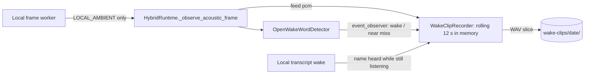

# Feature: Wake clip capture

- Status: `in-progress` (running on the Mac mini; `name_heard` not yet seen live)
- Last updated: 2026-10-27
- Plan: [wake-clip-capture.md](../plans/wake-clip-capture.md)

## Overview

To retrain the "Reachy" wake model on real living-room sound (music from the Echo, TV, kids, the
robot's own motors), Reachy can save short clips of what his wake model hears. It is off by default
and meant to run for a few days at a time. This is the one place the app keeps ambient audio on
disk, so it is opt-in, local, short-lived and transcript-free.

## User-visible behavior

With `WAKE_CLIPS_ENABLED=1` (and the acoustic wake on), while Reachy listens locally for his name:

| Kind | When | Length |
|------|------|--------|
| `wake` | The wake model fires | last 4 s |
| `near_miss` | A score event rises above 0.2 but stays under the threshold, saved when it falls back | last 4 s |
| `name_heard` | Local STT hears the name and wakes Reachy while the wake model stayed quiet | the utterance + 3 s for the STT delay, at most 10 s |
| `background` | At random, on average every 10 minutes | last 4 s |

- Nothing is buffered or saved during a cloud conversation, and the buffer is cleared when local
  listening starts again afterwards.
- Files: `~/.local/share/reachy_mini_conversation_app/wake-clips/<YYYY-MM-DD>/<HHMMSSmmm>-<kind>[-<score>].wav`,
  16-bit mono at the microphone's rate, folders `0700`, files `0600`. Day folders older than
  `WAKE_CLIPS_KEEP_DAYS` (default 14) are deleted when a clip is saved.
- Logs carry only `Wake clip saved kind=… score=… seconds=…`; no transcript or audio content.
- A `wake` clip that local STT did not confirm (for example "Thank you" scoring 0.99) is still saved;
  it is labelled as a false wake later, offline.

## Architecture and data flow



## Contracts and configuration

| Area | File | Contract |
|------|------|----------|
| Recorder | `wake_clips.py` | `WakeClipRecorder(directory, keep_days, clock, rng)`: `feed(pcm, rate)`, `clear()`, `save_wake_event(score, detected)`, `save_name_heard(speech_seconds)`; `wake_clips_directory()` |
| Detector | `acoustic_wake_word.py` | `OpenWakeWordDetector(..., event_observer)` gets `(score, True)` at each detection and `(peak, False)` at the end of each near miss |
| Runtime | `hybrid_runtime.py` | `HybridRuntime(..., wake_clips=)` feeds the recorder the wake model's PCM, clears it on a new listening epoch, saves `name_heard` from `observe_local_transcript` when the acoustic detector is on |
| Wiring | `main.py` | Builds the recorder only when both `LOCAL_ACOUSTIC_WAKE_ENABLED` and `WAKE_CLIPS_ENABLED` are on; warns when clips are on without the acoustic wake |
| Config | `config.py` | `WAKE_CLIPS_ENABLED` (0), `WAKE_CLIPS_KEEP_DAYS` (14, 1–365) |

## Extension guide

- Safe: the clip lengths, the background interval and the kinds are constants in `wake_clips.py`.
- Do not feed the recorder outside `LOCAL_AMBIENT`, save transcripts, or send clips anywhere
  without a new household decision and updated privacy tests.
- Labelling and training are offline steps on the saved clips; they are not part of the app.

## Constraints and gotchas

- `name_heard` clips are cut from the end of the buffer, so they may include a little sound after
  the utterance; crop when labelling.
- Background saves and `name_heard` saves write a small file on the event loop (about 128 KB per
  4 s at 16 kHz), a few times an hour.
- Clips are not deduplicated: a near miss right after a background sample can overlap it.

## Testing

| Test file | Covers |
|-----------|--------|
| `tests/test_wake_clips.py` | 4 s slice, name and `0600` mode; wake and name-heard lengths (10 s cap); background timing; clearing and sample-rate changes drop earlier audio; pruning old day folders |
| `tests/test_acoustic_wake_word.py` | The event observer gets near misses at their end and detections at once |
| `tests/test_hybrid_runtime.py` | Clips hold only audio heard while listening locally (none from the conversation); a name only local STT heard is saved |

Commands run on 2026-10-27 (macOS, Python 3.12):

```bash
.venv/bin/pytest tests/test_wake_clips.py tests/test_acoustic_wake_word.py tests/test_hybrid_runtime.py -q
ruff check . && ruff format --check . && mypy --pretty --show-error-codes && pytest tests/ -q
```

Result: 1,948 passed, 4 skipped.

On the robot (Mac mini, 2026-10-27): `background`, `near_miss` and `wake` clips were saved as 4 s,
16 kHz mono `0600` files during normal use; nothing was saved during the two conversations. A
`name_heard` clip has not happened live yet.
