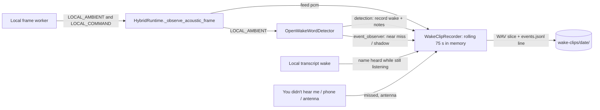

# Feature: Wake clip capture

- Status: `in-progress` (running on the Mac mini since 2026-10-27; event records added 2026-10-31)
- Last updated: 2026-10-31
- Plan: [wake-clip-capture.md](../plans/wake-clip-capture.md); learning from the clips: [wake-learning.md](wake-learning.md)

## Overview

To retrain the "Reachy" wake model on real living-room sound (music from the Echo, TV, kids, the
robot's own motors), Reachy can save short clips of what his wake model hears. It is off by default
and has run since 2026-10-27 with the household's consent (Eduardo decides for the household). This is
the one place the app keeps ambient audio on disk, so it is opt-in, local, short-lived and transcript-free.
Since 2026-10-31 every clip also has a line in the day's event record, so what came of each wake can be
joined to its clip, and [wake learning](wake-learning.md) labels and learns from them.

## User-visible behavior

With `WAKE_CLIPS_ENABLED=1` (and the acoustic wake on), the last 75 s of what the wake model hears are kept in
memory while Reachy listens locally: for his name, and for the request after it. Each event below adds a line to
the day's `events.jsonl` and saves a clip:

| Kind | When | Clip |
|------|------|------|
| `wake` | The wake model fires | 10 s before and 1.5 s after (so a call he only heard the second time is in it) |
| `shadow` | A shadow head (wake learning) would have fired; it never wakes him | 4 s before and 1.5 s after |
| `near_miss` | A score event rises above 0.2 but stays under the threshold, saved when it falls back | last 4 s, at most one clip per 30 s (every near miss is still logged) |
| `name_heard` | Local STT hears the name while the wake model stayed quiet | the utterance + 3 s for the STT delay, at most 10 s |
| `antenna` | Someone bends an antenna to wake him | the 15 s before |
| `missed` | "You didn't hear me" / "No me escuchaste" after a wake, or "He missed me" in the phone app | the minute before the wake (voice) or before now (phone) |
| `background` | At random, on average every 10 minutes, while waiting for the name | last 4 s |

- **Event record.** `wake-clips/<YYYY-MM-DD>/events.jsonl` has one line per event:
  - its fields: `id`, `t` (Unix time), `kind`, `clip`, `event_at` (seconds into the clip), the scores and
    head;
  - for a fire, also whether he was asleep and whether the TV was on.

  What came of an event is added later under the same `id`:
  - the name check (`heard`, `trusted`), the outcome (`rejected`, `woke`, `ignored` with why);
  - the request's length (`request_chars`, 0 when nothing was said), and who marked a missed call.

  Never any words.
- **Conversations.** Nothing is buffered or saved during a cloud conversation. A clip still waiting for its
  last 1.5 s is written short when one starts, and the buffer starts over when local listening resumes after
  it.
- **Files.** `~/.local/share/reachy_mini_conversation_app/wake-clips/<YYYY-MM-DD>/<HHMMSSmmm>-<kind>.wav`.
  - They are 16-bit mono at the microphone's rate; folders are `0700` and files `0600`.
  - Day folders older than `WAKE_CLIPS_KEEP_DAYS` (default 14) are deleted when a clip is saved. Clips the
    household labels are meant to be kept longer, by wake learning.
- **Logs** carry only `Wake clip saved <id> seconds=…`; no transcript or audio content.

## Architecture and data flow



## Contracts and configuration

| Area | File | Contract |
|------|------|----------|
| Recorder | `wake_clips.py` | `WakeClipRecorder(directory, keep_days, clock, rng)`: `feed(pcm, rate, ambient=)`, `record(kind, seconds_before=, ended_ago_s=, **details) -> id`, `note(id, **details)`, `save_score_event(event)`, `save_name_heard(speech_seconds)`, `flush()`, `clear()`, `begin_capture()`/`captured()`/`end_capture()`; `wake_clips_directory()`, `EVENTS_FILE` |
| Detector | `acoustic_wake_word.py` | `OpenWakeWordDetector(..., event_observer)` gets a `WakeScoreEvent` (kind, score, head, every head's raw score) at the end of each near miss and at each shadow fire; a detection carries `head` and `head_scores` |
| Runtime | `hybrid_runtime.py` | `HybridRuntime(..., wake_clips=)` feeds the recorder in `LOCAL_AMBIENT` and `LOCAL_COMMAND` (clearing it after a gap of over 1 s), records each wake and notes its check and outcome, records `name_heard`, `antenna` and `missed` (`mark_missed`), and flushes waiting clips when a conversation starts |
| Wiring | `main.py` | Builds the recorder only when both `LOCAL_ACOUSTIC_WAKE_ENABLED` and `WAKE_CLIPS_ENABLED` are on; warns when clips are on without the acoustic wake |
| Config | `config.py` | `WAKE_CLIPS_ENABLED` (0), `WAKE_CLIPS_KEEP_DAYS` (14, 1–365) |

## Extension guide

- Safe: the clip lengths, the background interval and the kinds are constants in `wake_clips.py`.
- Do not feed the recorder during a cloud conversation, save transcripts, or send clips anywhere
  without a new household decision and updated privacy tests. Detail fields are scores, flags and counts.
- Labelling and training happen in the nightly job ([wake-learning.md](wake-learning.md)), not in the app.

## Constraints and gotchas

- `name_heard` clips are cut from the end of the buffer, so they may include a little sound after
  the utterance; the nightly job locates the name inside.
- Clips around a fire include the start of the request (the 1.5 s after it), which is part of the household's
  consent for wake learning.
- Background saves and `name_heard` saves write a small file on the event loop (about 128 KB per
  4 s at 16 kHz), a few times an hour.
- Clips are not deduplicated: a near miss right after a background sample can overlap it.

## Testing

| Test file | Covers |
|-----------|--------|
| `tests/test_wake_clips.py` | Near-miss slice, `0600` files and its event line; a wake's 10 s + 1.5 s written once the audio arrives; clearing writes a waiting clip short; name-heard lengths; a missed call's minute; near-miss clip rate limit; notes join by id; background only while waiting for the name; sample-rate change; capture; pruning |
| `tests/test_acoustic_wake_word.py` | Near misses and shadow fires reach the observer with every head's scores; detections carry the head |
| `tests/test_hybrid_runtime.py` | Clips hold only audio heard locally (none from the conversation); a name only local STT heard is saved; a rejected fire's record holds the check and outcome; a confirmed one its check; missed marks |
| `tests/wake_learning/test_wake_store.py` | Events come back with their notes merged |

Commands run on 2026-10-27 (macOS, Python 3.12):

```bash
.venv/bin/pytest tests/test_wake_clips.py tests/test_acoustic_wake_word.py tests/test_hybrid_runtime.py -q
ruff check . && ruff format --check . && mypy --pretty --show-error-codes && pytest tests/ -q
```

Result: 1,948 passed, 4 skipped. Later runs are recorded in [wake-learning.md](wake-learning.md).

On the robot (Mac mini, 2026-10-27): `background`, `near_miss` and `wake` clips were saved as 4 s,
16 kHz mono `0600` files during normal use; nothing was saved during the two conversations. A
`name_heard` clip has not happened live yet.
