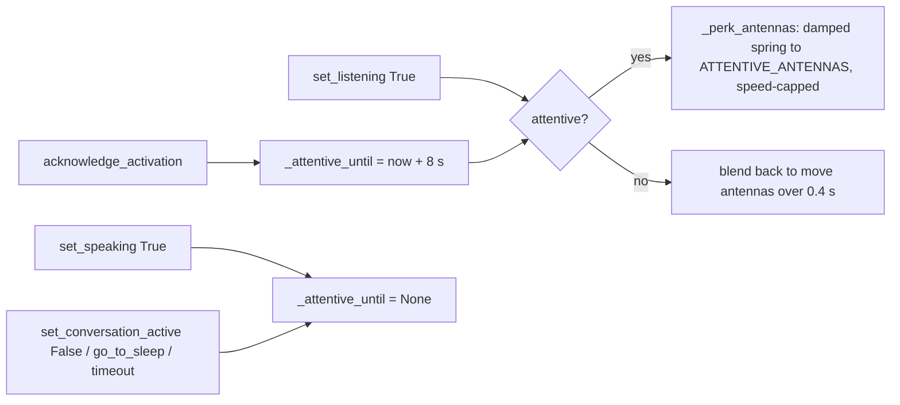

# Feature: Wake cue (antennas)

- Status: `in-progress`
- Last updated: 2026-10-25
- Plan: [Wake antenna cue](../plans/wake-antenna-cue.md)

## Overview

A visible "I heard you" signal, like the light on a smart speaker. On a wake the
antennas spring out to an alert V and hold it while Reachy listens; they ease
back once he starts answering. The head does a short chin-up lift at the same
time.

Before this, the only physical acknowledgment was a 0.18 s, 4° nod, and listening
froze the antennas wherever they happened to be, so a wake was easy to miss.

Out of scope: sound cues (an earcon), lights, and any change to when a wake is
accepted. Since 2026-10-28 every acoustic wake shows nothing until Whisper hears the name in the wake
audio (about 0.4 s, up to about 2 s); asleep, the name must come first (see
[hybrid runtime](hybrid-runtime.md)).

## User-facing behavior

- **Wake:** the antennas flick from wherever they are to ±35° (the spread of
  Pollen's `attentive` emotion), overshoot to about ±40° and settle in about
  0.35 s. The head lifts 8° and returns over 0.35 s.
- **Listening and thinking:** the antennas stay still in the alert pose while the
  user talks and while Reachy works out an answer.
- **Answering:** the first `set_speaking(True)` releases the pose; the antennas
  blend back to the current move's antennas over 0.4 s.
- **Follow-up turns:** in an open conversation, the user starting to talk
  (`set_listening(True)`) perks the antennas again, so each turn shows whose turn
  it is.
- **No answer:** the pose relaxes 8 s after the wake or the user's last words,
  when the conversation closes, or when Reachy goes to sleep.
- **Waking from sleep:** the perk swings the antennas up from the folded sleep
  pose at no more than 6 rad/s. The 1.5 s rise to the neutral pose is the
  acknowledgement; there is no head lift after it. The lift started from the sleep
  pose captured at the wake, so it pulled the head back down after the rise and
  then up again (2026-10-28).

## Current architecture and target changes

The cue lives entirely in `MovementManager`'s antenna layer, the step that used
to apply the listening freeze. It does not queue a move, so it shows on the
first tick, even while a wake, gaze turn or other move is still running.



Attentive means `_is_listening` or a live `_attentive_until` deadline. The
listening-end edge re-arms the deadline so the pose holds through the pause
before the answer. The perk starts from the last commanded antennas, follows
`1 - exp(-t/0.1) cos(2π·3t)` toward the alert pose, and each tick's change is
clipped to `PERK_MAX_SPEED_RAD_S × dt`. While attentive, `_listening_antennas`
tracks the perk output so the release blend starts from where the antennas
actually are.

## Canonical files and contracts

| Area | File or interface | Responsibility / contract |
|------|-------------------|---------------------------|
| Constants | `moves.py`: `ATTENTIVE_ANTENNAS`, `ATTENTIVE_HOLD_S`, `PERK_DECAY_S`, `PERK_FREQUENCY_HZ`, `PERK_MAX_SPEED_RAD_S` | Alert pose (radians, `[left, right]`), hold timeout, spring shape and speed cap |
| Head lift | `ActivationAcknowledgementMove` | 0.35 s relative lift of −8° pitch (negative looks up); antennas and body untouched; returns to the captured pose |
| Antenna layer | `MovementManager._calculate_blended_antennas`, `_perk_antennas` | Worker-thread only; the one place antenna commands are finalized |
| Triggers | `acknowledge_activation`, `set_listening`, `set_speaking`, `set_conversation_active`, `go_to_sleep` | Existing thread-safe command-queue APIs; no new public API |

`set_speaking(True)` releases the hold even when head tracking is off; the
tracking handoff that follows is unchanged.

## Extension guide

### Safe to extend

- Tune the pose, hold time or spring by editing the constants. Keep the pose
  within the range Pollen's recorded emotions use (outward spread up to about
  ±45°; `attentive1` sits around −30°/+40°).

### Do not change without updating this document and its tests

- The cue must not be a queued move: it would wait behind wake and gaze moves.
- Speaking releases the hold; sleep and conversation close clear it.
- The speed cap must stay below the fastest recorded emotion antenna speed
  (about 8 rad/s, `surprised1`).

### Common extension path

1. Add a new trigger by setting or clearing `_attentive_until` in the worker's
   command handler.
2. Drive it with `_AntennaClock` in `tests/test_moves.py`.
3. Check it on the robot.

## Constraints, privacy, and failure modes

- Antenna direction comes from the SDK constants: neutral is ±10°
  (`INIT_ANTENNAS_JOINT_POSITIONS`), sleep is ±175° folded
  (`SLEEP_ANTENNAS_JOINT_POSITIONS`). The alert pose spreads in the same
  direction as neutral, like the recorded `attentive` emotions.
- While attentive, the alert pose overrides antennas from any move, including an
  emotion played before Reachy speaks.
- Follow-up perks need the provider to report user speech with
  `set_listening(True)`. Gemini Live and the Hugging Face realtime provider do;
  GPT Live does not, so with it only the wake perks.
- A `set_listening(False)` at conversation close, while the user was mid-speech,
  re-arms the hold; it then relaxes after 8 s at most.
- No audio, images or PII are involved.

## Dependencies

- Depends on: `MovementManager` worker loop, provider `set_listening`/`set_speaking` calls, hybrid runtime `acknowledge_activation`.
- Used by: every wake path that acknowledges (acoustic, transcript, keyboard).

## Testing

### Unit tests

| File | Scenarios |
|------|-----------|
| `tests/test_moves.py::test_wake_springs_the_antennas_to_the_alert_pose_and_holds_it` | Overshoot past the alert pose, settle, hold through listening and the pause before an answer |
| `tests/test_moves.py::test_answering_releases_the_alert_antennas_smoothly` | Speaking releases; no snap; back to move antennas in 0.5 s |
| `tests/test_moves.py::test_alert_antennas_release_without_an_answer` | Timeout, conversation close and sleep each release |
| `tests/test_moves.py::test_following_turns_perk_again_when_the_user_speaks` | Listening alone perks |
| `tests/test_moves.py::test_perk_out_of_the_sleep_pose_is_speed_capped` | Per-tick change ≤ 6 rad/s from the folded sleep pose |
| `tests/test_moves.py::test_activation_acknowledgement_is_worker_owned_relative_and_returns_to_start` | Head lift is relative, leaves antennas and body yaw, returns exactly |

### Simulator / end-to-end tests

| Command or artifact | Scenarios |
|---------------------|-----------|
| Pending: on the robot | Say "Reachy": antennas flick out and hold; they drop when he answers; check the motion is clearly visible from across the room and not noisy in the mic |

### Test commands

```bash
REACHY_MINI_SKIP_DOTENV=1 .venv/bin/pytest tests/test_moves.py -q
REACHY_MINI_SKIP_DOTENV=1 .venv/bin/pytest tests/ -q
.venv/bin/ruff check . && .venv/bin/ruff format --check . && .venv/bin/mypy --pretty --show-error-codes
```

2026-10-25: `tests/test_moves.py` 29 passed; full suite 1,939 passed, 4 opt-in
skips, 2 expected warnings; ruff, ruff format and mypy clean.

## Changelog

| Date | Change |
|------|--------|
| 2026-10-25 | Initial implementation: antenna perk and hold, head lift replaces the nod. |
| 2026-10-28 | Waking from sleep: no head lift after the rise (it dipped the head back down); `test_sleep_holds_the_pose_until_an_activation_wakes_him`. |
| 2026-10-28 | Bending an antenna wakes him too (same cue); see [antenna-touch-wake.md](../plans/antenna-touch-wake.md). |
