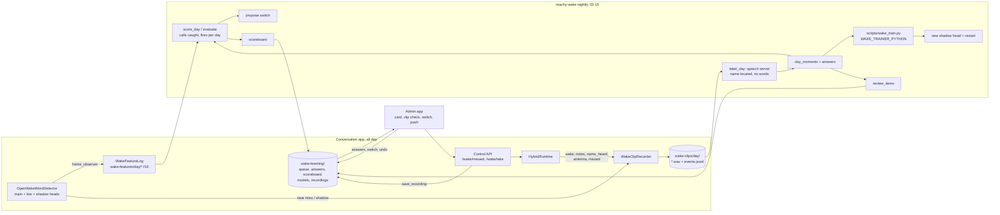

# Feature: Wake learning

- Status: `in-progress` (built 2026-10-31; first nights on the Mac mini pending)
- Last updated: 2026-10-31
- Plan: [wake-word-scoreboard.md](../plans/wake-word-scoreboard.md)
- Related: [Wake word](wake-word.md), [Wake clip capture](wake-clip-capture.md), [Phone admin app](phone-admin-app.md)

## Overview

Reachy's wake word improves from the household's own audio, measured instead of tuned by hand.

- **Daytime.** The app logs what the wake model hears (its input features, not audio), a record of every wake event
  with its clip, and a *shadow* wake head that only notes where it would have fired.
- **Each night**, a job does four things:
  - labels the day's clips with the local speech server;
  - counts how many calls each head pair would have caught and how often it would have fired over whole days;
  - trains a challenger;
  - offers Eduardo a switch when the shadow head has clearly earned it.
- **The household's part** happens in the phone admin app in under a minute: "He missed me", a short daily clip
  check, recording their own calls, and approving a switch.

Targets (agreed 2026-10-31): at least 19 of 20 calls answered the first time, at most 1 false wake a day.

## User-visible behavior

- **"You didn't hear me" / "No me escuchaste" / "Non mi hai sentito" / "Você não me ouviu"** said after he wakes:
  - the minute before that wake is kept as a missed call;
  - he says "Sorry about that. I'll learn from it." (or the Spanish, Italian or Portuguese line);
  - this is a quick command and never reaches the conversation.
- **"He missed me" in the phone app** (Home, or long-press the app icon) keeps the minute before now.
- **An antenna bend** keeps the 15 s before it; the night looks there for a call that went unheard.
- **Recording a voice**:
  - a phone flow walks one person through about 20 calls from around the room;
  - Reachy records each on his own microphones and wakes for none of them;
  - a take that was too quiet or too long is not kept.
- **Clips to check**: up to 10 a day, where the automatic signals are least sure. Each answer ("Called Reachy",
  "Didn't", "Not sure") overrules the speech model and the logs.
- **Switching**:
  - when the shadow pair caught clearly more calls than the live pair over a full day without firing more, one
    push offers it with the numbers;
  - "Switch" makes it live the next time Reachy is idle, and Undo stays for 7 days.
- **Scoreboard**: this week's calls answered the first time, false wakes a day, by TV on or off, and the live and
  shadow heads' numbers.

## Architecture and data flow

### What counts as what (`nightly.day_moments`)

- **Call:**
  - a fire whose name check passed (or a trusted fire that went on to wake him);
  - a transcript wake;
  - a name the speech server located in any kept clip (including one found in a fire's 10 s pre-roll more than
    2.5 s before the fire, which is an earlier call he missed);
  - a household "Called Reachy".
- **Not a call:**
  - a fire or shadow fire whose clip holds no name at all;
  - a household "Didn't".

  An automatic "no name" within 3 s of a call is dropped (the check misses calls), but a person's answer always
  stands.
- **Unknown:** the minute before a "missed" mark, or the 15 s before an antenna touch, when no name was found there.
  These stretches are never used as non-calls.

The name check is a feature here, never the only label: in the 2026-10-29 benchmark it heard the name in 15–19 of
28 real calls.

### Scoring (`nightly.score_day`, `evaluate`)

- **Inputs.** Every 16-frame window of the feature log is scored by each head; scores per head file are cached
  per day.
- **Pairing.** A pair is the main head and an extra head scaled onto its threshold, which is what the detector
  does.
- **Calls caught.** Calls with a window over the threshold between 0.6 s before and 1 s after them.
- **Fires per day.** Fires (one per 3 s) more than 20 s from any call or unknown stretch, per 16 hours of
  listening.
- **Switch offer.** The shadow pair must catch at least 2 more calls (and 5% more) than the live pair over the days
  since the shadow started, with fires no higher than the live pair's plus 0.5 a day.
- **Challenger.** It trains on every day but the newest. Its threshold is the one that catches the most calls on
  the newest day without firing more than the live pair. It becomes the shadow if it beats the current shadow
  there.
- **Thresholds.** An extra head's threshold stays at 0.4 or more, so its scaled score never reaches the trusted
  shortcut's 0.8.

## Contracts and configuration

| Area | File | Contract |
|------|------|----------|
| Records | `wake_learning/store.py` | `WakeLearningStore(root, clips)`: `days`, `events(day)` (notes merged); `write_queue`/`queue`/`answer`/`answers`/`clip_audio`; `write_scoreboard`/`scoreboard`; heads: `live`, `shadow`, `set_live`, `set_shadow`, `head_path`, `propose`, `proposal`, `mark_proposal_notified`, `decline`, `withdraw_proposal`, `switch`, `undoable`, `undo`, `history`; `save_recording`, `recordings_by_person`, `all_recordings`; `wake_features_directory()`, `wake_learning_directory()` |
| Feature log | `wake_learning/feature_log.py` | `WakeFeatureLog(directory, keep_days).add(frame)`; `read_runs(directory, day) -> [FeatureRun]`; `FeatureRun.windows(stride)`, `window_at(indices)` |
| Takes | `wake_learning/takes.py` | `take_finished`, `voiced_span`, `level_db` |
| Night | `wake_learning/nightly.py` | `run_night(NightSettings, NameCheck)`; `main()` is `reachy-wake-nightly` |
| Trainer | `scripts/wake_train.py` | `--data dataset.npz (X float16 n×16×96, Y 0/1) --init reachy-official33.onnx --out head.onnx`; free batch size |
| Detector | `acoustic_wake_word.py` | `from_directory(..., shadow_head=, shadow_threshold=, frame_observer=)`; `rearm()`; `WakeScoreEvent` |
| Runtime | `hybrid_runtime.py` | `mark_missed(by=, who=) -> bool`; `record_name(wait_s=) -> (rate, samples) | None` (holds wakes meanwhile) |
| Control API | `control_api.py` | `POST /wake/missed {"who"}` → `{"ok": true}` or 409; `POST /wake/take {"person", "prompt"}` → `{"ok", "seconds", "level_db", "reason": null|"quiet"|"too_long"}` or 409 |
| Quick command | `quick_commands.py` | kind `missed` (before the negation filter); `ToolDependencies.mark_missed` |

| Variable | Default | Meaning |
|----------|---------|---------|
| `WAKE_LEARNING_ENABLED` | `0` | Needs `WAKE_CLIPS_ENABLED=1`. The app logs features and runs the registry's live and shadow heads (the live one replaces `LOCAL_ACOUSTIC_WAKE_EXTRA_HEAD`; a missing file is skipped, never fatal); the nightly job runs. |
| `WAKE_FEATURES_KEEP_DAYS` | `30` | Days of feature log kept (about 9 MB per hour of listening). |
| `WAKE_TRAINER_PYTHON` | (none) | A Python with `torch`, `onnx` and `numpy` for `scripts/wake_train.py`; without it the night labels, scores and offers switches but trains nothing. |
| `ADMIN_APP_SERVICE` | (none) | The app's LaunchAgent label; the night restarts the app after choosing a new shadow head. |

Files on the computer Reachy runs on (`~/.local/share/reachy_mini_conversation_app/`, owner-only):
- `wake-features/<day>/<HHMMSSmmm>.f16`: the feature log.
- `wake-learning/`, which holds:
  - `queue.json` and `answers.jsonl`;
  - `scoreboard.json`;
  - `labels/<day>.json` (name end times per clip);
  - `scores/<day>/<head digest>.npy`;
  - `models/{live,shadow,proposal}.json`, `models/history.jsonl` and `models/heads/*.onnx`;
  - `recordings/<person>/*.wav` and `recordings/recordings.jsonl`.

## Setting it up on the Mac mini

1. In `.env`: `WAKE_CLIPS_ENABLED=1`, `WAKE_LEARNING_ENABLED=1`, `WAKE_TRAINER_PYTHON=<python with torch>`
   (`~/wake-retrain/.venv/bin/python` on the mini), and `ADMIN_APP_SERVICE` (already set for the admin app).
2. A LaunchAgent `com.eduardo.reachy-wake-nightly`:
   - program `<checkout>/.venv/bin/reachy-wake-nightly`;
   - working directory the checkout (so it finds `.env`);
   - `StartCalendarInterval` at 02:15, during quiet hours, when Reachy doesn't listen and the GPU is free;
   - log `~/Library/Logs/Reachy/wake-nightly.log`.
3. Restart Reachy once so the feature log starts.

## Extension guide

- **Safe changes.** The thresholds grid, margins, negative sampling and queue size are constants in
  `nightly.py`. The training recipe lives in `scripts/wake_train.py`.
- **Replay scoreboard.** A full-path replay (name check, transcript wake, blind time) belongs in a new module that
  reads recorded days; see the plan's phase 4.
- **Never** let the name check alone label a clip, or let the household's answers be overruled. Never send clips,
  features or recordings off the computer, or switch a head without Eduardo's tap.

## Constraints and gotchas

- **What the feature log measures.** It counts a head's fires, not false wakes. The name check and the
  transcript wake are not replayed, so "fires per day" is the acoustic stage only.
- **Clip timing.** Events are timed with the wall clock when recorded (milliseconds after the audio); feature
  frames are timed as they arrive. Calls are matched within −0.6 to +1 s.
- **Buffering.** Up to 2 s of features are buffered in memory and lost if the app stops abruptly.
- **Scoreboard approximations.** False wakes are woke-but-nothing-asked or a household "Didn't". Calls include
  names the speech server found that may have been people talking about Reachy, until someone answers. The
  scoreboard is an estimate until the replay scoreboard exists.
- **Restarts.** The shadow head loads at startup, so the night restarts Reachy after picking a new one (during
  quiet hours). A switch restarts him when he is idle.

## Testing

| Test file | Covers |
|-----------|--------|
| `tests/wake_learning/test_wake_store.py` | Queue and answers (latest wins, bad answers refused); clip cut and confinement; switch, undo and history; "not now" until the numbers change; recordings per person; events with notes merged |
| `tests/wake_learning/test_feature_log.py` | Runs split by gaps, start times, windows and `window_at`; pruning |
| `tests/wake_learning/test_takes.py` | When a take ends; voice span with margins; a far quiet call; level in dB |
| `tests/wake_learning/test_nightly.py` | Locating names; calls, non-calls and unknowns with answers winning; fires and calls caught; the clips to check (order, cap, answered skipped); the scoreboard's episodes; a whole night with a shadow head that earns a switch; the switch margin; thresholds kept out of the trusted shortcut |
| `tests/test_acoustic_wake_word.py` | Shadow fires reported, never waking; feature frames; re-arming inside the cooldown; loading a shadow head |
| `tests/test_hybrid_runtime.py` | A rejected wake keeps the stream (no reset) and hears a repeated call; fire records; missed marks; recording a name holds wakes |
| `tests/test_control_api.py` | `/wake/missed` (privacy refuses); `/wake/take` keeps only the voice, refuses quiet or long takes and when he can't record |
| `tests/test_quick_commands.py` | "No me escuchaste" / "you didn't hear me" mark the call; without wake clips it is not a command |

`scripts/wake_train.py` needs PyTorch, which the app's environment doesn't have; it is checked by running a night
on the Mac mini (see the plan's progress log).
