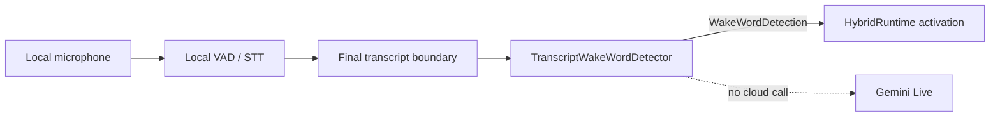

# Feature: local transcript and acoustic wake word

> Current experiment (2026-09-08): the user explicitly authorized local training on the 80 existing usable household recordings. Those sources are training-only now; fresh independent validation is required. Household-derived features/models stay private and outside cloud-training mounts. Earlier evaluation-only statements below describe the prior protocol.

- Status: `in-progress`
- Last updated: 2026-09-09
- Plan: [Reachy hybrid household companion](../plans/reachy-hybrid-household-companion.md)

## Overview

Two local implementations share the existing hybrid activation boundary. The
transcript detector remains the default when continuous local STT is configured.
The off-by-default official33 acoustic detector supports the supervised simulator
MVP without local STT. Its model quality gates remain unmet; this is an explicit
user-authorized trial, not production admission. See the
[model catalog](../plans/reachy-wake-model-catalog.md) for retained candidates.

The detector remains a pure local component. `HybridRuntime` owns activation,
physical acknowledgment, keyboard fallback, local-command routing, and provider
lifecycle wiring.

The optional acoustic benchmark is a separate fixture-only tool. It evaluates
caller-owned sherpa-onnx model files against WAV or raw PCM16 fixtures; it does
not capture a microphone, download or bundle weights, or participate in the
production runtime.

## User-facing behavior

The detector accepts local transcript updates and returns a metadata-only
activation event when the configured phrase appears as a complete word. Case
and punctuation are ignored around the phrase, while substrings such as
`reachyo` and `Reachy2` do not activate. The text after the phrase is retained
as `remaining_text`/`command_text`, so `Reachy, look left` can reach the local
command router without waiting for a second transcription pass.

Partial STT updates may be cumulative (`Rea`, then `Reach`) or short deltas
(`Rea`, then `chy`). The detector joins bounded partial state only while an
utterance is open. Every update is limited to its newest 512 characters before
matching or returning the command suffix, so an oversized STT result cannot
grow detector memory or activation payloads. A wake phrase that has already
fallen outside that retained tail is intentionally not recovered. A final
update closes the state. One detection is emitted per utterance; a configurable
monotonic cooldown suppresses repeated final updates or closely spaced
utterances.

For the current hybrid runtime integration, activation intentionally waits for
`segment.final`. The local STT boundary emits complete final segments, and
waiting preserves the full addressed suffix (`Reachy, look left`) for the
deterministic command router. A partial `Reachy` therefore does not construct a
provider or acknowledge a command; its later final segment is the first runtime
activation event. The detector still supports partial/delta callers directly,
and `consume_detection()` remains available to future integrations that act on
partial detections.

When a final wake contains no suffix, `HybridRuntime` acknowledges locally and
waits for at most one next final local segment for the configured bounded
timeout (five seconds by default). Sequence metadata rejects an older final
that arrives after local STT latency; it cannot become the follow-up command.
An exact stripped command remains local; an uncertain follow-up or timeout uses
the ordinary cloud activation path. A wake and command in the same final
segment keeps the immediate path above unchanged. Seeded background context is
fenced at the wake sequence, retaining only earlier context even if later local
segments were accepted before provider setup.

The detector returns no event for ordinary speech. An integration can keep the
keyboard activation path as a separate reliable fallback. The implementation
does not itself decide whether a detected command is safe or whether a
non-command should escalate to Gemini.

## Current architecture and target changes

Local audio flows through `HybridRuntime` into the replaceable ambient context
processor. Final local transcript events feed this detector for the current
runtime integration:



`TranscriptWakeWordDetector` owns only phrase matching, partial-text
debouncing, and detector metrics. It does not own audio capture, VAD, STT,
robot movement, command execution, or the cloud handler. `HybridRuntime` owns
the final-segment activation policy. The event contains no source-transcript
field; only the minimum command suffix and timing metadata needed by the next
local boundary are returned.

## Canonical files and contracts

| Area | File or interface | Responsibility / contract |
|------|-------------------|---------------------------|
| Detector boundary | `src/reachy_mini_conversation_app/wake_word.py:WakeWordDetector` | Typed local lifecycle/transcript contract for the current and future implementations, including accepted-detection consumption. |
| Transcript implementation | `src/reachy_mini_conversation_app/wake_word.py:TranscriptWakeWordDetector` | Case-insensitive, word-bounded `Reachy` matching with partial/final handling. |
| Detection event | `WakeWordDetection` | Wake phrase, suffix, first-word metadata, source kind, and optional monotonic latency; no raw transcript. |
| Benchmark counters | `WakeWordMetricsSnapshot` | Detection, suppression, externally labelled false-positive/missed-activation, update, and latency counters. |
| Acoustic extension seam | `AcousticWakeWordDetector` | Typed future local audio-detector contract; no model or dependency is selected in V0. |

`process_transcript(text, is_final=False, speech_started_at=None,
observed_at=None)` uses the injected monotonic clock when `observed_at` is not
provided. Observation timestamps must be finite and nondecreasing; a
non-finite or backward timestamp raises `ValueError` before detector state or
metrics change. `speech_started_at` is optional; when both timestamps are
valid and ordered, the detector records the local detection latency. Negative
or non-finite explicit benchmark latency is rejected. Error messages and logs
contain no transcript content.

`reset()` clears the in-progress partial utterance and cooldown so an
integration can recover at a VAD turn boundary or after an activation failure.
It intentionally preserves metrics. `consume_detection()` clears the
in-progress partial utterance and per-segment debounce marker after an
activation has been accepted, but leaves cooldown timestamps, configuration,
and metrics intact. It is reserved for integrations that deliberately act on
partial detections; the current runtime waits for final segments instead.
`reset_metrics()` starts a fresh benchmark without changing detector
configuration.

`first_word_retained` is true when text after the wake word was preserved in
the event. `wake_word_is_first_word` separately records whether any prior word
preceded the phrase. Integrations should use `remaining_text` as untrusted
input to deterministic local routing and escalate anything outside its
allowlist.

## Extension guide

### Safe to extend

- Replace `TranscriptWakeWordDetector` with a local implementation satisfying
  `WakeWordDetector`.
- Add an acoustic implementation satisfying `AcousticWakeWordDetector` after
  measuring model quality, CPU/RAM use, platform support, and license terms.
- Add fields to the event or metrics snapshot only when the privacy and
  documentation contracts are updated together.

### Do not change without updating this document and its tests

- Do not make wake detection depend on Gemini or a cloud transcript.
- Do not log or persist source transcript/audio payloads.
- Keep `consume_detection()` separate from `reset()`: accepted partial wakes
  must release their segment state without bypassing cooldown suppression.
- Keep the current runtime's final-segment gate until the local STT contract
  can reliably preserve the complete addressed suffix in partial updates.
- Do not remove word boundaries, partial debounce, cooldown, or command-suffix
  retention without a replacement regression test and benchmark evidence.
- Do not treat a wake detection as permission to execute an arbitrary command;
  local command policy belongs to the command router.

### Common extension path

1. Implement the typed detector against local-only input.
2. Return the same metadata-only event and counters, or document a deliberate
   contract revision.
3. Add deterministic unit tests for boundaries, turn lifecycle, failures,
   privacy, and latency; then run the focused test command and the repository
   gate from `docs/TESTING.md`.

## Ready-made acoustic candidates

The current runtime uses the dependency-free transcript detector. Research
identified candidates for a future implementation of the existing
`AcousticWakeWordDetector` seam. The optional `wake-benchmark` dependency group
contains only the sherpa-onnx engine, its native core wheel, and its undeclared
BPE tokenizer runtime dependencies; no model or runtime adapter has been added.

| Candidate | Integration fit | Evidence and caveats | License caveat |
|-----------|-----------------|----------------------|----------------|
| [`jguerrisi/sherpa-onnx-kws-zipformer-es-3M-2026-08-08`](https://huggingface.co/jguerrisi/sherpa-onnx-kws-zipformer-es-3M-2026-08-08) with [`sherpa-onnx`](https://k2-fsa.github.io/sherpa/onnx/kws/index.html) | Historical rejected candidate. The established engine accepts caller-supplied 16 kHz mono frames and runtime-configured keyword spellings. The initial bounded candidate set was `Reachy`, `Richie`, `Ritchie`, `Richi`, and `Ricci`; each generated entry used one canonical `@reachy` tag. | The checkpoint detected 0/30 private positives at documented settings and only 2/30 with an aggressive threshold/boost. It was rejected before negative testing; its result does not establish production microphone quality, false-positive rate, online latency, or Raspberry Pi resource use. | The card declares Apache-2.0, but also requires review of MLS, MUSAN, and each Piper voice's attribution terms before redistribution. Do not bundle the model until that audit is complete. |
| [`andyjmorgan/reachy-wake-word`](https://github.com/andyjmorgan/reachy-wake-word) | Its ONNX integration accepts mono 16 kHz PCM16 in 80 ms frames, matching the normalized local audio boundary. | The published `reechy` model detected only 6/30 private household positive fixtures at its documented 0.5 threshold. Gain and peak normalization did not improve recall, so it is rejected for this household. | Repository code is Apache-2.0, but the pretrained model is CC BY-NC-SA 4.0. Do not bundle it for Reachy. |
| [`luisomoreau/hey_reachy_wake_word_detection`](https://huggingface.co/spaces/luisomoreau/hey_reachy_wake_word_detection) / [Edge Impulse project](https://studio.edgeimpulse.com/public/855375/latest) | Its Mac ARM64/Linux AARCH64 packaging may inform deployment, but it expects 24 kHz and a 12,000-sample (1.5-second) window. | It detects `Hey Reachy`, not the written `Reachy` candidate, and therefore is not a phrase candidate. The example also owns its microphone instead of using the shared stream. | The public Edge Impulse project lists BSD 3-Clause Clear; the Hugging Face Space does not clearly declare an application license. |
| [`openWakeWord`](https://github.com/dscripka/openWakeWord) | General 16 kHz local model API with configurable score thresholds, optional VAD, and verifier support; a possible framework for a custom Reachy model. | Its built-in model list has no Reachy model. Phrase-specific training data and deployment testing are required on Mac and Raspberry Pi. | Code is Apache-2.0, while bundled pretrained models are CC BY-NC-SA 4.0 and are not automatically suitable for commercial use. |

There is no merged official Pollen wake-word solution to reuse today: the
[Conversation App standby/wake PR #514](https://github.com/pollen-robotics/reachy_mini_conversation_app/pull/514)
is open, and the SDK's [wake-word issue #1253](https://github.com/pollen-robotics/reachy_mini/issues/1253)
is unresolved. The PR is useful architectural context, not an upstream
dependency or acceptance evidence.

Hugging Face's official voice-assistant lesson uses a fixed-label Speech
Commands classifier; it can select an existing label such as `marvin`, but it
does not turn arbitrary text into a `Reachy` detector. The Hugging Face
speech-to-speech reference provides VAD and STT, not a separate wake-word
stage. The reviewed Hub listings contained no pretrained exact-`Reachy` model.

The Spanish sherpa-onnx checkpoint removed the need for phrase-specific model
training in the first benchmark because sherpa generates its keyword tokens at
configuration time. It did not pass the real positive-fixture screen: on 30
private Mac-microphone recordings, the documented threshold/boost detected
0/30 wakes, and an overly aggressive threshold/boost detected only 2/30. The
checkpoint is therefore a historical rejected candidate for this household
before collecting the negative set. This is an offline fixture result, not
production microphone, false-positive, activation-latency, or Raspberry Pi
evidence. Keep keyboard fallback, do not add fuzzy transcript aliases, and
never log or store wake audio. The approved next step is the custom
multilingual openWakeWord training plan, with Porcupine retained as a separate
AccessKey/proprietary fallback.

## Standalone acoustic benchmark foundation

Install the optional engine group when a local benchmark is needed:

```bash
uv sync --group wake-benchmark
```

`wake-benchmark` requires a caller-owned extracted model directory containing
the Spanish checkpoint's encoder, decoder, joiner, `tokens.txt`, and
`bpe.model` files. It never resolves a model identifier, contacts a model hub,
or copies model weights. Supply one or more expected-positive and
expected-negative fixtures:

```bash
wake-benchmark --model-dir ./external/reachy-model \
  --positive ./fixtures/reachy-01.wav \
  --negative ./fixtures/ordinary-speech.pcm16 \
  --json --output ./benchmark-result.json
```

The default acoustic spelling is `Reachy`. Repeat `--keyword` to opt into the
bounded candidate set (`Reachy`, `Richie`, `Ritchie`, `Richi`, or `Ricci`), for
example `--keyword Reachy --keyword Richie`. Candidates are deduplicated after
case/space normalization, and every generated sherpa entry uses the single
canonical metadata tag `@reachy`. These benchmark spellings do not become
transcript aliases or automatically accepted production wake words.
The historical `Tito` app override remains supported, but this Reachy-specific
benchmark intentionally rejects `Tito`; replay dated Tito evidence from its
recorded revision rather than mixing two product-name experiments.

Fixtures are mono, 16 kHz, uncompressed PCM16 WAV files or raw little-endian
PCM16 files. Input duration, decoder steps, and per-fixture detections are
bounded; malformed or unavailable fixtures abort the run rather than yielding
a partial report. A temporary keyword file is removed when the run exits.
Result strings are stripped and case-folded; only the exact canonical
tag (`reachy` or `@reachy`) counts as a detection. Other nonempty sherpa
results are ignored after the stream is reset. Each fixture records the first
exact detection only as its offline `fixture_start_to_result_p50_seconds`/`p95`
measurement from fixture processing start to decoder result; duplicate exact
events remain detection events but do not add latency samples. This is not
acoustic-onset, activation, or online latency. Aggregate
`positive_fixture_start_to_result_p50_seconds`/`p95` values include one
first-detection sample per positive fixture. The fixture protocol requires each
positive fixture to contain exactly one intended wake; duplicate detections
are retained in event counts for diagnosing the fixture. The report includes
fixture and aggregate
real-time factor (`processing_seconds / audio_seconds`) when audio duration is
available, plus the configured `num_trailing_blanks` and
`max_decode_steps_per_input` values.

The summary and JSON output are metadata-only: they include counts,
classifications, offline fixture-start-to-result timing, negative audio
exposure, event-based false positives per hour, fixture-level recall, real-time
factor, path-free model fingerprint, installed package versions, UTC start
time, sample rate, platform system/release, machine architecture, Python
version, and optional process resource metrics. They never include fixture or
model paths, audio samples, raw sherpa results, or transcripts; `keyword_tag`
is only the fixed metadata value `@reachy`. The report has no
queue/drop metric because fixture mode is offline and has no capture queue.
The CLI has no network, simulator, robot, or microphone mode and does not
collect CPU model identity. This tool is a deterministic foundation for a
later acoustic adapter, not evidence that the checkpoint is accurate in a
household.

## Constraints, privacy, and failure modes

- The V0 implementation has no model dependency and performs no network I/O.
- Partial text is bounded to 512 characters in memory and is cleared at final
  transcript boundaries or `reset()`. Direct and final updates are subject to
  the same newest-tail bound; no transcript is written to disk or emitted in
  logs.
- Observation timestamps must be finite and nondecreasing. Backward timestamps
  are rejected rather than treated as a cooldown reset, because accepting them
  would make duplicate suppression and latency measurements ambiguous. Calling
  `reset()` starts a new timestamp sequence.
- A cooldown suppresses duplicate detections but does not erase benchmark
  counters. A reset explicitly clears the cooldown.
- The detector cannot know whether a human-labelled activation was false or
  missed, so integrations record those labels through counter methods without
  supplying the original transcript.
- Invalid configuration raises `ValueError`, while missing or malformed
  fixtures abort the benchmark with `AudioInputError`; no partial metadata is
  emitted. A local processing boundary should catch and log those errors at
  its integration boundary.
- `recall` is fixture-level (`true_positive_count / positive_count`) and is
  `None` when there are no positive fixtures. `false_positives_per_hour` uses
  all negative-fixture detection events divided by negative audio exposure and
  is `None` when that exposure is zero.
- An out-of-order `speech_started_at` timestamp produces no latency sample; it
  does not create a negative measurement.
- The detector is not an acoustic wake-word model. Recognition quality,
  false-positive rate, and missed activations must be measured with the actual
  local STT backend and microphone before selecting a production backend.
- An acoustic candidate must remain local and consume the existing normalized
  audio stream. A model that opens its own microphone would duplicate capture
  and can violate the single-audio-owner design.

## Dependencies

- Depends on: local VAD/STT transcript updates supplied by the hybrid runtime.
- Used by: hybrid activation and the deterministic local command router.
- New runtime dependencies: none. The optional `wake-benchmark` group pins
  `sherpa-onnx==1.13.6` and its required `sherpa-onnx-core==1.13.6` wheel, plus
  the undeclared tokenizer dependencies `sentencepiece==0.2.2` and
  `pypinyin==0.55.0` for the standalone fixture tool; it does not change
  application startup or add model weights. No `click` pin is needed because
  the CLI uses Python's standard `argparse`.

## Testing

Tests ship with the detector implementation. They are hardware-, network-,
and provider-independent.

### Unit tests

| File | Scenarios |
|------|-----------|
| `tests/test_wake_word.py` | Case/punctuation handling, word boundaries, first-word metadata, command suffix retention, cumulative and delta partials, final-turn reset, accepted partial-detection consumption, cooldown preservation, injected clock, explicit reset, metrics, invalid configuration, invalid latency, and out-of-order timestamps. |

### Integration tests

`tests/test_hybrid_runtime.py` and `tests/test_main.py` assert final-segment
activation, partial-wake deferral, command-suffix retention, keyboard fallback
composition, exact local-command execution without a handler, and uncertain
escalation.

`tests/test_sherpa_wake_benchmark.py` covers model-file validation, tokenizer
output, WAV/raw PCM16 bounds and normalization, exact result tags, TP/FN/TN/FP
classification, per-fixture offline fixture-start-to-result timing, positive
aggregate timing, real-time factor, negative exposure and event rate,
fixture-level recall, trailing-blank and decode-step configuration,
temporary-file cleanup, model fingerprint/version and environment metadata,
error handling, metadata privacy, and fixture-only CLI behavior with
deterministic fakes.

### Simulator / end-to-end tests

No simulator or production live-microphone claim is made by this module. The
real 2026-09-07 screen used microphone recordings as offline fixtures. Phase 4
manual testing must still measure false positives, missed activations, and
activation latency on the development machine after integration.

### Test commands

```bash
.venv/bin/ruff check src/reachy_mini_conversation_app/wake_word.py tests/test_wake_word.py
.venv/bin/ruff format --check src/reachy_mini_conversation_app/wake_word.py tests/test_wake_word.py
.venv/bin/mypy --pretty --show-error-codes src/reachy_mini_conversation_app/wake_word.py
.venv/bin/pytest tests/test_wake_word.py -v
.venv/bin/ruff check src/reachy_mini_conversation_app/sherpa_wake_benchmark.py tests/test_sherpa_wake_benchmark.py
.venv/bin/ruff format --check src/reachy_mini_conversation_app/sherpa_wake_benchmark.py tests/test_sherpa_wake_benchmark.py
.venv/bin/mypy --pretty --show-error-codes src/reachy_mini_conversation_app/sherpa_wake_benchmark.py
.venv/bin/pytest tests/test_sherpa_wake_benchmark.py -v
```

On 2026-09-01, the historical Tito benchmark implementation's focused Ruff,
format, strict-mypy, pytest, lock, and diff checks passed; pytest reported 48
deterministic tests. An isolated
`sherpa-onnx==1.13.6` API probe confirmed its required
`sherpa-onnx-core==1.13.6` wheel and that its BPE helper imports both
`sentencepiece` and `pypinyin`, which are pinned above. Tokenizer assets from
reviewed source revision `b55eae785857eba4af1e24b200104354be23a975`
produced `▁ti to @tito` with the pinned BPE seam; that output is historical and
does not define the current Reachy benchmark. The content fingerprint remains
the authoritative model identity. No model-weight decoder, microphone, live
quality, or resource measurement was run.

On 2026-09-03, the generalized Reachy benchmark suite passed 74 deterministic
tests. It covers the explicit `Reachy`, `Richie`, `Ritchie`, `Richi`, and
`Ricci` candidate allowlist, normalized deduplication, unique token-sequence
generation, exact caller-vocabulary validation, canonical-tag collision and
marker-like OOV rejection, unsafe tokenizer-token rejection, and one exact
`reachy`/`@reachy` result boundary. This remains a fixture-only result and
makes no acoustic quality claim. The complete
dotenv-isolated repository gate also passed 863 tests with one explicit native
audio skip, plus Ruff, formatting, strict mypy, lock consistency, JavaScript
syntax, and diff checks.

On 2026-09-07, 30 consented Reachy/Richie/Ritchie/Richi/Ricci pronunciations
were recorded as private 16 kHz mono PCM16 fixtures under `/tmp`, outside the
repository. All 30 files were technically valid. The reviewed Spanish
checkpoint detected 0/30 at its documented threshold 0.20 and boost 1.0. A
parameter screen reached only 2/30 (6.7%) at threshold 0.02 and boost 8.0;
testing each spelling separately did not materially improve recall. The
checkpoint was rejected and the negative recording was intentionally skipped.
The run's real-time factor was about 0.015, with roughly 167 MiB peak process
RSS and about 350% multi-core process CPU on this Mac. These are offline Mac
process measurements, not acoustic activation latency or Raspberry Pi
evidence. Raw audio was not uploaded, committed, or included in metadata.

The existing `andyjmorgan/reachy-wake-word` model was then tested locally at
upstream commit `2631663f1fff1274ca01a5ee33db877a37b83f41`. Its 1.3 MiB
`reechy` ONNX model, identified by SHA-256
`bcd551a49315e443b11877ff52e11f30e42ecdf024b6c051dcaad80faee1e14f`,
received the same fixtures as 1,280-sample/80 ms frames with a reset between
fixtures. It detected 6/30 (20%) at the upstream 0.5 threshold. Lowering the
threshold to 0.2 detected only 7/30. Doubling or quadrupling gain and peak
normalizing to -12 dBFS all remained at 6/30, ruling out simple recording
volume as the cause. Offline inference measured a 0.036 real-time factor,
about 98% process CPU, 188.9 MiB peak process RSS, and 0.112 seconds to load on
this Apple Silicon Mac. These are local fixture-processing measurements, not
production activation latency or Raspberry Pi evidence. The model is rejected
before negative testing; its upstream synthetic-data results do not generalize
to this household's requested pronunciations.

Focused validation on 2026-08-29: Ruff, formatting, strict mypy for the new
source file, and all 18 wake-word tests passed. The movement regression and
hybrid lifecycle suite passed alongside them (64 tests total). The earlier
full repository gate was refreshed after those regressions and passed all 649
tests. On 2026-08-30, the live final-STT path worked with a configured
`LOCAL_WAKE_WORD=computer` through local activation. The attached command then
escalated to Gemini, so this validates the alternate wake phrase but not local
command routing. The historical former default `Reachy` path produced no action
because no exact matching final transcript token reached the detector; this is
not evidence for a new wake-word alias. Wake false-positive/miss rates and
latency remain unmeasured.

## Changelog

| Date | Change |
|------|--------|
| 2026-08-29 | Added dependency-free transcript wake-word detector, future acoustic protocol, privacy-safe metrics, partial debounce, cooldown, and deterministic tests. |
| 2026-08-29 | Wired continuous local transcripts to hybrid activation while retaining keyboard activation and cloud-free exact commands. |
| 2026-08-29 | Added explicit accepted-detection consumption for integrations that act on partial wakes; added cooldown and lifecycle regressions. |
| 2026-08-29 | Restricted the current runtime integration to final local STT segments so a partial `Reachy` cannot open cloud before its command suffix arrives; added local-command and next-wake regression coverage. |
| 2026-08-30 | Live validation isolated the default `Reachy` no-action result to the exact final-transcript match boundary; a configured `computer` wake reached the detector path successfully. |
| 2026-08-30 | Researched ready-made acoustic candidates: the 16 kHz `andyjmorgan` ONNX model is the closest seam fit but targets `reechy` and is CC BY-NC-SA; the 24 kHz/1.5 s Edge Impulse `Hey Reachy` candidate needs an adapter and has an unclear Space license; openWakeWord has no Reachy model. No model or dependency was added. |
| 2026-08-31 | Extended the split-final waiter to five seconds by default to cover local STT finalization latency while retaining a finite timeout, rejected stale final sequence IDs, and excluded current wake/follow-up segments from seeded cloud context. Exact follow-ups remain local; uncertain/timeout paths use normal cloud activation, and close/cancellation releases the waiter. Live segmentation and latency remain unmeasured. |
| 2026-08-31 | Bounded direct and environment-configured follow-up waits to 15 seconds, and changed context handoff from exact segment exclusion to an exclusive wake-sequence fence so post-wake ambient finals cannot be seeded. Processor-backed delayed-final and post-deadline regressions remain deterministic fake-boundary tests. |
| 2026-08-31 | Selected `Tito` as the product/default wake phrase. Historical `Reachy` and `computer` benchmark records remain prior test evidence; matching stays exact and the keyboard fallback remains available. |
| 2026-09-01 | The first live `Tito, look left` baseline completed three final local transcripts but produced zero exact wake detections or cloud traffic. Completed STT calls took about 15 seconds each, one call timed out, and rapid repetition caused 861 local-processing frame drops. Use one paced, opt-in RAM-preview diagnostic to identify the transcription mismatch before changing exact matching or selecting an acoustic path. |
| 2026-09-01 | The paced preview produced no text because both local STT calls timed out at 20 seconds; VAD had detected speech, but no final transcript existed. With 3,269 local-processing drops and zero cloud traffic, continuous Whisper is rejected as Tito's product wake detector on this Mac baseline. Phase 4 proceeds to a reviewed local acoustic Tito model while retaining keyboard fallback. |
| 2026-09-01 | Reviewed official Hugging Face wake examples and established local engines. Hugging Face's lesson is fixed-label and speech-to-speech has no wake stage. Selected a standalone benchmark of the community Spanish 3.3M sherpa-onnx open-vocabulary checkpoint, which can configure `Tito` without phrase-model training. The fixture-only CLI and optional `sherpa-onnx==1.13.6`, `sherpa-onnx-core==1.13.6`, and tokenizer-runtime group are now in place; no model is bundled, and live quality, resources, and model-redistribution terms remain acceptance gates. |
| 2026-09-01 | Added deterministic WAV/raw PCM16 benchmark coverage with exact `tito`/`@tito` result filtering, bounded input/detections, per-fixture offline timing, real-time factor, `num_trailing_blanks`, temporary-keyword cleanup, and metadata-only CLI output. This is implementation/test evidence only and makes no live wake-quality claim. |
| 2026-09-01 | Added a total decode-step bound across fixture input and tail draining, explicit positive-fixture timing names, negative exposure/event-rate and fixture-level recall metrics, path-free model fingerprint and environment/package metadata, and no queue/drop metric for offline mode. The CLI uses standard `argparse`, so no `click` pin is required. |
| 2026-09-01 | Verified sherpa's 1.13.6 BPE helper imports undeclared `sentencepiece` and `pypinyin` dependencies; pinned `sentencepiece==0.2.2` and `pypinyin==0.55.0` in the optional group and convert tokenizer import failures to a bounded dependency error. The reviewed source revision `b55eae785857eba4af1e24b200104354be23a975` produced `▁ti to @tito`; no external model directory was available for a live generation run, and the content fingerprint remains authoritative. |
| 2026-09-01 | Added the required `sherpa-onnx-core==1.13.6` pin after clean-install metadata showed it is required by `sherpa-onnx`; added clean assertion failure handling, in-loop detection limits, decoded-WAV payload validation, boolean rejection for integer knobs, and first-detection-only latency accounting. The focused suite now passes 48 tests; no live benchmark claim follows. |
| 2026-09-01 | Defined fixture latency as the first exact `tito`/`@tito` detection only, kept duplicate detection events separate for counts and false-positive rate, added duplicate-result regression coverage, and expanded the focused suite to 48 passing tests. Positive fixtures must contain exactly one intended wake; no live benchmark claim follows. |
| 2026-09-03 | Restored `Reachy` as the written/default wake name without adding fuzzy transcript aliases. Generalized the fixture-only sherpa benchmark to map the explicit spellings `Reachy`, `Richie`, `Ritchie`, `Richi`, and `Ricci` to one canonical `@reachy` event, with normalized and generated-token deduplication, exact caller-vocabulary validation, canonical-tag collision/marker-like OOV rejection, and unsafe tokenizer-token rejection. The focused suite passes 74 tests and the complete repository gate passes 863 tests with one explicit native-audio skip; live quality and licensing acceptance remain pending. The historical Tito app override remains available, while this Reachy-specific benchmark intentionally rejects it. |
| 2026-09-07 | Screened the reviewed Spanish sherpa checkpoint with 30 private, technically valid Mac-microphone positive fixtures. It detected 0/30 at documented settings and only 2/30 at an overly aggressive setting; individual spelling candidates did not rescue recall. Rejected this checkpoint before the negative set. The recordings remain outside the repository for reuse with the next candidate, and no production integration, false-positive, activation-latency, or Pi claim follows. |
| 2026-09-07 | Screened the existing `andyjmorgan` Reachy openWakeWord model against the same private fixtures. It detected 6/30 at its documented 0.5 threshold; lower thresholds and three local gain treatments did not materially improve recall. Rejected the model before negative testing. The model and isolated dependencies remained under `/tmp`; nothing was bundled or integrated. |
| 2026-09-07 | Marked the Spanish sherpa checkpoint as a historical rejected candidate and linked the custom multilingual openWakeWord training plan; no production acoustic model was selected. |

## Custom training preflight evidence

The [custom training plan](../plans/custom-reachy-openwakeword-training.md#execution-evidence--2026-09-07)
records the reproducible environment, source/model hashes, commands, provenance,
and remaining gates. On 2026-09-07, Mac ARM64 and local Docker Linux ARM64
produced 668 identical public/synthetic reference scores at the frozen 0.5
threshold; expected positives, negatives, silence/noise, and reset/repeat checks
passed. This does not reproduce the community Mac scoring problem and does not
identify the cause of earlier household misses.

An isolated English-only CPU smoke generated 12 synthetic clips with disjoint
training/validation speaker IDs, augmented them, extracted `(12, 16, 96)`
features, trained eight steps, and exported a 203,311-byte ONNX model.
Independent Mac/Linux inference-only processes loaded it and matched the fixed
probe score exactly. It is a pipeline test artifact, not a production wake
model or multilingual acceptance result. No application dependency, detector,
configuration, audio flow, or privacy boundary changed.

The private 30-clip metadata now reflects two user-reported speakers (25/5).
Surrounding language labels do not establish name pronunciation; unknown
variants remain unknown. Raw recordings stay outside Docker and are not used
for training, threshold tuning, or the platform diagnostic.

Validation: the external `run_preflight.py`, `cpu_smoke.py`, and
`check_export.py` passed in their documented environments. The command
`.venv/bin/pytest tests/test_wake_word.py tests/test_sherpa_wake_benchmark.py -q`
passed 100 tests. The full Ruff/format/mypy/pytest gate passed 863 tests with one
explicit optional native-speaker skip. Multilingual generation, interrupted
feature recovery, GPU execution, automatic Pod stop, private acoustic quality,
and new native/simulator/hardware measurements remain unverified. Reproduce
the local checks using the retained external experiment and the linked plan;
complete the pending gates before renting compute or integrating any model.

The subsequent user pronunciation review accepted sounds 1, 2 and 5 (English
Reachy, English Richie/Ritchie and Italian Ricci), rejecting the Spanish and
Portuguese preview sounds. The isolated candidate recipe uses those explicit
phonemes with separate synthetic training/validation voices; it makes no native
Spanish/Portuguese synthesis claim. The 48-positive/128-negative CPU smoke
passed generation, augmentation, feature integrity, eight training steps, ONNX
checking and fresh Mac/Linux loading with identical probe scores. Nine external
recovery/shutdown tests passed using fake provider calls, including detached
process survival. Paid shutdown and GPU evidence remain pending. The latest
full app gate passed 863 tests with one optional native-speaker skip.


Latest custom-training outcome (2026-09-07): resolved the missing CUDA library
lookup and verified actual CUDA mel/embedding execution and Torch backward.
Full GPU generation/training completed; all 23,800 synthetic WAV hashes and
model/feature artifacts were verified after download. All Runpod Pods/storage
are deleted: $8.8352740152 remains, $0/hour, approximately $1.16 total spent.
Candidate 1 detected 400/400 synthetic positives but activated on 313/3,168
negatives (9.88%). Local candidate 2 improved this to 397/400 and 106/3,168
(3.35%), still above the unchanged 1% gate. Candidate 3, using 600 additional
accented near-word negatives from training voices only, detected 400/400
positives but activated on 36/3,168 negatives
(1.136%). It also fails the 1% gate. The initial three full attempts are used.
The user authorized a fourth local CPU attempt. It completed with 400/400
positives and 106/3,168 negative activations (3.35%), again failing the 1% gate.
All four attempts are used; candidate 3 remains the best rejected experiment.
No further rental occurred. Review training-voice coverage before proposing
another model; no new recordings are requested while the synthetic gate fails.
Candidates 1, 2 and 4 have not evaluated household recordings; none is integrated.
The current full app gate passed 863 tests with one optional native-speaker
skip (26.09 seconds); context-feature and training split/label checks passed.
Earlier cache/shutdown checks passed ten tests. Prior entries are historical
milestones; see
the custom training plan for current decisions and remaining acceptance gates.


Exploratory private screen (2026-09-07): the user explicitly permitted candidate
3 to bypass the synthetic quality gate for one local screen only. The original
threshold 0.5 and model hash were retained. All 3,568 synthetic Mac/Linux event
counts matched, maximum score difference 1.55e-6; numerical agreement passed
while the synthetic failure stayed recorded. Under macOS OS-denied networking,
the model detected 19/30 private positives (63.3%): 17/25 from speaker 1 and
2/5 from speaker 2, with zero duplicate events. It fails the 27/30 screen.
Surrounding-language counts were EN 6/7, ES 4/7, PT 5/7, IT 3/8, standalone
unknown 1/1; exact pronunciation groups remain unknown, and speaker/language
coverage is confounded. No threshold sweep, negative collection, or integration
followed. Audio stayed local and out of training; private results have mode 0600.

Offline processing: 6.42 seconds for 186.09 seconds of audio (RTF 0.0345),
0.123-second load, 277% CPU relative to one core, 186.0 MiB peak RSS. Zero drops
refers to offline processing, not live queues; acoustic latency, household false
activations per hour and Pi performance remain unmeasured. Synthetic-only
regression checks verified the hash-bound exception, retained numerical gate,
unchanged synthetic failure, private permissions and duplicate-run refusal.

Post-screen repository Ruff, format, mypy and pytest gate passed: 863 passed,
one optional native-speaker skip, 13.00 seconds. No application code changed.


Local miss/hit diagnosis (2026-09-07): user review judged all 11 missed clips
clear and correctly pronounced. Original-WAV measurements were joined to saved
scores locally under network denial, without another private detector run.
Every miss is a name-first phrase: 6/17 detected, versus 12/12 with preceding
speech and 1/1 standalone. Missed clips have active-frame medians about 2.8 dB
quieter, but level ranges strongly overlap; quiet-frame level medians are
-58.68/-58.70 dBFS and no saturation was found. These energy proxies do not
measure name-specific SNR or phonetic clarity. Ten misses scored below 0.1.

A paired synthetic check preserved the same 60 name waveforms and voice-matched
speech, with an 80 ms join: 60/60 alone, 59/60 name-first, 60/60 name-last,
0/60 donor-only controls. Baselines matched saved scores within 1e-5. This
concatenation check does not reproduce the real connected-speech deficit;
natural transitions, voices and acoustics remain possible factors. It supports
reviewing naturally spoken full-phrase coverage before another model, without
establishing a cause. No private audio entered training, no new original
synthetic samples or rental were added, and no model or threshold changed.
Two acoustic-measurement tests passed; detailed limitations and verification
are recorded in the custom training plan.


Name-isolation diagnostic (2026-09-07): user authorized diagnostic replay of the
11 misses with trailing speech removed on temporary copies. Existing offline
Whisper-small supplied approximate boundaries, matched to the next supplied
word; clip 14 needed a prompt from the user's sentence. Boundaries were fixed
before scoring. Original timing, prefix samples, duration, gain and detector
threshold remained unchanged, with the suffix replaced by zeros. The primary
cut detected 3/11 versus 0/11 full sentences. Cuts ±40 ms detected 3/11 and 2/11;
a 5 ms fade detected 4/11. No clip detected in all four isolation variants.
These automatic cuts are not manually verified, so the result does not establish
following speech as the main cause or justify a simple spacing fix. Do not
select favorable cuts or count edited-audio detections as acceptance: the
original result remains 19/30. No training, threshold change or integration.

All full-sentence controls reproduced saved events/scores within 1e-5. Original
WAV and evaluation hashes remain unchanged; temporary audio was deleted and
private diagnostic files have mode 0600. All processing was network-denied.
Two editing-preservation tests passed; repository Ruff/format/mypy/pytest passed
863 tests with one optional native-speaker skip (17.90 seconds). No app code
changed and no new rental, dependency or model download was needed.


ElevenLabs synthetic-speech pilot preflight (2026-09-07): the user reports
training-use permission and configured a local API key. Authentication succeeded,
but a native Spanish Voice Library TTS request returned HTTP 402 requiring a paid
plan for API access. No audio or training resulted; usage remained 39/10,000
credits. Only a generic synthetic prompt was sent, with no household audio.
See the custom training plan for the pending multilingual listening pilot.

Preflight documentation validation: `.venv/bin/ruff check . --fix`,
`.venv/bin/ruff format .`, `.venv/bin/mypy --pretty --show-error-codes`,
`.venv/bin/pytest tests/ -q` passed; 863 tests passed, one optional native-speaker
skip, 18.11 seconds. No new executable code was introduced.


The user-authorized website Voice Design route subsequently succeeded on the
free tier (2026-09-07). Three custom voices target European Portuguese, standard
Italian and Venezuelan Spanish (the user corrected Spain Spanish). Those saved
voices and premade English Roger generated four API listening tracks using
Eleven v3, IPA name targets and bracketed performance tags. This removes the
subscription blocker for the small custom-voice pilot. All accents and name
sounds remain unverified pending user listening; no training or acceptance claim
follows. Total usage increased by 1,444 credits to 1,483/10,000. No household
audio was accessed or uploaded. See the active training plan for provenance,
sample counts and the limitations of using only one voice per language.

Pilot verification: all four MP3s decoded locally to non-silent 16 kHz PCM
(9.68–17.68 seconds); SHA-256 and duration checks recorded. This is technical
validation, not a listening judgment. Repository gate passed: `.venv/bin/ruff
check . --fix`, `.venv/bin/ruff format .`, `.venv/bin/mypy --pretty
--show-error-codes`, `.venv/bin/pytest tests/ -q`; 863 passed, one optional
native-speaker skip in 20.04 seconds. No application code changed.

The user approved all four pilot voices and authorized expanded iterative training
on 2026-09-07 within the original cumulative $10 Runpod budget. A 216-utterance
ElevenLabs batch is complete (144 positive, 72 negative); 184 originals enter
training and 32 same-voice sentence checks remain excluded. The original 30
household recordings remain local and excluded from training, but repeated
model selection makes them a development benchmark. Fresh recordings remain
necessary for independent acceptance. Candidate 5 failed (19/30; 5.05% old
synthetic negative activation), and candidates 6/7 are in progress. See the
active plan for frozen recipes, budget, hashes and results. No application
runtime, threshold, dependency or deployed detector has changed.


Iteration status after candidates 5–10 (2026-09-07): 264 ElevenLabs originals
were generated; six new local models failed the 27/30 development target.
Best candidate 9 detected 23/30, but activated on 125/3,168 older synthetic
negatives (3.95%, above 1%). No model is accepted or integrated. All original
household audio hashes remain unchanged and evaluation was network-denied.
ElevenLabs has 129 credits left; the next planned experiment uses 12 distinct
public voices with separate training/validation speakers and needs an account
upgrade. Runpod balance is $8.7798144967, with no pods, volumes or hourly spend.
Expanded generation/training is already authorized; only the paid-account
change remains user-controlled. The active plan records all recipes, failures,
checks and the next data-diversity experiment.


Starter upgrade verified on 2026-09-07; the credit blocker above is resolved.
A bounded 720-utterance, 12-voice batch is generating, with eight training
speakers and four excluded validation speakers (480/240 originals). The
active plan records the conservative credit bound and resumed training.
No detector is accepted or installed; original30 development and negative
activation thresholds remain unchanged.


### Selected custom training candidate — 2026-09-07

Candidate 18 meets the frozen development training target at threshold 0.5:
27/30 original recordings, 400/400 older synthetic positives, 1/3,168 older
negative activations (0.032%), and 178/180 new speaker-disjoint positives with
0/60 negative activations. Training stopped. The classifier uses convolution
features followed by an ordered temporal linear head, exported with the same
`(1, 16, 96)` ONNX input contract. This is an external artifact; no app runtime
provider, threshold, dependency or installed model changed.

The active plan records corpus provenance, training-only speaker separation,
recipes, model SHA-256, all failed comparisons, validation commands and budget.
The original 30 recordings remain unchanged and local, but repeated evaluation
makes them a development benchmark. Fresh household positives and long
negative listening are required before deployment; the synthetic percentage
is not a false-wakes-per-hour measurement. The complete repository gate passed
with 863 tests and one optional native-speaker skip (19.55 seconds), plus
external feature, checksum, speaker-split, export and streaming checks.
No new hardware, simulator or full cross-platform candidate equivalence test
was performed in this phase. Runpod remains at zero hourly spend; no further
ElevenLabs upgrade was needed after Starter.


Fresh candidate-18 screen (2026-09-07): 27/30 at threshold 0.5, zero duplicates;
speakers 13/15 and 14/15, languages EN 7/8, ES 6/8, PT 7/7, IT 7/7. This
passes the initial screen but does not meet final household acceptance (95%
overall, 90% per speaker/stratum, labeled variants and multiple sessions).
Missed clips 01/08/23 need review before more collection. All new audio remains
private and evaluation-only; no model, threshold, normalization or app code
changed. Evaluation ran under OS network denial; application tests were not
rerun for this recording-only check. App enablement and long-negative recording
remain pending. See the active training plan for the exact audit and command.


Corrected fresh-screen update (2026-09-07): the user identified original clips
01/08 as inaudible and supplied two replacements, both detected by frozen
candidate 18. Originals and the original report remain preserved. Corrected
result: 29/30 (96.7%), zero duplicates; speakers 15/15 and 14/15; EN 8/8,
ES 7/8, PT 7/7, IT 7/7. Clip 23 remains a genuine connected-speech miss.
Final acceptance still needs the prescribed multi-session, labeled-stratum
coverage and improved Spanish evidence (currently 87.5%). No negative run,
training, threshold adjustment or app enablement followed. Replacement
evaluation ran with OS networking denied; app tests were not rerun for this
recording-only check. The custom training plan contains the audit details.


Spanish follow-up (2026-09-07): candidate 18 detected 8/10 new speaker-1
recordings with a delayed speaking cue and playback confirmation, zero
duplicates. Missed clips 01/03 were name-first (3/5 name-first, 5/5 name-later).
Audio format/duration/sample checks passed; missed-clip levels were comparable
to detected clips. The descriptive pattern does not establish causation. This
80% session fails the 90% stratum target and stays separate from the earlier
corrected 29/30 result. Final acceptance and enablement remain unmet; investigate
the misses before more household collection. Frozen threshold/model, local
network-denied evaluation, no audio edits or training. Application tests were
not rerun for this recording-only check; see the training plan for evidence.


Connected-speech diagnosis (2026-09-08): inserting a 200 ms gap after the
same wake audio robustly rescues Spanish clip 03 and earlier fresh clip 23,
supporting interference from following speech. Clip 01 remains unresolved;
gain/startup controls did not rescue either Spanish miss. Passing clip 09
fails under some 20–60 ms onset shifts, exposing timing sensitivity. These
are temporary local diagnostics, not acceptance improvements: Spanish remains
8/10 and corrected earlier fresh remains 29/30. No training or enablement.
See the custom training plan for controls, private reports, and full gate
results (863 passed, 1 skipped; lint/format/type checks passed).


Connected-speech refinement (2026-09-08): candidate 19, trained locally on
synthetic-only additions, detects 30/30 original and 30/30 corrected later
development recordings. Spanish remains 8/10 (01/03 missed); clip 09 now
survives all four timing phases and earlier clip 23 detects. Synthetic gates
pass, but older negative activations increase from 1 to 7/3,168 and prior
speaker-validation positives drop from 178 to 177/180. Candidate 19 is a
promising development alternative, not accepted or enabled; candidate 18
remains preserved. Cost: 4,269 ElevenLabs credits, $0 additional Runpod.
No more recording needed for this experiment. See the custom training plan
for exact protocols, caveats, reports and validation (863 passed, 1 skipped;
lint/format/type checks passed).


Timing diagnosis (2026-09-08): both remaining candidate-19 Spanish misses
pass when locally time-stretched to 80% or 90% speed across all four tested
onset phases. Clip 01 also passes at 110%, so a simple speech-speed limit
is not supported. Gain controls do not rescue either miss; synthetic Spanish
stays 36/36 under all tested speed/gain controls. This points to temporal/
context sensitivity and an insufficiently challenging synthetic test set.
Actual Spanish remains 8/10; diagnostic transforms do not improve acceptance.
Next proposed experiment is pitch-preserving timing augmentation with synthetic
stress cases that fail the frozen candidate. No training, spending or runtime
change occurred. Full gate: 863 passed, 1 skipped; details in the training plan.


Pitch-preserving refinement (2026-09-08): candidate 20 improves Spanish
from 8/10 to 9/10 at original timing and all three shifted phases; clip 01
now detects, clip 03 still misses. Both earlier development sets remain
30/30. Timing stress validation is 216/216 positives, 0/72 negatives;
older synthetic negatives rise to 13/3,168 (0.410%), an explicit regression.
Candidate 20 is a preferred development alternative, not enabled or accepted.
Fresh independent household acceptance is the next stage; reused development
sets do not establish it. No provider spending or app code change. Full gate:
863 passed, 1 skipped; detailed commands and evidence in the training plan.


Fresh Spanish acceptance (2026-09-08): frozen candidate 20 detected 8/10
new speaker-1 recordings at approximately 40 cm, with zero duplicates.
Misses 02/09; format/hash/duration checks passed, no clipping, missed-file
levels within the detected range. This fails the 90% Spanish target; keep
separate from development results. No training, threshold change, negative
acceptance or enablement. Local network-denied evaluation; reports stay private.
See the custom training plan for evidence and next investigation step.


Acceptance-miss diagnosis (2026-09-08): candidate 20 detects both missed
clips after only a 20 ms leading-silence shift, but that shift loses clip 07.
This confirms streaming phase sensitivity; a fixed delay is not a general fix.
Gain does not rescue either miss, and slower tempo rescues only clip 09.
Next proposed synthetic-only experiment: multiple timing alignments with shared
cooldown, testing false activations and CPU/latency before runtime changes.
Original fresh acceptance remains 8/10; diagnostic union is not acceptance.
No spending, training or enablement; full evidence in the custom training plan.


Dual-alignment result (2026-09-08): reject the offline 0/20 ms maximum-score
combination. Synthetic negative activations increase from 13 to 48/3,168
(1.515%), and tempo negatives from 0 to 2/72 (2.778%), exceeding the 1% gate.
Positive detections are unchanged and shared cooldown prevents duplicate
positive events in this corpus. Predict cost roughly doubles on this Mac,
but stays below real time in the small synthetic benchmark. No private dual
screen, app integration, spending or enablement. Single-lane fresh acceptance
remains 8/10. See the custom training plan for exact protocol and limitations.


Stricter alignment rules (2026-09-08): all four fixed confidence/persistence
rules rejected on synthetic-only evidence. The best negative count is 24
with >=0.9, versus the current single lane's 13; it also loses one positive
and exceeds 1% on tempo negatives. Same-lane consecutive evidence still
produces 42 negative activations. No rule selected or tested on private audio;
no app integration, spending or enablement. Fresh acceptance remains 8/10.
Details, delay tradeoffs and full gate results are in the custom training plan.


Explicitly authorized household adaptation (2026-09-08):80 existing usable
recordings now belong to training, with all variants kept together; previous
reports remain historical and new independent validation is required.
Candidates21/22 both detect80/80 training originals, including all former
misses, but both fail the tempo-negative gate at1/72. Synthetic positive
counts remain400/400,216/216,72/72 and177/180 across existing sets. Prefer21
only for further investigation (23 vs24 old negative activations); neither
is accepted or enabled. Models/features stay in private household-adaptation21,
never the cloud-training directory. No provider spending. Docker hit a
read-only filesystem error; correction finished natively without restarting
Docker. See the training plan for exact evidence and dependency/runtime details.

Focused-negative household refinement23 (2026-09-08) rejected:80/80 training
fit remains, but tempo negative1/72 persists and old false activations rise
from23 to25/3168. Existing training Rita windows were already below0.004;
reinforcing them did not fix the unseen voice. Candidate21 remains preferred
for further work, unaccepted and disabled. Docker works after the user's
restart. Network-isolated local run, no spending; full gate863 passed,1 skipped.
See the training plan for the private artifacts and complete results.

Candidate24 (2026-09-08) is frozen at0.5 for fresh acceptance. Harder training
negative mining found36 false-positive windows; local refinement passes all
4192 synthetic fixtures' configured gates: positives400/400,216/216,72/72,
177/180; negatives14/3168,0/72,0/24,0/60. Household80/80 is training fit only.
Private model/freeze receipt in household-adaptation21/candidate-run-24;
not enabled or finally accepted. Next: new household sessions, then negative
exposure after the positive gate. Network-isolated, zero provider spending;
full gate863 passed,1 skipped. Complete evidence in the custom training plan.

Candidate24 fresh Spanish batch (2026-09-08): Eduardo at about40cm,9/10,
zero duplicate events; clip02 missed (peak0.1777 at threshold0.5). Below95%
overall target, so not accepted/enabled. Lunch audio20m56s format/hash audited
but left unscored pending positive acceptance. Both batches private, excluded
from training; remaining speaker/session/language coverage pending. Details
and private reports in the training plan.

Candidate24 miss diagnosis (2026-09-08): unchanged clip02 triggers after40ms
leading silence (score0.882 vs0.178);10–20% slower also triggers, gain2/4 does
not. Confirms timing sensitivity. Post-hoc shifted/slowed10/10 is diagnostic,
not acceptance; original9/10 remains authoritative. No timing workaround,
training or threshold change; private derivatives removed. See training plan.

Candidate25 timing expansion (2026-09-08) is blocked before training by local
disk exhaustion (~140MiB free). No new model. A compressed streaming feature
writer is prepared but unrun; free disk space before retry. Candidate24 and
all original recordings preserved. See active training plan for recovery.

Candidate25 completed after disk recovery (2026-09-08):2000 timing-augmented
training bags, synthetic gates pass, latest Spanish development10/10 vs24's9/10.
Training originals80/80; one older clip now triggers twice. Older synthetic
false activations rise14 to25/3168; other negative sets0. Candidate25 is for
further investigation, not enabled or independently accepted. Review duplicate
before fresh acceptance. Latest10 remain excluded from fitting; lunch unscored.
Full gate863 passed,1 skipped; private local processing, zero provider spend.

Candidate25 duplicate diagnosis (2026-09-08): a quiet opening segment triggers
at1.40s, then the main event at4.44s after cooldown. First2s alone reproduces
the extra event; digital silence does not. Muting the opening removes it.
Sound identity unverified; timing also matters. No cooldown/threshold/model
change. Next: verified non-wake training segments as negatives, then gates and
fresh acceptance. Private evidence in the active training plan.

Candidate26 background correction (2026-09-08) resolves the observed duplicate:
training80/80 and Spanish development10/10, zero duplicates. All synthetic gates
pass; old negatives24/3168, other sets0. Frozen26 at0.5/3s cooldown for genuinely
new acceptance, not enabled. Prefix negatives come from nine older training
recordings' pre-cue segments with conservative activity screening; one excluded.
No latest Spanish/lunch fitting. Full gate863 passed,1 skipped; no spending.

Fresh candidate26 Eduardo Spanish check (2026-09-08) passes10/10 with zero
duplicates, about40cm. Frozen model/hash verified; recordings excluded from
training. Adriana and further session/language coverage remain pending; not
final household acceptance or enablement. Private results in acceptance26-eduardo-sE0oOY8e.

Fresh Adriana Spanish batch (2026-09-08):10/10, zero duplicates; combined with
Eduardo20/20 across two fresh adult batches. User speaker identification overrides
copied Eduardo folder/session label, which is preserved with receipt provenance.
Remaining session/language coverage pending; no enablement or lunch scoring.
Optional child benchmark is separate/evaluation-only and never an adult/model
acceptance requirement, per user instruction.

Candidate26 Eduardo session2 (2026-09-08):English3/4, Portuguese4/4, Italian4/4,
11/12 with zero duplicates. Miss clip01 “Hey Reachy, are you there?”. Combined
fresh adults31/32 does not override English3/4 or incomplete coverage. Frozen
model unchanged, no training or lunch scoring; private receipts in supplied folder.

English session2 miss diagnosis (2026-09-08):tempo0.8 rescues clip01, while gain,
20/40/60ms phase and other tested tempos do not. Original English3/4 remains;
no modified-score acceptance claim. Keep26 frozen and complete planned fresh
English coverage before deciding on training. No model change or lunch scoring.

Adriana session2 (2026-09-08):12/12, zero duplicates; English/Portuguese/Italian
4/4 each. Combined fresh adults43/44, only Eduardo's prior English miss remains.
Two sessions each; further coverage pending. Candidate26 unchanged; all new
recordings remain evaluation-only, no lunch scoring or enablement.

Lunch26 negative screen (2026-09-08), explicitly authorized before formal
coverage completion:22 triggers in20m56s, about63 events/hour in this recording
if all speech is non-wake. Pending event review, this is unsuitable for trial
enablement. Candidate26 remains disabled despite fresh positive43/44. Private
continuous-score report and22 short review excerpts saved; lunch stays out of
training. No provider spending; full gate863 passed,1 skipped.

Confirmed lunch-negative diagnosis (2026-09-08): user says no wake phrase was
spoken. Continuous false activations20:13,24:12,25:28,26:22. Timing fine-tuning
coincides with regression; quiet-prefix correction partly recovers it.26 still
fires8 times at0.99 and12 with three consecutive predictions>=0.5. No simple
confidence/persistence fix selected. Real conversational negative coverage is
next training priority; lunch still excluded from fitting, independent new
negative validation required after any future training-role transition.

Candidate27 lunch training explicitly authorized (2026-09-08). Lunch role is
now training-only; family recording stays untouched as independent test.
Lunch replay22->1 false wake; synthetic negatives24->7/3168, other sets0,
positive counts unchanged. Training80/80 and recent adult development43/44
preserved; older Spanish development10/10->9/10 regression remains. Frozen27
for independent family scoring, not accepted/enabled. Local/private, zero spend;
full gate863 passed,1 skipped. Complete provenance/tradeoffs in training plan.

Candidate27 fresh family test (2026-09-08):one trigger at7:07.4 in26m17s.
Untouched source, frozen0.5/3s continuous stream, local network denial. Review
excerpt saved privately; event label pending. No fitting/tuning, no enablement.
This is independent negative evidence, unlike the lunch training replay; one
recording does not establish a stable long-run rate. Full gate863 passed,1 skipped.

Second candidate27 untouched conversation (2026-09-08):dinner26m38s yields11
triggers, event labels pending; first family26m17s single trigger now confirmed
false by user.12 events across52m55s independent audio, with no lunch-training
pooling. Strong variation across sessions; not ready for enablement. Private
review excerpts saved, both recordings remain excluded from fitting. Full gate
863 passed,1 skipped; no spending/model changes.

User confirmed all dinner speech non-wake: all11 dinner events are false,
bringing independent family+dinner evidence to12 false wakes in52m55s. Pending
labels resolved; candidate27 remains unsuitable for enablement. No fitting or
runtime change; recordings retain evaluation-only roles.

Candidate28 broader-negative round (2026-09-08) rejected. Dinner explicitly
transitioned to training, first family excluded from fitting. Lunch/dinner fit0
false wakes but excluded family still1; adult development43/44->41/44 (Adriana
Spanish10/10->8/10),older Spanish9/10->8/10. Synthetic gates pass but do not
outweigh regressions. Stop this fine-tuning sequence;27 preserved as baseline
only. Next proposed approach is separate local verification evaluated on existing
material before new recording requests. No verifier/runtime change implemented.
Full gate863 passed,1 skipped; private/local,zero spending.

Local second-stage Whisper-small experiment (2026-09-08) rejected. Fixed
3s history+1s lookahead, cached multilingual ASR, exact existing wake aliases:
13/13 false triggers blocked, but positive clips52/54->31/54. Median compute
1.536s plus1s lookahead; too much recall loss/delay. Full-clip diagnostic rescues
only4/21 rejected positives, so crop length alone is insufficient. No raw
transcripts retained, no model training/app integration/provider spending.
Private development evidence in verifier27-whisper-small; no new recordings
requested for this approach. Full gate863 passed,1 skipped.

Pipeline review (2026-09-08): whole-utterance positive training and scoring do
not establish keyword location.80 original training sources remain80 independent
sources despite2000 variants; mined conversation windows have limited session
diversity. Next design prioritizes word-boundary supervision, timing-aware
scoring and a controlled comparison before further model selection. No new
model or runtime change. Full findings, limitations and implementation order
are recorded in the custom training plan.

Localization tooling (2026-09-08): private timing scorer implemented/tested;
134 existing originals processed for draft word timestamps,88 proposals and46
unresolved. All remain unreviewed, so zero strong training labels or validated
timing results. Baseline clip recall remains52/54; no new model trained/enabled.
16 focused timing tests and full gate863 passed/1 skipped. See active custom
training plan for fixed timing rules, private artifact contracts and label gate.

Private review utility: localization29/review.html verifies locally selected
WAV hashes and exports explicit reviewer/basis/uncertainty annotations. Boundary
edits clear review state; audio duration and matching source are required.
JavaScript syntax/static review passed; browser-tool policy blocked local-file
preview, so playback/download verification is pending. Review exports are
manual downloads; page-memory changes are not automatically persisted.

Known-phrase alignment (2026-09-08) supersedes the bulk manual-review handoff:
73/80 training sources pass fixed automatic consistency heuristics;7 are
excluded. Eight short excerpts (11.76s total with silence) cover four languages
and both speakers for a small listening check. These are pseudo-label candidates,
not verified labels;54 development clips remain excluded from fitting. No new
model or runtime change. Full gate863 passed/1 skipped; active plan contains
method, thresholds, artifacts and limitations.

Four-arm localization comparison completed (2026-09-08): user accepted the eight
alignment spot-checks;73 automatic pseudo-label sources used equally across all
arms. Twelve checkpoints evaluated locally against baseline27. Three retain
52/54 development detections with zero duplicates, but every checkpoint retains
the excluded-family false wake. Best recall-preserving results: lunch1, family1,
dinner3 versus baseline1/1/11. Lunch/dinner are training replays, so this is not
proof of generalization. All checkpoints rejected by the predeclared rule; no
further synthetic screen or runtime enablement. No provider cost or audio upload.
Full gate863 passed/1 skipped;20 private timing/mask/aggregation tests passed.
Detailed matrix, artifacts, memory fix and limitations are in the active custom
wake-word training plan. No new independent acceptance or hardware test.

Feature diagnostic30 (2026-09-08) tests a fixed linear classifier on the existing
1536-feature windows, trained only on the73 screened sources and prior/lunch/
dinner negatives. It rejects the stubborn family frame but is unusable alone:
54/54 clip activations and37/43/58 conversation false events. Same-frame agreement
with baseline27 yields49/54 and zero conversation events. An exploratory past-only
1s event-confirmation rule restores52/54 with lunch1/family0/dinner0; selected after
seeing development timing, so not independent acceptance. Private confirmation.py
retains both3s event cooldowns and consumes no future evidence. Four boundary/
causality tests pass via `.venv/bin/pytest -q` on private
`feature-diagnostic30/test_confirmation.py`. No app API/config change or enablement.
Synthetic regression and final disposition are recorded in the active plan.

Diagnostic30 complete (2026-09-08): current features can reject the persistent
family frame, but the prototype is not acceptable. Exploratory past-only1s
confirmation keeps52/54 development detections and reduces conversation events
13→1 (remaining lunch training replay). Full4192 synthetic regression fails:
diverse-voice detections177/180→134/180; other positive groups unchanged and old
negative activations7→5/3168. All4192 baseline fixture counts reproduce exactly.
No runtime enablement or spending. Next hypothesis, not started: broaden the
confirmation classifier TRAINING coverage using existing synthetic training
voices and training negatives; keep all development/validation sources excluded.
Full gate863 passed/1 skipped;4 causal tests and54 per-clip streaming parity checks
passed. Full artifacts, metrics and limitations are in the custom training plan.

Broadened confirmation31 completed (2026-09-08): one fixed fit with existing
synthetic training voices and broader lunch/dinner negatives. Household49/54
versus baseline52/54; lunch/family/dinner false events1/1/0. Diverse synthetic
voices improve134/180→150/180 versus prototype30, but remain below baseline
177/180; older/tempo/connected positives regress to375/400,197/216,66/72.
Rejected: no runtime enablement or further automatic fit. All57 household and
4192 synthetic baseline counts reproduce; all4192 validation WAV hashes checked
with zero training intersection. Full gate863 passed/1 skipped and4 private
causal tests passed. No spending, uploads or fresh acceptance. Full matrix and
provenance caveats are in the active custom wake-word training plan.

Exact-event verifier32 completed (2026-09-08): scores only the current baseline
trigger features, with no independent verifier history or timer. Reused household
calls 51/54 versus baseline 52/54; lunch/family/dinner false events all zero versus
1/1/11. Older/tempo/connected synthetic positives unchanged; diverse voices
176/180 versus 177/180, with Portuguese variant2 at 13/15 below the 90% gate.
Not promoted: one extra household miss and failed synthetic stratum. Negative
fit examples represent only two recordings. All 57 household and 4,192 synthetic
baseline event counts reproduce; all validation WAVs rehashed with zero fitting
overlap. Full gate 863 passed/1 skipped; 2 private event tests passed. No runtime
change, spending or independent acceptance. Full evidence is in the custom plan.

Frozen32 fresh assessment workflow (2026-09-09): private record_acceptance32.py
provides two 10-call speaker batches and a 30–60-minute negative conversation.
Accepted files are root-level reachy-01..10.wav plus labels.tsv; retakes are
separate. Session metadata freezes model hashes and marks fresh evaluation-only
usage. Three-second speaking cue and playback/redo address microphone startup;
conversation stops on Return (60-minute cap). No collection was started by the
agent. CLI/Ruff/compile passed; full gate 863 passed/1 skipped. Hardware recording
remains user-driven. Fresh results are pending; frozen32 is not enabled.

Fresh32 Eduardo screen (2026-09-09): 9/10 detections with no duplicates at roughly
40 cm. Baseline27 also 9/10; clip02 had no baseline event. ES3/4, EN/PT/IT2/2 each.
Accepted sources validated and scored with frozen hashes under OS network denial;
retakes excluded, no fitting or runtime enablement. Adriana and fresh negative
conversation remain pending. Full receipt and status are in the custom plan.


Fresh32 Adriana screen (2026-09-09): baseline27 and frozen verifier32 both detect
9/10, zero duplicates, at approximately 40 cm. Clip04 produced no baseline event.
ES 3/4; EN, PT and IT each 2/2. Combined fresh adult batches: 18/20, zero
duplicates; Spanish 6/8 and other languages each 4/4. Network denied during local
evaluation, no training overlap or parameter changes. Model remains disabled;
earlier preservation failures remain. Only the planned fresh conversation remains
for this assessment. No additional call batches or automatic retakes requested.


Frozen32 fresh assessment complete (2026-09-09): the confirmed no-Reachy
fresh32-conversation-z4o6tgyc recording lasts 2969.9093125s (49.50 minutes).
Baseline27 produces 14 false activation events; verifier32 accepts 3, rejecting
11/14. Observed final false activation rate: 3.6365/hour, above the provisional
maximum 1/hour. This single exposure is not a long-term rate guarantee.
Fresh adult calls remain 18/20 (90%), Spanish 6/8 (75%), each speaker 9/10,
EN/PT/IT each 4/4, zero duplicate positive triggers. The 95% aggregate and 90%
language recall targets are unmet, and earlier preservation failures remain.
Decision: reject frozen32 for runtime admission; keep disabled and stop this
assessment. No further recordings requested, no automatic fits or threshold
sweeps. Any different design is a separate experiment with scope agreed upfront.
All scoring used frozen hashes, threshold 0.5 and baseline cooldown 3s under OS
network denial. Conversation hash has no verifier training-source overlap;
private frozen32-started.json and frozen32-results.json preserve the receipts.
No uploads, provider spend, training, or runtime changes.


2026-09-09 frozen32 error diagnosis: both fresh misses have extremely low baseline
maxima (Eduardo 0.00754, Adriana 0.000151 against 0.5); modest sensitivity changes
cannot recover them. False-event verifier scores are 0.735–0.862. Training negative
coverage is only two conversations. Recommend separate-data main-detector coverage
and negative-diversity improvements, not threshold tuning on these evaluation
sources or independent use of the current event-only verifier. No changes to
models/runtime; diagnosis and limitations recorded in the custom training plan.

2026-09-09: official33 stock DNN/auto_train baseline completed locally without a
verifier. Fresh replay: Eduardo 10/10, Adriana 7/10; latest 49.5-minute conversation
1 false wake. Older calls 50/54 and synthetic preservation gates fail. Rejected
for runtime; no new recordings, tuning or spend. Uses cached features, not a full
stock synthesis/augmentation rerun. Full provenance and limits are in the custom
training plan; official baseline is complete and the architecture comparison deferred.

### Official34 aligned ElevenLabs baseline — 2026-09-09

Completed and rejected. One stock openWakeWord DNN/auto_train fit added locally
aligned ElevenLabs TRAIN speech with upstream augmentation; no verifier. Latest
call replay: Eduardo 10/10, Adriana 6/10, combined 16/20, zero duplicates. Spanish
6/8, English 2/4, Portuguese and Italian 4/4 each. The 49.50-minute confirmed
negative conversation produced 7 false events (8.4851/hour observed), versus 1
for official33. Older household calls: 46/54, versus official33's 50/54 and
candidate27's 52/54. Lunch/first-family/dinner false events: 8/1/8.

Synthetic recall improved over official33: old 400/400, tempo 204/216, connected
71/72, diverse 164/180. Negative events: old 138, diverse 1, tempo/connected 0.
This does not compensate for household recall and false-wake regressions. No
runtime admission, extra fit, threshold sweep, new recording request or paid call.
Protected evaluation audio remained outside training; replayed sources are now
design-informed regression evidence, not independent acceptance. No hardware,
SDK integration or latency validation occurred.

Private `official34` preserves alignment/source/augmentation receipts, input
checks, training/export hashes, complete replay scores, per-language/voice/variant
strata, decision and artifact checksums. Export parity passed 256 examples
(max absolute error 1.228e-5; identical threshold decisions). Adapter tests: 2
passed. Full gate: Ruff check/format and mypy passed; pytest 863 passed, 1 skipped
in 13.19s. See the custom training plan for preparation counts and limitations.

Parallel35 diagnostic completed (2026-09-09), existing20 latest calls and49.50min
conversation only. All individual detector counts reproduced their archived
results. Event-level OR with a shared3s cooldown: official33+official34 catches
17/20 with8 false events; official33+baseline27+verifier32 catches19/20 with4
false events; official33+raw baseline27 catches19/20 with15 false events. Here
"+verifier32" filters only baseline27 events; official33 remains an independent
branch. The19/20 pair yields Eduardo10/10, Adriana9/10 (still misses clip04),
Spanish7/8 and EN/PT/IT4/4 each. No positive duplicate events for any pair.
Thus complementary detectors recover calls but increase false wakes: official33
alone17/20 and1 false event, baseline27+verifier32 alone18/20 and3 false events.
No runtime integration, training, threshold sweep or paid action. This diagnostic
is not full-corpus acceptance or hardware/latency validation. Receipts and sample
timings: private parallel35/{protocol,official33,official34,verifier32,results}.json.
Merger edge assertions passed; full gate Ruff/format/mypy passed, pytest863 passed
and1 skipped in12.89s; git diff --check passed.

## Supervised acoustic simulator contract — 2026-09-09

`acoustic_wake_word.OpenWakeWordDetector` implements `AcousticWakeWordDetector`
using pinned upstream openWakeWord and CPU ONNX. `LOCAL_ACOUSTIC_WAKE_ENABLED`
defaults false; an enabled trial requires hybrid mode and an explicit
`LOCAL_ACOUSTIC_WAKE_MODEL_DIR`. Missing or changed official33/backbone assets
fail before optional model import. All three expected SHA-256 values are fixed
in the adapter; no runtime downloads, microphone ownership, training or persisted
audio. The optional `wake-runtime` group pins upstream commit
`368c03716d1e92591906a84949bc477f3a834455`; dependency/model licensing is recorded
in the training plan and model catalog. No weights are committed or redistributed.

Flow: SDK microphone → LocalStream bounded FIFO → HybridRuntime local worker →
mono PCM16 → acoustic adapter → `activate("acoustic_wake")` → existing capture
barrier, movement acknowledgment and provider lifecycle. Inference runs off the
asyncio loop, one frame at a time. Source PCM is buffered into exact80ms blocks
before optional resampling to16kHz, making the input independent of caller chunk
sizes. Accepted rates are positive multiples of25Hz (including8/16/22.05/44.1/48kHz);
one call accepts at most5seconds and returns its first detection, while processing
all blocks. A remainder shorter than80ms stays in RAM. Threshold0.5 and sample-time
cooldown3s are frozen. Acoustic events have no transcript suffix, word-position
claim or measured acoustic latency.

Acoustic wake and transcript wake are mutually exclusive in this trial. Acoustic
wake opens the existing cloud path directly; it does not wait for or classify a
local STT follow-up. Say Reachy, wait for the nod, then speak. Prebarrier capture
never enters the provider; postbarrier frames retain the existing bounded
handshake FIFO. No guarantee is made for a command inside the wake's captured
frame. Keyboard/browser activation is unchanged. Inactivity or manual deactivation
returns to listening. Every state transition changes the acoustic epoch, so old
queued/in-flight results cannot activate after a manual action or shutdown.
Queue drops invalidate acoustic history; the next valid frame starts a new stream.
Inference failure disables acoustic wake and logs only exception type, preserving
manual activation. Native inference cannot be forcibly interrupted, but close
cancels its waiter and no late result can start a provider.

`conversation.status` adds metadata-only `acoustic_wake_enabled`; existing wake
counters report the selected detector. False-positive/miss labels are not inferred
from model scores. The trial's `.env` settings are documented in root README and
`.env.example`. No parallel merger or verifier32 is integrated. Architecture source
labels now mention the acoustic option; generated SVG regeneration remains pending.

Validation inventory:

- `tests/test_acoustic_wake_word.py`: buffering, PCM, threshold/cooldown, reset,
  invalid input/output, verified local assets, constructor settings,48kHz chunk
  invariance and preserving the rest of a caller frame after a hit.19 passed.
- `tests/test_hybrid_runtime.py`: automatic acknowledgment/activation, prewake
  byte exclusion, postwake forwarding, timeout/rearm, manual fallback on error,
  stale inference after manual activate/deactivate, and close during inference.
- `tests/test_main.py`, `tests/test_config.py`: default-off, explicit prerequisites,
  optional loading and provider construction deferred until activation.
- `tests/test_acoustic_wake_simulator.py`: opt-in native model → headless MuJoCo
  SDK/movement → fake provider → return to ambient;1 passed in2.71s. Use
  `REACHY_WAKE_SIMULATOR_TEST=1`, `LOCAL_ACOUSTIC_WAKE_MODEL_DIR`, and
  `REACHY_WAKE_TEST_POSITIVE` with a private16kHz mono PCM16 positive WAV and a
  running simulator. No Gemini call or physical hardware is part of this test.
- Private `simulator-mvp/check_native.py` under OS network denial reproduced
  all20 archived official33 counts (17 detections) through the actual app adapter.
- Full gate: Ruff check/format and mypy passed; pytest892 passed,2 skipped in13.30s;
  `uv lock --check` passed. Skips are the opt-in simulator/model test and the
  existing native-audio opt-in test. They are not claimed as default-suite passes.

Graphical live acceptance is pending: the Mac was locked and the viewer exited
139 with `_glfwGetVideoModeCocoa` on the main thread. This is distinct from the
older GStreamer mixer crash. Headless `--no-media` permits lifecycle testing but
makes the SDK intentionally skip microphone initialization even if the client
requests local media. Use headless without `--no-media` for a microphone test.


Media-enabled headless microphone smoke also passed: the SDK delivered 472 frames
(75,488 samples at 16kHz) with nonzero input through the actual detector. No wake
was observed during this short unattended check; the provider was fake only,
ambient cloud bytes were zero, and no audio was persisted. This proves microphone
wiring, not a human-spoken wake/conversation. Independent re-review found no
remaining blocking defects and reran 93 focused tests successfully.


### Human headless conversation acceptance — 2026-09-10

User reports the headless trial worked well: a conversation followed by an
explicit request to shut down. The supplied log confirms acoustic activation
at 17:04:44, Gemini readiness, responses/tool calls and interruption flushes,
then go_to_sleep at 17:06:21 and Shutdown complete at 17:06:27. The daemon
stop-current-app request returned HTTP 400, but local cleanup completed and
the shell prompt returned. Capture drops still reached 100 in this run; do not
claim drop-free performance or that headless mode fully resolves overload.
This accepts the supervised headless wake/conversation/shutdown path. It does
not verify inactivity rearm or ordinary-chatter false wakes in this session,
visible viewer reliability, or physical hardware. Training remains paused.
Validation: user report and supplied log review only; documentation-only update,
no code or model changes and no test suite rerun.

### Hardware threshold calibration support — 2026-10-13

The first hybrid run on the Reachy Mini Lite (robot microphone, XVF3800 echo
cancellation and AGC) woke about 16 seconds after startup without the user saying
"Reachy". The official33 operating point was chosen on simulator and Mac audio, and
the log gave no score, so the margin could not be judged. `OpenWakeWordDetector` now
takes a threshold (`LOCAL_ACOUSTIC_WAKE_THRESHOLD`, default and invalid-value
fallback `0.5`, valid range (0, 1]) and logs metadata only: `Acoustic wake detected
score=… threshold=…` for each wake, and `Acoustic wake near miss peak=…` once per
score event that rose above `min(0.2, threshold/2)` but stayed under the threshold.
No audio or transcript is kept. Setting the threshold to `1` turns a run into a
calibration pass: wakes effectively stop while every score event is logged, so
counts for spoken "Reachy" and ordinary speech can be compared to choose a threshold.
Cooldown (3 s) is unchanged. Tests: `test_configured_threshold_replaces_the_default`,
`test_rejects_invalid_thresholds`, `test_logs_detection_scores_and_near_miss_peaks`,
and `test_acoustic_wake_threshold_resolution` in `tests/test_config.py`.

Guided calibration tool (same day): unannotated log timestamps could not be matched to
the user's phases, so `reachy-wake-calibrate` (`wake_calibration.py`, also
`python -m reachy_mini_conversation_app.wake_calibration`) runs a prompted sequence on
the robot microphone with the app stopped: 15 s quiet, 60 s ordinary speech without the
wake word (`--talk-seconds`), two tries each of "ready", "really", "reach", "peachy"
and "Richie", then ten "Reachy" trials (six normal, two soft, two from 2–3 m). Each
step resets the detector, feeds live audio through official33 (threshold 1, so nothing
wakes) and records every 80 ms score through the detector's `score_observer`. Score
runs above the 0.2 floor that are less than 1 s apart count as one event. The report
lists each step's peak and event counts at candidate thresholds 0.5–0.98, then per
threshold the wake recall, similar-word hits and background events per minute. Only
scores are held in memory; no audio, transcript or file is kept. Tests:
`tests/test_wake_calibration.py`.

The first hardware run of the tool reported 0.00 for every step, including the
60 s talk step, and its report could not tell missing audio from a silent model. The
tool now feeds a 1.5 s pre-roll after each reset before printing "Now!" (the model
scores nothing for about 1.3 s after a reset, which could swallow a word spoken right
after Enter), reports each step's peak microphone RMS, stops with an error if a step
receives no frames, and warns if every level is exact silence. "Richie" is accepted
as an alternative wake word by the user, so it does not count against a threshold.

Reachy Mini Lite calibration result (2026-10-13, robot microphone, user's voice, after
restarting the daemon; levels confirm live audio):

| Group | Steps | Peak scores |
|---|---|---|
| Quiet (15 s) | 1 | 0.02 |
| Ordinary speech (60 s) | 1 | 0.00 |
| "ready" / "really" | 4 | 0.96, 0.04, 0.05, 0.00 |
| "reach" | 2 | 0.96, 0.77 |
| "peachy" | 2 | 0.81, 0.00 |
| "Richie" (accepted as a wake word) | 2 | 0.99, 0.99 |
| "Reachy" normal ×6, soft ×2, far ×2 | 10 | 0.99 ×9; 0.34 for the second far try |

At every candidate threshold from 0.5 to 0.98, recall was 9/10 with no background
events; only the similar-word hits changed (6/10 at 0.5, 4/10 at 0.9–0.95, 2/10 at
0.98, both "Richie"). The chosen threshold for the Lite is **0.98**, which rejects
"ready" and "reach" (0.96) while keeping every "Reachy" that scored. The margin is
narrow on both sides (0.96 vs 0.99), and one minute of ordinary speech is a small
false-wake sample: the earlier 0.5 run woke on ordinary speech, so a longer live run
at 0.98 is still required.

Live hybrid run at 0.98 (same day, about 18 minutes, roughly 12 of them in ambient
listening): two intended wakes (scores 0.98 and 0.99), no false wakes, and two near
misses during ordinary talk (0.70 and 0.88). Because a real wake landed exactly on
0.98, the user chose **0.97** for the Lite: it keeps a small margin under real wakes,
still rejects the ordinary-talk peak (0.88) and the calibration's "ready"/"reach"
(0.96, a 0.01 margin), and accepts "Richie". The first wake felt slow: Gemini
connected in 0.5 s but registered the user's first speech only 26 s later, while the
second wake's speech registered within 3 s. The difference matches the bare-wake path,
where the runtime asks Gemini to acknowledge the wake before forwarding speech; the
cause is not yet confirmed.

