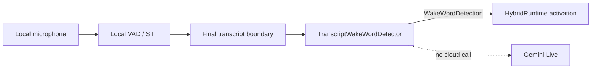

# Feature: local transcript and acoustic wake word

- Status: `in-progress`
- Last updated: 2026-08-30
- Plan: [Reachy hybrid household companion](../plans/reachy-hybrid-household-companion.md)

## Overview

The Phase 4 V0 detector recognizes the local wake phrase `Reachy` from local
partial or final speech-to-text updates. It is a small, dependency-free
boundary that can later be replaced by an acoustic detector such as a local
wake-word model. It does not create a provider session, call Gemini, or send
audio anywhere.

The detector remains a pure local component. `HybridRuntime` owns activation,
physical acknowledgment, keyboard fallback, local-command routing, and provider
lifecycle wiring.

## User-facing behavior

The detector accepts local transcript updates and returns a metadata-only
activation event when the configured phrase appears as a complete word. Case
and punctuation are ignored around the phrase, while substrings such as
`preachy` and `Reachy2` do not activate. The text after the phrase is retained
as `remaining_text`/`command_text`, so `Reachy, look left` can reach the local
command router without waiting for a second transcription pass.

Partial STT updates may be cumulative (`Re`, then `Reach`) or short deltas
(`Re`, then `achy`). The detector joins bounded partial state only while an
utterance is open. Every update is limited to its newest 512 characters before
matching or returning the command suffix, so an oversized STT result cannot
grow detector memory or activation payloads. A wake phrase that has already
fallen outside that retained tail is intentionally not recovered. A final
update closes the state. One detection is emitted per utterance; a configurable
monotonic cooldown suppresses repeated final updates or closely spaced
utterances.

For the current hybrid runtime integration, activation intentionally waits for
`segment.final`. The local STT boundary emits complete final segments, and
waiting preserves the full addressed suffix (`Reachy, look left`) for the
deterministic command router. A partial `Reachy` therefore does not construct a
provider or acknowledge a command; its later final segment is the first runtime
activation event. The detector still supports partial/delta callers directly,
and `consume_detection()` remains available to future integrations that act on
partial detections.

When a final wake contains no suffix, `HybridRuntime` acknowledges locally and
waits for at most one next final local segment for the configured short timeout.
An exact stripped command remains local; an uncertain follow-up or timeout uses
the ordinary cloud activation path. A wake and command in the same final
segment keeps the immediate path above unchanged.

The detector returns no event for ordinary speech. An integration can keep the
keyboard activation path as a separate reliable fallback. The implementation
does not itself decide whether a detected command is safe or whether a
non-command should escalate to Gemini.

## Current architecture and target changes

Local audio flows through `HybridRuntime` into the replaceable ambient context
processor. Final local transcript events feed this detector for the current
runtime integration:



`TranscriptWakeWordDetector` owns only phrase matching, partial-text
debouncing, and detector metrics. It does not own audio capture, VAD, STT,
robot movement, command execution, or the cloud handler. `HybridRuntime` owns
the final-segment activation policy. The event contains no source-transcript
field; only the minimum command suffix and timing metadata needed by the next
local boundary are returned.

## Canonical files and contracts

| Area | File or interface | Responsibility / contract |
|------|-------------------|---------------------------|
| Detector boundary | `src/reachy_mini_conversation_app/wake_word.py:WakeWordDetector` | Typed local lifecycle/transcript contract for the current and future implementations, including accepted-detection consumption. |
| Transcript implementation | `src/reachy_mini_conversation_app/wake_word.py:TranscriptWakeWordDetector` | Case-insensitive, word-bounded `Reachy` matching with partial/final handling. |
| Detection event | `WakeWordDetection` | Wake phrase, suffix, first-word metadata, source kind, and optional monotonic latency; no raw transcript. |
| Benchmark counters | `WakeWordMetricsSnapshot` | Detection, suppression, externally labelled false-positive/missed-activation, update, and latency counters. |
| Acoustic extension seam | `AcousticWakeWordDetector` | Typed future local audio-detector contract; no model or dependency is selected in V0. |

`process_transcript(text, is_final=False, speech_started_at=None,
observed_at=None)` uses the injected monotonic clock when `observed_at` is not
provided. Observation timestamps must be finite and nondecreasing; a
non-finite or backward timestamp raises `ValueError` before detector state or
metrics change. `speech_started_at` is optional; when both timestamps are
valid and ordered, the detector records the local detection latency. Negative
or non-finite explicit benchmark latency is rejected. Error messages and logs
contain no transcript content.

`reset()` clears the in-progress partial utterance and cooldown so an
integration can recover at a VAD turn boundary or after an activation failure.
It intentionally preserves metrics. `consume_detection()` clears the
in-progress partial utterance and per-segment debounce marker after an
activation has been accepted, but leaves cooldown timestamps, configuration,
and metrics intact. It is reserved for integrations that deliberately act on
partial detections; the current runtime waits for final segments instead.
`reset_metrics()` starts a fresh benchmark without changing detector
configuration.

`first_word_retained` is true when text after the wake word was preserved in
the event. `wake_word_is_first_word` separately records whether any prior word
preceded the phrase. Integrations should use `remaining_text` as untrusted
input to deterministic local routing and escalate anything outside its
allowlist.

## Extension guide

### Safe to extend

- Replace `TranscriptWakeWordDetector` with a local implementation satisfying
  `WakeWordDetector`.
- Add an acoustic implementation satisfying `AcousticWakeWordDetector` after
  measuring model quality, CPU/RAM use, platform support, and license terms.
- Add fields to the event or metrics snapshot only when the privacy and
  documentation contracts are updated together.

### Do not change without updating this document and its tests

- Do not make wake detection depend on Gemini or a cloud transcript.
- Do not log or persist source transcript/audio payloads.
- Keep `consume_detection()` separate from `reset()`: accepted partial wakes
  must release their segment state without bypassing cooldown suppression.
- Keep the current runtime's final-segment gate until the local STT contract
  can reliably preserve the complete addressed suffix in partial updates.
- Do not remove word boundaries, partial debounce, cooldown, or command-suffix
  retention without a replacement regression test and benchmark evidence.
- Do not treat a wake detection as permission to execute an arbitrary command;
  local command policy belongs to the command router.

### Common extension path

1. Implement the typed detector against local-only input.
2. Return the same metadata-only event and counters, or document a deliberate
   contract revision.
3. Add deterministic unit tests for boundaries, turn lifecycle, failures,
   privacy, and latency; then run the focused test command and the repository
   gate from `docs/TESTING.md`.

## Ready-made acoustic candidates

The current runtime uses the dependency-free transcript detector. Research
identified candidates for a future implementation of the existing
`AcousticWakeWordDetector` seam; no model or runtime dependency has been added.

| Candidate | Integration fit | Evidence and caveats | License caveat |
|-----------|-----------------|----------------------|----------------|
| [`andyjmorgan/reachy-wake-word`](https://github.com/andyjmorgan/reachy-wake-word) | Best first seam fit. Its ONNX model accepts mono 16 kHz PCM16, matching the normalized local audio boundary; an adapter can feed frames to openWakeWord without opening another microphone. | The published model targets phonetic `reechy`, not a guaranteed literal `Reachy`. Reported accuracy, recall, and false-positive rates are maintainer results and require an actual microphone benchmark. | Repository code is Apache-2.0, but the pretrained model is CC BY-NC-SA 4.0. Confirm that its non-commercial terms fit this project before bundling it. |
| [`luisomoreau/hey_reachy_wake_word_detection`](https://huggingface.co/spaces/luisomoreau/hey_reachy_wake_word_detection) / [Edge Impulse project](https://studio.edgeimpulse.com/public/855375/latest) | Exact-phrase candidate with Mac ARM64 and Linux AARCH64 artifacts, but it expects 24 kHz and a 12,000-sample (1.5-second) window. It must be adapted to the shared audio stream and lower-level classifier API; the example's `AudioImpulseRunner` owns a microphone. | The author reports only Apple Silicon testing and describes the small training set as non-production-grade. Resampling, windowing, and model-process lifecycle need latency and resource tests. | The public Edge Impulse project lists BSD 3-Clause Clear; the Hugging Face Space does not clearly declare an application license. Audit the app, model, and training assets separately before reuse. |
| [`openWakeWord`](https://github.com/dscripka/openWakeWord) | General 16 kHz local model API with configurable score thresholds, optional VAD, and verifier support; suitable as the adapter framework for a selected model. | Its built-in model list has no Reachy model. A custom model still needs phrase-specific data and deployment testing on Mac and Raspberry Pi. | Code is Apache-2.0, while bundled pretrained models are CC BY-NC-SA 4.0 and are not automatically suitable for commercial use. |

There is no merged official Pollen wake-word solution to reuse today: the
[Conversation App standby/wake PR #514](https://github.com/pollen-robotics/reachy_mini_conversation_app/pull/514)
is open, and the SDK's [wake-word issue #1253](https://github.com/pollen-robotics/reachy_mini/issues/1253)
is unresolved. The PR is useful architectural context, not an upstream
dependency or acceptance evidence.

The next safe step is an offline, metadata-only benchmark of the 16 kHz ONNX
candidate against the current seam, followed by a separate comparison with the
24 kHz Edge candidate if its licensing is acceptable. Record threshold,
debounce, false positives, misses, activation latency, CPU, and RSS. Keep the
keyboard fallback, do not add fuzzy transcript aliases, and never log or store
the wake audio.

## Constraints, privacy, and failure modes

- The V0 implementation has no model dependency and performs no network I/O.
- Partial text is bounded to 512 characters in memory and is cleared at final
  transcript boundaries or `reset()`. Direct and final updates are subject to
  the same newest-tail bound; no transcript is written to disk or emitted in
  logs.
- Observation timestamps must be finite and nondecreasing. Backward timestamps
  are rejected rather than treated as a cooldown reset, because accepting them
  would make duplicate suppression and latency measurements ambiguous. Calling
  `reset()` starts a new timestamp sequence.
- A cooldown suppresses duplicate detections but does not erase benchmark
  counters. A reset explicitly clears the cooldown.
- The detector cannot know whether a human-labelled activation was false or
  missed, so integrations record those labels through counter methods without
  supplying the original transcript.
- Invalid configuration and invalid benchmark samples raise `ValueError` so
  callers cannot silently collect misleading measurements. A local processing
  boundary should catch and log those errors at its integration boundary.
- An out-of-order `speech_started_at` timestamp produces no latency sample; it
  does not create a negative measurement.
- The detector is not an acoustic wake-word model. Recognition quality,
  false-positive rate, and missed activations must be measured with the actual
  local STT backend and microphone before selecting a production backend.
- An acoustic candidate must remain local and consume the existing normalized
  audio stream. A model that opens its own microphone would duplicate capture
  and can violate the single-audio-owner design.

## Dependencies

- Depends on: local VAD/STT transcript updates supplied by the hybrid runtime.
- Used by: hybrid activation and the deterministic local command router.
- New runtime dependencies: none.

## Testing

Tests ship with the detector implementation. They are hardware-, network-,
and provider-independent.

### Unit tests

| File | Scenarios |
|------|-----------|
| `tests/test_wake_word.py` | Case/punctuation handling, word boundaries, first-word metadata, command suffix retention, cumulative and delta partials, final-turn reset, accepted partial-detection consumption, cooldown preservation, injected clock, explicit reset, metrics, invalid configuration, invalid latency, and out-of-order timestamps. |

### Integration tests

`tests/test_hybrid_runtime.py` and `tests/test_main.py` assert final-segment
activation, partial-wake deferral, command-suffix retention, keyboard fallback
composition, exact local-command execution without a handler, and uncertain
escalation.

### Simulator / end-to-end tests

No simulator or live microphone claim is made by this module. Phase 4 manual
testing must measure false positives, missed activations, and activation
latency on the development machine after integration.

### Test commands

```bash
.venv/bin/ruff check src/reachy_mini_conversation_app/wake_word.py tests/test_wake_word.py
.venv/bin/ruff format --check src/reachy_mini_conversation_app/wake_word.py tests/test_wake_word.py
.venv/bin/mypy --pretty --show-error-codes src/reachy_mini_conversation_app/wake_word.py
.venv/bin/pytest tests/test_wake_word.py -v
```

Focused validation on 2026-08-29: Ruff, formatting, strict mypy for the new
source file, and all 18 wake-word tests passed. The movement regression and
hybrid lifecycle suite passed alongside them (64 tests total). The earlier
full repository gate was refreshed after those regressions and passed all 649
tests. On 2026-08-30, the live final-STT path worked with a configured
`LOCAL_WAKE_WORD=computer` through local activation. The attached command then
escalated to Gemini, so this validates the alternate wake phrase but not local
command routing. The default `Reachy` path produced no action because no exact
matching final transcript token reached the detector; this is not evidence for
a new wake-word alias. Wake false-positive/miss rates and latency remain
unmeasured.

## Changelog

| Date | Change |
|------|--------|
| 2026-08-29 | Added dependency-free transcript wake-word detector, future acoustic protocol, privacy-safe metrics, partial debounce, cooldown, and deterministic tests. |
| 2026-08-29 | Wired continuous local transcripts to hybrid activation while retaining keyboard activation and cloud-free exact commands. |
| 2026-08-29 | Added explicit accepted-detection consumption for integrations that act on partial wakes; added cooldown and lifecycle regressions. |
| 2026-08-29 | Restricted the current runtime integration to final local STT segments so a partial `Reachy` cannot open cloud before its command suffix arrives; added local-command and next-wake regression coverage. |
| 2026-08-30 | Live validation isolated the default `Reachy` no-action result to the exact final-transcript match boundary; a configured `computer` wake reached the detector path successfully. |
| 2026-08-30 | Researched ready-made acoustic candidates: the 16 kHz `andyjmorgan` ONNX model is the closest seam fit but targets `reechy` and is CC BY-NC-SA; the 24 kHz/1.5 s Edge Impulse `Hey Reachy` candidate needs an adapter and has an unclear Space license; openWakeWord has no Reachy model. No model or dependency was added. |
| 2026-08-30 | Added the bounded two-second one-shot waiter for wake-only final segments followed by a separate final command, allowing for the existing silence boundary and local STT delay. Exact follow-ups remain local; uncertain/timeout paths use normal cloud activation, and close/cancellation releases the waiter. Live segmentation and latency remain unmeasured. |
