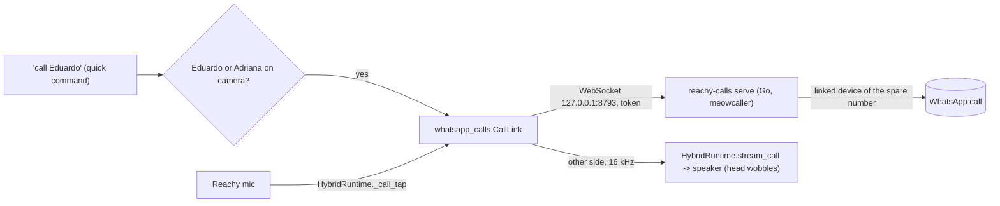

# Feature: WhatsApp calls through Reachy

- Status: `in-progress` (stage 2: outgoing calls through Reachy's speaker and mic; incoming calls are declined)
- Last updated: 2026-10-30
- Plan: [WhatsApp voice calls through Reachy](../plans/whatsapp-calls.md)

## Overview

"Richie, call Eduardo" rings that person's WhatsApp from Reachy's spare number. When they answer, their
voice comes out of Reachy, his head moving with it as when he speaks, and his microphone carries the room
back. Calls go only to people on an approved list, and only Eduardo or Adriana can start one. Incoming
calls are not answered yet (stage 3); video, group calls and recording are out of scope.

## User-facing behavior

- **Asking:** "call Eduardo", "please call dad", "llama a papá", "llámale a Eduardo", "chiama Eduardo",
  "liga para o Eduardo". It is a call only when the name is on the approved list (its name or a `say`
  name); anything else ("call grandma", "llama la atención") goes to the conversation, which has no way to
  place a call.
- **Who may ask:** face recognition must see Eduardo or Adriana (`WHATSAPP_CALLERS`) in front of the camera
  at that moment. Anyone else, or nobody recognized, hears "Only Mom or Dad can start a call." and nothing
  is dialed.
- **The call:** "Calling Eduardo!", then it rings (silently on Reachy's side) for up to 60 s. Once
  answered, the other side plays from Reachy's speaker and his head wobbles with it; his mic goes to the
  call. Name detection, the room transcript and Gemini hear nothing during the call; music stays lowered.
- **Ending:** the other person hangs up, or 60 min pass. Then "Call ended." Unanswered: "Eduardo didn't
  answer." Service down or refused: "I couldn't call Eduardo." (Hanging up from Reachy's side, by an
  antenna bend, is stage 3.)
- **Disabled:** without the service's token file (`WHATSAPP_CALLS_TOKEN_FILE`) or without the approved
  list, "call x" is not a call.

## Current architecture

- `tools/whatsapp-calls/` (Go): `reachy-calls serve` keeps a second linked device of the spare number
  online (GOWA is the first; photos and messages are untouched) and runs one call at a time for the app.
  It reads the approved list itself and refuses anyone not on it, declines every incoming call, hangs up an
  unanswered call at 60 s and a call at 60 min, and logs names, never numbers. It listens on loopback only
  and requires the token it created in `~/.local/share/reachy-whatsapp-calls/token` (mode 600).
- `whatsapp_calls.py`: `CallLink` (one call over the WebSocket: mic out once answered, the other side in,
  the end reason), `load_callees` (names and spoken names from the approved list; numbers are not read),
  `call_pcm` (a captured frame's first channel at 16 kHz, as Gemini Live hears the room).
- `HybridRuntime.stream_call(link)`: during a quick command, sets `_call_tap` so post-activation frames go
  to the call instead of the post-activation queue, and queues the other side as reply audio until the
  call ends. Exposed to quick commands as `ToolDependencies.stream_call`.
- `QuickCommands._call`: the grammar (`_CALL`), the approved-name match, the face check
  (`identify_now`), the replies (`CALLING`, `CALL_ENDED`, `CALL_NO_ANSWER`, `CALL_FAILED`,
  `CALL_PARENTS_ONLY`), and a step timeout of ringing plus 60 min.
- Audio on the wire: 16 kHz mono 16-bit PCM both ways; meowcaller sends 960-sample (60 ms) frames.

## Configuration

| Variable | Default | Meaning |
|---|---|---|
| `WHATSAPP_CALLS_URL` | `ws://127.0.0.1:8793/call` | The call service |
| `WHATSAPP_CALLS_TOKEN_FILE` | `~/.local/share/reachy-whatsapp-calls/token` | Its token; no calls without it |
| `WHATSAPP_CALLS_APPROVED_FILE` | `~/.config/reachy-whatsapp/calls.json` | `{"approved": [{"name": "…", "phone": "+…", "say": ["…"]}]}`; shared with the service |
| `WHATSAPP_CALLERS` | `eduardo,adriana` | Face ids that may start a call |

## Privacy and safety

- No call audio is stored or sent anywhere but the call; the room is not transcribed or sent to the cloud
  during it. Numbers live only in the approved list on the mini (never in the repo or logs).
- meowcaller is unofficial: calling from it is outside WhatsApp's terms and the spare number could be
  banned (risk accepted by the household; see the plan). It is pinned to an unmerged fix (PR 26) for
  incoming audio.

## Tests

- `tests/test_whatsapp_calls.py`: the approved list read without numbers, mic frames at 16 kHz, a call
  carrying audio both ways only once answered, an unanswered call's reason, an unreachable service.
- `tests/test_hybrid_runtime.py::test_a_call_sends_the_room_to_the_other_side_and_plays_their_voice`.
- `tests/test_quick_commands.py`: "call x" in four languages, a parent calling, a kid or nobody refused,
  a name not approved left to the conversation, no answer and failure replies, no token no call.
- `tools/whatsapp-calls/main_test.go`: the approved list, the mic source's silence and drop-oldest.

## Changelog

- 2026-10-30: Stage 2: outgoing calls through Reachy (service mode, `CallLink`, `stream_call`, "call x"
  with the face check).
