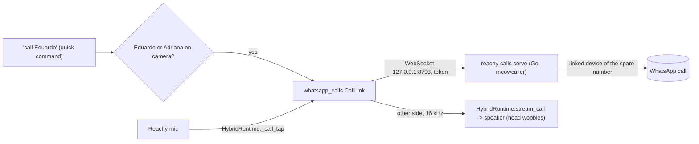

# Feature: WhatsApp calls through Reachy

- Status: `in-progress` (stage 3: calls both ways through Reachy's speaker and mic; live check of incoming pending)
- Last updated: 2026-10-30
- Plan: [WhatsApp voice calls through Reachy](../plans/whatsapp-calls.md)

## Overview

"Richie, call Eduardo" rings that person's WhatsApp from Reachy's spare number. When they answer, their
voice comes out of Reachy, his head moving with it as when he speaks, and his microphone carries the room
back. Approved people can call Reachy too: he announces them and the TRMNL shows who is calling. Calls go
only to and from people on an approved list, and only Eduardo or Adriana can start one. Video, group calls
and recording are out of scope.

## User-facing behavior

- **Asking:** "call Eduardo", "please call dad", "llama a papá", "¿puedes llamar a Eduardo?", "márcale a
  Eduardo", "hazle una llamada a Eduardo", "llámale a Eduardo", "chiama Eduardo",
  "liga para o Eduardo", and "calla Eduardo" / "Col Eduardo" (how the speech models heard "call Eduardo" on
  the first try). It is a call only when the name is on the approved list (its name or a `say`
  name); anything else ("call grandma", "llama la atención") goes to the conversation.
- **In a conversation:** Gemini's `call_person` tool (a skill) takes the same request: it checks the name and
  the face, then closes the conversation after Reachy's reply and hands "call x" (in the conversation's
  language) to the call command, which checks again and calls. Before 2026-10-30 Gemini had no way to call
  and said "I can't make calls right now".
- **Who may ask:** face recognition must see Eduardo or Adriana (`WHATSAPP_CALLERS`) in front of the camera,
  looking for up to 3 s (`CALLER_CHECK_S`; one frame just after waking was too unsure on 2026-10-30). Anyone else, or nobody recognized, hears "Only Mom or Dad can start a call." and nothing
  is dialed.
- **The call:** "Calling Eduardo!", then it rings for up to 60 s, and Reachy plays a ringback tone meanwhile
  (`ringback`: 425 Hz, 1 s on, 4 s off, as in Portugal) so the room hears it ringing and hears it stop when
  the other side answers. Once
  answered, the other side plays from Reachy's speaker and his head wobbles with it; his mic goes to the
  call. Name detection, the room transcript and Gemini hear nothing during the call; music stays lowered.
- **Sound:** while the room is quiet, what Reachy sends is turned down to a tenth (a noise gate: the idle
  room's hiss was heard as rustling), opening at once when someone speaks. The other side plays at most
  about a third of full scale (a limiter: shouting on the phone cut Reachy's speaker out).
- **Ending:** either side hangs up (on Reachy: bend an antenna), or 60 min pass. Then "Call ended."
  Unanswered: "Eduardo didn't answer." Service down or refused: "I couldn't call Eduardo."
- **Being called:** an approved person calling the spare number rings for up to 60 s. The TRMNL shows a
  caller card ("Llamada de / Eduardo / Di sí, o dobla una antena") while it rings. Awake, Reachy says
  "¡Te llama Eduardo!" (`WHATSAPP_CALLS_LANGUAGE`, default Spanish) and listens once without the name:
  "sí / yes / dale…" answers, "no" declines ("Vale, no contesto."), anything else leaves it ringing.
  Anyone may answer, kids included; "contesta / answer / atiende / rispondi / atende" also answer while it
  rings, and so does an antenna bend. A conversation open when it rings closes so he can announce it.
  Asleep (night, naps): no voice, only the caller card and a small repeating antenna wiggle; a bend still
  answers. Not approved, another call on, or the app not listening: declined by the service.
- **Disabled:** without the service's token file (`WHATSAPP_CALLS_TOKEN_FILE`) or without the approved
  list, "call x" is not a call.

## Current architecture

- `tools/whatsapp-calls/` (Go): `reachy-calls serve` keeps a second linked device of the spare number
  online (GOWA is the first; photos and messages are untouched) and runs one call at a time for the app.
  It reads the approved list itself and refuses anyone not on it, declines every incoming call, hangs up an
  unanswered call at 60 s and a call at 60 min, and logs names, never numbers. It listens on loopback only
  and requires the token it created in `~/.local/share/reachy-whatsapp-calls/token` (mode 600).
- `whatsapp_calls.py`: `CallLink` (one call over the WebSocket: mic out once answered, the other side in,
  the end reason), `load_callees` (names and spoken names from the approved list; numbers are not read),
  `call_pcm` (a captured frame's first channel at 16 kHz, as Gemini Live hears the room), `NoiseGate`
  (outgoing: `GATE_OPEN_RMS` 0.02, `GATE_FLOOR` 0.1, `GATE_HOLD_S` 0.4), `Limiter` (incoming: `LIMIT_PEAK`
  0.35), `parent_in_front` (the face check shared with the tool), `call_request` (the hand-off text).
- `tools/call_person.py`: Gemini's tool; enabled with the hybrid runtime once the token and approved list
  exist (`core_tools.CALL_TOOLS`). `HybridRuntime.request_after_close(text)` closes the conversation after
  the reply and then activates locally with ``text`` as the request.
- `HybridRuntime.stream_call(link)`: during a quick command, sets `_call_tap` so post-activation frames go
  to the call instead of the post-activation queue, and queues the other side as reply audio until the
  call ends. Exposed to quick commands as `ToolDependencies.stream_call`.
- `QuickCommands._call`: the grammar (`_CALL`), the approved-name match, the face check
  (`identify_now`), the replies (`CALLING`, `CALL_ENDED`, `CALL_NO_ANSWER`, `CALL_FAILED`,
  `CALL_PARENTS_ONLY`), and a step timeout of ringing plus 60 min.
- Audio on the wire: 16 kHz mono 16-bit PCM both ways; meowcaller sends 960-sample (60 ms) frames.
- Incoming: the service holds an approved caller ringing and reports it on `/events` (kept open by
  `whatsapp_calls.CallManager` from its own thread, reconnecting every 5 s); the app answers with
  `{"op": "answer", "call_id"}` on `/call` or declines on `/events`. `main._start_calls` shows the caller card,
  announces through `HybridRuntime.request_announcement` with `QuickCommands.answer_incoming`, or wiggles
  the antennas (`set_listening`) while asleep. The antenna-touch handler asks `CallManager.antenna_touched()`
  first: during a call it hangs up; while one rings it activates with `CALL_ANSWER_REQUEST`; otherwise the
  usual wake.

## Configuration

| Variable | Default | Meaning |
|---|---|---|
| `WHATSAPP_CALLS_URL` | `ws://127.0.0.1:8793/call` | The call service |
| `WHATSAPP_CALLS_TOKEN_FILE` | `~/.local/share/reachy-whatsapp-calls/token` | Its token; no calls without it |
| `WHATSAPP_CALLS_APPROVED_FILE` | `~/.config/reachy-whatsapp/calls.json` | `{"approved": [{"name": "…", "phone": "+…", "say": ["…"]}]}`; shared with the service |
| `WHATSAPP_CALLERS` | `eduardo,adriana` | Face ids that may start a call |
| `WHATSAPP_CALLS_LANGUAGE` | `es` | The language incoming calls are announced (and answered) in |

## Privacy and safety

- No call audio is stored or sent anywhere but the call; the room is not transcribed or sent to the cloud
  during it. Numbers live only in the approved list on the mini (never in the repo or logs).
- meowcaller is unofficial: calling from it is outside WhatsApp's terms and the spare number could be
  banned (risk accepted by the household; see the plan). It is pinned to an unmerged fix (PR 26) for
  incoming audio.

## Tests

- `tests/test_whatsapp_calls.py`: the approved list read without numbers, mic frames at 16 kHz, a call
  carrying audio both ways only once answered, an unanswered call's reason, an unreachable service.
- `tests/test_hybrid_runtime.py::test_a_call_sends_the_room_to_the_other_side_and_plays_their_voice`,
  `test_a_call_handed_off_by_gemini_runs_once_the_conversation_closes`.
- `tests/tools/test_call_person.py`: a parent hands the call off in Spanish, a kid is refused, a name not on
  the list is not called, no runtime no calls.
- `tests/test_whatsapp_calls.py` also: the gate (closed on hiss, opens on speech without a click, holds),
  the limiter (caps a shout, eases back), the hand-off text parsed in each language.
- `tests/test_quick_commands.py`: "call x" in four languages, a parent calling, a kid or nobody refused,
  a name not approved left to the conversation, no answer and failure replies, no token no call.
- `tools/whatsapp-calls/main_test.go`: the approved list, the mic source's silence and drop-oldest.
- Incoming (`tests/test_whatsapp_calls.py`): a ringing call answered on its call id without a ringback, a
  decline sent back and an abandoned call cleared, an antenna bend hanging a call up;
  (`tests/test_quick_commands.py`): "answer" in four languages, answering only while it rings, "sí" answers
  and "no" declines after the announcement.

## Changelog

- 2026-10-30: Stage 3: incoming calls from approved people, announced with a caller card on the TRMNL,
  answered by voice or an antenna bend, a silent ring while asleep; an antenna bend hangs up any call.
- 2026-10-30: A ringback tone while it rings (the household could not tell ringing from answered).
- 2026-10-30: A noise gate on what Reachy sends, a limiter on what he plays, and `call_person` for Gemini.
  The recorded call (both directions, deleted after) showed no echo of the caller's voice in what Reachy
  sent, about 0.01 RMS of high-pitched hiss whenever the room was quiet, and the caller's shouts arriving
  whole (so the cut-out is at Reachy's speaker). Two tries that day were misheard and went to Gemini.
- 2026-10-30: First call through Reachy (78 s, Eduardo): the other side clear through Reachy, no delay,
  the head moving with the voice; Reachy's side to the phone "rustling"; very loud speech on the phone
  side cut the audio from Reachy's speaker. The face check now looks for 3 s; `REACHY_CALLS_RECORD_DIR`
  records both directions of a call for checking these by hand.
- 2026-10-30: "calla" and "col" accepted for "call" (the first live try was heard as both).
- 2026-10-30: Stage 2: outgoing calls through Reachy (service mode, `CallLink`, `stream_call`, "call x"
  with the face check).
