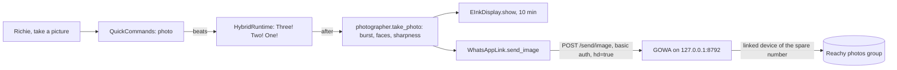

# Feature: Photos and messages to WhatsApp

- Status: `in-progress` (live check of the quick command passed on the Mac mini 2026-10-29; `take_photo` from Gemini not yet tried live)
- Last updated: 2026-10-29
- Plans: [Photos to the family WhatsApp group](../plans/whatsapp-photos.md),
  [Voice messages and photos to family groups](../plans/whatsapp-family-messages.md)

## Overview

"Richie, take a picture" counts "three, two, one" out loud, takes a short burst with Reachy's camera,
keeps the best frame, shows it on the e-ink screen and sends it to the household's "Reachy photos"
WhatsApp group from Reachy's own WhatsApp number (the household's spare number, linked to GOWA, a
WhatsApp server on this computer).

"Richie, send a message to Tío Sergio" records a voice message after a beep and sends it to the
"Reachy <> Sergio" group as a WhatsApp voice note; "send a picture to Sergio" sends the photo there. Each
family group holds that relative, the spare number and both parents.

Out of scope: sending anywhere but the photos group and the groups in the contacts file, photo edits,
video, replies, ending a message by touch, and messages from a Gemini conversation.

## User-facing behavior

- **Asking.** A woken request that is, after politeness, "(let's) take a picture / photo / pic (of us /
  me / everyone)", "take our picture", "tomemos / saquemos / hagamos / vamos a sacar una foto",
  "facciamo / scattiamo una foto", "vamos tirar / tiremos uma foto", "(puedes) sacar / tomar / hacer una foto (de nosotros)", "sácanos /
  hazme una foto", "(puoi) fare / scattare una foto (a noi)", "facci / scattaci una foto", "(podes)
  tirar / bater uma foto(grafia) (de nós)" or "tira-nos uma foto". Anything more ("take a picture of me as
  a pirate") or a negation goes to the conversation.
- **Framing.** From the countdown until the photo is taken, Reachy follows the face in view (daemon face
  tracking through `MovementManager.frame_faces`), then eases back to his idle gaze. Meanwhile speaker
  turns wait (at most `PHOTO_FRAMING_MAX_S`, 30 s), so a voice from the side cannot turn him away from the
  face. Tracking someone had turned on stays on; a conversation that starts mid-photo takes the tracking
  over and ends it. Gemini's `take_photo` frames the same way.
- **Countdown.** Reachy says "Three!", "Two!", "One!" in the request's language, about one second apart
  (cached phrases play without Gemini's padding silence; before that, a beat ran about 1.8 s), waits 0.4 s for his head to settle, and takes up to five frames 0.12 s
  apart. The frame with the most faces wins, then the sharpest.
- **Preview.** With the TRMNL set up, the photo goes on the screen for 10 minutes (within about five
  minutes when the screen is asleep; the now-playing card may replace it while music plays).
- **Sent.** "Sent!" ("¡Enviada!", "Inviata!", "Enviada!"). The photo arrives in the group fitted to
  2560 px (GOWA's HD mode; without it, GOWA would shrink it to 600 px).
- **Failures.** No frame within 1.5 s, or the photo step over 4 s: "Sorry, the camera didn't give me a
  picture." GOWA down, refusing or logged out: "I couldn't send the photo." The send timed out after
  leaving (15 s deadline): "I'm not sure the photo went through." Reachy keeps working either way.
- **Busy.** From the countdown to "Sent!" (usually about 5 s; at most about 23 s when GOWA is slow)
  Reachy is running a local command and does not listen; there is no way to cancel once the countdown
  starts. No cooldown or limit (household choice).
- **Not configured, or the camera off** (`--no-camera`): "take a picture" goes to the conversation as
  before, where `show_on_display kind=camera` shows it on the screen without sending it.
- **In a Gemini conversation** (one already open, or a request the grammar did not catch), Gemini
  has the `take_photo` tool, offered only when WhatsApp photos are configured: it says "3, 2, 1" as it
  calls the tool, which waits `CAMERA_COUNTDOWN_S` (3 s) and then takes, shows and sends the photo the
  same way, to the photos group or, with `to` ("Sergio"), to that family group (an unknown name takes no
  photo and returns who it can go to), returning `sent`, `unsure`, `not_sent` or an error for Gemini to put in its own words.
  Photo edits ("make me a pirate") stay with `show_on_display kind=camera` and are not sent.

### Messages and photos to family groups

- **Asking.** "Send a message / a voice message to [x]", "send [x] a message", "vamos a mandar un mensaje
  a [x]", "mándale un audio al tío Sergio", "manda un messaggio vocale allo zio Sergio", "envia uma
  mensagem para o Sergio", and "send a picture to [x]", "manda una foto a [x]" (polite forms too). "Pon / ponle / poner una foto / un mensaje a [x]" counts too,
  only with a recipient (a misheard "mandar", 2026-10-29). [x] is
  any name in the contacts file ("sergio", "tío sergio", "zio sergio"…), with articles and "a / al / to /
  para" ignored. A message for Maribel stays with her hand-off.
- **No name, or one he does not know** (or two groups at once): "Who should I send it to? I can send to
  Tío Sergio." He listens once without his name (as after Maribel's questions); a known name goes on, an
  unknown one gets "Sorry, I can only send to Tío Sergio.", "never mind" ends it. Nothing is guessed.
- **A message.** "Okay! Tell me your message for Tío Sergio after the beep." The antennas perk and idle
  breathing stops; a rising two-note beep; then he records until 3 s of silence after the speech, or 60 s.
  Nothing said within 8 s of the beep: "I didn't hear a message, so I didn't send anything." The
  recording (with 0.5 s kept around the speech) is encoded to OGG Opus and sent as a voice note:
  "Sent to Tío Sergio!", or "I couldn't send the message." / "I'm not sure the message went through.".
  It stays in memory only.
- **A picture** is the photo countdown and burst, sent to that group: "Sent to Tío Sergio!".
- **Not set up** (no WhatsApp, no contacts file, or the camera off for pictures): the request goes to the
  conversation.

## Current architecture



- `photographer.take_and_share(deps, chat)` is the one path for both: takes the photo in a thread
  (bounded by `PHOTO_TAKE_S`), shows it (bounded by `PHOTO_PREVIEW_S`, errors logged) and sends it;
  None when there was no picture, otherwise the `SendResult`.
- `QuickCommands._photo` returns a `QuickReply` with no text, the countdown as `beats`, and an `after`
  step that settles and calls `take_and_share`. `after_timeout_s` (`PHOTO_STEP_TIMEOUT_S`, 22.4 s) is
  longer than all of these, so the runtime never cuts the send short.
- `HybridRuntime._try_quick_command` speaks `beats` after the reply's text: beat k starts `k·beat_s`
  after the first (at once if the previous one ran long), the last one is waited out, and a superseded
  activation stops the countdown before `after`.
- `tools/take_photo.py` (`TakePhoto`) waits the 3 s countdown and calls `take_and_share`; it is in
  `WHATSAPP_TOOLS`, added when `whatsapp_photos_configured()` and removed otherwise, and a direct tool
  (not behind a skill: the countdown needs it at once).
- `photographer.FaceFinder` owns the SDK YuNet `FaceDetector`; `photographer.FACES` is the one instance. `main.py` warms it up in the
  `photo-setup` thread at startup; a photo never waits for that (non-blocking lock), and a failed
  creation is remembered: photos are then chosen by sharpness only.
- The same thread speaks every photo phrase once through `LocalSpeech` so they are in the on-disk cache
  (they are in `FIXED_PHRASES`), then after 20 s logs whether GOWA is connected and logged in.
- GOWA is not our code: [go-whatsapp-web-multidevice](https://github.com/aldinokemal/go-whatsapp-web-multidevice)
  v9.7.0 (MIT, built on whatsmeow), run as `whatsapp rest`. `scripts/start-reachy.sh` starts it when it is
  configured and not running, and leaves it running when the app exits.

## Canonical files and contracts

| Area | File or interface | Responsibility / contract |
|------|-------------------|---------------------------|
| Link | `whatsapp.py`: `WhatsAppLink(url, auth).send_image(chat, jpeg) -> SendResult` | Multipart `phone`, `hd=true`, `image` (`photo.jpg`, `image/jpeg`); `SENT` on 2xx with `code == SUCCESS`; `FAILED` otherwise or when it could not connect (one retry after 1 s on `ConnectError`/`ConnectTimeout` only); `UNSURE` on a read/write timeout or the 15 s `SEND_DEADLINE_S`; never retried once it may have left |
| Server status | `WhatsAppLink.status() -> ServerStatus | None` | `connected`, `logged_in` from `GET /app/status`, GOWA's code and message; None when unreachable |
| CLI | `python -m reachy_mini_conversation_app.whatsapp status / groups / pair PHONE` | `groups` prints `name<TAB>id` for `WHATSAPP_PHOTOS_CHAT`; `pair` creates the `reachy` device slot on a fresh server and prints the pairing code |
| Photo | `photographer.take_photo(media, faces) -> bytes | None` | Up to `BURST_FRAMES` (5) frames `BURST_INTERVAL_S` (0.12 s) apart within `BURST_WINDOW_S` (1.5 s), missed frames retried every 30 ms; score `(faces, sharpness)`; JPEG quality 92, one retry of the encode |
| Share | `photographer.take_and_share(deps, chat, *, faces, take) -> SendResult | None` | Shared by the quick command and the tool; `SHARE_TIMEOUT_S` bounds it from outside |
| Tool | `tools/take_photo.py`: `take_photo` (optional `to`, a contact name) | `{status: sent / unsure / not_sent, instruction}` or `{error, instruction?}` |
| Trigger | `quick_commands.parse` → `QuickCommand("photo", language)` | Checked after the negation check and weather, before `_NOT_A_COMMAND_START` |
| Reply | `QuickReply.beats`, `QuickReply.beat_s`, `QuickReply.before` | `before` runs once the runtime takes the reply (never for a cut-off request handed to the conversation), before any speech; beats are spoken after `text`, before `after`; phrases `COUNTDOWN`, `PHOTO_SENT`, `PHOTO_NOT_SENT`, `PHOTO_UNSURE`, `PHOTO_NO_PICTURE`; `PHOTO_PHRASES` lists them with their language |
| Wiring | `main._build_whatsapp`, `deps.whatsapp`, `_prepare_photos` | `deps.whatsapp` is None unless `whatsapp_photos_configured()` |
| Contacts | `whatsapp_contacts.py`: `load_contacts(path, fold)`, `find_contact(phrase, contacts)` | `{"contacts": [{"name", "chat" (`@g.us` only), "say": [...]}]}` read on each request; unknown, empty or ambiguous → None |
| Voice note | `voice_notes.encode_voice_note(rate, pcm) -> bytes | None`; `WhatsAppLink.send_audio(chat, ogg)` | GStreamer `opusenc ! oggmux`, 48 kHz mono 32 kbit/s; `/send/audio` with `ptt=true` and `message.ogg` (`audio/ogg`), same retry and deadline rules as photos |
| Recording | `HybridRuntime.record_message() -> (rate, mono int16) | None`, `deps.record_message` | Only during the current quick command; beep (`local_speech.beep`), then `_request_clip` with the post-activation queue paused; `_MESSAGE_START_S` 8, `_MESSAGE_SILENCE_S` 3, `_MESSAGE_MAX_S` 60, `_MESSAGE_MARGIN_S` 0.5 |
| Messages | `quick_commands`: kinds `message` / `send_photo` with `{"to": phrase or None}`; `MESSAGE_PROMPT`, `SENT_TO`, `SEND_TO_WHO`, `SEND_TO_ONLY`, `MESSAGE_NOTHING`, `MESSAGE_NOT_SENT`, `MESSAGE_UNSURE`; `MESSAGE_STEP_TIMEOUT_S` | The three outcome sets are in `FIXED_PHRASES` |
| Config | `WHATSAPP_API_URL`, `WHATSAPP_API_AUTH` (`user:password`, GOWA's `APP_BASIC_AUTH`), `WHATSAPP_PHOTOS_CHAT` (group id, `...@g.us`) | All three needed; `WHATSAPP_SERVER_BIN` and `WHATSAPP_SERVER_DIR` are for the start script only |

## Operations (Mac mini)

1. `curl -LO` `whatsapp_9.7.0_darwin_arm64.zip` and `checksums-macos.txt` from the GOWA v9.7.0 release
   (curl adds no Gatekeeper quarantine), check with `shasum -a 256`, unpack into
   `~/.local/share/reachy-whatsapp`, rename the binary (`darwin-arm64`) to `whatsapp`, and `chmod 700`
   the directory.
2. In that directory, a `.env` for GOWA: `APP_HOST=127.0.0.1`, `APP_PORT=8792`,
   `APP_BASIC_AUTH=reachy:<random>`, `APP_UI_ENABLED=false`, `MCP_ENABLED=false`, `WHATSAPP_AUTO_REPLY=`,
   `WHATSAPP_AUTO_DOWNLOAD_MEDIA=false`, `WHATSAPP_WEBHOOK=`, and `APP_OS=Reachy` (the name the phone
   shows under Linked devices). GOWA reads `.env` from its working directory.
3. In Reachy's `.env`: `WHATSAPP_API_URL=http://127.0.0.1:8792`, `WHATSAPP_API_AUTH=reachy:<random>`,
   `WHATSAPP_SERVER_BIN=~/.local/share/reachy-whatsapp/whatsapp`.
4. Start it. On the Mac mini it is the LaunchAgent `com.eduardo.reachy-whatsapp` (`RunAtLoad`,
   `KeepAlive`, 30 s throttle), which runs `/bin/sh -c 'umask 077; cd ~/.local/share/reachy-whatsapp &&
   exec ./whatsapp rest >~/Library/Logs/Reachy/whatsapp.log 2>&1'` (an owner-only log, rewritten each
   start); restart it with `launchctl kickstart -k gui/$(id -u)/com.eduardo.reachy-whatsapp`. Elsewhere,
   `scripts/start-reachy.sh` starts it when `WHATSAPP_SERVER_BIN` is set. Then
   `python -m reachy_mini_conversation_app.whatsapp pair <spare number, digits only>`; on the spare phone:
   WhatsApp → Linked devices → Link a device → Link with phone number, and type the code.
5. Create a group with the spare number in it (the household's is "Reachy group"); `... whatsapp groups`; put its id in
   `WHATSAPP_PHOTOS_CHAT`; restart Reachy. `... whatsapp status` should say `logged_in=True`.
6. Keep the spare phone plugged in on Wi-Fi: WhatsApp logs out linked devices whose phone has been
   offline for about two weeks.

## Extension guide

### Safe to extend

- More trigger phrasings in `_PHOTO` (with tests for each language).
- Other recipients: `send_image` takes any chat id; voice notes would use GOWA's `/send/audio`.
- The scoring in `take_photo` (e.g. eyes open), as long as it stays within `PHOTO_TAKE_S`.

### Do not change without updating this document and its tests

- `hd=true` (600 px photos otherwise) and the `image/jpeg` part (GOWA refuses others).
- No retry after the request may have left; `UNSURE` rather than `FAILED` for those.
- `PHOTO_STEP_TIMEOUT_S` above the sum of its parts.
- Every photo phrase in `FIXED_PHRASES`.
- Nothing taken or sent without a parsed `photo` command; only to `WHATSAPP_PHOTOS_CHAT`.

## Constraints, privacy, and failure modes

- **Terms of service.** GOWA is an unofficial WhatsApp client; WhatsApp may ban the number. The
  household accepted that for the spare number (2026-10-29).
- **What leaves the house:** only the chosen photo, only on request, only to the photos group.
- **What Reachy keeps:** nothing; the e-ink preview file is deleted after 10 minutes. Logs hold sizes,
  times, counts and outcomes, never the chat id, the credentials or the image.
- **What GOWA keeps** (its v9.7.0 source): the session keys (`storages/whatsapp.db`), the text and
  metadata of messages in the spare number's chats (`storages/chatstorage.db`; there is no setting to turn
  this off), and briefly each sent image (`statics/senditems`, deleted after the send). It prints its
  settings, its password included, at startup: the start script rewrites an owner-only log each start and
  makes the data directory owner-only.
- **GOWA down or crashed:** nothing restarts it until the next `start-reachy.sh`; each photo says "I
  couldn't send the photo" (connection refused is immediate).
- **Two GOWA devices:** it then needs `X-Device-Id`, which Reachy does not send; keep one.

## Dependencies

- Depends on: quick commands, the hybrid runtime's quick-command path, `camera_frames`, the SDK
  `FaceDetector`, `LocalSpeech`, the e-ink display (optional), GOWA, `httpx`.
- Used by: nothing yet; the kids' messages to family are the next milestone.

## Testing

### Unit tests

| File | Scenarios |
|------|-----------|
| `tests/test_whatsapp.py` | `phone`, `hd=true`, the `image` part's name and type, basic auth; refused (400, `code` not SUCCESS, 500) not retried; one retry on `ConnectError` and `ConnectTimeout`; read timeout and deadline are `UNSURE`, sent once; logs hold neither the group nor the password; status logged in / no device / unreachable; groups; pairing creates the device slot; the `groups` command and missing settings |
| `tests/test_photographer.py` | Sharper scores higher; most faces wins over sharpness; equal faces → sharpest; no detector (failure remembered) and a detection error fall back to sharpness; a running warm-up does not block a photo; missed frames retried until the burst is full; nothing in the window → None; waits between frames; a failed encode tried once more |
| `tests/test_quick_commands.py` | Messages: grammar with and without a name, Maribel's left alone; prompt, recording with antennas perked, voice note to the group; nothing said, not sent, unsure; a picture to his group; "who?" and its answers (known, unknown, cancel), nothing sent to an unknown name; no contacts or WhatsApp → conversation; outcome phrases cached. Photos: the grammar in four languages, polite and infinitive forms; edits, negations and questions are not photos; countdown, preview for 10 minutes, sent to the group, nothing before the countdown; not sent and unsure lines; no picture and a stuck camera send nothing; a broken screen still sends; not configured or camera off → conversation; other commands never touch the camera or WhatsApp; every phrase cached |
| `tests/test_hybrid_runtime.py` | `test_a_countdown_speaks_each_beat_on_schedule_before_the_follow_up` (beats on schedule, last waited out, the conversation never opens), `test_a_superseded_countdown_stops_and_skips_the_follow_up` |
| `tests/test_moves.py` | `test_speaker_turns_wait_while_a_photo_is_framed`, `test_a_photo_that_never_ends_stops_holding_speaker_turns`, `test_a_photo_frames_the_face_then_lets_go`, `test_a_photo_leaves_tracking_someone_turned_on`, `test_a_conversation_started_during_a_photo_ends_its_tracking` |
| `tests/tools/test_take_photo.py` | A photo for a family member goes to their group, framed; an unknown name takes nothing; waits the countdown, sends to the group, each outcome; no picture sends nothing; needs the link, the group and the camera; offered only with WhatsApp photos set up |
| `tests/test_whatsapp_contacts.py` | Folded names; only named groups (a person's number, missing fields, junk skipped, not logged); missing or broken file; articles and accents; unknown and ambiguous names |
| `tests/test_voice_notes.py` | A tone encodes to OGG Opus (skipped without GStreamer); empty → None |
| `tests/test_hybrid_runtime.py` (messages) | Beep then recording until silence, trailing silence trimmed, post-activation queue left empty, no conversation; the length cap; nothing said → None; outside a command → None |
| `tests/test_config.py` | `test_whatsapp_photos_need_all_three_settings` (trimmed values; `_build_whatsapp` None unless all three) |

### Not yet validated

- Checked live 2026-10-29: "vamos a mandar un mensaje a Sergio" (10.2 s recorded, ended by silence,
  42 KB voice note sent in 1.1 s) and "mándale una foto a Sergio" (sent in 0.9 s) both arrived. Not yet:
  the 3 s silence ending with the children, and face framing during the countdown.
- Gemini's `take_photo` in a live conversation.
- Checked live on 2026-10-29: install, pairing by code, the group listing, the LaunchAgent restart
  keeping the link, and one "tomemos una foto": countdown and settle 6.7 s (beats about 1.8 s each),
  burst 0.8 s, a 185 KB JPEG sent in 1.6 s on the first try, 9.7 s from request to "¡Enviada!".
- The start-script block was checked with a fake server (start, owner-only data directory and log,
  reuse, missing binary), not with GOWA.

### Test commands

```bash
pytest tests/test_whatsapp.py tests/test_photographer.py tests/test_quick_commands.py tests/test_config.py -v
pytest tests/test_whatsapp_contacts.py tests/test_voice_notes.py -v
pytest tests/test_hybrid_runtime.py -v -k "countdown or message or beep"
```

## Changelog

| Date | Change |
|------|--------|
| 2026-10-29 | Speaker turns wait while a photo is framed; `take_photo` takes `to`; "pon una foto a [x]". |
| 2026-10-29 | Photos frame the face in view during the countdown (live: the head did not turn to the person asking). |
| 2026-10-29 | Voice messages and pictures to family groups from a contacts file; "who?" when no name is known. |
| 2026-10-29 | Tighter countdown: cached phrases play without their padding silence. |
| 2026-10-29 | `take_photo` tool: Gemini sends photos too. |
| 2026-10-29 | Initial implementation. GOWA installed on the Mac mini as a LaunchAgent and paired with the spare number; group "Reachy group". |
