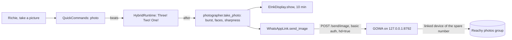

# Feature: Photos to WhatsApp

- Status: `in-progress` (built and tested; GOWA installed and paired on the Mac mini 2026-10-29; live photo check pending)
- Last updated: 2026-10-29
- Plan: [Photos to the family WhatsApp group](../plans/whatsapp-photos.md)

## Overview

"Richie, take a picture" counts "three, two, one" out loud, takes a short burst with Reachy's camera,
keeps the best frame, shows it on the e-ink screen and sends it to the household's "Reachy photos"
WhatsApp group from Reachy's own WhatsApp number (the household's spare number, linked to GOWA, a
WhatsApp server on this computer).

Out of scope: sending from a Gemini conversation, sending to anyone but the photos group, voice notes,
video, replies, and the kids' messages to family (later milestones of the same link).

## User-facing behavior

- **Asking.** A woken request that is, after politeness, "(let's) take a picture / photo / pic (of us /
  me / everyone)", "take our picture", "tomemos / saquemos / hagamos / vamos a sacar una foto",
  "facciamo / scattiamo una foto", "vamos tirar / tiremos uma foto", "(puedes) sacar / tomar / hacer una foto (de nosotros)", "sácanos /
  hazme una foto", "(puoi) fare / scattare una foto (a noi)", "facci / scattaci una foto", "(podes)
  tirar / bater uma foto(grafia) (de nós)" or "tira-nos uma foto". Anything more ("take a picture of me as
  a pirate") or a negation goes to the conversation.
- **Countdown.** Reachy says "Three!", "Two!", "One!" in the request's language, one second apart (a beat
  can stretch to about 1.4 s), waits 0.4 s for his head to settle, and takes up to five frames 0.12 s
  apart. The frame with the most faces wins, then the sharpest.
- **Preview.** With the TRMNL set up, the photo goes on the screen for 10 minutes (within about five
  minutes when the screen is asleep; the now-playing card may replace it while music plays).
- **Sent.** "Sent!" ("¡Enviada!", "Inviata!", "Enviada!"). The photo arrives in the group fitted to
  2560 px (GOWA's HD mode; without it, GOWA would shrink it to 600 px).
- **Failures.** No frame within 1.5 s, or the photo step over 4 s: "Sorry, the camera didn't give me a
  picture." GOWA down, refusing or logged out: "I couldn't send the photo." The send timed out after
  leaving (15 s deadline): "I'm not sure the photo went through." Reachy keeps working either way.
- **Busy.** From the countdown to "Sent!" (usually about 5 s; at most about 23 s when GOWA is slow)
  Reachy is running a local command and does not listen; there is no way to cancel once the countdown
  starts. No cooldown or limit (household choice).
- **Not configured, or the camera off** (`--no-camera`): "take a picture" goes to the conversation as
  before, where `show_on_display kind=camera` shows it on the screen without sending it.
- **In an open Gemini conversation** the request reaches Gemini, not the quick commands: the photo is
  shown, not sent.

## Current architecture



- `QuickCommands._photo` returns a `QuickReply` with no text, the countdown as `beats`, and an `after`
  step that settles, takes the photo in a thread (bounded by `PHOTO_TAKE_S`), shows it (bounded by
  `PHOTO_PREVIEW_S`, errors logged) and sends it. `after_timeout_s` (`PHOTO_STEP_TIMEOUT_S`, 22.4 s) is
  longer than all of these, so the runtime never cuts the send short.
- `HybridRuntime._try_quick_command` speaks `beats` after the reply's text: beat k starts `k·beat_s`
  after the first (at once if the previous one ran long), the last one is waited out, and a superseded
  activation stops the countdown before `after`.
- `photographer.FaceFinder` owns the SDK YuNet `FaceDetector`. `main.py` warms it up in the
  `photo-setup` thread at startup; a photo never waits for that (non-blocking lock), and a failed
  creation is remembered: photos are then chosen by sharpness only.
- The same thread speaks every photo phrase once through `LocalSpeech` so they are in the on-disk cache
  (they are in `FIXED_PHRASES`), then after 20 s logs whether GOWA is connected and logged in.
- GOWA is not our code: [go-whatsapp-web-multidevice](https://github.com/aldinokemal/go-whatsapp-web-multidevice)
  v9.7.0 (MIT, built on whatsmeow), run as `whatsapp rest`. `scripts/start-reachy.sh` starts it when it is
  configured and not running, and leaves it running when the app exits.

## Canonical files and contracts

| Area | File or interface | Responsibility / contract |
|------|-------------------|---------------------------|
| Link | `whatsapp.py`: `WhatsAppLink(url, auth).send_image(chat, jpeg) -> SendResult` | Multipart `phone`, `hd=true`, `image` (`photo.jpg`, `image/jpeg`); `SENT` on 2xx with `code == SUCCESS`; `FAILED` otherwise or when it could not connect (one retry after 1 s on `ConnectError`/`ConnectTimeout` only); `UNSURE` on a read/write timeout or the 15 s `SEND_DEADLINE_S`; never retried once it may have left |
| Server status | `WhatsAppLink.status() -> ServerStatus | None` | `connected`, `logged_in` from `GET /app/status`, GOWA's code and message; None when unreachable |
| CLI | `python -m reachy_mini_conversation_app.whatsapp status / groups / pair PHONE` | `groups` prints `name<TAB>id` for `WHATSAPP_PHOTOS_CHAT`; `pair` creates the `reachy` device slot on a fresh server and prints the pairing code |
| Photo | `photographer.take_photo(media, faces) -> bytes | None` | Up to `BURST_FRAMES` (5) frames `BURST_INTERVAL_S` (0.12 s) apart within `BURST_WINDOW_S` (1.5 s), missed frames retried every 30 ms; score `(faces, sharpness)`; JPEG quality 92, one retry of the encode |
| Trigger | `quick_commands.parse` → `QuickCommand("photo", language)` | Checked after the negation check and weather, before `_NOT_A_COMMAND_START` |
| Reply | `QuickReply.beats`, `QuickReply.beat_s` | Spoken after `text`, before `after`; phrases `COUNTDOWN`, `PHOTO_SENT`, `PHOTO_NOT_SENT`, `PHOTO_UNSURE`, `PHOTO_NO_PICTURE`; `PHOTO_PHRASES` lists them with their language |
| Wiring | `main._build_whatsapp`, `deps.whatsapp`, `_prepare_photos` | `deps.whatsapp` is None unless `whatsapp_photos_configured()` |
| Config | `WHATSAPP_API_URL`, `WHATSAPP_API_AUTH` (`user:password`, GOWA's `APP_BASIC_AUTH`), `WHATSAPP_PHOTOS_CHAT` (group id, `...@g.us`) | All three needed; `WHATSAPP_SERVER_BIN` and `WHATSAPP_SERVER_DIR` are for the start script only |

## Operations (Mac mini)

1. `curl -LO` `whatsapp_9.7.0_darwin_arm64.zip` and `checksums-macos.txt` from the GOWA v9.7.0 release
   (curl adds no Gatekeeper quarantine), check with `shasum -a 256`, unpack into
   `~/.local/share/reachy-whatsapp`, rename the binary (`darwin-arm64`) to `whatsapp`, and `chmod 700`
   the directory.
2. In that directory, a `.env` for GOWA: `APP_HOST=127.0.0.1`, `APP_PORT=8792`,
   `APP_BASIC_AUTH=reachy:<random>`, `APP_UI_ENABLED=false`, `MCP_ENABLED=false`, `WHATSAPP_AUTO_REPLY=`,
   `WHATSAPP_AUTO_DOWNLOAD_MEDIA=false`, `WHATSAPP_WEBHOOK=`, and `APP_OS=Reachy` (the name the phone
   shows under Linked devices). GOWA reads `.env` from its working directory.
3. In Reachy's `.env`: `WHATSAPP_API_URL=http://127.0.0.1:8792`, `WHATSAPP_API_AUTH=reachy:<random>`,
   `WHATSAPP_SERVER_BIN=~/.local/share/reachy-whatsapp/whatsapp`.
4. Start it. On the Mac mini it is the LaunchAgent `com.eduardo.reachy-whatsapp` (`RunAtLoad`,
   `KeepAlive`, 30 s throttle), which runs `/bin/sh -c 'umask 077; cd ~/.local/share/reachy-whatsapp &&
   exec ./whatsapp rest >~/Library/Logs/Reachy/whatsapp.log 2>&1'` (an owner-only log, rewritten each
   start); restart it with `launchctl kickstart -k gui/$(id -u)/com.eduardo.reachy-whatsapp`. Elsewhere,
   `scripts/start-reachy.sh` starts it when `WHATSAPP_SERVER_BIN` is set. Then
   `python -m reachy_mini_conversation_app.whatsapp pair <spare number, digits only>`; on the spare phone:
   WhatsApp → Linked devices → Link a device → Link with phone number, and type the code.
5. Create a group with the spare number in it (the household's is "Reachy group"); `... whatsapp groups`; put its id in
   `WHATSAPP_PHOTOS_CHAT`; restart Reachy. `... whatsapp status` should say `logged_in=True`.
6. Keep the spare phone plugged in on Wi-Fi: WhatsApp logs out linked devices whose phone has been
   offline for about two weeks.

## Extension guide

### Safe to extend

- More trigger phrasings in `_PHOTO` (with tests for each language).
- Other recipients: `send_image` takes any chat id; voice notes would use GOWA's `/send/audio`.
- The scoring in `take_photo` (e.g. eyes open), as long as it stays within `PHOTO_TAKE_S`.

### Do not change without updating this document and its tests

- `hd=true` (600 px photos otherwise) and the `image/jpeg` part (GOWA refuses others).
- No retry after the request may have left; `UNSURE` rather than `FAILED` for those.
- `PHOTO_STEP_TIMEOUT_S` above the sum of its parts.
- Every photo phrase in `FIXED_PHRASES`.
- Nothing taken or sent without a parsed `photo` command; only to `WHATSAPP_PHOTOS_CHAT`.

## Constraints, privacy, and failure modes

- **Terms of service.** GOWA is an unofficial WhatsApp client; WhatsApp may ban the number. The
  household accepted that for the spare number (2026-10-29).
- **What leaves the house:** only the chosen photo, only on request, only to the photos group.
- **What Reachy keeps:** nothing; the e-ink preview file is deleted after 10 minutes. Logs hold sizes,
  times, counts and outcomes, never the chat id, the credentials or the image.
- **What GOWA keeps** (its v9.7.0 source): the session keys (`storages/whatsapp.db`), the text and
  metadata of messages in the spare number's chats (`storages/chatstorage.db`; there is no setting to turn
  this off), and briefly each sent image (`statics/senditems`, deleted after the send). It prints its
  settings, its password included, at startup: the start script rewrites an owner-only log each start and
  makes the data directory owner-only.
- **GOWA down or crashed:** nothing restarts it until the next `start-reachy.sh`; each photo says "I
  couldn't send the photo" (connection refused is immediate).
- **Two GOWA devices:** it then needs `X-Device-Id`, which Reachy does not send; keep one.

## Dependencies

- Depends on: quick commands, the hybrid runtime's quick-command path, `camera_frames`, the SDK
  `FaceDetector`, `LocalSpeech`, the e-ink display (optional), GOWA, `httpx`.
- Used by: nothing yet; the kids' messages to family are the next milestone.

## Testing

### Unit tests

| File | Scenarios |
|------|-----------|
| `tests/test_whatsapp.py` | `phone`, `hd=true`, the `image` part's name and type, basic auth; refused (400, `code` not SUCCESS, 500) not retried; one retry on `ConnectError` and `ConnectTimeout`; read timeout and deadline are `UNSURE`, sent once; logs hold neither the group nor the password; status logged in / no device / unreachable; groups; pairing creates the device slot; the `groups` command and missing settings |
| `tests/test_photographer.py` | Sharper scores higher; most faces wins over sharpness; equal faces → sharpest; no detector (failure remembered) and a detection error fall back to sharpness; a running warm-up does not block a photo; missed frames retried until the burst is full; nothing in the window → None; waits between frames; a failed encode tried once more |
| `tests/test_quick_commands.py` | The grammar in four languages, polite and infinitive forms; edits, negations and questions are not photos; countdown, preview for 10 minutes, sent to the group, nothing before the countdown; not sent and unsure lines; no picture and a stuck camera send nothing; a broken screen still sends; not configured or camera off → conversation; other commands never touch the camera or WhatsApp; every phrase cached |
| `tests/test_hybrid_runtime.py` | `test_a_countdown_speaks_each_beat_on_schedule_before_the_follow_up` (beats on schedule, last waited out, the conversation never opens), `test_a_superseded_countdown_stops_and_skips_the_follow_up` |
| `tests/test_config.py` | `test_whatsapp_photos_need_all_three_settings` (trimmed values; `_build_whatsapp` None unless all three) |

### Not yet validated

- A photo in the group from the Mac mini: its size and quality, timings. (Install, pairing by code,
  the group listing and the LaunchAgent restart keeping the link were checked on 2026-10-29.)
- The start-script block was checked with a fake server (start, owner-only data directory and log,
  reuse, missing binary), not with GOWA.

### Test commands

```bash
pytest tests/test_whatsapp.py tests/test_photographer.py tests/test_quick_commands.py tests/test_config.py -v
pytest tests/test_hybrid_runtime.py -v -k countdown
```

## Changelog

| Date | Change |
|------|--------|
| 2026-10-29 | Initial implementation. GOWA installed on the Mac mini as a LaunchAgent and paired with the spare number; group "Reachy group". |
