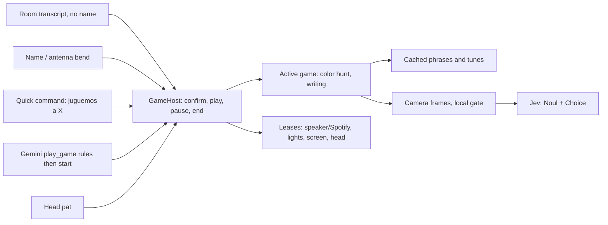

# Plan: Games on Reachy (a shared game mode, the color hunt first)

- Status: `approved` (designed with the household 2026-10-30; nothing built)
- Owner: Eduardo
- Created: 2026-10-30
- Last updated: 2026-10-31
- Feature doc: to be written as `docs/features/games.md` with the first game

## Goal

Games for the kids (2 and 4) and for adults, all started, paused and ended the same way, and all cheap: a game
runs on the Mac mini (local Whisper, cached phrases, the camera, pats and antennas) with no Gemini session
open. Cloud models are used only for narrow judgments, mostly Jev on a camera frame (a small fraction of a cent).

The first game is the **color hunt** ("juguemos a los colores", "let's play color hunt"): Reachy names a
color, a tune speeds up for 30 seconds, and the child shows him something of that color; Jev checks the frame.

## Scope

- A shared game host: names in Spanish and English, starting locally or through Gemini, a yes before every
  start, the game owning the speaker, lights, screen, head and camera, pause and quit, restoring everything
  afterwards, idle endings.
- The color hunt.
- Writing practice moved onto the host (it gains the confirmation and pause; its own words stay).
- Out of scope here (each gets its own plan on this host): freeze dance, peekaboo, 20 questions, Pictionary
  reveal, antenna quiz, red light / green light and the rest of the 2026-10-30 brainstorm. Scores kept across
  days, and per-child difficulty.

## Decisions

| Question | Choice |
|----------|--------|
| Game names | Each game has a name list in Spanish and English plus Whisper's usual mishearings, e.g. color hunt: "los colores", "el juego de los colores", "colores", "color game", "color hunt", "colors". The name is what matters; it is found inside common frames: "juguemos a / vamos a jugar a / ¿jugamos a / quiero jugar a / ¿podemos jugar a …", "let's play / can we play / I want to play …" |
| No name given | "Juguemos" / "let's play a game" alone: "¿A qué jugamos? ¿A los colores o …?" and the answer is heard without the name |
| Starting locally | A quick command finds the game, then Reachy asks a cached question with a one-line pitch: "¿Jugamos a los colores? Yo digo un color y tú me traes algo de ese color." "Sí / vale / dale / claro / yes / ok / sure", or a head pat, starts it; "no", or 8 s of silence, drops it. The yes is the guard against false starts from the TV or chatter |
| Starting through Gemini | Progressive disclosure: a direct `play_game` tool, always offered (not a skill), with one line per game. `action=rules` returns the game's rules and how to pitch it in one sentence and ask for a yes; `action=start` is refused unless `rules` was called for that game in this conversation. On start the result says to say only "¡Vamos!" / "Let's go!" and call `end_conversation`; the game then runs locally. Gemini's own question is the confirmation, so the game does not ask again |
| Language | The language the game was asked for in; every game phrase exists in both and is cached on disk |
| What a game owns | The speaker (Spotify is paused if playing and not resumed afterwards), the lights it uses (their state is saved and restored), the e-ink screen (owner `game`, so the music card holds off), the head and antennas, the camera |
| Other requests mid-game | Any request to Reachy that is not a game word ("Richie, enciende la luz", a song, a question) gets "Estamos jugando a los colores. ¿Lo terminamos?" Yes ends the game and then carries out the request as if just asked (quick command or Gemini); no, or silence, resumes. So lights, music and Gemini are blocked while a game runs without trapping anyone in it. `home_lights` and `spotify_control` also refuse while a game is active, as a guard |
| Pause | Heard without the name: "pausa", "espera", "pause", "wait". His name alone, or an antenna bend, also pauses and asks "Pausa. ¿Seguimos o terminamos?" Paused: the tune and any music stop, the lights are restored, the screen shows PAUSA, timers freeze. "Seguimos / sigue / continue / keep playing" or a pat resumes; 10 minutes paused ends it |
| Quit | Heard without the name: "se acabó el juego", "terminamos", "ya no quiero jugar", "stop the game", "game over", "quit the game". A bare "para" or "stop" does not count (kids shout "¡para!" in games); "para el juego" does |
| Ending on its own | 5 minutes with no game input; camera games pause after 60 s with no face in view; an incoming WhatsApp call pauses the game and rings; a game's own end ("¿Otra vez?" with no yes) |
| After a game | Lights as they were, the screen as it was before the game, head back to normal, Reachy listening as usual. Music stays off |
| Other announcements | Maribel replies and other announcements wait until the game is paused or over; an incoming call does not wait |
| Fast feedback | The speaker, head, antennas and lights carry anything timed; the e-ink screen (seconds to change) only shows prompts, scores and pictures |
| Cheap first | Movement, faces, timing and sound are judged on the Mac mini; Jev is asked only the semantic question ("is this red?"), and only when the frame changed |
| Head pats | A pat only registers while the head is held still (`MovementManager.hold_still`), so games hold the head while they wait for a pat; during dancing parts, voice and antennas are the controls |

## Color hunt

| Part | Design |
|------|--------|
| Round | Reachy says "¡Busca algo ROJO!" (cached), the screen shows ROJO in large letters, the game's lights glow the color for ~3 s and are restored before the camera looks, then a 30 s tune starts at ~100 BPM and speeds up to ~180 |
| Colors | rojo, azul, amarillo, verde, rosa, blanco, negro; no color twice in a row. Reachy's camera shows red and hot pink as orange-ish (spike, 2026-10-31), so "rojo" accepts a red or orange answer; naranja, morado and marrón are left out (naranja cannot be told from red on this camera; the other two were not found at home) |
| Accepting | Two of the last three checked frames with held ≥ 0.5 and the target's family on top (rojo: red or orange). A wrong color is named only when the top answer is a color outside the target's family with probability ≥ 0.7. A color already in view when the round starts (a bottle on the table) counts only after a frame without it |
| The tune | Made on the Mac mini (numpy tones, as the voice-note beep is), played through the runtime's reply audio in 1 s chunks so it stops at once on a find, a pause or a quit |
| Looking | A frame every ~0.7 s, the next only after the previous answer. A local gate skips frames that barely differ from the last one checked, so an empty room costs nothing. A frame goes to Jev in one request: a Noul "someone is holding an object up to the camera, close enough to see clearly" and a Choice "the main color of that object" over the color list plus "none" |
| Found | The tune stops: "¡Sí! ¡Rojo!", a happy emotion, a star on the screen |
| Wrong color | "Mmm, eso es azul. ¡Busca algo rojo!" at most once every 5 s, the timer keeps running |
| Time up | "¡Se acabó el tiempo! Era el rojo." and the next round; nobody loses |
| Game length | 5 rounds, then "¡Cinco estrellas! ¿Otra vez?"; yes plays 5 more, otherwise the game ends |
| Lights | Only the lights named in `GAME_LIGHTS` (e.g. the TV LED strip); without it the game plays without lights. The room lights would tint the camera, hence the restore before looking |
| Cost | Jev on a changed frame only; a round of 30 s is at most ~40 checks, well under a cent. No image model, no Gemini |
| Later variants (same engine) | shapes ("algo redondo"), first letter ("algo que empieza con P"), categories ("algo blando"), counts ("tres cosas"), an adult speed round |

## Architecture

| Piece | File | Responsibility |
|-------|------|----------------|
| Game names | `games/catalog.py` | Each game's names and mishearings in es/en; `find_game(text) -> (game, language) or None`; the yes/no, pause, resume and quit word sets |
| Host | `games/host.py` | One active game; states confirming, playing, paused, ended; the room listener; the hooks the quick commands, wake, antenna, call and cloud-session paths call; idle and pause timers; leases taken at start and restored at the end |
| Game protocol | `games/base.py` | `phrases` (for the cache), `start`, `heard(text) -> bool`, `touched`, `pause`, `resume`, `stop` |
| Color hunt | `games/color_hunt.py` | Rounds, tune, frame loop, Jev questions, screens |
| Jev client | `jev.py` | The TypeSafe request now inside `web_pictures.py` (headers, image limits, usage ledger), shared by both |
| Screens | `eink_display.py` | `render_game_prompt` (big word, stars, PAUSA) |
| Tool | `tools/play_game.py` | `play_game(game, action=rules|start)`; direct, always on |
| Wiring | `quick_commands.py`, `hybrid_runtime.py`, `main.py`, `now_playing.py`, `whatsapp_calls.py` | A `game` quick command; mid-game interception where writing practice intercepts today; wake and antenna to the host while a game runs; announcements held; the call pauses; `game` screen owner |

## Implementation order

1. **Jev spike** (done 2026-10-31, see the progress log). Record ~30 frames from Reachy's camera (toys of each color held up, empty room, a hand
   without an object, under warm and colored light); time Jev and set the Noul and Choice thresholds.
   Stop here and revisit if Jev is too slow (over ~1.5 s) or unreliable on colors.
2. `jev.py` extracted from `web_pictures.py` (no behavior change).
3. `games/catalog.py` and `games/host.py` with the start question, pause, quit, interception, leases and
   timers; the `game` quick command; the room listener and wake/antenna hooks; held announcements; the call
   pause; `play_game` tool.
4. `games/color_hunt.py`, the tune and the screens.
5. Writing practice onto the host: its start asks first ("¿Escribimos PAPÁ?"), and it gains pause and the quit
   words; "ya terminé", "otra vez" and pats stay. `show_on_display kind=writing` hands over to `play_game`.
6. Tests, feature doc `docs/features/games.md`, quick-commands doc, README tool row, profile sentence for
   `play_game`.
7. Deploy to the Mac mini; play with the kids.

## Acceptance criteria

- [ ] "Juguemos a los colores", "vamos a jugar a los colores", "let's play color hunt" and "can we play the
      color game" all ask the start question; "juguemos" alone asks which game.
- [ ] Nothing starts without a yes (voice or pat); "no" and 8 s of silence start nothing.
- [ ] Through Gemini: `start` without `rules` first is refused; with it, the game starts and the conversation ends.
- [ ] While playing, "Richie, enciende la luz" asks whether to end; yes ends and the light turns on; no resumes.
- [ ] "Pausa", the name alone and an antenna bend pause; "seguimos" or a pat resumes; quit words end it;
      a bare "para" does not.
- [ ] After a game, lights and screen are as before, Spotify stays paused, Reachy wakes normally.
- [ ] An incoming call pauses the game; a Maribel reply waits until it ends.
- [ ] Color hunt: a red toy held up is found within ~2 s on the Mac mini; an empty room makes no Jev calls;
      a wrong color is named.
- [ ] Writing practice asks before starting and pauses and quits like the games.
- [ ] Full gate passes.
- [ ] On the Mac mini: five rounds played with the kids without a false start, false find or stuck game.

## Risks

- **Warm colors and evening light.** The spike ran in daylight; warm lamps in the evening may push more colors
  toward orange. Retest under evening light before relying on yellow and white at night. A gray-world color
  correction before Jev did not help (tried in the spike).
- **Light tint.** Colored room lights change what the camera sees; lights are restored before looking and
  limited to `GAME_LIGHTS`.
- **The tune in the transcript.** Reachy's own audio may reach the room transcription; game words must still
  be heard over it. Check live; lower the tune while listening if needed.
- **Short words.** "Sí", "ya" and "pausa" are short and common; the start question has an 8 s window, and
  pause/quit words count only when they are the whole transcript.
- **A child says yes to everything.** Harmless: the confirmation is against the TV and chatter, not the kids.
- **Head held still** for pats stops breathing and speaker turns while a game waits; released on pause and end.

## Test strategy

Unit tests for the catalog (names, frames, languages, mishearings, "para" vs "para el juego"), the host
(confirm by word, pat and timeout; pause and resume by word, name and antenna; quit; mid-game request asks,
then ends and re-dispatches or resumes; idle and pause timeouts; leases restored; announcements held; call
pause), the tool (rules before start), the color hunt with a fake clock, fake frames and a fake Jev (found,
wrong color, time up, unchanged frames skipped, two-frame agreement), and writing practice on the host. Then
the gate, the spike's recorded frames as a fixture, and a live game on the Mac mini.

## Progress log

| Date | Update |
|------|--------|
| 2026-10-30 | Brainstormed 18 games with the household; the color hunt chosen first on a shared game host. Designed: names in es/en, confirmation before every start, Gemini through `play_game` (rules, then start), games own lights/music/screen, pause and quit by voice, name or antenna, mid-game requests offer to end the game. Plan approved; nothing built. |
| 2026-10-31 | Jev spike on the Mac mini: 258 frames from Reachy's camera (640x360, admin camera stream, every 0.5 s) while Reachy spoke the steps; labelled by eye. Jev median 0.16 s (max 0.31 s), ~1,120 input tokens per frame (~$0.00005). Held up: 0.78–0.98 for objects at arm's length; an object shoved right into the lens 0.35–0.71; empty room, walking past, standing, empty hand ≤ 0.28; an object 3 m away ≤ 0.41; frames while lowering the object 0.5–0.76 (the object is still in hand, harmless). Colors, every frame right: blue (12/12), yellow (11/11), green (11/11), white car (10/10), phone with a colorful sticker as black (9/9), pale pink bottle (5/5). Wrong: red car read as orange (5/5 at arm's length, 7/8 up close, red second at 0.08–0.46); hot pink block read as orange or red (10/12). A gray-world color correction did not change this. Decisions: rojo accepts red or orange; naranja, morado, marrón dropped; held ≥ 0.5 in two of the last three frames. Frames and scripts kept on the Mac mini in `~/game-spike` (household images, not committed). An early test frame showed a pink bottle standing in front of the camera read as held (0.64–0.70), hence the "already in view" rule. |
