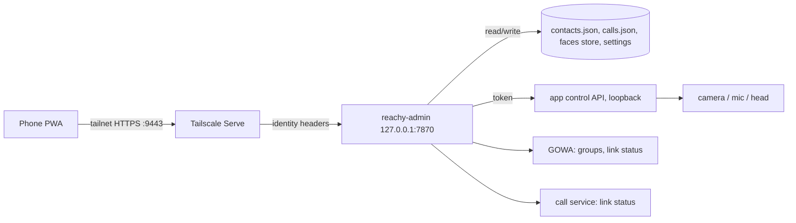

# Plan: Phone admin app for Reachy

- Status: `in-progress`
- Owner: household
- Created: 2026-10-30
- Last updated: 2026-10-30
- Feature doc: [Phone admin app](../features/phone-admin-app.md)
- Builds on: [Voice messages and photos to family groups](whatsapp-family-messages.md),
  [WhatsApp voice calls through Reachy](whatsapp-calls.md), [Face recognition](../features/face-recognition.md)

## Goal

Eduardo and Adriana manage Reachy from their phones, at home or away: the people he knows (spoken
names, WhatsApp group, whether they can call and be called, enrolled faces), his health, a privacy
switch, and a live camera view. It is a web app installed on the home screen (a PWA). Nobody else can
reach it: not the open internet, not a guest on the home Wi-Fi, not another device on the tailnet.

## Decisions (with the household, 2026-10-30)

1. **A separate admin process.** Its own small server on the Mac mini (a LaunchAgent, like the call
   service), not more pages on the conversation app. It stays up when the app crashes or restarts,
   which is when "restart Reachy" and "what went wrong" matter most, and it is the only thing exposed.
2. **Tailscale is the login.** Tailscale Serve publishes the admin process to the tailnet only, with a
   real HTTPS certificate (needed to install a PWA). No passwords.
3. **Adriana joins Eduardo's tailnet as a user** (an invite link; she installs Tailscale on her phone
   and signs in with her own account). Simplest for her, and her identity reaches the app the same way
   Eduardo's does.
4. **No "say this" intercom.**
5. **A privacy switch:** mic and camera off, enforced where audio and frames are captured.
6. **A live camera view,** like a security camera: video only, watched live, never recorded.

## Non-goals

- Access for anyone but Eduardo and Adriana; the kids' devices are not on the tailnet.
- A public URL, Tailscale Funnel, or a cloud relay.
- Recording or storing the camera stream; audio in the camera view.
- Replacing the 7860 settings page for development use (it stays as it is).

## Access and security

| Layer | What it does |
|-------|--------------|
| Admin server binds `127.0.0.1:7870` (`ADMIN_PORT`) | Nothing listens on the LAN. |
| `tailscale serve --bg --https=9443 http://127.0.0.1:7870` | Tailnet-only HTTPS at `https://<mini>.<tailnet>.ts.net:9443`. **Never on 443:** Maribel's Funnel is on 443, and Funnel opens a whole port, so anything served there would be public. |
| Tailscale access rules (grants) | Only Eduardo's and Adriana's users may reach the mini on 9443. |
| Identity check in the admin server | Every request must carry `Tailscale-User-Login` in `ADMIN_ALLOWED_LOGINS`; otherwise 403. Funnel traffic carries no such header, so even a misconfigured Funnel is refused. Requests must come from loopback (the Serve proxy). |
| Writes | JSON bodies only, `Origin` must match the admin URL (no cross-site form posts). |
| Audit log | Append-only JSONL: who, what and when (no phone numbers). Shown in Activity. |
| App control API | The conversation app's loopback-only endpoints (camera frames, privacy, sleep and wake, face enroll from the camera) require a shared token from an owner-only file, like the call service's token. |
| Existing 7860 settings page | Unchanged. Its faces, memory and transcript routes already refuse anyone not on this computer; it only runs with `--ui`, which the Mac mini does not use. The admin app does not depend on it. |

On iPhone, Tailscale's VPN On Demand for the `ts.net` domain lets the home-screen icon open without
switching the VPN on by hand.

## Architecture

- Python package `reachy_mini_conversation_app.admin`, FastAPI on uvicorn (already dependencies), its
  own entry point and LaunchAgent `com.eduardo.reachy-admin`.
- Front end: plain JS like the existing `static/js/views`, no build step, under `static/admin/`, with a
  manifest, a minimal service worker (installability; no offline data) and a phone-first layout.
- Files edited in place keep their formats; both readers already re-read on each request
  (`whatsapp_contacts.py` per request; the call service's `loadApproved` per call), so edits need no
  restart. Writes are atomic (temp file and rename), keep the last few copies, preserve unknown
  fields, and carry a version so two phones editing at once get "changed elsewhere, reload" rather than
  a silent overwrite.
- The app control API runs whether or not the app was started with `--ui`.

## Features by phase

### Phase 0: lock down and skeleton

- Admin server with the identity check, a health page (app running, last error), the audit log.
- Tailscale Serve on 9443, access rules, LaunchAgent; Adriana invited and the PWA installed on both
  phones.

### Phase 1: people

One card per person, joining what is spread across three stores today:

| On the card | Stored in |
|-------------|-----------|
| Name and the names people say for them | `contacts.json` `say`, `calls.json` |
| WhatsApp group for voice notes and photos, picked from Reachy's group list (GOWA `/user/my/groups`) | `contacts.json` `chat` |
| Can be called and can call Reachy | `calls.json` approved list |
| May start calls (the face check, Eduardo and Adriana today) | `WHATSAPP_CALLERS` in Settings |
| Face photos: upload from the phone, enroll from Reachy's camera, delete | face store (`faces.json`, `photos/`) |

- Entries gain an optional `id` matching the face store's person id, so the card joins them reliably;
  name matching is the fallback for entries without one.
- Warnings when two people share a spoken name ("abuela").

### Phase 2: status, privacy, camera, controls

- **Status:** app, GOWA linked, call service linked (an unlink or ban of the spare number shows here
  first), TRMNL battery, disk, last error.
- **Privacy switch** (below).
- **Camera view** (below).
- **Controls:** sleep and wake, volume (the Reachy daemon's `/api/volume`), restart the app (`launchctl kickstart`).
- **Activity:** calls in, out and missed; voice notes and photos sent, with thumbnails; the audit log;
  usage costs (reuse `usage_costs.py`).

### Phase 3: notifications, schedules, settings

- Web Push (iOS 16.4+ for installed PWAs): missed call, WhatsApp unlinked, app crashed, privacy left
  on for hours.
- Quiet hours (no wake, calls declined or silent).
- Languages, who may start calls, wake sensitivity, face recognition, speaker following, the song on the
  e-ink screen: allowlisted `.env` keys, applied by a restart.

## Privacy switch

- **On:** mic audio is dropped before wake detection and speech recognition; the camera is not read (no
  face recognition, photos or camera view); incoming calls are declined; tools that need the mic or
  camera refuse. Enforced at capture, not by instructions to the model.
- **Visible on Reachy:** he goes to sleep and the TRMNL's resting card becomes "Privacy on" so the room knows.
- **Persists** across restarts.
- **Off:** from the admin app. Voice cannot turn it off (the mic is off).

## Camera view

- MJPEG (`multipart/x-mixed-replace`) at about 5 fps, 640 px wide, from the app's loopback API through
  the admin server, shown in an ``: works in iOS Safari without WebRTC.
- Live only: nothing stored, nothing sent to a cloud model.
- Refused while the privacy switch is on.
- Frames share the SDK's JPEG encoder with the live model and face recognition (`camera_frames.py`
  `_CAPTURE_LOCK`): measure the load, lower the rate if it costs the conversation.
- Works away from home over Tailscale.

## Settled questions (with the household, 2026-10-30)

1. **Nothing on Reachy shows that someone is watching,** for now.
2. **A "look up" button** lifts the lowered head while he sleeps, without waking him.
3. **Only the app turns privacy off;** an antenna bend does not.
4. **The head turns from the camera view** (left, right, up, down, centre).

## Implementation order

1. Phase 0, then confirm from both phones and from outside the tailnet.
2. Phase 1 with tests for every file round-trip.
3. Phase 2: privacy switch first (the camera view depends on its gate), then camera view, status,
   controls, activity.
4. Phase 3 after the household has used phases 1–2.

## Acceptance criteria

- From a phone on the home Wi-Fi without Tailscale: 7861, 7870 and 9443 do not answer.
- From the tailnet as Eduardo or Adriana: the PWA installs and works; as any other tailnet user or a
  tagged device: 403. `tailscale funnel status` shows only `/maribel/reply` public.
- A person added from the phone can be messaged and called by voice right away, with no restart.
- Privacy on: no wake, no face recognition, camera view refused, incoming call declined; survives an
  app restart.
- Camera view plays on both phones away from home; the conversation's responsiveness is unchanged
  while it plays.

## Tests

- Unit: identity check (allowed, other login, missing header, non-loopback), Origin check, atomic
  writes preserving unknown fields, version conflicts, spoken-name collisions, joining cards by id and
  by name.
- App: privacy gate drops mic frames and refuses camera reads; stream endpoint refuses without the
  token or while private.
- Go: call service still loads lists written by the admin server.
- Manual on the mini: the acceptance checks above from both phones.

## Risks

- **Serve and Funnel confusion exposing the admin app.** Mitigated by the separate port, the identity
  check refusing header-less requests, and a `funnel status` check in acceptance.
- **Camera load** on the shared encoder; mitigated by a low rate and measurement.
- **Two phones editing at once;** mitigated by versioned writes.
- **iOS PWA quirks** (push only for installed apps, VPN must be up); On Demand VPN covers the second.

## Dependencies

None new for phases 0–2. Phase 3 Web Push needs a VAPID library (e.g. `pywebpush`), reviewed then.

## Documentation

A feature doc `docs/features/phone-admin-app.md` when phase 0 lands (setup, Tailscale commands,
security model); README and architecture diagram updated; this plan and the index kept current.

## Progress log

- 2026-10-30: Discussed with the household; decisions 1–6 recorded. Nothing built.
- 2026-10-30: Open questions settled (nothing shows a watcher; "look up" lifts the sleeping head; only
  the app turns privacy off; the head turns from the camera view). Built all three phases:
  `reachy-admin` (admin/), the app's control API, the privacy switch and quiet hours, the activity log,
  Web Push, the PWA. Deviations from the draft, all simpler: the privacy "pose" is the sleep pose plus the
  TRMNL resting card; quiet hours are an `.env` setting (restart) that stops listening and declines calls;
  the 7860 page is left as is (its personal routes were already loopback-only); no per-person "ring"
  toggle (the call service has none) and no test voice note (groups are picked from Reachy's own list);
  volume goes to the daemon's REST API; persona, speech engine and home layout are not editable (the
  engine is a start-script setting; the layout needs its own design). No new dependencies:
  `cryptography`, FastAPI and uvicorn were already installed (`cryptography` and FastAPI through the SDK).
  Not yet done: the LaunchAgent, Tailscale Serve and access rules on the Mac mini, Adriana's invite, and a
  live check from both phones (the acceptance criteria above).
- 2026-10-31: Validation on the development Mac. `ruff check .`, `ruff format --check .`, `mypy` (strict,
  129 files) clean; `pytest tests/` 2654 passed, 4 skipped; `uv lock --check` in sync. New tests:
  `tests/admin/` (257, including the RFC 8291 vector and decrypting a pushed message), `test_control_api.py`,
  `test_privacy.py`, `test_json_lines.py`, plus additions to the console, moves, e-ink, calls, quick-command
  and photo tests. The admin tests found four bugs, fixed with regression tests: one malformed push
  subscription stopped every notification; saving people while the app was down unlinked faces; a phone
  with no digits was silently dropped; a newline in quiet hours split the `.env` line. A local preview at
  phone size (sample data, an injected login header) checked People, adding a person, Camera with the app
  down, Status, Activity and Settings (only changed keys written); it found and fixed hidden buttons still
  showing, unset on/off settings that would have been saved as off, and stale cached files after an update.
  Not run: the robot, the simulator, Tailscale, a real phone, push delivery through Apple.
- 2026-10-31: Set up on the Mac mini: `.env` (`ADMIN_ALLOWED_LOGINS` for both logins, `ADMIN_APP_SERVICE=com.eduardo.reachy`;
  backup `~/Coding/.env.bak-2026-10-31`), LaunchAgent `com.eduardo.reachy-admin` (log `~/Library/Logs/Reachy/admin.log`),
  `tailscale serve --bg --https=9443 http://127.0.0.1:7870` (tailnet only; Maribel's Funnel on 443 untouched). Restart
  from the app now stops the app with SIGINT and waits for it and `start-reachy` before `kickstart`, since the mini's
  LaunchAgent only opens the launcher (which exits while Reachy runs); checked live. Eduardo opened it on his Pixel.
- 2026-10-31: First phone use found group ids shown instead of names (name and id were swapped) and people known only by
  face (Enzo, Mara, Fernanda, Elena, Martin, Miguel) missing. Both fixed with tests; faces with no card are now cards, a
  known face can be linked onto a card, people with neither group nor number are kept under `others` in the contacts
  file, and "New group with …" creates a WhatsApp group with Reachy and that number (GOWA `POST /group`). The page was
  redesigned: a Home tab with Reachy drawn in his current state and the one action that fits, people tiles and a bottom
  sheet, group options by name, name chips, a d-pad, activity by day, settings with real controls and a save bar, an
  in-app confirm dialog, dark mode, a new icon. Checked in a local preview at phone size in light and dark.
