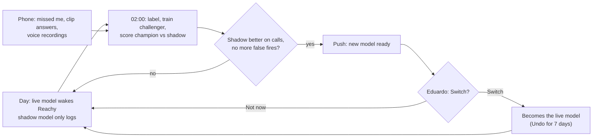

# Plan: Measure the wake word, then improve it every night

- Status: `in-progress` (build steps 1–4 built on branch `worktree-wake-word-loop` 2026-10-31; not yet deployed)
- Last updated: 2026-10-31
- Feature docs: [Wake learning](../features/wake-learning.md), [Wake word](../features/wake-word.md),
  [Hybrid runtime](../features/hybrid-runtime.md),
  [Wake clip capture](../features/wake-clip-capture.md), [Phone admin app](../features/phone-admin-app.md)
- Related: [Catch "Ri-chi" calls](missed-calls-spanish-richi.md), [Wake clip capture](wake-clip-capture.md),
  [Name check](wake-name-check.md), [Qwen speech engine](qwen-speech-engine.md), [Phone admin app](phone-admin-app.md)

## Problem

Each fix for missed calls has raised false wakes, and each fix for false wakes has brought misses back:

- the threshold went from 0.97 to 0.3;
- name checks were added, then a "trusted wake" shortcut, then that shortcut was narrowed;
- the Richi head and open-segment checks came next, then TV strict mode.

Every change was judged on one day's anecdotes, with no fixed measurement, so each one moved along the trade-off
between misses and false wakes instead of improving both.

What the logs and clips show (2026-10-29 to 10-31):

- **The first stage is weak for this household.**
  - On 10-30/31 the wake heads fired 732 times and the name check passed 47 (6%).
  - The Richi head fired 369 times on 10-30, against official33's 84.
  - official33 scored 0.00 on 10 of 14 Spanish "Ri-chi" calls.
  - On 10-30 the transcript caught 52 calls the wake heads never fired on.
- **The name check limits recall too.** In the 2026-10-29 benchmark, Qwen heard the name in 19 of 28 real calls
  (0.6B) and 15 of 28 (1.7B).
  - Recall multiplies across the two stages, so 19 of 20 needs about 97–98% at each stage.
  - False wakes are non-call fires times the check's false-pass rate. At about 400 non-call fires a day, 1 false
    wake a day needs a false-pass rate of 0.25% or less.
  - Neither stage alone can reach the targets.
- **Misses are invisible.** Clips are saved only when something fires or the transcript catches the name. A call
  nothing caught leaves no trace, and we learn of it only from complaints.
- **The paths block each other.** After every fire, the wake head stops scoring while the name is checked, resets
  (about 1.3 s blind) and clears the clip buffer (`hybrid_runtime.py` `_observe_acoustic_frame`, `activate`). The
  open room segment is closed at the wake, so the transcript wake probably cannot rescue a call the check
  rejected (to confirm with a test). A repeated call can land in that gap.
- **Clips are hard to label.** Nothing ties a fire's clip, head, name check and request together. Clip names carry
  only the highest scaled score, and the Richi head's scaled maximum is 0.33, so the heads cannot be told apart.
  Wake clips end at the fire, so audio after it is missing.

## Targets and decisions (agreed 2026-10-31)

| Question | Choice |
|----------|--------|
| Calls | At least 19 of 20 call episodes answered the first time, counted per speaker group and condition (TV, music, kitchen, quiet), not only overall |
| False wakes | At most 1 a day |
| Consent | Capture keeps running; labelled clips are kept past the 14-day purge. Eduardo decides for the household |
| Enrolment | Each person records about 2 minutes of calls around the room |
| Cadence | A new model is trained every night and runs in shadow mode; Eduardo approves every swap |
| Eduardo's part | Everything he or Adriana needs to do happens in the phone admin app: fast, a minute or less, with a push reminder |
| Patch freeze | No threshold, alias or rule tweaks until the scoreboard exists |
| Privacy | Audio stays on the Mac mini (clips play on the two admin phones over Tailscale and are never stored there); no transcripts are stored or logged |

A "call episode" merges the repeats of one call ("Ricci! Ricci! Ricci!") and every clip of the same moment.

## The nightly loop

Quiet hours (21:30–07:00) are when Reachy doesn't listen, so the GPU is free. A LaunchAgent runs the loop at
02:00, on the mini, with nothing leaving it.

Each night:

1. **Label.**
   - Merge the day's clips into episodes by time.
   - Add the people's answers (clip checks, "missed me", recordings).
   - Run Qwen on the rest as a feature (never as the label).
   - Pick tomorrow's clips to check: the ones where the signals disagree, plus a few random ones, at most 10.
2. **Score yesterday's shadow model against the live model on the same live audio:**
   - its fires on everything heard, by condition;
   - the calls it caught among the day's labelled episodes;
   - how many of its extra fires the name check would have passed (replayed on its clips).
3. **Ask for a swap** if the shadow model has run at least one full day and:
   - it catches more calls, beyond a margin set in advance;
   - it doesn't fire more on non-calls, within its margin.
   One push a day at most, with the plain-language numbers.
4. **Train a challenger** on all labels so far: fine-tuned from the live model, plus the same shape from scratch.
   Train on all days except the dev days; the better on the dev days becomes tomorrow's shadow model if it beats
   the current shadow model there.
5. **Write the scoreboard** for the app's card: this week's calls answered the first time, false wakes a day, by
   person group and condition.

**Shadow mode** is a third head on the same feature stream as the live heads:

- It never wakes Reachy.
- When it crosses its threshold, it logs `Shadow wake` with its score and saves a clip (kind `shadow`, with
  post-roll).
- When a live head fires and the shadow model stays under, the record shows that too.
- It costs one tiny MLP per 80 ms.
- This measures its false fires on every hour of real audio, which saved clips alone cannot.

**Swapping** copies the model into place, keeps the last five, and restarts Reachy the next time he is asleep or
idle. Undo stays on the card for 7 days.

## In the admin app

Everything Eduardo or Adriana does for this happens on the phone, in under a minute, with the fewest taps.

### Home: the "Wake word" card

- **What it shows.** This week's score in one line ("47 of 49 calls answered first time · 0.6 false wakes a day ·
  goal 95% and 1"), a sparkline, and a badge for what's waiting ("6 clips · new model").
- **Where it leads.** Tapping it opens the Wake word sheet: the things to do first, then the score by person and
  condition, the model history with Undo, and the recording switch.
- **No new tab.**

### "He missed me": three ways, all a second or two

- **Phone.** A big "He missed me" button on Home, and the same as an Android home-screen shortcut (long-press the
  Reachy icon). It marks the last 60 s. The answer: "Got it, he'll learn from it tonight."
- **Voice, for everyone including the kids.** After he finally wakes, say "you didn't hear me" / "no me
  escuchaste". A local command marks the 60 s before the wake. Reachy answers "Sorry, I'll learn that one" and
  carries on.
- **Antenna.** An antenna wake within 10 s of speech is marked as a likely miss automatically.

A marked miss is looked for in that 60 s at night. Unless it is certain, it goes into the clip check as "Is this the
call?" with the 3 s around the best guess.

### Check clips: about 1 minute a day

- **How it works.** A stack of cards, one clip each, 2–6 s. The clip plays on its own, with a waveform. Answer with
  two big buttons or a swipe:
  - "Called Reachy" (right);
  - "Didn't" (left);
  - "Not sure" (down) skips.
- **Size.** 10 at most a day, in priority order. The last card says "Done: 8 checked. Reachy learns from these
  tonight."
- **Who.** Either admin can answer. Adriana is best placed for Spanish calls, and each answer records who gave it.
- **Push.** At the reminder time (default 19:30, never in quiet hours), only when there are clips: "6 clips to
  check, about a minute". Android buttons: "Check now" / "Tomorrow".

### New model ready: one tap

- **Push.** "A better wake model is ready: it caught 5 more of yesterday's 41 calls, with no more false wakes.
  Switch?" Android buttons: "Switch" / "Not now". "Switch" works straight from the notification.
- **Card.** It shows the same numbers, before and after, per person group, and the false fires a day, with "Switch"
  and "Keep current".
- **Undo.** It stays on the card for 7 days.
- **Not now.** The model stays in shadow and asks again only when its numbers change.

### Teach Reachy your voice: 2 minutes per person

- **Starting it.** From the Wake word sheet, or a person's card ("Record their call"). Pick who; kids are recorded
  with a parent holding the phone.
- **The prompts.** The phone shows big prompts one at a time: "Stand by the sofa. Call him like you normally do."
  Then "from the kitchen", "louder", "quietly", "in a sentence: 'Richi, apaga la luz'", "from the hallway",
  "with the TV on".
- **Recording.** Reachy records on his own microphones, never the phone's, and doesn't answer while recording.
- **Feedback.** A level meter shows he heard it, a tick and a count follow ("7 of 20"), and a quiet one gets
  "Again, a bit louder?".
- **Monthly push.** "2-minute voice refresh? Lucía hasn't recorded yet."

### Record the room for 7 days

- **The switch.** One switch with an end date. While it's on, Home shows "Recording the room: 4 days left" with a
  stop button.
- **What happens to it.** The audio stays on the mini and is deleted once the test set is cut.

### Notifications policy

- At most one wake-word push a day, bundled ("New model ready, and 6 clips to check"), at the reminder time.
- Nothing during quiet hours.
- A setting turns them off or moves the time.
- iPhone shows the same notifications without the buttons; tapping opens the right card.

### Wake sensitivity slider

The Settings slider (`LOCAL_ACOUSTIC_WAKE_THRESHOLD`) is a hand dial of the kind that caused the swinging.

- While the loop runs, it is replaced by the scoreboard and the model history. The operating point is chosen from
  measured curves and offered as a swap.
- Changing it by hand is still possible from `.env`, and every change is noted on the scoreboard.

## Phases

### 1. Measure what happens (code, no behaviour change beyond blind spots)

- **One record per fire.** Each acoustic fire gets an id. It is logged with every head's raw score, the head that
  fired, which name-check models ran and what they decided, trusted or not, the request (length only), and the
  context: TV on, Reachy's own music playing, the direction-of-arrival reading, and loudness. Clip file names carry
  the id and the head.
- **Better clips.**
  - Fire clips include 1.5 s after the fire (the write is delayed).
  - Every successful wake saves the 10 s before it, so a call that had to be repeated shows up.
  - A rejected fire no longer clears the clip buffer.
- **No blind time.**
  - The wake head keeps its stream state across a rejected fire instead of resetting.
  - A test confirms whether the transcript wake sees a rejected call's segment. If it doesn't, fix that.
- **Lost audio.** Log the spans when listening stopped (dropped frames, the detector disabled, dropped STT
  segments), and log the hours listened each day.
- **Shadow head.** Support for it in the detector.

### 2. Ground truth from people (admin app)

"He missed me" (phone, voice, antenna), the clip check, enrolment and the reminder push, as designed above.

- **The name check is never a label.** Its verdict is only a feature.
- **Automatic labels come only from:**
  - a request that was followed and answered (a call);
  - a "missed me" mark (a miss);
  - the clip check (both).

### 3. Nightly loop with shadow mode and approved swaps

As designed above. Until the recorded days exist, promotions rest on two numbers: shadow fires on live audio, and
calls caught on labelled episodes.

### 4. Recorded days and the scoreboard

- **Recorded days.**
  - Record 7 full days of the room as FLAC on the mini (about 1–1.5 GB a day), using the app's switch.
  - Keep a continuous log of the wake head's input features (not audio) as cheap ongoing telemetry.
- **Replay harness.** It runs the whole path offline: heads, name check, trusted rule, transcript wake, and how they
  interact, including blind time. It replays:
  - the recorded days, to count false wakes a day by condition;
  - the labelled call episodes, to count calls answered the first time by speaker × condition.
- **Comparisons.**
  - Paired comparisons on the same audio, with the "no worse" margins set in advance.
  - Confidence intervals: 57 of 60 is somewhere between 86% and 98%.
  - A dev set for nightly work; a sealed test set used monthly and rotated.

### 5. A better name check

- **First,** measure the leftover hint-echo rate. Also compare Qwen with and without the hint, and a name-likelihood
  score in place of the transcript regex, on the scoreboard.
- **Then a learned verifier that runs only on fires.**
  - A pretrained multilingual audio encoder (for example a Whisper-base encoder or WavLM-base+) with a small head,
    fine-tuned on household calls.
  - It scores the audio from 2 s before the fire to 0.5 s after it.
  - It aims for about 10–50 ms per fire on the M1, with a calibrated score and no hint echo.
- **Rollout.** It joins the nightly loop and goes through the same shadow mode and approved swaps.

### 6. One wake head with a fire budget

- **Goal.** One head with a budget of about 30 non-call fires a day at 97–98% call recall, evaluated
  leave-one-day-out.
- **Decision point.** If heads on the frozen openWakeWord features cannot reach that, change the front end.
- **Trusted shortcut.** Recalibrate it whenever the live head changes, until phase 7 replaces it.

### 7. One fitted decision

- **Inputs.** One calibrated decision over:
  - the head score and the verifier score;
  - TV on, and Reachy's own music playing;
  - direction of arrival compared with the TV's bearing (a feature, not a gate);
  - loudness.
- **Operating point.** Chosen from the curve to meet both targets.
- **What it replaces.** The trusted shortcut, TV mode and the separate thresholds.

## Build order

1. **Measurement.** Phase 1 (one record per fire, clips with post-roll and pre-roll, no blind time, lost-audio log,
   shadow head support), plus:
   - a continuous log of the wake head's input features, about 200 MB a day, kept 30 days;
   - "missed me" by voice and phone.

   The feature log supplies every hour of room sound as non-calls and measures any head's fires on full days.
   Round 2 showed both are missing. Step 1 is small, and it starts collecting the right data at once.
2. **Clip check.** The Home card, the clip check and the reminder push, with nightly labelling.
3. **Enrolment.** The guided recording; then each person records once.
4. **Nightly training.** Training, shadow mode, and the approval push and card, with Undo.
5. **Recorded days and the replay scoreboard.**
6. **Later.** The verifier, then the fitted decision.

## Considered, not chosen now

- **Always-on streaming keyword spotting with an ASR.** The open-segment checks already do this, and it has the same
  name-recall weakness. The sherpa checkpoint scored 0 of 30.
- **Camera / face presence as a prior.** Calls often come from other rooms.
- **Speaker verification.** It is weak on a 0.5 s word and rejects guests. At most a TV-mode feature in phase 7.
- **Echo cancellation of Reachy's own Spotify.** The Mac has the exact reference, but it does nothing for the TV or
  the Echo. Count fires during playback first.
- **"Oye/Hey Reachy" as the phrase.** This is the biggest acoustic lever against false wakes, but it's a household
  decision. It could be added as an extra phrase later.

## Round 2 training (2026-10-31, before the scoreboard)

The household asked for one training round now with the five days of clips. **Result: not switched in.** It
catches calls today's heads miss, but it fires far more often on ordinary room sound.

- **Labels.** From the app log, checked with Qwen 1.7B. A "not a call" clip within 20 s before a heard name or a
  transcript catch is left out, since Qwen misses many real calls.
- **Split.**
  - Clips from 2026-10-30 17:00 on are the test set, fixed before any score was seen.
  - Validation uses whole hours of the earlier days.
- **Variants.** official33 fine-tuned at two learning rates, plus the same shape and a wider head trained from
  scratch.
  - Each variant's threshold is the lowest one whose false fires on validation stay within the live pair's.
  - Training data adds macOS voices in en/es/it/pt, some pitched up like children, over room audio from the training
    days.
- **Limits.**
  - Clips were chosen by the live heads, so a new head's false fires on unrecorded audio cannot be seen. This round
    cannot estimate false wakes a day.
  - Holdout-30 is a weak check that English isn't forgotten: a Mac mic, one adult, and already used once.
- **Deploying.** If it is clearly better, it replaces only the Richi head, as the extra head. The name check still
  gates every wake it causes, and its scaled score cannot reach the trusted shortcut.

### Data

- 4,251 clips labelled.
- Fit: 3,729 clips, 357 real call windows, 128,896 non-call windows.
- Validation: 14 of 74 hours.
- Test: 966 clips.
- "Not a call" clips left out because a call came within 20 s: 54 in training, 61 in the test period.

### Validation

Every variant fit the false-fire budget at its lowest threshold (0.2), so the budget did not discriminate:

| Variant | Calls (16) | False fires |
|---------|------------|-------------|
| Fine-tuned official33, 1e-4 for 15 epochs (chosen) | 15 | 157 |
| Fine-tuned, 3e-4 for 30 epochs | 11 | 45 |
| From scratch, width 32 | 12 | 102 |
| From scratch, width 128 | 6 | 32 |

### Test (2026-10-30 17:00 → 10-31 15:30)

| Clips | Live pair | official33 alone | New @0.5 | New @0.9 | New @0.95 |
|-------|-----------|------------------|----------|----------|-----------|
| Calls a live head caught (19) | 19 | 9 | 17 | 11 | 10 |
| Calls only the transcript caught (36) | 0 | 0 | 23 | 15 | 11 |
| Random room samples (107) | 0 | 0 | 16 | 3 | 2 |
| Labelled near misses, no name (482 of 6,995 saved) | 0 | 0 | 239 | 76 | 40 |
| Live fires the name check rejected (322) | 320 | 179 | 113 | 44 | 24 |

### Reading

- **Biases.** The first row favours the live pair: those clips exist because it fired, and they end at its fire. The
  second row is the opposite. Only the random room samples are unbiased.
- **What it means.** At a setting that catches noticeably more calls, the new head fires on 3–15% of random 4-second
  room samples, where the live pair fired on none. Counting the near misses it would turn into fires, it would fire
  roughly twice as often as today's heads, or more, at any setting that gains calls.
- **What it shows.** The Spanish calls are learnable from household audio: 23 of 36 calls only the transcript
  caught. But the training set has too little ordinary room sound: one 4 s sample every 10 minutes. The validation
  budget, counted on clips the live heads chose, could not see the problem.
- **What needs to change.** Two things:
  - all-day non-call data, so a continuous feature log moves into build step 1;
  - fire counts measured on full days (shadow mode), before any head is trusted.
- **Not done.** Holdout-30 was not run, since the head is not being switched in.

## Acceptance criteria

- [ ] Phase 1 shipped; one fire's records can be joined by id; blind time after a rejected fire is gone.
      (Built and unit-tested 2026-10-31; live check pending.)
- [ ] "Missed me" works by voice, button, shortcut and antenna; the clip check takes a minute or less for 10
      clips on a phone; the reminder push arrives once a day at most and never in quiet hours. (Built; phone
      check pending.)
- [ ] Each person has recorded once.
- [ ] The nightly loop runs unattended; a shadow model's daily fires and caught calls appear on the card; a swap
      happens only on Eduardo's "Switch", and Undo restores the previous model. (Built; first nights pending.)
- [ ] Seven recorded days and the sealed test set cut; the replay harness reproduces the live counts for a
      recorded day within a stated margin; today's setup measured as the baseline.
- [ ] Both targets met on the sealed set and in live counts for two consecutive weeks.

## Risks

- **Privacy.**
  - The recorded days are continuous audio. They stay on the mini, are deleted once cut, and are started and
    stopped by a visible switch.
  - Clips play on the admin phones and are never cached there.
- **Selection bias.** Clips only exist where the live path reacted. Shadow mode, the recorded days, "missed me" and
  enrolment are the counterweight.
- **Small numbers.** A few dozen calls a day gives wide intervals. Count episodes, compare paired, set margins in
  advance, and only ask for a swap when the gain is clear.
- **Chasing noise.** A nightly loop learns from fresh, noisy labels. Human answers outrank automatic ones; nothing
  goes live without Eduardo's tap; Undo is one tap.
- **Kids.** Children's voices are probably the weakest for both the English-trained front end and the ASR.
  Report them as their own group.
- **Reminder fatigue.** One bundled push a day at most, only when there is something to do, and it can be turned
  off.
- **Shared GPU.** Heavy jobs run during quiet hours.

## Progress log

| Date | Update |
|------|--------|
| 2026-10-31 | Targets, consent, enrolment and patch freeze agreed. An independent review moved the name check and labels to the front: the check misses many real calls, so it cannot label clips, and each rejected fire leaves about 2 s of blind time. Round 2 training started. |
| 2026-10-31 | Cadence set to nightly training with shadow mode and swaps Eduardo approves. Everything people do (missed me, clip check, enrolment, approving swaps) is designed into the admin app with one daily reminder push. |
| 2026-10-31 | Round 2: an official33 fine-tune catches 23 of 36 calls only the transcript caught (at 0.5), but fires on 3–15% of random room samples where the live pair fired on none; not switched in. The continuous feature log moves into build step 1. |
| 2026-10-31 | Built steps 1–4 on their own branch (another session was editing `hybrid_runtime.py` in the main checkout): one record per fire (`events.jsonl`) with clips of 10 s before and 1.5 s after, no deafness after a rejected wake (`rearm`), the feature log, shadow heads, "missed me" (voice, phone, antenna), recordings of the name (`/wake/take`), the nightly job (`reachy-wake-nightly`) with the trainer script, and the admin app's card, clip check, switch/undo and daily reminder. See [wake-learning.md](../features/wake-learning.md). |
